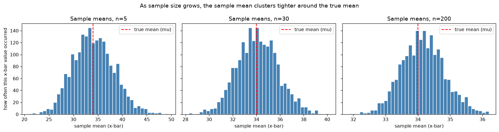

# Chapter 1: Data, Populations, and Samples - Thinking Like a Statistician

## The one idea this whole chapter is building toward

**You almost never have all the data you wish you had, so every number you compute is a guess about something bigger, and that guess has uncertainty attached to it.** That's it. That single sentence is the root of statistics, and later, the root of why machine learning models can fail on new data even though they looked perfect on the data you trained them on.

> **Intuition, in one breath:** You're always peeking at a slice and guessing about the whole pie - and the honest part of statistics is admitting how big the slice's blind spot is.

## Population vs. sample

A **population** is the entire set of things you actually care about. A **sample** is the subset you actually managed to observe or measure.

Example: you want to know the average height of adult men in Austria. The population is *every adult man in Austria* (millions of people). You cannot measure all of them. So you measure, say, 500 men you can access - that's your sample. You compute the average height of those 500 men, and you *hope* it's close to the true average of the whole population.

This gap - sample vs. population - is unavoidable, and almost the entire machinery of statistics exists to answer one question: **"Given what I saw in my sample, how confident can I be about the population, and how wrong might I be?"**

### Why this matters for AI specifically

When you train a model, your training set is a *sample* from the real-world distribution of situations the model will eventually face (the "population" of all possible inputs, past and future). Your model's performance on the training set tells you about the sample. What you actually care about is performance on the population - i.e. on new, unseen data. That gap is precisely what train/test splits, cross-validation, and the entire concept of "generalization" exist to manage. We will come back to this exact analogy in Chapter 9 and again in Chapter 16 - keep it in the back of your mind.

## Reconstructing it yourself - the problem Laplace actually faced

Put yourself in 1783 France. The king's finance minister wants to know the population of the entire country - a number needed for taxation and conscription planning - but a full door-to-door census of 25+ million people is impossibly slow and expensive. Pierre-Simon Laplace (the same Laplace who later perfected Bayes' Theorem, Chapter 4) was handed this exact problem. **If your first instinct is "just count the people in a few small regions, then scale up by area" - try that, and see where it breaks.**

Laplace's actual approach: he had reliable birth records (church registries recorded every baptism) for the whole country, and he knew that the *ratio* of total population to annual births was roughly constant across regions. So he picked a small number of specific regions (a sample), went through the trouble of actually counting every single person in just those regions (not estimating - a genuine, exhaustive local count), and divided each region's true population by its number of recorded births to get a ratio - "roughly 1 birth per 28 people," in his result. Then: multiply that ratio by the *nationally available* birth record count (which, unlike population, was already tracked everywhere) to estimate the national population, without ever counting most of France directly.

**Why this is the entire chapter in miniature**: Laplace's "regions actually counted" were his *sample*; "all of France" was his *population*; the birth-to-population ratio was a *statistic* computed from the sample, used to estimate a population-level quantity he could never measure directly. And crucially, Laplace didn't stop at a single number - he was one of the first to also report how much that estimated ratio might vary if he'd picked different sample regions, an early ancestor of the confidence interval you'll meet properly in Chapter 11. The entire modern machinery of "sample now, infer about the whole population, and be honest about how much the estimate could be off" was being invented, by hand, to solve a tax-collector's practical problem - not as abstract theory for its own sake.

## Parameter vs. statistic - the naming convention

This is a small but important vocabulary distinction that will remove confusion later:

- A **parameter** is a true numeric fact about the population (e.g., the actual average height of all Austrian men). We almost never know it exactly. Convention: parameters get Greek letters, like $\mu$ (mu) for the true population mean.
- A **statistic** is a number computed from your sample (e.g., the average height of your 500 measured men). Convention: statistics get Latin letters with a hat or bar, like $\bar{x}$ (x-bar) for the sample mean.

So $\bar{x}$ is our *estimate* of $\mu$. They are usually not exactly equal. The entire question of "how close is $\bar{x}$ likely to be to $\mu$?" is what Chapters 8-11 formalize.

## Types of data - why the type changes what math you're allowed to do

Not all data behaves the same way, and using the wrong summary on the wrong type of data produces nonsense. Four categories:

1. **Nominal** (categories with no order): eye color, country, model architecture name. You can count frequencies, but "average eye color" is meaningless.
2. **Ordinal** (categories with order, but unclear spacing): star ratings 1-5, education level. You can say "higher/lower," but you can't assume the *gap* between 1★ and 2★ equals the gap between 4★ and 5★.
3. **Discrete numeric** (countable numbers): number of children, number of clicks. Can only take specific values (often integers).
4. **Continuous numeric** (measurable, infinitely divisible in principle): height, weight, temperature, time.

Why this matters in practice: if you one-hot encode a categorical feature versus treat it as an ordinal integer versus treat it as continuous, you are making a *statistical claim* about its structure, and if that claim is wrong, your model learns a false pattern. This is a frequent, very real bug source in ML pipelines - e.g., encoding "small/medium/large" as 1/2/3 implicitly claims the gap from small→medium equals medium→large.

## Variables: independent vs. dependent

In an experiment or a dataset, a **dependent variable** is the thing you're trying to explain or predict (sometimes called the *target*, *label*, or *response*). An **independent variable** is something you think might explain or influence it (sometimes called a *feature*, *predictor*, or *covariate*). "Does hours studied (independent) predict exam score (dependent)?" In ML terms: independent variables = `X`, dependent variable = `y`. Same concept, different vocabulary across fields - worth knowing both names since papers mix terminology.

## Worked example - by hand, no code yet

Suppose the *true* population here is "all 10 employees in a small team," and their true ages (known to us only because we made up this toy example) are:

$$22, 25, 25, 28, 30, 31, 35, 40, 45, 60$$

The true population mean is $\mu = \frac{22+25+25+28+30+31+35+40+45+60}{10} = \frac{341}{10} = 34.1$.

Now imagine you can only survey 4 of them at random - say you happen to get $25, 28, 31, 45$. Your sample mean is $\bar{x} = \frac{25+28+31+45}{4} = \frac{129}{4} = 32.25$.

Notice: $\bar{x} = 32.25 \ne \mu = 34.1$. Your sample estimate is off by 1.85. If you'd drawn a *different* 4 people, you'd get a different $\bar{x}$ - maybe closer, maybe farther. This variability of the sample mean, across different possible samples, is exactly what later chapters (8, 9, 11) put precise numbers on (standard error, confidence intervals). For now, just internalize: **the sample mean is a random quantity that depends on which sample you happened to draw**, and the true mean is a fixed (if unknown) number.

<div class="labcard">
<div class="labkicker">Live - draw your own samples</div>
<div class="labcontrols">
  <div class="labctrl"><label>Sample size (n) <b id="ch01_n_label">30</b></label><input type="range" id="ch01_n" min="2" max="500" value="30"></div>
  <div class="labctrl"><label>Samples to draw at once <b id="ch01_reps_label">1</b></label><input type="range" id="ch01_reps" min="1" max="500" value="1"></div>
</div>
<div class="labrow">
  <button class="labbtn" id="ch01_draw">Draw sample(s)</button>
  <button class="labbtn secondary" id="ch01_reset">Reset population</button>
</div>
<div class="labcanvas-wrap"><canvas id="ch01_canvas" width="820" height="260"></canvas></div>
<div class="lablegend">
  <span><i class="labswatch" style="background:var(--border)"></i>Population</span>
  <span><i class="labswatch" style="background:var(--accent2)"></i>Sampled points</span>
  <span><i class="labswatch" style="background:var(--accent4)"></i>True mean (&mu;)</span>
  <span><i class="labswatch" style="background:var(--accent)"></i>Sample mean (x&#772;)</span>
</div>
<div class="labcanvas-wrap" style="margin-top:12px;"><canvas id="ch01_hist" width="820" height="200"></canvas></div>
<div class="labstat-grid">
  <div class="labstat"><div class="lbl">True mean</div><div class="val" id="ch01_truemean">-</div></div>
  <div class="labstat"><div class="lbl">Latest sample mean</div><div class="val" id="ch01_samplemean">-</div></div>
  <div class="labstat"><div class="lbl">Std dev of sample means so far</div><div class="val" id="ch01_se">-</div></div>
</div>
<p class="labnote">Drag n up, then draw 200+ samples repeatedly: watch the bottom histogram (all sample means drawn so far) get visibly narrower. That's the Central Limit Theorem (Chapter 8), already happening.</p>
</div>
<script>
document.addEventListener('DOMContentLoaded', function(){
  var SL = window.StatsLab;
  var population = [], allMeans = [], lastSample = [];
  function genPop(){ population = []; for(var i=0;i<10000;i++) population.push(Math.max(18, Math.min(90, SL.randNormal(34,10)))); }
  genPop();

  function drawPop(){
    var plot = SL.makePlot(document.getElementById('ch01_canvas'));
    var bins = SL.histogram(population, 40, [15,95]);
    var maxC = Math.max.apply(null, bins.map(function(b){return b[1];}));
    plot.setDomain([15,95],[0,maxC*1.15]); plot.clear(); plot.axes('age','count');
    plot.bars(bins.map(function(b){return [b[0],b[1]];}), SL.colors.border, 0.95);
    var trueMean = SL.mean(population);
    plot.vline(trueMean, SL.colors.accent4);
    if(lastSample.length){
      var ctx = plot.ctx; ctx.fillStyle = SL.colors.accent2;
      lastSample.forEach(function(v){ var x = plot.px(v); ctx.fillRect(x-1, plot.py(0)-10, 2, 10); });
      var sMean = SL.mean(lastSample);
      plot.vline(sMean, SL.colors.accent);
      document.getElementById('ch01_samplemean').textContent = sMean.toFixed(2);
    }
    document.getElementById('ch01_truemean').textContent = trueMean.toFixed(2);
  }
  function drawHist(){
    var plot = SL.makePlot(document.getElementById('ch01_hist'));
    if(allMeans.length<2){ plot.clear(); return; }
    var lo = Math.min.apply(null, allMeans)-1, hi = Math.max.apply(null, allMeans)+1;
    var bins = SL.histogram(allMeans, 30, [lo,hi]);
    var maxC = Math.max.apply(null, bins.map(function(b){return b[1];}));
    plot.setDomain([lo,hi],[0,maxC*1.15]); plot.clear(); plot.axes('sample mean value','frequency');
    plot.bars(bins.map(function(b){return [b[0],b[1]];}), SL.colors.accent, 0.95);
    plot.vline(SL.mean(population), SL.colors.accent4);
    document.getElementById('ch01_se').textContent = allMeans.length>1 ? SL.std(allMeans,1).toFixed(3) : '-';
  }
  function drawSample(){
    var n = parseInt(document.getElementById('ch01_n').value);
    var reps = parseInt(document.getElementById('ch01_reps').value);
    for(var r=0;r<reps;r++){
      var sample = [];
      for(var i=0;i<n;i++) sample.push(population[Math.floor(Math.random()*population.length)]);
      if(r===reps-1) lastSample = sample;
      allMeans.push(SL.mean(sample));
    }
    if(allMeans.length>5000) allMeans = allMeans.slice(-5000);
    drawPop(); drawHist();
  }
  document.getElementById('ch01_n').addEventListener('input', function(e){ document.getElementById('ch01_n_label').textContent = e.target.value; });
  document.getElementById('ch01_reps').addEventListener('input', function(e){ document.getElementById('ch01_reps_label').textContent = e.target.value; });
  document.getElementById('ch01_draw').addEventListener('click', drawSample);
  document.getElementById('ch01_reset').addEventListener('click', function(){ genPop(); allMeans=[]; lastSample=[]; drawPop(); drawHist(); });
  drawPop();
});
</script>

## Figures



*Sample means from the same population, drawn at n=5, 30, 200. Notice the spread shrinks as n grows -- the seed of the Central Limit Theorem (Chapter 8).*

## Run it yourself

Open `book/code/ch01_population_vs_sample.py`. It builds a "population" of 10,000 fake people with a known true mean age, then repeatedly draws small random samples and shows you how the sample mean bounces around the true mean - and how that bouncing shrinks as your sample size grows. Watching that shrinkage happen visually is one of the most useful two-minute exercises in all of statistics; it's the seed of the Central Limit Theorem in Chapter 8.

```bash
python book/code/ch01_population_vs_sample.py
```

## Why This Matters - In AI and In Everyday Life

**In AI / machine learning:**

- **Train/test splits are population vs. sample wearing a different hat**: your training set is a sample from the real-world population of inputs the model will eventually face; test accuracy is a *sample statistic* standing in for true population performance.
- **Dataset bias**: a face-recognition or hiring model trained on a non-representative sample of people will systematically misjudge the parts of the population it rarely saw -- a direct, high-stakes version of Chapter 1's population/sample gap.
- **Distribution shift in production is the sample/population gap reopening**: a model trained on last year's traffic (a sample) is deployed on this year's inputs (a changed population), so its offline validation statistic stops estimating the population it now faces -- the exact failure mode this chapter builds the vocabulary for, and why monitoring live data drift matters.
- **K-fold cross-validation trades one sample split for many**: instead of one train/test draw, K-fold averages K sample estimates of performance, reducing the variance of your estimate of true (population) performance -- a direct application of "more draws of the sample statistic give a steadier guess about the population."

**In everyday, non-AI life:**

- **Political polling**: pollsters survey a few thousand people (the sample) to estimate how millions will vote (the population), and every reported result is an estimate with inherent uncertainty.
- **Factory quality control**: inspecting 50 items from a production run of 100,000 to estimate the overall defect rate, because checking every single unit isn't feasible.

## Worked example - by hand, larger

Imagine an AI team wants to know the mean inference latency (in ms) of a deployed model across *all* possible requests it will ever serve - that's the population, unknown and effectively infinite. They can only measure a sample. Suppose a sample of 5 requests gives latencies $48, 52, 50, 55, 45$ ms. Sample mean: $\bar{x} = \frac{48+52+50+55+45}{5} = \frac{250}{5} = 50$ ms.

Now suppose the *true* population mean is $\mu = 54$ ms (which the team doesn't know). The sample estimate is off by $50 - 54 = -4$ ms - it underestimates. Draw a second sample of 5, say $60, 58, 52, 49, 61$: $\bar{x} = \frac{280}{5} = 56$ ms, now overestimating by $+2$. A third sample, $54, 53, 51, 56, 47$: $\bar{x} = \frac{261}{5} = 52.2$ ms, off by $-1.8$.

The lesson is not which specific sample is "right" - none of them is guaranteed right - but that the sample mean *bounces around* the true mean by a few units, sometimes over, sometimes under. Averaging the three sample means, $\frac{50 + 56 + 52.2}{3} = \frac{158.2}{3} \approx 52.7$, lands closer to the truth than any single sample happened to, which is the first hint of why more data (and later, the Central Limit Theorem in Chapter 8) tightens your guess.

**A sample mean is one roll of the dice, not a verdict - it's a random draw from a cloud of possible sample means, and the only honest way to read it is with the uncertainty of that cloud in mind.**

## Check your understanding

- Why is $\bar{x}$ written with Latin letters and $\mu$ with Greek letters - what's the actual distinction being encoded?
- If you surveyed *all 10* employees instead of 4, would $\bar{x}$ still be "random"? Why or why not?
- Give an ML example of a "population" and a "sample" that's different from the training/test-set analogy above.

## Exercises

### Exercise 1 - Compute a sample mean and its miss distance

A holding-out validation set of 4 examples yields losses $0.4, 0.5, 0.7, 0.2$. The true (unknown) population mean loss is $\mu = 0.5$. Compute $\bar{x}$ and the estimation error $\bar{x} - \mu$.

<details><summary>Show solution</summary>

$\bar{x} = \frac{0.4 + 0.5 + 0.7 + 0.2}{4} = \frac{1.8}{4} = 0.45$. Error $= 0.45 - 0.5 = -0.05$. The validation set under-estimated the true loss by 0.05, which is exactly the population/sample gap this chapter warns about - the number is a guess, not the truth.

</details>

### Exercise 2 - Parameter vs. statistic, in an ML setting

A team reports "our model's accuracy on the test set is 0.91." Which symbol names this number, and what is the corresponding unknown parameter? Why can't they report the parameter directly?

<details><summary>Show solution</summary>

The reported 0.91 is a *statistic* - call it $\hat{p}$ (or $\bar{x}$ for a proportion) - computed from the test set. The parameter is the true accuracy on the entire population of inputs the model will face, which we could call $p$. It cannot be reported directly because the population is unobservable: the test set is only a sample, so 0.91 is an estimate with uncertainty attached.

</details>

### Exercise 3 - Conceptual: why train/test splits matter

Explain in one paragraph why training a model and reporting its accuracy on the *same* data is the population/sample gap being violated, and what a held-out test set restores.

<details><summary>Show solution</summary>

Reporting accuracy on the training data lets the model's summary statistic be computed on the very sample it was fitted to, so the model can memorize sample-specific noise rather than population structure - the statistic no longer estimates the population honestly. A held-out test set is an independent sample from the population that the model never saw, so its accuracy is a fresh draw analogous to $\bar{x}$ estimating $\mu$. The gap is restored because the test sample's randomness is independent of the model's fitting.

</details>

## What's next

Chapter 2 asks: given a sample, how do we *summarize* it numerically and visually - not just the mean, but spread and shape too, and why each of those summaries can mislead you if used alone (the classic case: two wildly different datasets can have the identical mean).
