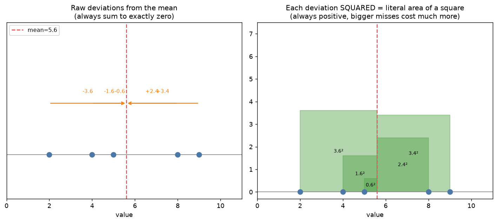
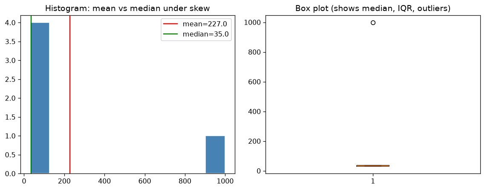
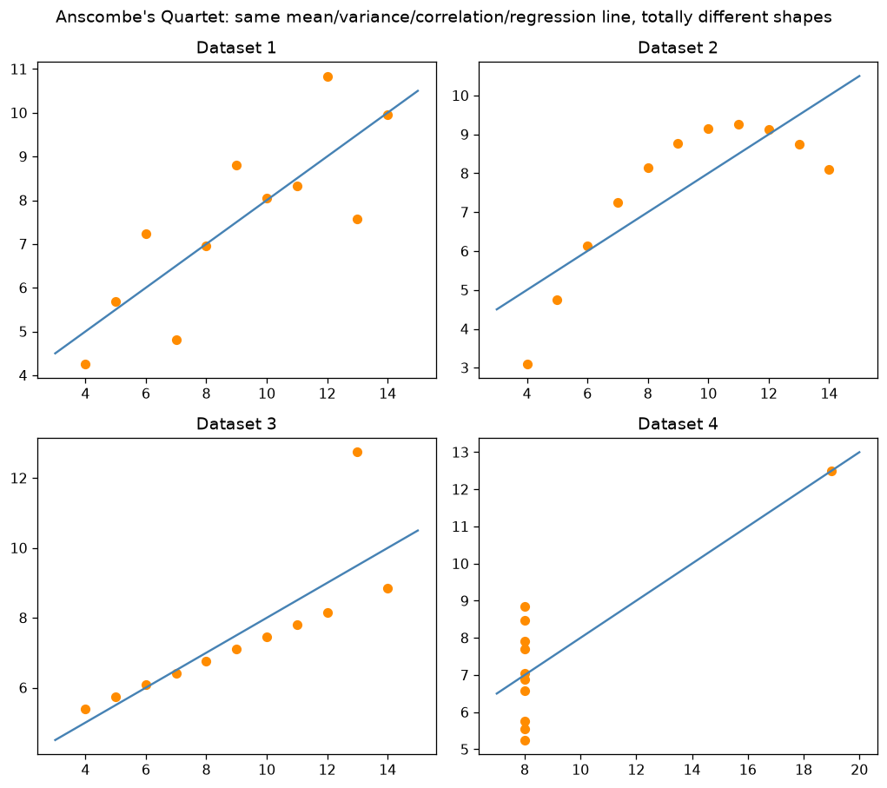

# Chapter 2: Describing Data - Center, Spread, and Shape

## The idea this chapter builds toward

A single number can never fully describe a pile of data, but a *few well-chosen* numbers can describe it well enough to reason about. This chapter gives you the standard toolkit: where is the data centered, how spread out is it, and what shape does it have. You'll also see the single most important cautionary example in descriptive statistics: datasets that are *wildly* different in shape but share identical means and variances (Anscombe's Quartet) - proof that you must *look* at data, never just summarize it blindly.

> **Intuition, in one breath:** A few good numbers can capture the center, the spread, and the shape of your data - but they can also lie in perfect agreement, so always glance at the picture too.

## Measures of center

### Mean (average)

$$\bar{x} = \frac{1}{n}\sum_{i=1}^{n} x_i$$

In plain words: add everything up, divide by how many there are. Intuition: the mean is the "balance point" of the data - if you put each data point as a weight on a number line, the mean is where it balances like a seesaw.

**Weakness**: the mean is extremely sensitive to outliers. Example: incomes of 5 people: $30k, 32k, 35k, 38k, 1{,}000k$ (one billionaire). Mean = $\frac{30+32+35+38+1000}{5} = \frac{1135}{5} = 227$k. That "average income of 227k" badly misrepresents 4 of the 5 people. This is not a rare edge case - income, latency, and error-magnitude data in real systems are *routinely* this skewed.

### Reconstructing it yourself - why is "add and divide" the right way to summarize data at all?

Here's a question worth sitting with before accepting the mean as obviously correct: suppose you have data points $x_1,\ldots,x_n$ and you want to pick a single number $c$ that best represents all of them. **If your first guess is "just pick whatever number makes the total squared distance to every point as small as possible" - let's actually test that guess and see what falls out.** Define the total squared error as a function of your candidate center $c$:

$$E(c) = \sum_{i=1}^n (x_i - c)^2$$

To find the $c$ that minimizes this, use the same calculus move you'll see repeated in Chapters 10 and 14: take the derivative with respect to $c$ and set it to zero (at a minimum, the slope is flat).

$$\frac{dE}{dc} = \sum_{i=1}^n -2(x_i-c) = 0 \;\implies\; \sum_{i=1}^n x_i = nc \;\implies\; c = \frac{1}{n}\sum_{i=1}^n x_i = \bar x$$

**The mean is not an arbitrary convention - it is the unique number that minimizes total squared distance to your data.** This single fact is the hidden thread connecting an enormous amount of this book: it's why least-squares regression (Chapter 14) fits a line by minimizing squared residuals (the line's predictions are, at each point, trying to be a "local mean"); it's why Gauss's reverse-engineered Normal distribution (Chapter 6) was built specifically to make averaging the statistically optimal choice; and it's a direct preview of the bias-variance decomposition's use of squared error in Chapter 16. If you had instead minimized *absolute* distance, $\sum|x_i-c|$, the calculus works out differently (the derivative of $|x_i-c|$ isn't smooth at $c=x_i$, which is exactly the "mean absolute deviation is less mathematically convenient" point from the backstory below) and the minimizing $c$ turns out to be the **median** instead - which is a genuinely satisfying, rarely-taught fact: **mean minimizes squared error, median minimizes absolute error**, and that distinction alone explains why each one is "robust" or "sensitive" to outliers in exactly the way you're about to see.

### Median

The middle value when data is sorted. For the income example above, sorted data is $30, 32, 35, 38, 1000$; the middle (3rd of 5) value is $35$k. The median shrugs off the billionaire entirely - it only cares about *position*, not *magnitude*. This is why "median household income" is reported in the news, not "average household income": it's robust to outliers.

If you have an even number of points, the median is the average of the two middle values.

### Mode

The most frequently occurring value. Most useful for categorical data (e.g., "the most common browser used is Chrome") where mean/median don't even make sense.

## Measures of spread

Knowing the center isn't enough - you also need to know how spread out the data is. Consider two classrooms with identical mean test score of 70: in Class A, everyone scored between 65-75. In Class B, scores range from 20-100. Same center, totally different story.

### Variance

The intuitive goal: measure the *average squared distance* of each point from the mean.

$$\sigma^2 = \frac{1}{n}\sum_{i=1}^{n} (x_i - \mu)^2 \quad \text{(population variance)}$$

Why squared and not just the raw distance? Two reasons:
1. Raw distances $(x_i - \mu)$ always sum to exactly zero (by definition of the mean, positive and negative deviations cancel). Squaring makes everything positive so it doesn't just cancel to zero.
2. Squaring also penalizes large deviations disproportionately more than small ones - a point far from the mean contributes a lot more to variance than a point close to the mean. (You could use absolute value instead - that's called "mean absolute deviation" and is sometimes used, but it has worse mathematical properties for the theory built on top of it in later chapters - e.g. it isn't smoothly differentiable at zero, which matters once we start optimizing things.)



*Left: raw deviations from the mean point in opposite directions and always cancel out to exactly zero - useless as a measure of spread. Right: square each deviation and you get a literal square whose **area** is that deviation squared - always positive, and a point twice as far from the mean contributes four times the area, not twice. Variance is just the average of all these square areas.*

### Sample variance - the "n-1" surprise

When you compute variance from a *sample* (not the full population), you divide by $n-1$ instead of $n$:

$$s^2 = \frac{1}{n-1}\sum_{i=1}^{n} (x_i - \bar{x})^2 \quad \text{(sample variance)}$$

**Why n-1, intuitively?** Because $\bar{x}$ (computed from the very same sample) is *already* the value that minimizes the sum of squared deviations for that specific sample - so $\sum (x_i - \bar{x})^2$ is, on average, a bit *smaller* than $\sum (x_i - \mu)^2$ would be if you magically knew the true $\mu$. The sample mean "overfits" slightly to its own sample. Dividing by $n-1$ instead of $n$ exactly corrects for this so that $s^2$ is an *unbiased* estimate of the true population variance $\sigma^2$ (we formalize "unbiased" precisely in Chapter 9 - for now, just trust that $n-1$ is the correction and remember the name for it: **Bessel's correction**). In practice, when $n$ is large (hundreds+), the difference between dividing by $n$ vs $n-1$ is negligible - this detail mostly matters for small samples.

### Standard deviation

$$\sigma = \sqrt{\sigma^2}, \quad s = \sqrt{s^2}$$

Why take the square root at all? Because variance is in *squared units* (e.g., "dollars²" or "years²"), which isn't interpretable. Standard deviation brings it back to the original units, so you can say "the typical deviation from the mean is about $s$" in the same units as the data itself.

### Range and IQR (interquartile range)

- **Range** = max - min. Simple, but extremely sensitive to a single extreme outlier.
- **Percentile**: the value below which a given percentage of data falls. The 50th percentile is the median.
- **IQR** = (75th percentile) - (25th percentile): the spread of the *middle 50%* of the data, ignoring extreme tails. This is the basis of the classic **box plot**, and of the standard outlier rule-of-thumb: a point is a candidate outlier if it falls more than $1.5 \times \text{IQR}$ below Q1 or above Q3.

<div class="labcard">
<div class="labkicker">Live - edit the data and watch every statistic recompute</div>
<textarea id="ch02_data" rows="3">30, 32, 35, 38, 34, 31, 36, 33, 29, 37</textarea>
<div class="labrow">
  <button class="labbtn" id="ch02_update">Recompute</button>
  <button class="labbtn secondary" id="ch02_outlier">Add one billionaire (+1000)</button>
  <button class="labbtn secondary" id="ch02_random">Randomize 12 points</button>
</div>
<div class="labstat-grid">
  <div class="labstat"><div class="lbl">Mean</div><div class="val" id="ch02_mean">-</div></div>
  <div class="labstat"><div class="lbl">Median</div><div class="val" id="ch02_median">-</div></div>
  <div class="labstat"><div class="lbl">Std Dev (n-1)</div><div class="val" id="ch02_std">-</div></div>
  <div class="labstat"><div class="lbl">Variance</div><div class="val" id="ch02_var">-</div></div>
  <div class="labstat"><div class="lbl">IQR</div><div class="val" id="ch02_iqr">-</div></div>
  <div class="labstat"><div class="lbl">Skew</div><div class="val" id="ch02_skew">-</div></div>
</div>
<div class="labcanvas-wrap" style="margin-top:12px;"><canvas id="ch02_canvas" width="820" height="240"></canvas></div>
<p class="labnote">Click "Add one billionaire" and watch the mean rocket away from the median while the median barely moves - Chapter 2's robustness argument, live.</p>
</div>
<script>
document.addEventListener('DOMContentLoaded', function(){
  var SL = window.StatsLab;
  function parseData(){ return document.getElementById('ch02_data').value.split(',').map(function(s){return parseFloat(s.trim());}).filter(function(v){return !isNaN(v);}); }
  function mode(arr){
    var counts = {}; arr.forEach(function(v){ counts[v]=(counts[v]||0)+1; });
    var best=null, bestCount=0;
    for(var k in counts){ if(counts[k]>bestCount){ bestCount=counts[k]; best=k; } }
    return bestCount>1 ? parseFloat(best) : null;
  }
  function update(){
    var data = parseData();
    if(data.length<2) return;
    var m = SL.mean(data), med = SL.median(data), s = SL.std(data,1), v = SL.variance(data,1);
    var q1 = SL.percentile(data,25), q3 = SL.percentile(data,75);
    var lo = Math.min.apply(null,data), hi = Math.max.apply(null,data);
    document.getElementById('ch02_mean').textContent = m.toFixed(2);
    document.getElementById('ch02_median').textContent = med.toFixed(2);
    document.getElementById('ch02_std').textContent = s.toFixed(2);
    document.getElementById('ch02_var').textContent = v.toFixed(2);
    document.getElementById('ch02_iqr').textContent = (q3-q1).toFixed(2);
    document.getElementById('ch02_skew').textContent = m>med+0.01 ? 'right-skewed' : (m<med-0.01 ? 'left-skewed' : 'symmetric');

    var plot = SL.makePlot(document.getElementById('ch02_canvas'), {l:50,r:20,t:16,b:60});
    var bins = SL.histogram(data, Math.min(20,Math.max(5,Math.round(data.length/2))), [lo-1, hi+1]);
    var maxC = Math.max.apply(null, bins.map(function(b){return b[1];}));
    plot.setDomain([lo-1,hi+1],[0,maxC*1.2]); plot.clear(); plot.axes('value','count');
    plot.bars(bins.map(function(b){return [b[0],b[1]];}), SL.colors.accent, 0.9);
    plot.vline(m, SL.colors.accent4); plot.vline(med, SL.colors.accent3);

    var ctx = plot.ctx, by = document.getElementById('ch02_canvas').height - 24;
    ctx.strokeStyle = SL.colors.inkSoft; ctx.lineWidth = 1.5;
    var pxQ1=plot.px(q1), pxQ3=plot.px(q3), pxMed=plot.px(med), pxLo=plot.px(lo), pxHi=plot.px(hi);
    ctx.beginPath(); ctx.moveTo(pxLo,by); ctx.lineTo(pxQ1,by); ctx.stroke();
    ctx.beginPath(); ctx.moveTo(pxQ3,by); ctx.lineTo(pxHi,by); ctx.stroke();
    ctx.strokeRect(pxQ1, by-9, pxQ3-pxQ1, 18);
    ctx.beginPath(); ctx.moveTo(pxMed,by-9); ctx.lineTo(pxMed,by+9); ctx.stroke();
  }
  document.getElementById('ch02_update').addEventListener('click', update);
  document.getElementById('ch02_outlier').addEventListener('click', function(){
    var el = document.getElementById('ch02_data');
    el.value = el.value.trim().replace(/,\s*$/,'') + ', 1000';
    update();
  });
  document.getElementById('ch02_random').addEventListener('click', function(){
    var vals = []; for(var i=0;i<12;i++) vals.push(Math.round(SL.randNormal(50,12)));
    document.getElementById('ch02_data').value = vals.join(', ');
    update();
  });
  update();
});
</script>

## Measures of shape

### Skewness

Measures *asymmetry*. A **right-skewed** (positively skewed) distribution has a long tail stretching to the right (e.g., income - most people cluster at modest values, a few earn enormous amounts). A **left-skewed** distribution has a long tail to the left. When data is skewed, mean and median diverge: in right-skewed data, mean > median (the tail pulls the mean up), which is exactly what happened in our income example above (mean 227k vs median 35k).

### Kurtosis

Measures how "heavy-tailed" a distribution is relative to a normal distribution - i.e., does it produce extreme outliers more or less often than a bell curve would predict? High kurtosis ("fat tails") means extreme events are more common than a naive bell-curve intuition would suggest - important in risk modeling and anomaly detection.

## The backstory - how would you have invented variance yourself?

Put yourself in the shoes of an 18th/19th-century astronomer. You measure the position of a star on five different nights and get five slightly different numbers, because your telescope, your eyes, and the atmosphere all introduce tiny errors. You want one number to summarize "how spread out are my measurement errors" so you can judge how much to trust your instrument. Your first instinct is probably: average the raw deviations from the mean, $\frac{1}{n}\sum(x_i - \bar x)$. If you try this yourself on paper, you'll discover something immediately: it always comes out to exactly zero, no matter what the data is - not a useful measure of spread at all! This isn't a coincidence; it's a direct consequence of the mean being defined as the balance point (positive and negative deviations around a balance point cancel by construction, the same way a seesaw balances).

So your next instinct might be to strip the signs off before averaging - average the *absolute* deviations, $\frac1n\sum|x_i-\bar x|$. This actually works, and is a real statistic (**mean absolute deviation**), still used today. So why isn't it the standard? Because absolute value has an awkward kink at zero - it isn't smooth there, which made it mathematically unpleasant for 18th-century mathematicians (Gauss, Legendre, Laplace) who wanted to build a whole theory of errors on top of it, including finding the "best" line through noisy data (least-squares regression, foreshadowing Chapter 14). Squaring, instead of taking absolute value, kills the sign problem just as well, is smooth everywhere (so calculus - derivatives - works cleanly on it, which is exactly what the MLE derivation in Chapter 10 depends on), and has a bonus physical interpretation: squared deviations are literally the mathematics of "energy" or "moment of inertia" in physics, a connection Gauss (who was also a physicist) would have found natural. This is why variance historically grew out of **Gauss's theory of errors** (early 1800s) and underlies the method of least squares - not an arbitrary modern convention, but the mathematically convenient choice that happened to also be theoretically elegant.

As for "why divide by $n-1$, not $n$" - that correction came later, formalized by Friedrich Bessel in the 1820s (hence "Bessel's correction"), once statisticians rigorously worked out that using the sample mean (which is itself fit *to* the same sample) slightly understates the true spread. We'll fully justify this with the formal idea of bias in Chapter 9 - for now, the historical point is: this "n-1" wasn't guessed, it was *discovered* as the fix needed to make the estimator behave correctly on average.

## More real-world examples of center and spread

- **Finance**: daily stock returns. The mean tells you expected return; the standard deviation ("volatility") tells you risk - two stocks with identical mean return but very different standard deviations are *very* different investments, which is why volatility, not just average return, is quoted everywhere in finance.
- **Manufacturing/quality control**: a machine cutting metal rods to 10cm. The mean should be 10cm, but the standard deviation tells you how consistent the machine is - tight tolerances in engineering (e.g. aircraft parts) are fundamentally a demand for *low variance*, not just a correct mean.
- **ML model latency**: a model's inference time might average 50ms, but if the standard deviation is high (or the distribution is right-skewed, Chapter 2's skewness idea), some requests might take 500ms+ - this is why production ML systems report p95/p99 latency (percentiles, from this chapter) instead of just the mean; the mean alone hides tail risk that angry users actually experience.
- **A/B testing dashboards**: reporting "average time on page increased" without reporting spread can be misleading if a few power users skew the mean - median time-on-page is often more representative of the typical user, exactly like the income example above.

## Anscombe's Quartet - the warning this chapter is really about

In 1973, statistician Francis Anscombe constructed four different (x, y) datasets that all share: the same mean of x, same mean of y, same variance of x, same variance of y, same correlation, and even the same best-fit regression line - and yet, when plotted, look completely different (one is linear, one is a clean curve, one is linear with one outlier wrecking the fit, one is a vertical line of points plus one outlier). The lesson: **summary statistics can be identical while the underlying data tells completely different stories. Always plot your data before trusting summary numbers.** This is not a cute historical anecdote - it is the reason "exploratory data analysis" (plotting everything before modeling) is a mandatory first step in any real ML project, not an optional nicety.

## Figures



*A right-skewed income-like dataset: the histogram with mean and median marked, and the corresponding box plot. Notice how far the mean sits from the median.*



*Anscombe's Quartet: four datasets with identical mean, variance, correlation, and regression line -- yet visibly different shapes.*

## Run it yourself

`book/code/ch02_descriptive_stats.py` computes mean/median/mode/variance/std/IQR on a skewed income-like dataset (showing mean ≠ median clearly), draws a box plot and histogram, and then reproduces Anscombe's Quartet so you can see four identical-statistics datasets look utterly different side by side.

```bash
python book/code/ch02_descriptive_stats.py
```

## Why This Matters - In AI and In Everyday Life

**In AI / machine learning:**

- **Latency monitoring**: production ML systems report p95/p99 latency (percentiles), not just the mean, because a skewed tail of slow requests is exactly what angry users experience and a mean would hide.
- **Outlier/label-noise detection**: spotting mislabeled training examples or corrupted sensor readings often starts with exactly this chapter's IQR-based outlier rule before any model is trained.
- **Feature scaling and normalization in neural networks are this chapter applied literally**: batch norm and layer norm compute per-feature batch means and standard deviations and re-center/rescale activations using exactly this chapter's mean and std -- standardizing data before it flows through a network is the same transform whether you call it preprocessing or a normalization layer.
- **Anomaly detection flags the tails via kurtosis and percentiles**: production ML anomaly detectors routinely compare a live metric's percentile (or its excess kurtosis, "fat tails") against a training-era baseline, because a mean shift hides in the average while the tails -- where chapter 2's kurtosis and IQR live -- are where incidents actually announce themselves.

**In everyday, non-AI life:**

- **Household income reporting**: governments report *median* household income, not mean, precisely because a few very wealthy households would otherwise distort the mean upward (Chapter 2's billionaire example, for real).
- **Personal budgeting**: looking at your median monthly spending versus the mean reveals whether one unusual expensive month is skewing your sense of "normal" spending.

## Worked example - by hand, larger

Suppose a model's per-request latency (ms) on a small sample of 5 requests is $10, 12, 14, 16, 18$. The mean is $\bar{x} = \frac{10+12+14+16+18}{5} = \frac{70}{5} = 14$. The deviations from the mean are $-4, -2, 0, 2, 4$. Check they sum to zero: $-4-2+0+2+4 = 0$. Squared deviations: $16, 4, 0, 4, 16$, summing to $40$. Sample variance (Bessel's correction, divide by $n-1=4$): $s^2 = \frac{40}{4} = 10$. Sample standard deviation: $s = \sqrt{10} \approx 3.162$ ms.

Now median and IQR. Sorted data is already $10, 12, 14, 16, 18$. The median (3rd of 5) is $14$. For the quartiles, take the median of the lower half $\{10, 12\}$ = $11$ and of the upper half $\{16, 18\}$ = $17$, so $\text{IQR} = 17 - 11 = 6$. The outlier fences are $Q1 - 1.5\,\text{IQR} = 11 - 9 = 2$ and $Q3 + 1.5\,\text{IQR} = 17 + 9 = 26$; since all values lie in $[2, 26]$, no outliers.

Now inject one catastrophe: a single request takes $1000$ ms. New data $10, 12, 14, 16, 18, 1000$. New mean: $\frac{1070}{6} \approx 178.33$ ms - the mean has been shredded by one point, jumping from 14 to 178. The median is now the average of the two middle values $\frac{14+16}{2} = 15$ ms, barely moved. **One number (the median) shrugged off the outlier while another (the mean) collapsed - which is exactly why latency dashboards report p95/p99, not just the mean.**

**Center and spread are a team: report the robust pair (median, IQR) when outliers are real, and the mean-and-standard-deviation pair when the data is well behaved.**

## Check your understanding

- Why does dividing by $n-1$ instead of $n$ make the sample variance a better estimate of the *population* variance?
- If mean > median, is the data more likely left-skewed or right-skewed, and why?
- Why is squaring deviations preferred over taking their absolute value, beyond "it avoids cancellation to zero"?

## Exercises

### Exercise 1 - Variance and standard deviation by hand

Compute the population variance $\sigma^2$ and standard deviation $\sigma$ of the values $2, 4, 4, 4, 5, 5, 7, 9$.

<details><summary>Show solution</summary>

Mean: $\frac{2+4+4+4+5+5+7+9}{8} = \frac{40}{8} = 5$. Deviations: $-3, -1, -1, -1, 0, 0, 2, 4$. Squared: $9, 1, 1, 1, 0, 0, 4, 16$, summing to $32$. Population variance: $\frac{32}{8} = 4$. Standard deviation: $\sqrt{4} = 2$. (If treated as a sample, dividing by $n-1 = 7$ gives $s^2 = \frac{32}{7} \approx 4.571$, $s \approx 2.138$.)

</details>

### Exercise 2 - Why the billionaire wrecks the mean but not the median

Incomes are $20, 22, 25, 30, 5000$ (thousands). Compute mean and median, then explain the gap.

<details><summary>Show solution</summary>

Mean: $\frac{20+22+25+30+5000}{5} = \frac{5097}{5} = 1019.4$. Median: middle of the sorted list is $25$. The mean is about 40x the median because it sums the magnitude of the extreme value, while the median only looks at position. This is the robustness argument for reporting median household income.

</details>

### Exercise 3 - Conceptual: why scale matters before comparing features

A model uses "income in dollars" (thousands) and "age in years" (tens). Why does comparing their raw variances mislead, and what transformation fixes it?

<details><summary>Show solution</summary>

Raw variance depends on the units: income in thousands will have a numerically larger variance than age simply because its scale is larger, not because it is more informative or more variable relative to its own range. The fix is standardization to z-scores (Chapter 6), $\frac{x-\bar{x}}{s}$, which removes units and puts both features on the same scale - the same reason ML pipelines apply `StandardScaler` before scale-sensitive algorithms like k-NN or gradient descent.

</details>

## What's next

Chapter 3 leaves "data I already have" and enters the world of probability itself - the mathematical language for describing uncertainty before you've observed anything, which is the foundation everything from Chapter 4 onward depends on.
