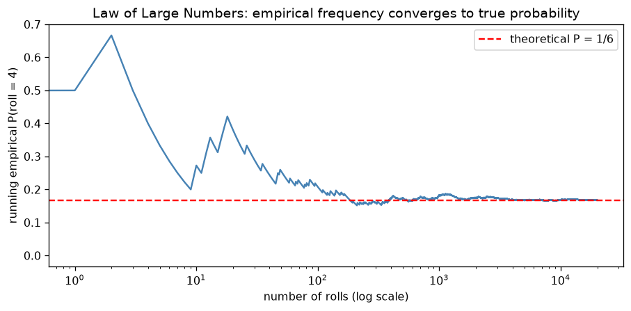

# Chapter 3: Probability Foundations — Events, Rules, and Conditioning

## Why we need a whole separate subject just for "chance"

Descriptive statistics (Chapter 2) summarizes data you already collected. But before you collect data, you often need to *reason* about what's likely to happen — and after you collect data, you need a precise language to express "how sure are we?" Probability is that language. Everything from here through Chapter 8 is pure probability theory — no real datasets yet — because this is the scaffolding that inferential statistics (Chapter 9+) and ultimately ML model outputs ("this image is 93% likely to be a cat") are built on.

## Sample space and events

The **sample space** ($\Omega$, read "omega") is the set of *all possible outcomes* of a random process. Rolling a six-sided die: $\Omega = \{1,2,3,4,5,6\}$. Flipping two coins: $\Omega = \{HH, HT, TH, TT\}$.

An **event** is any subset of the sample space you care about — "rolling an even number" is the event $\{2,4,6\}$.

A probability $P(A)$ is a number between 0 and 1 assigned to event $A$, satisfying:
- $P(A) \ge 0$ for any event.
- $P(\Omega) = 1$ (something in the sample space definitely happens).
- If two events can't both happen (mutually exclusive, e.g. "roll a 2" and "roll a 5"), $P(A \text{ or } B) = P(A) + P(B)$.

That's genuinely the entire axiomatic foundation. Everything else in probability is derived from these three rules.

## The backstory — probability existed for centuries before anyone agreed what it meant

Gamblers and mathematicians (Pascal, Fermat, Huygens) were correctly computing odds for dice and card games as early as the 1650s, motivated by actual gambling disputes — a nobleman named Chevalier de Méré asked Pascal why one dice bet seemed profitable in practice but another, superficially similar one, wasn't, and the resulting correspondence between Pascal and Fermat is often cited as probability theory's true starting point. But for nearly 300 years afterward, "probability" had no single rigorous, agreed-upon mathematical foundation — different schools of thought argued about whether it fundamentally meant "long-run frequency of repeatable events" (the frequentist view) or "a rational degree of belief" (closer to how Bayes and Laplace, Chapter 4, used it). It was the Soviet mathematician **Andrey Kolmogorov**, in a short 1933 monograph, who settled the question not by picking a side in that philosophical debate, but by sidestepping it: he laid down the three bare axioms you saw above ($P(A)\ge 0$, $P(\Omega)=1$, additivity over mutually exclusive events) as a self-contained mathematical structure, borrowing the rigorous language of "measure theory" from pure mathematics. The genius of Kolmogorov's move was that *both* the frequentist and the Bayesian/belief interpretations of probability can sit on top of his same three axioms without contradiction — the axioms describe the *math*, while frequentist vs. Bayesian remains a separate question about what real-world meaning you attach to that math. This is why, even though Chapters 4 and 17 of this book present a philosophically different flavor of probability than the "classical" hypothesis-testing chapters (9-13), they're all built on the exact same Kolmogorov axioms you just learned — the disagreement is about interpretation, never about the arithmetic.

## The two ways to get a probability number

1. **Classical/theoretical**: count favorable outcomes over total outcomes, when all outcomes are equally likely. A fair die: $P(\text{roll a 4}) = \frac{1}{6}$.
2. **Empirical/frequentist**: run the experiment many times and compute the relative frequency. Roll a die 10,000 times, count how often you got a 4, divide by 10,000. As the number of trials grows, this empirical frequency converges to the theoretical probability — this convergence fact is called the **Law of Large Numbers**, and we'll prove it to ourselves visually in the code below (and formally connect it to Chapter 8).

## Combining events: AND, OR, NOT

### NOT (complement)

$$P(\text{not } A) = 1 - P(A)$$

If $P(\text{rain tomorrow}) = 0.3$, then $P(\text{no rain}) = 0.7$. Trivial but used constantly — often it's easier to compute the complement of what you want and subtract from 1.

### OR (union)

$$P(A \text{ or } B) = P(A) + P(B) - P(A \text{ and } B)$$

Why subtract the last term? Because if $A$ and $B$ overlap, naively adding $P(A) + P(B)$ double-counts the overlap region. Picture two overlapping circles (a Venn diagram) — adding both circles' areas counts the lens-shaped overlap twice, so you subtract it once to correct. If $A$ and $B$ are **mutually exclusive** (no overlap, like "roll a 2" and "roll a 5"), then $P(A \text{ and } B) = 0$ and the formula reduces to simple addition.


*Left: the complement $P(\text{not }A)=1-P(A)$ is just everything outside the circle. Right: when you add the areas of circle A and circle B, the overlapping lens gets counted twice — that's exactly why the formula subtracts $P(A\text{ and }B)$ once, to undo the double-count.*

### AND (intersection) and independence

This is the big one. Two events are **independent** if knowing one happened tells you *nothing* about whether the other happened. For independent events:

$$P(A \text{ and } B) = P(A) \times P(B)$$

Example: two separate fair coin flips. $P(\text{first is H}) = 0.5$, $P(\text{second is H}) = 0.5$, and since the coins don't influence each other, $P(\text{both H}) = 0.5 \times 0.5 = 0.25$. Check by enumeration: $\Omega = \{HH, HT, TH, TT\}$, each equally likely at $\frac{1}{4} = 0.25$. ✓.

**But if events are NOT independent**, multiplying their plain probabilities gives the wrong answer — you need **conditional probability** instead (next section), because what happens with $A$ changes the odds for $B$.

## Conditional probability — the single most important concept in this chapter

$P(B \mid A)$ ("the probability of B, *given that* A has happened") is defined as:

$$P(B \mid A) = \frac{P(A \text{ and } B)}{P(A)}$$

**Intuition**: once you know $A$ happened, you shrink your sample space down to just the part where $A$ is true, and ask what fraction of *that* shrunken space also satisfies $B$.


*Left: $P(A\text{ and }B)$ is only the red overlapping lens — nothing outside it counts. Right: this is the picture that makes conditional probability click — once you're told B happened, B itself becomes your entire new universe, and $P(A\mid B)$ is simply "what fraction of that new, smaller universe is also covered by A" — red area divided by the whole orange circle's area.*

### Worked example

A deck of 52 cards. Let $A$ = "card is a King" (4 of 52), $B$ = "card is a face card" (Jack, Queen, King — 12 of 52).

$P(B \mid A)$ = "given the card is a King, what's the probability it's a face card?" Well, every King *is* a face card, so this should be 1. Check with the formula: $P(A \text{ and } B) = P(\text{King AND face card}) = P(\text{King}) = \frac{4}{52}$ (since all Kings are face cards, the intersection is just "King"). So $P(B\mid A) = \frac{4/52}{4/52} = 1$. ✓ Matches intuition.

Now the reverse: $P(A \mid B)$ = "given the card is a face card, what's the probability it's specifically a King?" Since face cards are Jack/Queen/King in equal number (4 each), it should be $\frac{1}{3}$. Check: $P(A \mid B) = \frac{P(A \text{ and }B)}{P(B)} = \frac{4/52}{12/52} = \frac{1}{3}$. ✓.

Notice $P(B\mid A) = 1$ but $P(A \mid B) = \frac{1}{3}$ — **conditional probability is not symmetric**. $P(B\mid A) \ne P(A \mid B)$ in general. This asymmetry, and how to flip from one to the other correctly, is *exactly* what Bayes' Theorem (Chapter 4) formalizes — so make sure this example feels solid before moving on, because Chapter 4 is built entirely on this one idea.

### Independence, restated using conditional probability

A cleaner, equivalent definition: $A$ and $B$ are independent exactly when $P(B \mid A) = P(B)$ — i.e., learning that $A$ happened doesn't change your belief about $B$ at all.

## The Monty Hall problem — a famous gut-check for conditional reasoning

Three doors: one hides a car, two hide goats. You pick door 1. The host (who knows what's behind every door) opens door 3, revealing a goat, and offers you the chance to switch to door 2. Should you switch?

Most people's gut says "50/50, doesn't matter." That gut feeling is wrong, and it's wrong for a precisely conditional-probability reason: the host's action is not random — he *always* reveals a goat, and this gives you information. Switching wins the car with probability $\frac{2}{3}$; staying wins with probability $\frac{1}{3}$. We don't derive this by hand here (it's a satisfying exercise, try it, or ask me), but the code below *simulates* the game thousands of times so you can watch the $\frac{2}{3}$ vs $\frac{1}{3}$ split emerge empirically — a good trust-building exercise before Chapter 4 does this kind of reasoning formally with Bayes' theorem.

## Figures



*Law of Large Numbers: the empirical frequency of rolling a 4 converges to the true probability 1/6 as the number of rolls grows (x-axis is log-scaled).*

## Run it yourself

`book/code/ch03_probability_foundations.py` does three things: (1) simulates die rolls to show empirical frequency converging to $\frac{1}{6}$ (Law of Large Numbers), (2) verifies the card conditional-probability example by brute-force enumeration, (3) simulates Monty Hall 10,000 times for both the "always switch" and "always stay" strategies.

```bash
python book/code/ch03_probability_foundations.py
```

## Why This Matters — In AI and In Everyday Life

**In AI / machine learning:**

- **Combining independent model signals**: an ensemble or a spam filter combining several independent weak signals relies directly on the multiplication rule for independent events to compute a combined probability.
- **Calibrated classifier outputs**: a model saying "93% cat" is making a probability claim governed by exactly the axioms in this chapter -- it must behave like a real probability (between 0 and 1, consistent under AND/OR) to be trustworthy.

**In everyday, non-AI life:**

- **Weather forecasts**: "70% chance of rain" is a real probability statement built from historical frequency (the empirical/frequentist approach from this chapter).
- **Everyday risk reasoning**: deciding whether to carry an umbrella by combining "chance of rain" with "chance I'll be outside" is literally the AND rule for independent-ish events.

## Check your understanding

- Why does $P(A \text{ or } B) = P(A) + P(B) - P(A \text{ and } B)$ need that last subtraction term, in your own words (picture the Venn diagram)?
- In the card example, explain in plain English why $P(B\mid A) \ne P(A\mid B)$ — what sample space is each one shrinking to?
- Come up with your own pair of real-world events that are NOT independent, and explain which direction the conditioning would push the probability.

## What's next

Chapter 4 takes the asymmetry we just saw ($P(B\mid A) \ne P(A\mid B)$) and gives you the exact formula for converting between them — Bayes' Theorem — which is simultaneously one of the oldest ideas in statistics and the literal mathematical foundation of how Naive Bayes classifiers, spam filters, medical test interpretation, and Bayesian deep learning all work.
