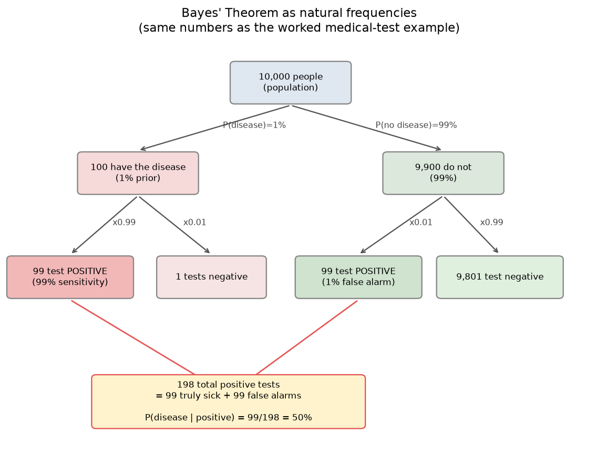
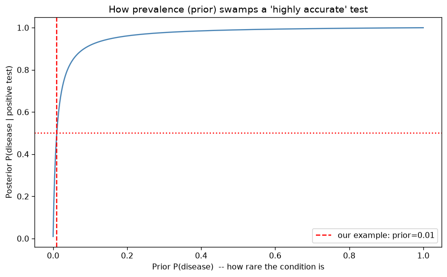

# Chapter 4: Bayes' Theorem — Updating Beliefs With Evidence

## The idea this chapter builds toward

Bayes' Theorem is a formula for exactly one thing: **flipping a conditional probability around**, turning $P(\text{evidence} \mid \text{hypothesis})$ (which is often easy to know) into $P(\text{hypothesis} \mid \text{evidence})$ (which is usually what you actually want to know, but is hard to get directly). This single flip is the foundation of medical test interpretation, spam filters, Naive Bayes classifiers, A/B test interpretation, and — much later, in Chapter 17 — the entire Bayesian school of statistics and Bayesian deep learning.

## Deriving it from what you already know

Recall from Chapter 3, conditional probability was defined two ways:

$$P(B \mid A) = \frac{P(A \text{ and } B)}{P(A)} \qquad P(A \mid B) = \frac{P(A \text{ and } B)}{P(B)}$$

Both equations share the same numerator, $P(A \text{ and } B)$. Rearranging each to solve for that shared numerator:

$$P(A \text{ and } B) = P(B\mid A) \cdot P(A) = P(A \mid B) \cdot P(B)$$

Now just take the right two pieces of that chain and divide:

$$P(A \mid B) = \frac{P(B \mid A) \cdot P(A)}{P(B)}$$

That's Bayes' Theorem. It is not some separate mysterious law — it's pure algebra falling out of the *definition* of conditional probability you already learned. If this derivation feels shaky, re-read Chapter 3's conditional probability section before continuing — everything below depends on trusting this one rearrangement.

## Renaming the pieces so it's usable

In practice we write it with names that make the "updating a belief" story obvious:

$$\underbrace{P(H \mid E)}_{\text{posterior}} = \frac{\overbrace{P(E \mid H)}^{\text{likelihood}} \cdot \overbrace{P(H)}^{\text{prior}}}{\underbrace{P(E)}_{\text{evidence}}}$$

- **Prior** $P(H)$: how likely you thought the hypothesis was *before* seeing any evidence.
- **Likelihood** $P(E \mid H)$: if the hypothesis were true, how likely is it you'd see this particular evidence?
- **Posterior** $P(H \mid E)$: your *updated* belief in the hypothesis, after accounting for the evidence.
- **Evidence** $P(E)$: the overall probability of seeing this evidence at all, under every possible hypothesis (acts as a normalizing constant so the posterior is a valid probability).

The entire story in one sentence: **posterior ∝ likelihood × prior** — your new belief is your old belief, reweighted by how well the evidence matches it.

<div class="labcard">
<div class="labkicker">Live — drag these and watch the posterior update</div>
<div class="labcontrols">
  <div class="labctrl"><label>Prior P(H) <b id="ch04inline_prior_label">1%</b></label><input type="range" id="ch04inline_prior" min="0.1" max="99" step="0.1" value="1"></div>
  <div class="labctrl"><label>Likelihood P(E|H) <b id="ch04inline_lik_label">99%</b></label><input type="range" id="ch04inline_lik" min="1" max="99.9" step="0.1" value="99"></div>
  <div class="labctrl"><label>P(E | not H) <b id="ch04inline_notlik_label">1%</b></label><input type="range" id="ch04inline_notlik" min="0.1" max="99" step="0.1" value="1"></div>
</div>
<div class="labstat-grid">
  <div class="labstat"><div class="lbl">Evidence P(E)</div><div class="val" id="ch04inline_evidence">—</div></div>
  <div class="labstat"><div class="lbl">Posterior P(H|E)</div><div class="val" id="ch04inline_posterior">—</div></div>
</div>
<div class="labcanvas-wrap" style="margin-top:12px;"><canvas id="ch04inline_canvas" width="820" height="240"></canvas></div>
<p class="labnote">The bars show, out of 10,000 people at your chosen prior: how many truly have the condition, and how many test positive among the sick (true positives) vs. among the healthy (false positives). Drag the prior down toward realistic rare-condition levels and watch the false-alarm bar start to dominate, even at high likelihood values.</p>
</div>
<script>
document.addEventListener('DOMContentLoaded', function(){
  var SL = window.StatsLab;
  function update(){
    var prior = parseFloat(document.getElementById('ch04inline_prior').value)/100;
    var lik = parseFloat(document.getElementById('ch04inline_lik').value)/100;
    var notlik = parseFloat(document.getElementById('ch04inline_notlik').value)/100;
    document.getElementById('ch04inline_prior_label').textContent = (prior*100).toFixed(1)+'%';
    document.getElementById('ch04inline_lik_label').textContent = (lik*100).toFixed(1)+'%';
    document.getElementById('ch04inline_notlik_label').textContent = (notlik*100).toFixed(1)+'%';
    var evidence = lik*prior + notlik*(1-prior);
    var posterior = (lik*prior)/evidence;
    document.getElementById('ch04inline_evidence').textContent = (evidence*100).toFixed(2)+'%';
    document.getElementById('ch04inline_posterior').textContent = (posterior*100).toFixed(2)+'%';

    var total = 10000;
    var sick = total*prior, healthy = total-sick;
    var truePos = sick*lik, falsePos = healthy*notlik;
    var plot = SL.makePlot(document.getElementById('ch04inline_canvas'), {l:60,r:20,t:16,b:50});
    var maxV = Math.max(sick, truePos, falsePos, truePos+falsePos)*1.15;
    plot.setDomain([0,4],[0,maxV]); plot.clear(); plot.axes('', 'people out of 10,000');
    var ctx = plot.ctx;
    var bars = [
      {x:0.5, v:sick, color:SL.colors.accent2, label:'Truly has H'},
      {x:1.5, v:truePos, color:SL.colors.accent3, label:'True positives'},
      {x:2.5, v:falsePos, color:SL.colors.accent4, label:'False positives'},
      {x:3.5, v:truePos+falsePos, color:SL.colors.accent, label:'All positives'},
    ];
    bars.forEach(function(b){
      ctx.fillStyle = b.color;
      var x = plot.px(b.x), y = plot.py(b.v), y0 = plot.py(0);
      ctx.fillRect(x-45, y, 90, y0-y);
      ctx.fillStyle = SL.colors.ink; ctx.textAlign='center'; ctx.font='12px -apple-system,sans-serif';
      ctx.fillText(Math.round(b.v), x, y-6);
      ctx.fillStyle = SL.colors.inkSoft;
      ctx.fillText(b.label, x, plot.py(0)+16);
    });
  }
  ['ch04inline_prior','ch04inline_lik','ch04inline_notlik'].forEach(function(id){
    document.getElementById(id).addEventListener('input', update);
  });
  update();
});
</script>

## The backstory — a minister's thought experiment, and why it was controversial for 200 years

Reverend Thomas Bayes, an English Presbyterian minister and amateur mathematician, worked this out in the 1740s/50s, apparently motivated by a philosophical/theological question: can we reason rigorously from observed *effects* back to their unknown *causes*? His essay was only published posthumously in 1763 by a friend, Richard Price. The derivation you worked through above (two equations for the same joint probability, set equal, rearranged) is essentially the exact algebraic path Bayes himself walked — it is not a complicated theorem, which is part of why it's remarkable it hadn't been written down clearly before him. The hard part was never the algebra; it was the philosophical leap of treating an unknown hypothesis (like "this coin is biased" or "this patient has the disease") as something that itself has a *probability distribution* that can be updated — at the time, many mathematicians considered probability to only sensibly apply to genuinely random future events (like dice), not to fixed-but-unknown facts about the world. This exact philosophical fork — "can an unknown fixed parameter have a probability?" — is the root of the frequentist-vs-Bayesian divide that still structures statistics today, and that we'll address head-on in Chapter 17.

It was the French mathematician **Pierre-Simon Laplace**, working independently a few decades later and with far more mathematical firepower, who really developed Bayesian reasoning into a usable general tool — Laplace used it for things like estimating the probability a given birth would be a boy or girl, and for astronomical problems (inferring a planet's unknown orbit parameters from a handful of noisy telescope observations — structurally the same "infer the hidden cause from the observed evidence" problem as the medical test example below).

## The classic worked example: medical testing (do this by hand, it's the whole point)

A disease affects 1% of the population. A test for it is 99% accurate: if you have the disease, it correctly tests positive 99% of the time (true positive rate); if you don't have the disease, it correctly tests negative 99% of the time (meaning a 1% false positive rate). You test positive. **What's the probability you actually have the disease?**

Gut instinct says "99%, obviously, the test is 99% accurate." This gut instinct is wrong, and Bayes' Theorem shows exactly why.

Let $H$ = "has the disease", $E$ = "tests positive." We're given:
- $P(H) = 0.01$ (prior: 1% of population has it)
- $P(E \mid H) = 0.99$ (likelihood: true positive rate)
- $P(E \mid \text{not } H) = 0.01$ (false positive rate)

We need $P(E)$ — the total probability of testing positive, *regardless* of whether you actually have the disease. There are two ways to test positive: you have the disease and correctly test positive, OR you don't have the disease and incorrectly test positive. Add those two paths:

$$P(E) = P(E\mid H)P(H) + P(E \mid \text{not }H)P(\text{not }H) = (0.99)(0.01) + (0.01)(0.99) = 0.0099 + 0.0099 = 0.0198$$

Now plug into Bayes:

$$P(H \mid E) = \frac{P(E\mid H) P(H)}{P(E)} = \frac{0.0099}{0.0198} = 0.5$$



*The exact same calculation, but as counts of actual people instead of abstract probabilities — this "natural frequency" framing is often far more intuitive than the formula. Start with 10,000 people. Split them by the true (but hidden) disease status: 100 sick, 9,900 healthy. Now split each of those groups by test result, using the test's known accuracy. You end up with two separate streams of "tested positive" people — 99 who are truly sick, and 99 who are healthy but got a false alarm — and because those two streams are the same size, a positive test is only a coin flip's worth of evidence for actually having the disease, despite the test being "99% accurate." Nothing here is more than counting — the formula in the previous paragraph is just this same tree written in fractions instead of raw counts.*

**Only 50%** — a coin flip — despite a "99% accurate" test. Why? Because the disease is *rare* (1% prior), so even a small false-positive rate (1%) generates almost as many false alarms (0.0099) as the true positive rate generates real detections (0.0099) — the two are *exactly equal* here because of how the specific numbers were chosen, but the lesson generalizes: **when a condition is rare, most positive test results are false positives, even with a very accurate test.** This single insight underlies why screening for rare diseases/rare fraud/rare anomalies in huge populations is so much harder than people's intuition suggests, and why ML models evaluated on heavily imbalanced data (e.g. 1% fraud rate) need more than just "accuracy" to be trusted (we revisit this exact imbalance problem concretely in Chapter 12 when discussing error types, and again when discussing classifier evaluation).

## Bayes' Theorem as sequential updating

A powerful reframing: the posterior from one piece of evidence becomes the *prior* for the next piece of evidence. If you tested positive twice (independently), you'd plug $P(H) = 0.5$ (yesterday's posterior) back in as today's prior, and recompute. This "update as new evidence arrives" framing is exactly how Bayesian statistics (Chapter 17) and Bayesian online learning work, and it mirrors something you already know intuitively: good detectives update their suspicions incrementally as each new clue arrives, rather than re-deriving everything from scratch.

## Connecting this to Naive Bayes classifiers (a sneak peek)

A spam filter asks: "given these words in the email ($E$), what's $P(\text{spam} \mid E)$?" It estimates $P(\text{word} \mid \text{spam})$ and $P(\text{word}\mid\text{not spam})$ from a labeled training set (that's the "likelihood"), combines them with the prior $P(\text{spam})$ = overall spam rate, and uses Bayes' Theorem to get the posterior probability of spam given the actual words seen. The "naive" part is an independence assumption we'll touch on later — but structurally, it's just this chapter's formula applied word by word.

## More real-world examples of Bayesian updating

- **Spam filters**: described below, but worth restating as its own example — $P(\text{spam}\mid\text{"free money" appears})$ is computed from how often that phrase appears in known spam vs known ham (the likelihoods) and the overall spam rate (the prior).
- **Legal reasoning ("prosecutor's fallacy")**: a DNA match has a 1-in-a-million random match probability. A prosecutor might claim "so there's a 1-in-a-million chance the defendant is innocent" — but this confuses $P(\text{match}\mid\text{innocent})$ with $P(\text{innocent}\mid\text{match})$, exactly the Chapter 3 asymmetry. In a city of 10 million people, you'd expect *about 10* innocent people to also match by chance — the prior (how many potential suspects even exist) matters enormously, exactly like the disease-prevalence effect above.
- **Spam/fraud detection at scale**: credit card fraud is rare (low prior, like the disease), so even a fraud-detector with excellent accuracy generates many false alarms relative to true frauds caught — exactly the same math as the medical test, and the reason real fraud systems are tuned around this tradeoff rather than just "accuracy."
- **Everyday reasoning**: hearing hoofbeats, you assume horses, not zebras (unless you're in a region where zebras are common) — "common things are common" is just a prior speaking, and unusual-sounding evidence needs proportionally strong likelihood ratios to overturn a confident prior. This folk wisdom is literally Bayes' Theorem in plain English.

## Figures



*How the posterior P(disease | positive test) changes as the prior (disease prevalence) sweeps from near 0 to 1, for a 99%-accurate test. Our worked example (prior=0.01) is marked.*

## Run it yourself

`book/code/ch04_bayes_theorem.py` recomputes the medical test example exactly as above, then simulates 200,000 fake "patients" (1% actually sick, tested with the stated accuracy) and counts, among those who tested positive, what fraction are actually sick — confirming the 50% result empirically rather than just algebraically. It also shows how the posterior changes as you vary the disease's true prevalence (prior), which is the most important lever in the whole formula.

```bash
python book/code/ch04_bayes_theorem.py
```

## Why This Matters — In AI and In Everyday Life

**In AI / machine learning:**

- **Spam filters and Naive Bayes classifiers**: directly compute P(spam | words seen) from P(words | spam) and a prior spam rate -- this chapter's formula, applied word by word.
- **Bayesian A/B testing and Bayesian deep learning**: treat an unknown conversion rate or an unknown weight as a distribution to be updated, using exactly this posterior-equals-likelihood-times-prior recipe.

**In everyday, non-AI life:**

- **Medical diagnosis**: doctors (should) combine a test's accuracy with how common a disease actually is in the patient's group -- exactly the worked example in this chapter, and a real source of diagnostic error when skipped.
- **Legal reasoning**: evaluating DNA or forensic evidence against how many people could plausibly match by chance (the "prosecutor's fallacy" mentioned above) is Bayes' Theorem misapplied in real courtrooms, with real consequences.

## Check your understanding

- In the medical example, if the disease were *more common* (say 50% prior instead of 1%), would you expect the posterior $P(H\mid E)$ to go up or down relative to 50%? Compute it to check your intuition.
- Explain in plain words why $P(E)$ in the denominator is computed as a sum of two products, rather than just being "given" directly.
- Why does "posterior becomes next prior" make sequential evidence-gathering mathematically consistent, in your own words?

## What's next

Chapter 5 formalizes the idea of a **random variable** — a way to attach numbers to random outcomes — and introduces the standard discrete probability distributions (Bernoulli, Binomial, Poisson) that show up constantly in both classical statistics and in modeling events like click-through rates, number of errors per batch, and classification outcomes.
