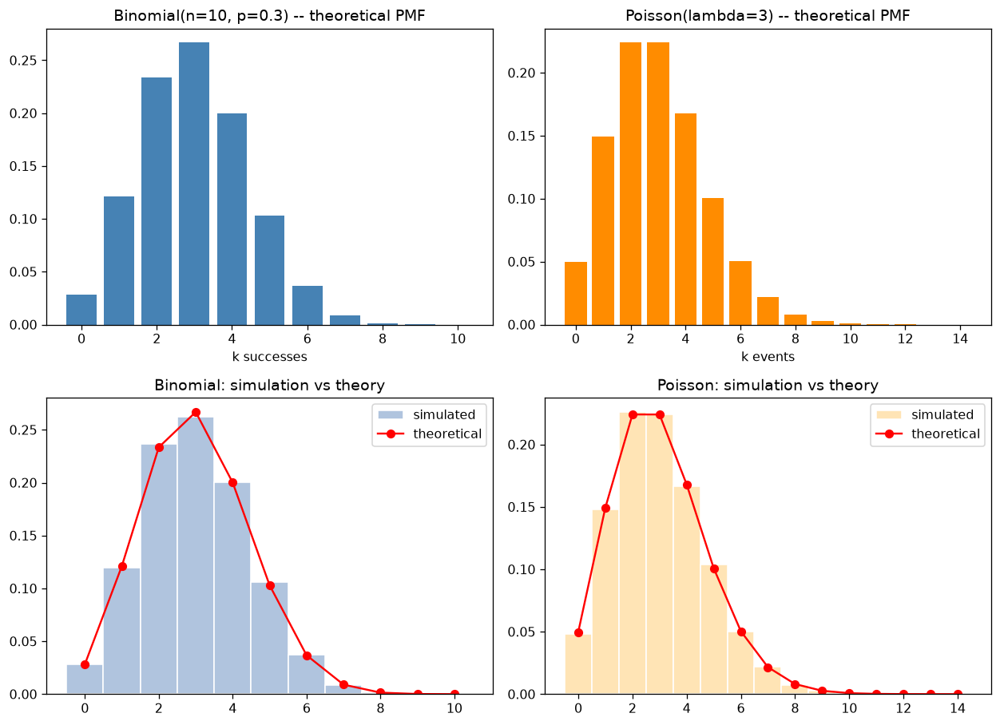

# Chapter 5: Random Variables and Discrete Distributions

## The idea this chapter builds toward

A **random variable** is just a rule that assigns a number to each possible outcome of a random process. This sounds trivial, but it's the bridge that lets us use all the algebra/calculus machinery of numbers (adding, averaging, finding maximums) on things that are fundamentally about chance. Once outcomes are numbers, we can define a **probability distribution** - a complete description of which numbers are likely and by how much - and a handful of these distributions (Bernoulli, Binomial, Poisson in this chapter; Normal, Uniform, Exponential in Chapter 6) show up so often that they have names, and knowing them by shape and by "when does this apply" is one of the highest-leverage skills in this whole book.

> **Intuition, in one breath:** A random variable turns "which outcome happened" into "what number," so that all your familiar number-crunching suddenly works on chance.

## Random variable, formally but gently

If $\Omega = \{H, T\}$ for a coin flip, a random variable $X$ might be defined as $X(H) = 1, X(T) = 0$. Now "the coin landed heads" (an abstract event) has become "$X = 1$" (a number), and we can ask things like $E[X]$ (its average value - formalized fully in Chapter 7).

Convention: random variables get capital letters ($X$), and a specific value they might take gets lowercase ($x$). $P(X = x)$ means "the probability that the random variable $X$ happens to take the specific value $x$."

## Discrete vs continuous random variables

A **discrete** random variable can only take specific, separate values (often integers) - number of heads in 10 flips, number of customers arriving per hour, number of typos on a page. A **continuous** random variable can take any value in a range - height, time, temperature. This chapter covers discrete; Chapter 6 covers continuous. The math for each is structurally parallel but uses sums for discrete and integrals for continuous - don't worry about integrals, we'll keep the continuous chapter intuition-first too.

## Probability Mass Function (PMF)

For a discrete random variable, the **PMF** $P(X=x)$ gives the probability of each possible value. Requirements: every value is $\ge 0$, and they all sum to exactly 1 (something has to happen).

## Distribution 1: Bernoulli - a single yes/no trial

The simplest possible distribution: one trial, two outcomes, "success" (1) with probability $p$, "failure" (0) with probability $1-p$. A single coin flip, a single click/no-click, a single email being spam/not-spam. That's it - it's the atomic building block everything else in this chapter is made from.

$$P(X=1) = p, \quad P(X=0) = 1-p$$

## Distribution 2: Binomial - counting successes across repeated Bernoulli trials

**When to use it**: you repeat the *same* Bernoulli trial $n$ times, independently, and you want to know the probability of getting exactly $k$ successes. Example: flip a fair coin 10 times - how likely is exactly 7 heads? Or: out of 100 emails sent, each independently has a 20% open rate - how likely are exactly 25 opens?

$$P(X=k) = \binom{n}{k} p^k (1-p)^{n-k}$$

**Building this formula piece by piece (the intuition, not just the formula):**
- $p^k$: the probability of getting successes on $k$ *specific* trials (multiplying independent probabilities, from Chapter 3).
- $(1-p)^{n-k}$: the probability of getting failures on the remaining $n-k$ trials.
- $\binom{n}{k}$ ("n choose k"): there are many different *orderings* in which you could get exactly $k$ successes among $n$ trials (e.g., successes could come first, or be scattered) - this term counts how many such orderings exist, so that we count every arrangement that gives $k$ total successes, not just one specific arrangement.

$\binom{n}{k} = \frac{n!}{k!(n-k)!}$, where $n! = n \times (n-1) \times \cdots \times 1$ ("n factorial" - the number of ways to arrange $n$ distinct items in a row).

### Worked example

Fair coin, 4 flips, probability of exactly 2 heads? $n=4, k=2, p=0.5$.

$\binom{4}{2} = \frac{4!}{2!2!} = \frac{24}{4} = 6$ (there are 6 distinct ways to arrange 2 heads among 4 flips: HHTT, HTHT, HTTH, THHT, THTH, TTHH).

$$P(X=2) = 6 \times (0.5)^2 \times (0.5)^2 = 6 \times 0.25 \times 0.25 = 0.375$$

So there's a 37.5% chance of exactly 2 heads in 4 flips - the single most likely outcome, but still well under 50%, because "exactly 2" competes against 0,1,3,4 as possibilities too.

### The backstory - Jacob Bernoulli and "the art of conjecturing"

The Swiss mathematician Jacob Bernoulli spent roughly two decades (working mostly in the 1680s-1700s, published posthumously in 1713 in *Ars Conjectandi*, "The Art of Conjecturing") trying to rigorously answer a very practical question: if you repeat a yes/no trial with a known success probability $p$ many times, how does the *number* of successes behave, and - crucially for him - how many trials do you need before the observed proportion of successes reliably tells you the true $p$? (This question is literally the seed of what became the Law of Large Numbers, which you already simulated in Chapter 3.) To answer it, he first needed to count: "in how many distinct ways can exactly $k$ successes occur among $n$ trials?" This counting question is a pure combinatorics problem unrelated to probability itself, and the answer he (and others working in combinatorics around the same time, building on Pascal's and Fermat's earlier work on gambling problems) landed on is exactly the "n choose k" formula: think of it as filling $k$ of $n$ ordered slots with "success" labels - the number of ways to choose *which* $k$ slots get the label, out of $n$ total slots, is $\binom{n}{k}$. Once you have that counting tool, multiplying by $p^k(1-p)^{n-k}$ (the chance of any *one* specific arrangement, via independence from Chapter 3) was the easy part - the real intellectual labor was the combinatorics, not the probability.

### Deeper intuition for the binomial coefficient itself

Here's the derivation, built from scratch rather than quoted. First: in how many ways can you arrange $n$ *distinct* items in a row? Pick the first position: $n$ choices. Second position: $n-1$ remaining choices. And so on down to 1. Total: $n \times (n-1) \times \cdots \times 1 = n!$. Now: if you want to choose an *unordered* subset of $k$ items out of $n$ (not caring about their order within the subset), start from $n!$ (all full orderings), then divide out the orderings *within* the chosen $k$ items (there are $k!$ equivalent orderings of the same subset) and the orderings *within* the unchosen $n-k$ items (there are $(n-k)!$ of those) - because swapping items around within "chosen" or within "not chosen" doesn't create a new subset. That division gives exactly $\binom{n}{k} = \frac{n!}{k!(n-k)!}$. This is worth working through on paper once with small numbers ($n=4,k=2$ from the worked example) until it clicks - it's genuinely one of the more satisfying "aha" derivations in combinatorics.

### Where Binomial shows up in ML/AI

A/B testing (Chapter 12): if your true conversion rate is $p$ and you show the page to $n$ users, the number of conversions follows a Binomial distribution - this is the generative model underlying every "is variant B significantly better" test. Classifier evaluation on a balanced test set also follows binomial-like reasoning for how many correct predictions you'd expect by chance.

## Distribution 3: Poisson - counting rare events over a fixed window

**When to use it**: you're counting how many times a rare, independent event happens in a fixed window of time or space, when you know the *average rate* ($\lambda$, "lambda") but not a fixed number of "trials" the way Binomial needs. Examples: number of server errors per hour, number of typos per page, number of customers arriving per minute, number of mutations per genome segment.

$$P(X=k) = \frac{\lambda^k e^{-\lambda}}{k!}$$

**Intuition for where this comes from**: Poisson is actually the *limit* of a Binomial distribution where $n \to \infty$ (you slice time into infinitely many infinitesimally small intervals) and $p \to 0$ (the chance of an event in any one tiny slice is tiny) while $n \times p = \lambda$ stays fixed (the overall average rate is constant). You don't need to re-derive this limit by hand - just remember: **Binomial needs a known, fixed number of discrete trials with a per-trial probability; Poisson needs only a known average rate over a continuous window, with no natural "number of trials" to speak of.** That's the practical test for "which distribution should I use" that trips people up most.

### Worked example

A website averages $\lambda = 3$ server errors per hour. What's the probability of exactly 5 errors in the next hour?

$$P(X=5) = \frac{3^5 e^{-3}}{5!} = \frac{243 \times 0.0498}{120} = \frac{12.10}{120} \approx 0.1008$$

About a 10% chance. Note a key Poisson property: both its mean *and* its variance equal $\lambda$ - a distinctive fingerprint you can check against real count data to see if Poisson is actually a reasonable model (if real-world variance is much larger than the mean, the data is "overdispersed" and Poisson is probably the wrong model - this exact diagnostic is used routinely in analyzing event-log/error-count data).

## The backstory - Poisson, and the Prussian cavalry horse-kick data

Siméon Denis Poisson derived this distribution in 1837 as a mathematical limit of the Binomial (sketched above) while studying legal/criminal statistics - he was interested in rare miscarriages-of-justice-type events. But the result that *cemented* the distribution's fame came almost 60 years later: the statistician Ladislaus Bortkiewicz (1898) studied an almost comically narrow dataset - the number of Prussian cavalry soldiers kicked to death by horses each year, across 14 army corps over 20 years (280 corps-years of data). Each individual soldier had a tiny, independent chance of being fatally kicked in a given year (a "rare event"), and there was no natural fixed "number of trials" the way flipping a coin $n$ times is fixed - just an average rate of incidents per corps per year. Bortkiewicz showed the actual observed frequencies of 0, 1, 2, 3+ deaths per corps-year matched the Poisson formula's predictions remarkably well, making this grim dataset the textbook proof-of-concept for the distribution ever since. The derivation sketch promised earlier: start with Binomial($n, p$) with $np=\lambda$ fixed, and literally take the limit as $n\to\infty$ and $p = \lambda/n \to 0$ term by term in the Binomial PMF formula - the $\binom{n}{k}p^k(1-p)^{n-k}$ expression algebraically collapses down to $\frac{\lambda^k e^{-\lambda}}{k!}$ (the $e^{-\lambda}$ emerges specifically from the limit $(1-\lambda/n)^n \to e^{-\lambda}$, the same limit definition of $e$ that shows up in continuously-compounded interest). You don't need to redo this limit yourself, but knowing it exists tells you precisely *when* Poisson is the right approximation to reach for: many independent trials, each individually unlikely, with a fixed overall average rate.

### Reconstructing it yourself - actually walking through Poisson's limit

Let's not just take that collapse on faith - watch each piece fall into place. Start from the Binomial PMF, substitute $p = \lambda/n$ (fixing the average rate $np=\lambda$ as $n$ grows), and examine the three factors separately as $n\to\infty$:

$$P(X=k) = \binom{n}{k}\left(\frac{\lambda}{n}\right)^k\left(1-\frac{\lambda}{n}\right)^{n-k}$$

**Piece 1 - the binomial coefficient and the $n^k$ it's dividing against.** Expand $\binom{n}{k} = \frac{n(n-1)(n-2)\cdots(n-k+1)}{k!}$. For large $n$ and fixed small $k$, each factor $n, (n-1), (n-2),\ldots$ is approximately just $n$, so the numerator is approximately $n^k$. Combined with the $\left(\frac{\lambda}{n}\right)^k = \frac{\lambda^k}{n^k}$ term sitting right next to it, the $n^k$ in the numerator and denominator **cancel almost exactly**, leaving just $\frac{\lambda^k}{k!}$.

**Piece 2 - the $\left(1-\frac{\lambda}{n}\right)^{n}$ part.** This is precisely the limit definition of $e$ generalized: $\lim_{n\to\infty}\left(1-\frac{\lambda}{n}\right)^n = e^{-\lambda}$ (the same limit, just with $-\lambda$ in place of $1$, that defines continuous compound growth - if you've ever seen $\lim_{n\to\infty}(1+\frac{r}{n})^n = e^r$ for continuously compounded interest at rate $r$, this is that exact same limit with a negative rate).

**Piece 3 - the leftover $\left(1-\frac{\lambda}{n}\right)^{-k}$.** As $n\to\infty$ with $k$ fixed, $\frac{\lambda}{n}\to 0$, so this factor goes to $1$ and simply disappears.

Multiply the surviving pieces back together: $\frac{\lambda^k}{k!} \times e^{-\lambda} \times 1 = \frac{\lambda^k e^{-\lambda}}{k!}$ - exactly the Poisson PMF. Nothing about this derivation required any new machinery beyond algebra and one limit you may already know from compound interest; the "rare events over a fixed rate" distribution was hiding inside the "count successes over many fixed trials" distribution the entire time, as a limiting case.

<div class="labcard">
<div class="labkicker">Live - explore Bernoulli, Binomial, and Poisson</div>
<div class="labrow">
  <select id="ch05_dist">
    <option value="bernoulli">Bernoulli</option>
    <option value="binomial" selected>Binomial</option>
    <option value="poisson">Poisson</option>
  </select>
</div>
<div class="labcontrols" id="ch05_params"></div>
<div class="labcanvas-wrap"><canvas id="ch05_canvas" width="820" height="260"></canvas></div>
<div class="labstat-grid">
  <div class="labstat"><div class="lbl">Mean</div><div class="val" id="ch05_mean">-</div></div>
  <div class="labstat"><div class="lbl">Variance</div><div class="val" id="ch05_var">-</div></div>
  <div class="labstat"><div class="lbl">Std Dev</div><div class="val" id="ch05_std">-</div></div>
</div>
<p class="labnote" id="ch05_hint"></p>
</div>
<script>
document.addEventListener('DOMContentLoaded', function(){
  var SL = window.StatsLab;
  var distSelect = document.getElementById('ch05_dist');
  var paramsDiv = document.getElementById('ch05_params');
  var CONFIGS = {
    bernoulli: {params:[{id:'p', label:'p (success prob)', min:0.01, max:0.99, step:0.01, val:0.5}]},
    binomial: {params:[{id:'n', label:'n (trials)', min:1, max:100, step:1, val:20},
                        {id:'p', label:'p (success prob)', min:0.01, max:0.99, step:0.01, val:0.3}]},
    poisson: {params:[{id:'lambda', label:'lambda (rate)', min:0.1, max:30, step:0.1, val:4}]},
  };
  function buildParams(){
    var cfg = CONFIGS[distSelect.value];
    paramsDiv.innerHTML = '';
    cfg.params.forEach(function(p){
      var div = document.createElement('div'); div.className='labctrl';
      div.innerHTML = '<label>'+p.label+' <b id="ch05_'+p.id+'_label">'+p.val+'</b></label>'+
        '<input type="range" id="ch05_'+p.id+'" min="'+p.min+'" max="'+p.max+'" step="'+p.step+'" value="'+p.val+'">';
      paramsDiv.appendChild(div);
    });
    cfg.params.forEach(function(p){
      var el = document.getElementById('ch05_'+p.id);
      el.addEventListener('input', function(){ document.getElementById('ch05_'+p.id+'_label').textContent = el.value; draw(); });
    });
  }
  function getParam(id){ return parseFloat(document.getElementById('ch05_'+id).value); }
  function draw(){
    var dist = distSelect.value;
    var plot = SL.makePlot(document.getElementById('ch05_canvas'));
    var meanV, varV, hint='';
    if(dist==='bernoulli'){
      var p = getParam('p'); meanV=p; varV=p*(1-p);
      plot.setDomain([-0.5,1.5],[0,1]); plot.clear(); plot.axes('outcome (0 or 1)','probability');
      plot.bars([[0,1-p],[1,p]], SL.colors.accent, 0.3);
      hint = 'A single yes/no trial. Mean = p, variance = p(1-p), maximized at p=0.5.';
    } else if(dist==='binomial'){
      var n = getParam('n'), pb = getParam('p'); meanV=n*pb; varV=n*pb*(1-pb);
      var pts=[]; for(var k=0;k<=n;k++) pts.push([k, SL.binomPMF(k,n,pb)]);
      var maxY = Math.max.apply(null, pts.map(function(pt){return pt[1];}));
      plot.setDomain([-0.5,n+0.5],[0,maxY*1.2]); plot.clear(); plot.axes('k successes','P(X=k)');
      plot.bars(pts, SL.colors.accent, 0.85);
      hint = 'Counts successes across n independent Bernoulli trials. Try n=4,p=0.5 to reproduce the worked example (P(X=2)=0.375).';
    } else if(dist==='poisson'){
      var lambda = getParam('lambda'); meanV=lambda; varV=lambda;
      var kmax = Math.max(10, Math.ceil(lambda*3));
      var ptsP=[]; for(var kk=0;kk<=kmax;kk++) ptsP.push([kk, SL.poissonPMF(kk,lambda)]);
      var maxYP = Math.max.apply(null, ptsP.map(function(pt){return pt[1];}));
      plot.setDomain([-0.5,kmax+0.5],[0,maxYP*1.2]); plot.clear(); plot.axes('k events','P(X=k)');
      plot.bars(ptsP, SL.colors.accent2, 0.85);
      hint = 'Counts rare independent events over a fixed window. Notice mean always equals variance for Poisson.';
    }
    document.getElementById('ch05_mean').textContent = meanV.toFixed(3);
    document.getElementById('ch05_var').textContent = varV.toFixed(3);
    document.getElementById('ch05_std').textContent = Math.sqrt(varV).toFixed(3);
    document.getElementById('ch05_hint').textContent = hint;
  }
  distSelect.addEventListener('change', function(){ buildParams(); draw(); });
  buildParams(); draw();
});
</script>

## More real-world examples of discrete distributions

- **Bernoulli/Binomial**: whether a single ad impression gets clicked (Bernoulli); the total number of clicks out of 10,000 impressions shown (Binomial) - the literal basis of click-through-rate statistics in advertising.
- **Binomial**: quality control sampling - out of 50 items pulled off a production line, how many are defective, if the true defect rate is 2%? Binomial tells you how surprising it would be to find, say, 8 defective items if 2% were really the rate (directly feeding into the hypothesis-testing framework of Chapter 12).
- **Poisson**: number of typos per page in a manuscript, number of radioactive decay events detected per second by a Geiger counter, number of customer support calls received per hour, number of mutations per DNA segment, number of goals scored in a football match (a classic, if imperfect, application) - all "count of rare independent events over a fixed window" situations.
- **Poisson in ML/software engineering**: modeling the rate of server errors, exceptions, or security incidents per day - anomaly-detection systems often flag a day as unusual if the observed count falls far into the tail of the Poisson distribution implied by the historical average rate.

## Figures



*Top row: theoretical PMFs for Binomial(n=10, p=0.3) and Poisson(lambda=3). Bottom row: 50,000 simulated draws from each, overlaid on the theoretical PMF to confirm they match.*

## Run it yourself

`book/code/ch05_discrete_distributions.py` plots the PMF of a Binomial(n=10, p=0.3) and a Poisson(λ=3) side by side, verifies the hand-computed examples above using `scipy.stats`, and simulates 50,000 draws from each to confirm the simulated histogram matches the theoretical PMF.

```bash
python book/code/ch05_discrete_distributions.py
```

## Why This Matters - In AI and In Everyday Life

**In AI / machine learning:**

- **A/B test conversion counts**: the number of conversions among n shown visitors is a Binomial random variable -- the generative model underneath every conversion-rate significance test.
- **Rare-event / anomaly monitoring**: modeling the number of fraud cases, server errors, or security incidents per day as Poisson is standard practice in production ML monitoring and anomaly detection.
- **Dropout in neural networks is a Bernoulli draw per unit**: each activation is independently dropped (set to zero) with probability $p$ on every forward pass, which is exactly a Bernoulli random variable applied once per neuron -- and the binomial mean/variance fingerprint tells you how many units survive per layer on average.
- **Perplexity and token-count analyses in LLMs use Poisson-style count reasoning**: counting how many runs of a rare failure mode, hallucination, or exact-match token occur per evaluation batch is a count-over-a-window problem, so production eval harnesses rely on the Poisson mean-equals-variance diagnostic to flag overdispersed, bursty failures.

**In everyday, non-AI life:**

- **Call center staffing**: the number of customer calls arriving per hour is classically modeled as Poisson, directly driving how many staff to schedule.
- **Quality control sampling**: counting how many defective items turn up in a batch of n inspected units is a direct real-world Binomial calculation.

## Worked example - by hand, larger

Suppose a spam classifier is evaluated on $n = 5$ emails, each independently classified correctly with probability $p = 0.8$. We want the probability of exactly $k = 3$ correct. This is Binomial: $n=5, k=3, p=0.8$.

Binomial coefficient: $\binom{5}{3} = \frac{5!}{3!\,2!} = \frac{120}{6 \times 2} = \frac{120}{12} = 10$. Success part: $(0.8)^3 = 0.512$. Failure part: $(1-0.8)^{5-3} = (0.2)^2 = 0.04$. Put together:
$$P(X=3) = 10 \times 0.512 \times 0.04 = 10 \times 0.02048 = 0.2048$$
So exactly 3 of 5 correct happens about 20.5% of the time. Now compute the mean and variance fingerprint: $\mu = np = 5 \times 0.8 = 4$; $\sigma^2 = np(1-p) = 5 \times 0.8 \times 0.2 = 0.8$, so $\sigma = \sqrt{0.8} \approx 0.894$.

Now switch to a Poisson scenario with the same chapter's other distribution. Suppose a data pipeline logs $\lambda = 2$ failures per hour, and we ask for exactly 3 failures in the next hour:
$$P(X=3) = \frac{2^3 e^{-2}}{3!} = \frac{8 \times 0.1353}{6} = \frac{1.0827}{6} \approx 0.1804$$
About 18% chance. Note the fingerprint that distinguishes Poisson from Binomial: here mean equals variance equals $\lambda = 2$, whereas the Binomial above had mean 4 but variance only 0.8.

**Binomial answers "how many successes out of a fixed set of trials," Poisson answers "how many rare events in a fixed window," and their mean-vs-variance relationship is the quickest way to tell which model fits your counts.**

## Check your understanding

- Why does the Binomial formula need the $\binom{n}{k}$ term but the Bernoulli distribution (n=1) doesn't need anything like it?
- Give a real scenario where Poisson is the right model and Binomial is not, and explain why in terms of "fixed number of trials" vs "average rate over a window."
- If a Poisson-distributed count of events has a sample mean of 4 but a sample variance of 40, what does that suggest about whether Poisson is actually a good model here?

## Exercises

### Exercise 1 - Binomial by hand

Out of $n=6$ independent A/B test visitors, each converting with probability $p=0.5$, what is the probability of exactly $k=2$ conversions?

<details><summary>Show solution</summary>

$\binom{6}{2} = \frac{6!}{2!\,4!} = 15$. Then $P(X=2) = 15 \times (0.5)^2 \times (0.5)^4 = 15 \times 0.25 \times 0.0625 = 15 \times 0.015625 = 0.234375$. So about 23.4%. The mean is $np = 3$ and variance is $np(1-p) = 1.5$, matching the expected fingerprint.

</details>

### Exercise 2 - Poisson by hand

A model's error log shows on average $\lambda = 4$ exceptions per batch. What is the probability of exactly 2 exceptions in the next batch?

<details><summary>Show solution</summary>

$P(X=2) = \frac{4^2 e^{-4}}{2!} = \frac{16 \times 0.01832}{2} = \frac{0.2931}{2} \approx 0.1465$. About 14.7%. Since Poisson has mean $=$ variance $= \lambda = 4$, a real batch whose observed variance dwarfs 4 would signal overdispersion and cast doubt on the model.

</details>

### Exercise 3 - Conceptual: choosing the right distribution

Decide whether Binomial or Poisson fits each case, and why: (a) number of heads in 20 flips; (b) number of typos on a random book page given an average of 1.5 per page; (c) number of defective units in a batch of 50 with a 3% defect rate.

<details><summary>Show solution</summary>

(a) Binomial - a fixed number of trials ($n=20$) with a per-trial probability. (b) Poisson - no natural "number of trials"; only an average rate over a continuous window (a page). (c) Binomial - a finite, fixed set of 50 inspected units, each independently defective with probability 0.03. The deciding question is always "is there a fixed trial count, or only an average rate?"

</details>

## What's next

Chapter 6 extends this to **continuous** random variables - quantities that can take any value in a range, not just discrete counts - and introduces the single most important distribution in all of statistics: the Normal (Gaussian) distribution, along with the intuition for *why* it shows up absolutely everywhere in nature and in ML.
