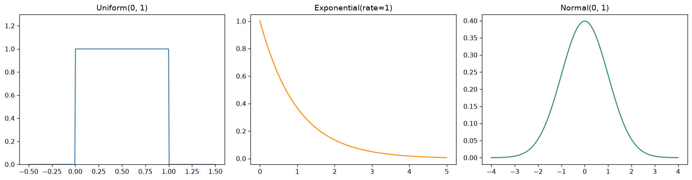
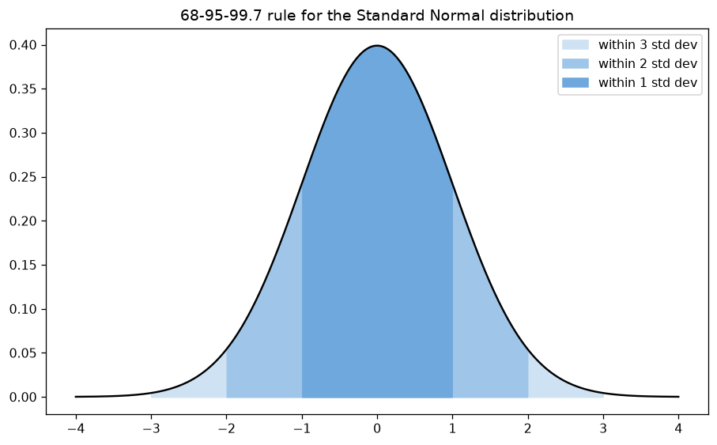

# Chapter 6: Continuous Distributions and the Normal Distribution

## The idea this chapter builds toward

For continuous quantities (height, time, error magnitude, pixel intensity, model weights), we can't ask "what's $P(X = 2.0)$ exactly" in the same way as discrete — there are infinitely many possible values, so the probability of landing on any *exact* number is essentially zero. Instead, we talk about the probability of falling in a *range*, and we describe the distribution with a **density curve** instead of a bar chart of exact probabilities. And then this chapter introduces the single most important distribution in statistics — the **Normal (Gaussian) distribution** — and, crucially, *why* it keeps appearing everywhere, which is not an accident.

## From PMF to PDF — why we need a new concept

For discrete variables (Chapter 5), the PMF gave you $P(X=k)$ directly, and all those probabilities summed to 1. For continuous variables, we instead use a **Probability Density Function (PDF)**, written $f(x)$. Crucially, $f(x)$ is **not** a probability — it can even be greater than 1. What it represents is *relative likelihood density*: taller regions of the curve mean values near there are more likely than values under shorter regions. To get an actual probability, you compute the **area under the curve** over a range:

$$P(a \le X \le b) = \text{area under } f(x) \text{ between } a \text{ and } b$$

(Formally this area is computed via an integral, $\int_a^b f(x)\,dx$ — you will never need to compute one by hand in this book; `scipy` does it for you, and the intuition "area under the curve = probability of landing in that range" is all you need to carry forward.) Two consequences worth internalizing:
- $P(X = \text{exactly } 2.000000\ldots) = 0$ for any single exact point — there's no area under a curve at a single point with zero width. This is why with continuous data we always talk about ranges ("between 1.9 and 2.1") not exact values.
- The total area under the whole curve, across all possible values, must equal 1 (same "something happens" requirement as before).

## The Uniform distribution — the simplest continuous case

Every value in a range $[a, b]$ is equally likely; the density is flat. Example: a random number generator producing any value between 0 and 1 with equal density. Useful as a baseline/building block (e.g., it's literally what `np.random.random()` samples from), and as the "maximally uninformative" prior in Bayesian statistics (Chapter 17) when you truly have no reason to favor one value over another within a range.

## The Exponential distribution — waiting times

Models the time between independent, randomly occurring events (the continuous cousin of the Poisson distribution from Chapter 5 — in fact, if event *counts* per unit time follow Poisson, the *time gap* between consecutive events follows Exponential). Example: time between server requests, time until a component fails (if failure is memoryless — doesn't "wear out," which is a strong assumption, but a common starting model). Its defining and slightly counterintuitive property is being **memoryless**: if you've already waited 10 minutes for a bus with exponentially-distributed arrival times, your expected *additional* wait is exactly the same as if you'd just started waiting. (Real bus arrivals usually aren't memoryless — that's why this assumption is a modeling simplification, worth flagging when you use it.)

## The star of the show: the Normal (Gaussian) distribution

### What it looks like and why the formula is shaped the way it is

$$f(x) = \frac{1}{\sigma\sqrt{2\pi}} \, e^{-\frac{(x-\mu)^2}{2\sigma^2}}$$

You don't need to memorize this, but here's what each piece is *doing*:

- $(x - \mu)^2$: distance of $x$ from the center $\mu$, squared (so symmetric — equally far above or below the mean counts the same, and larger deviations are penalized much more, same reasoning as variance in Chapter 2).
- Dividing by $2\sigma^2$: controls how fast the density shrinks as you move away from the mean. Large $\sigma$ (big spread) means the penalty for being far from the mean kicks in more slowly → wide, flat bell curve. Small $\sigma$ → narrow, tall, peaked bell curve.
- $e^{-(\cdots)}$: exponentiating a negative, ever-growing penalty means the density drops off extremely fast (and smoothly) as you move away from the center — this specific exponential-of-negative-square shape is what gives the "bell" silhouette, with thin tails that approach but never quite touch zero.
- $\frac{1}{\sigma\sqrt{2\pi}}$: just a normalizing constant out front, chosen so that the total area under the whole curve works out to exactly 1 (recall: total probability must be 1). It's not a mysterious constant — it's whatever makes the areas add up correctly, and $\sqrt{2\pi}$ falls out of the calculus of that normalization (you never need to re-derive it).

The Normal distribution is fully described by just two numbers: $\mu$ (center) and $\sigma$ (spread). Shorthand notation: $X \sim N(\mu, \sigma^2)$ ("X is distributed Normal with mean mu, variance sigma-squared").

### The 68-95-99.7 rule

For *any* Normal distribution, regardless of $\mu$ and $\sigma$:
- About 68% of values fall within 1 standard deviation of the mean ($\mu \pm \sigma$).
- About 95% fall within 2 standard deviations ($\mu \pm 2\sigma$).
- About 99.7% fall within 3 standard deviations ($\mu \pm 3\sigma$).

This is an extremely useful mental ruler: if adult male heights are roughly Normal with $\mu=175$cm, $\sigma=7$cm, then about 95% of men are between $175 \pm 14 = [161, 189]$cm, and someone at 200cm is roughly 3.5 standard deviations out — genuinely rare. This rule is also exactly what "z-scores" (next section) and later "confidence intervals" (Chapter 11) and "p-values" (Chapter 12) are built from.

### The z-score — putting any Normal variable on a universal scale

$$z = \frac{x - \mu}{\sigma}$$

**Intuition**: this converts "x" into "how many standard deviations away from the mean is x," regardless of the original units or scale. A z-score of +2 always means "2 standard deviations above the mean," whether you're talking about height, test scores, or model residuals. This is called **standardizing** and is exactly the "StandardScaler" / "z-score normalization" preprocessing step used constantly in ML to put features on comparable scales before training a model (a feature like "income in dollars" and "age in years" live on wildly different scales — standardizing both to z-scores lets algorithms sensitive to scale, like gradient descent or k-NN, treat them fairly).

## The backstory — three different people independently bump into the same curve

**Abraham de Moivre** (1733, extending work on gambling problems posed to him by friends) was trying to approximate Binomial probabilities (Chapter 5) for large $n$, because computing $\binom{n}{k}p^k(1-p)^{n-k}$ by hand for, say, $n=1000$ is brutally tedious. Using Stirling's approximation (a formula for approximating large factorials), he showed that for large $n$, the Binomial PMF's *shape*, plotted as a function of $k$, collapses into a smooth curve that is exactly the Gaussian bell shape — this is actually a special case of the Central Limit Theorem (Chapter 8), discovered about 150 years before the CLT was understood in full generality. De Moivre wasn't trying to invent a new distribution for its own sake — he stumbled into it purely as a computational shortcut for a different, already-familiar distribution, which is a very common way important math gets discovered: as a convenient approximation that turns out to be deeper than the original problem.

**Carl Friedrich Gauss** (early 1800s, hence "Gaussian distribution") approached it from an entirely different direction: astronomy. He had many noisy telescope measurements of the same celestial object and wanted the mathematically "best" way to combine them into one estimate, and the "best" way to describe how errors scatter around the truth. He essentially worked backwards: he *assumed* the sample mean should be the best estimator of the true value (a very natural assumption) and asked "what error distribution would make the arithmetic mean the mathematically optimal (maximum likelihood, in the language of Chapter 10, though that formal framework came a century later) choice?" Solving that reverse-engineering problem, the answer that falls out is precisely the bell-curve formula from this chapter — so in Gauss's hands, the Normal distribution wasn't an empirical observation but the unique answer to "what error law makes averaging the right thing to do?" This is genuinely one of the most elegant derivations in the history of statistics, and it directly foreshadows Chapter 10's proof that the sample mean is the Gaussian MLE — Gauss essentially ran that exact argument in reverse to *construct* the Normal distribution in the first place.

**Adolphe Quetelet** (1830s-40s), a Belgian astronomer-turned-social-scientist, then applied Gauss's error-curve idea to a radically different domain: human bodies. He collected chest measurements of Scottish soldiers and heights of French conscripts and found they, too, followed this same bell curve — not measurement *error* around a single true star position, but genuine natural variation around an "average man" (*l'homme moyen*, his term) that he treated as a kind of biological ideal. This was controversial (and arguably sociologically naive) but it's the historical moment the Normal distribution jumped from "a tool for astronomers' measurement errors" to "a general pattern seen throughout nature" — which is also roughly when Francis Galton (Darwin's half-cousin) started using Quetelet's bell curve to study inherited traits, which directly leads into Chapter 7's covariance/correlation story.

### Deriving the shape, one more layer deeper

Why specifically $e^{-x^2}$ and not some other fast-decaying function? Gauss's "reverse-engineering" argument above actually pins this down precisely: he required that estimating a location parameter from several independent noisy measurements by **averaging** them must give the *maximum likelihood* answer (the single most statistically justifiable way to combine repeated measurements). Working through what likelihood function has this property forces the log of the density to be a quadratic function of the error, $-c(x-\mu)^2$ for some positive constant $c$ — and exponentiating a (negative) quadratic is exactly $e^{-c(x-\mu)^2}$, the Gaussian shape. In other words: **the Gaussian is the unique error distribution for which "just average your measurements" is mathematically optimal** — which is a deeply satisfying explanation for why it is also the natural target of the Central Limit Theorem (averaging keeps producing it, because it's the fixed point of averaging, in a sense).

<div class="labcard">
<div class="labkicker">Live — explore Normal, Uniform, and Exponential</div>
<div class="labrow">
  <select id="ch06_dist">
    <option value="normal" selected>Normal</option>
    <option value="uniform">Uniform</option>
    <option value="exponential">Exponential</option>
  </select>
</div>
<div class="labcontrols" id="ch06_params"></div>
<div class="labcanvas-wrap"><canvas id="ch06_canvas" width="820" height="260"></canvas></div>
<div class="labstat-grid">
  <div class="labstat"><div class="lbl">Mean</div><div class="val" id="ch06_mean">—</div></div>
  <div class="labstat"><div class="lbl">Variance</div><div class="val" id="ch06_var">—</div></div>
  <div class="labstat"><div class="lbl">Std Dev</div><div class="val" id="ch06_std">—</div></div>
</div>
<p class="labnote" id="ch06_hint"></p>
</div>
<script>
document.addEventListener('DOMContentLoaded', function(){
  var SL = window.StatsLab;
  var distSelect = document.getElementById('ch06_dist');
  var paramsDiv = document.getElementById('ch06_params');
  var CONFIGS = {
    normal: {params:[{id:'mu', label:'mu (mean)', min:-10, max:10, step:0.1, val:0},
                      {id:'sigma', label:'sigma (std dev)', min:0.2, max:5, step:0.1, val:1}]},
    uniform: {params:[{id:'a', label:'a (min)', min:-10, max:5, step:0.1, val:0},
                       {id:'b', label:'b (max)', min:0, max:15, step:0.1, val:5}]},
    exponential: {params:[{id:'lambda', label:'lambda (rate)', min:0.1, max:3, step:0.05, val:1}]},
  };
  function buildParams(){
    var cfg = CONFIGS[distSelect.value];
    paramsDiv.innerHTML = '';
    cfg.params.forEach(function(p){
      var div = document.createElement('div'); div.className='labctrl';
      div.innerHTML = '<label>'+p.label+' <b id="ch06_'+p.id+'_label">'+p.val+'</b></label>'+
        '<input type="range" id="ch06_'+p.id+'" min="'+p.min+'" max="'+p.max+'" step="'+p.step+'" value="'+p.val+'">';
      paramsDiv.appendChild(div);
    });
    cfg.params.forEach(function(p){
      var el = document.getElementById('ch06_'+p.id);
      el.addEventListener('input', function(){ document.getElementById('ch06_'+p.id+'_label').textContent = el.value; draw(); });
    });
  }
  function getParam(id){ return parseFloat(document.getElementById('ch06_'+id).value); }
  function draw(){
    var dist = distSelect.value;
    var plot = SL.makePlot(document.getElementById('ch06_canvas'));
    var meanV, varV, hint='';
    if(dist==='normal'){
      var mu = getParam('mu'), sigma = getParam('sigma'); meanV=mu; varV=sigma*sigma;
      var pts=[]; for(var x=mu-4*sigma; x<=mu+4*sigma; x+=sigma*8/200) pts.push([x, SL.normalPDF(x,mu,sigma)]);
      var maxY = Math.max.apply(null, pts.map(function(p){return p[1];}));
      plot.setDomain([mu-4*sigma, mu+4*sigma],[0,maxY*1.2]); plot.clear(); plot.axes('x','density f(x)');
      plot.line(pts, SL.colors.accent3, 2.5);
      hint = '~68% of mass lies within 1 sigma, ~95% within 2 sigma, ~99.7% within 3 sigma, regardless of mu/sigma.';
    } else if(dist==='uniform'){
      var a = getParam('a'), b = getParam('b'); if(b<=a) b=a+0.5;
      meanV=(a+b)/2; varV=Math.pow(b-a,2)/12;
      var h = 1/(b-a);
      plot.setDomain([a-1,b+1],[0,h*1.3]); plot.clear(); plot.axes('x','density f(x)');
      plot.line([[a-1,0],[a,0],[a,h],[b,h],[b,0],[b+1,0]], SL.colors.accent, 2.5);
      hint = 'Every value in [a,b] is equally likely. Flat density = h = 1/(b-a).';
    } else if(dist==='exponential'){
      var lambda = getParam('lambda'); meanV=1/lambda; varV=1/(lambda*lambda);
      var xmax = 5/lambda;
      var ptsE=[]; for(var xx=0;xx<=xmax;xx+=xmax/200) ptsE.push([xx, lambda*Math.exp(-lambda*xx)]);
      var maxYE = Math.max.apply(null, ptsE.map(function(p){return p[1];}));
      plot.setDomain([0,xmax],[0,maxYE*1.2]); plot.clear(); plot.axes('x (time)','density f(x)');
      plot.line(ptsE, SL.colors.accent4, 2.5);
      hint = 'Models waiting time between independent events. Memoryless: expected additional wait never depends on how long you already waited.';
    }
    document.getElementById('ch06_mean').textContent = meanV.toFixed(3);
    document.getElementById('ch06_var').textContent = varV.toFixed(3);
    document.getElementById('ch06_std').textContent = Math.sqrt(varV).toFixed(3);
    document.getElementById('ch06_hint').textContent = hint;
  }
  distSelect.addEventListener('change', function(){ buildParams(); draw(); });
  buildParams(); draw();
});
</script>

## More real-world examples of continuous distributions

- **Normal**: IQ scores (by construction, standardized to be roughly Normal), blood pressure readings across a population, measurement error in a calibrated scientific instrument, residual noise in sensor readings.
- **Normal in ML specifically**: neural network weight *initialization* is frequently drawn from a Normal (or related) distribution (Chapter 25 goes deep on why); residuals of a well-fit regression model are assumed approximately Normal (Chapter 14-15); many statistical tests (Chapter 12-13) explicitly assume Normally-distributed data or Normally-distributed sampling distributions via the CLT.
- **Exponential**: time between earthquakes in a region (approximately, over short windows), time until a lightbulb or machine part fails under a "constant hazard rate" assumption, time between arriving customer support tickets.
- **Uniform**: a well-shuffled deck's position of any specific card, pseudo-random number generation itself, rounding error when a continuous quantity is rounded to the nearest unit (uniformly distributed between -0.5 and +0.5 of the rounding unit, a fact used in signal processing noise analysis).

## WHY is the Normal distribution everywhere? (the real payoff of this chapter)

This is the question most courses skip past, and it's the single most important "why" in this book, because the answer is the **Central Limit Theorem**, which we dedicate the *entirety* of Chapter 8 to. The one-paragraph preview: whenever a quantity is the result of **adding up many small, independent, random influences** (e.g., height is affected by many independent genes and environmental factors; measurement error is the sum of many tiny independent error sources; even a sample mean, as you saw bouncing around in Chapter 1's code, is itself a sum of many random data points divided by n), the *sum* of those influences tends toward a Normal distribution, almost regardless of what the individual influences' own distributions looked like. This is such a strong, surprising, and universal mathematical fact that it alone explains why bell curves show up in biology, measurement error, finance, and — critically for us — in the sampling distributions that make hypothesis testing and confidence intervals (Chapters 9-12) work at all. Hold that thought; Chapter 8 proves it to you visually.

## Figures



*The Uniform, Exponential, and Normal probability density functions side by side.*



*The 68-95-99.7 rule for the Standard Normal distribution: the shaded regions show the area (probability) within 1, 2, and 3 standard deviations of the mean.*

## Run it yourself

`book/code/ch06_continuous_distributions.py` plots the Uniform, Exponential, and Normal PDFs, shades the 68-95-99.7 regions under a Normal curve with actual computed areas, and converts a worked height example into z-scores to make the "universal scale" idea concrete.

```bash
python book/code/ch06_continuous_distributions.py
```

## Why This Matters — In AI and In Everyday Life

**In AI / machine learning:**

- **Neural network weight initialization and noise models**: weights are commonly drawn from Normal distributions, and regression/generative models routinely assume Normally-distributed noise -- both leaning directly on this chapter.
- **Sensor noise in robotics and autonomous vehicles**: measurement error from LIDAR, GPS, or cameras is frequently modeled as Normal or Exponential (for time-between-events) noise feeding into a perception pipeline.

**In everyday, non-AI life:**

- **Standardized test scores**: SAT/IQ-style scores are explicitly constructed to be Normally distributed, and z-scores are how colleges and psychologists compare people across different tests.
- **Waiting for a bus or a bank queue**: the time between arrivals is a classic real-world Exponential-distribution scenario, memoryless property and all.

## Check your understanding

- Why is $P(X = 2.0)$ meaningless (essentially zero) for a continuous random variable, but $P(1.9 \le X \le 2.1)$ is not?
- If $\sigma$ doubles while $\mu$ stays the same, what happens to the shape of the Normal curve, and why, tracing through the formula's logic?
- A person is 189cm tall, and height is $N(175, 7^2)$. Compute their z-score and describe what percentile-ish range that roughly corresponds to using the 68-95-99.7 rule.

## What's next

Chapter 7 formalizes **expectation** (the true population mean, as a probability-weighted average) and **variance** for random variables in general, then extends to **covariance and correlation** — how two random variables move together — setting up the vocabulary needed for regression (Chapters 14-15) and multivariate statistics (Chapter 20).
