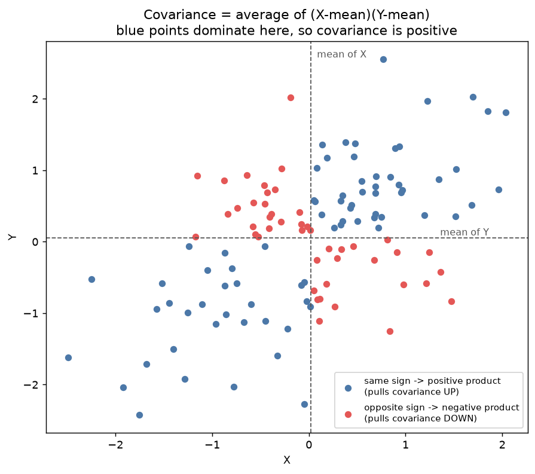
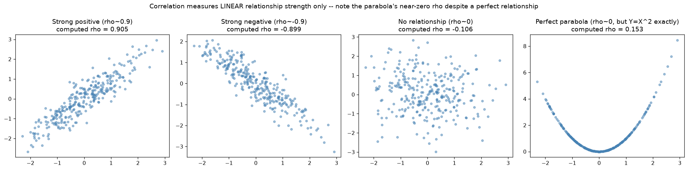

# Chapter 7: Expectation, Variance, Covariance, and Correlation

## The idea this chapter builds toward

Chapter 2 gave you mean and variance as summaries of data *you already have*. This chapter gives you the probability-theory version of the same ideas — **expectation** and **variance of a random variable** — which describe a distribution itself, before you've drawn any sample from it. Then we extend to two variables at once: **covariance** and **correlation**, which measure whether two quantities tend to move together — the conceptual seed of regression (Chapter 14) and of why features in a dataset can be redundant or informative together (Chapter 20).

## Expectation — the "mean" of a random variable

For a discrete random variable $X$ with PMF $P(X=x)$:

$$E[X] = \sum_x x \cdot P(X=x)$$

**Intuition**: it's a *probability-weighted average* — instead of weighting every observed data point equally (like the plain mean in Chapter 2), you weight each *possible value* by how likely it is. If you played a game infinitely many times, $E[X]$ is the long-run average payout per game.

### Worked example: expected value of a die roll

$X \in \{1,2,3,4,5,6\}$, each with probability $\frac{1}{6}$.

$$E[X] = 1(\tfrac16) + 2(\tfrac16) + 3(\tfrac16) + 4(\tfrac16) + 5(\tfrac16) + 6(\tfrac16) = \frac{21}{6} = 3.5$$

Notice: $E[X] = 3.5$ is not even a possible outcome of a single roll! That's completely normal — expectation describes the *long-run average*, not a value you'll ever see on any one trial. This is a common beginner stumbling block worth internalizing now.

### Worked example: expected value of a biased bet

A game costs \$1 to play. You win \$5 (net \$4 profit) with probability 0.1, and win nothing (net \$1 loss) with probability 0.9. Should you play?

$$E[\text{net profit}] = (4)(0.1) + (-1)(0.9) = 0.4 - 0.9 = -0.5$$

On average, you lose 50 cents per play. This "expected value" framing — multiply each outcome by its probability and sum — is exactly how casinos, insurance companies, and (as we'll see starting in Chapter 10) loss functions in machine learning are all designed: a loss function's *expected value over the data distribution* is precisely the quantity training tries to minimize.

### Linearity of expectation (an extremely useful shortcut)

$$E[aX + b] = aE[X] + b \qquad E[X + Y] = E[X] + E[Y]$$

The second rule is remarkable because it holds **even if $X$ and $Y$ are not independent** — you never need to worry about how two random variables interact just to add their expectations. This is a huge computational shortcut used throughout statistics (e.g., it's exactly why the expected value of a sample mean, a sum of many random data points divided by n, is clean to compute — see Chapter 8).

## Variance of a random variable

$$\text{Var}(X) = E[(X - E[X])^2]$$

Same intuition as Chapter 2's variance (average squared distance from the center), just now computed via probability-weighting over the distribution rather than averaging over observed data. An equivalent, often more computationally convenient formula:

$$\text{Var}(X) = E[X^2] - (E[X])^2$$

("average of the squares, minus the square of the average" — worth memorizing, it comes up constantly, including inside the derivation of why we divide by $n-1$ for sample variance in Chapter 2, and inside the bias-variance decomposition in Chapter 16.)

### A useful variance rule

$$\text{Var}(aX + b) = a^2 \text{Var}(X)$$

Notice: adding a constant $b$ doesn't change the spread at all (shifting everything left/right doesn't change how spread out it is), but scaling by $a$ scales the variance by $a^2$ (and so the standard deviation by $|a|$, not $a^2$) — because variance is in squared units, as you learned in Chapter 2.

## Covariance — do two variables move together?

$$\text{Cov}(X, Y) = E[(X - E[X])(Y - E[Y])]$$

**Intuition**: for each data point, look at whether $X$ is above or below its own mean, and whether $Y$ is above or below its own mean, *at the same time*. Multiply those two deviations together.

- If $X$ and $Y$ tend to be above their means together (and below together), the product of deviations is usually positive → positive covariance (they move together).
- If when $X$ is above its mean, $Y$ tends to be below its mean (and vice versa), the product is usually negative → negative covariance (they move oppositely).
- If there's no consistent relationship, positive and negative products roughly cancel out → covariance near zero.



*Draw a vertical line through the mean of X and a horizontal line through the mean of Y — this splits the scatter plot into four quadrants. Points where X and Y are both above their mean, or both below (blue), contribute a **positive** product $(X-\bar X)(Y-\bar Y)$. Points where one is above its mean and the other below (red) contribute a **negative** product. Covariance is just the average of all these signed products — in this data, blue clearly dominates, so the covariance (and hence the correlation) comes out positive, exactly matching the visibly upward-sloping trend.*

### The problem with covariance: it's not scale-free

If you measure height in centimeters vs. meters, the covariance between height and weight changes by a factor of 100, even though the *underlying relationship* hasn't changed at all. This makes raw covariance values hard to interpret or compare across different variable pairs — a covariance of "150" tells you almost nothing on its own without knowing the units and scales involved.

## Correlation — covariance, but scale-free

$$\rho = \text{Corr}(X,Y) = \frac{\text{Cov}(X,Y)}{\sigma_X \sigma_Y}$$

Dividing by both standard deviations cancels out the units entirely, so $\rho$ (Pearson's correlation coefficient) always falls between $-1$ and $+1$:

- $\rho = +1$: perfect positive linear relationship (as X goes up, Y goes up, exactly proportionally).
- $\rho = -1$: perfect negative linear relationship.
- $\rho = 0$: no *linear* relationship (important caveat below).
- Values in between indicate the *strength* of the linear relationship — e.g., $\rho = 0.8$ is a strong positive linear trend with some scatter; $\rho = 0.2$ is a weak one.

### The critical caveat: correlation only measures *linear* relationships

$\rho = 0$ does **not** mean "no relationship" — it means "no *linear* relationship." A perfect parabola ($Y = X^2$, symmetric around $X=0$) has $\rho \approx 0$ despite $Y$ being *completely determined* by $X$ — just not linearly. This is a very common and very costly misreading of correlation in practice. **Always plot the scatter plot** (same Anscombe's Quartet lesson from Chapter 2) before trusting a correlation number.

### Correlation is not causation (the most famous warning in all of statistics)

Ice cream sales and drowning deaths are strongly positively correlated across months of the year. Does ice cream cause drowning? No — both are driven by a hidden **confounding variable**: hot weather, which independently increases both ice cream sales and swimming (and therefore drowning risk). Whenever you see a correlation, always ask: could a third variable be driving both? This question is formalized properly in causal inference (briefly previewed in Chapter 26), but the instinct to ask it starts here.

## The backstory — Galton's sweet peas and "regression to the mean"

Francis Galton, in the 1870s-80s, was obsessed with heredity and measurement (he was Darwin's half-cousin and a committed, if ethically troubling by modern standards, eugenicist — worth naming honestly rather than politely skipping). He measured the sizes of sweet-pea seeds and their offspring, and later human heights across parents and children, and noticed something that surprised him: tall parents tended to have somewhat shorter children than themselves (on average), and short parents tended to have somewhat taller children — offspring sizes drifted back *toward* the population average rather than preserving the full extremity of the parent. He called this "regression toward mediocrity" (we now say **regression to the mean**), and to quantify *how strongly* two measurements (parent height, child height) moved together, he needed exactly the tool this chapter builds: a number that captures "when one goes up, does the other reliably go up too, and how strongly." Galton himself sketched the geometric idea (fitting a line through a scatter of points and measuring how tightly points hugged it), but it was his student **Karl Pearson** who in 1895 turned Galton's intuition into the precise formula you learned above — the covariance-divided-by-both-standard-deviations construction — which is exactly why today's standard correlation coefficient is called the **Pearson correlation coefficient**.

It's worth sitting with *why* "regression to the mean" happens at all, because it trips people up constantly even today: it is not that genetics is "pulling" extreme values back down — it is a near-mechanical consequence of the fact that any single measurement (a parent's height) is a mix of a true underlying genetic signal plus some randomness/luck, and when you select on an *extreme* observed value, you've disproportionately selected for people who got lucky on the random part too — and luck doesn't carry over to the next measurement, so the next measurement (the child, or a repeated measurement of the same quantity) tends to land closer to the true average. This exact "regression to the mean" trap explains why, e.g., a sports player's spectacular rookie season is often followed by a more average "sophomore slump" season — not because they got worse, but because some of that spectacular performance was variance, not pure skill, and variance doesn't repeat.

## Why this chapter matters for what's coming

Covariance between many variables at once, arranged in a grid, becomes the **covariance matrix** (Chapter 20) — the foundation of PCA, Gaussian distributions in multiple dimensions, and much of multivariate statistics. The "expected value of a squared deviation" framing in this chapter is also *exactly* the same algebra used to decompose prediction error into bias and variance (Chapter 16) — same formula, reused for a different purpose. Learning this chapter well pays off repeatedly.

## More real-world examples of covariance and correlation

- **Finance**: portfolio diversification is literally an exercise in picking assets with *low or negative* covariance, so that when one investment drops, another tends to hold steady or rise, reducing total portfolio variance (directly using the variance-of-a-sum formula that covariance makes necessary once variables aren't independent).
- **ML feature engineering**: two highly correlated features (e.g., "square footage" and "number of rooms" in a housing dataset) carry largely redundant information — this is "multicollinearity," a real issue for regression models (Chapter 15) and the direct motivation for dimensionality reduction techniques like PCA (Chapter 20), which literally operates on the covariance matrix.
- **Medicine**: correlation between a biomarker (e.g., cholesterol level) and disease risk is the first screening step before more rigorous causal studies — and the "correlation isn't causation" warning is the single most repeated caveat in medical research reporting, for good reason (confounders like age or diet routinely muddy such correlations).
- **A/B testing/analytics**: correlating "time spent on page" with "purchase conversion" might reveal a real relationship, or might both be driven by a confound like "genuine interest in the product," which also independently affects both time-on-page and purchase likelihood — a textbook Chapter-7-style confounding trap.

## Figures



*Four (X, Y) relationships and their computed correlation rho: strong positive, strong negative, none, and a perfect parabola -- notice the parabola's near-zero rho despite Y being completely determined by X.*

## Run it yourself

`book/code/ch07_expectation_variance_covariance.py` computes $E[X]$ for a die roll and a biased bet by simulation (confirming the hand-computed values), then generates several synthetic (X, Y) datasets with different true correlations (strong positive, strong negative, none, and a non-linear parabola with near-zero correlation despite a perfect relationship) and plots them side by side with their computed $\rho$ values so you can see correlation strength *and its blind spot* directly.

```bash
python book/code/ch07_expectation_variance_covariance.py
```

## Why This Matters — In AI and In Everyday Life

**In AI / machine learning:**

- **Expected loss during training**: the quantity every ML training loop minimizes is literally an expected value (Chapter 7's E[X]) of a loss function over the training distribution.
- **Multicollinearity in ML features**: two highly correlated features (covariance near their product of standard deviations) carry redundant information, directly motivating PCA (Chapter 20) and regularization (Chapter 16).

**In everyday, non-AI life:**

- **Investment portfolio risk**: diversification is explicitly about picking assets with low or negative covariance, so losses in one don't compound with losses in another.
- **"Regression to the mean" in sports and business**: an athlete's amazing rookie season or a startup's unusually great quarter tends to be followed by something closer to average -- Galton's original discovery, still fooling people today.

## Check your understanding

- Why can $E[X]$ be a value that $X$ itself can never actually take (like 3.5 for a die)?
- Explain, in your own words, why multiplying centered deviations $(X-E[X])(Y-E[Y])$ and looking at the average sign/size tells you about co-movement.
- Construct (in words) a real-world pair of correlated variables where a hidden confounder is plausible, different from the ice cream/drowning example.

## What's next

Chapter 8 proves — visually and conceptually, not just by assertion — the single fact that makes almost all of classical inferential statistics (Chapters 9-13) work: the **Central Limit Theorem**, which explains why sample means tend toward a Normal distribution regardless of the shape of the underlying data.
