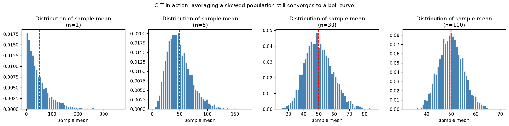

# Chapter 8: The Central Limit Theorem — The Secret Engine of Statistics

## The idea this chapter builds toward

Here it is, stated plainly: **if you take the average of a large enough number of independent random values — no matter what distribution those individual values came from — that average will be approximately Normally distributed.** This single fact (the **Central Limit Theorem**, or **CLT**) is why the Normal distribution from Chapter 6 shows up so relentlessly, and it is the mathematical justification for nearly every confidence interval and hypothesis test you'll learn in Chapters 9-13. Once you've internalized this chapter, those later chapters stop looking like a list of arbitrary rules and start looking like consequences of one idea, applied repeatedly.

## Stating it more precisely

Suppose you have $n$ independent observations $X_1, X_2, \ldots, X_n$, each drawn from *the same* distribution (any distribution — skewed, lumpy, uniform, whatever — as long as it has a finite mean $\mu$ and variance $\sigma^2$). Define the sample mean $\bar{X} = \frac{1}{n}\sum X_i$. The CLT says that as $n$ grows large:

$$\bar{X} \approx N\left(\mu, \frac{\sigma^2}{n}\right)$$

Two separate claims are packed into this:
1. **The shape becomes Normal** — regardless of the original distribution's shape, even if it's heavily skewed or even bimodal (two humps).
2. **The spread shrinks as $1/\sqrt{n}$** — specifically, the standard deviation of $\bar{X}$ (called the **standard error**) is $\frac{\sigma}{\sqrt{n}}$. This is why you saw, back in Chapter 1's code, the sample-mean histograms getting narrower and narrower as sample size grew from 5 to 30 to 200 — that shrinkage follows this exact $\frac{\sigma}{\sqrt n}$ formula.

## Why does averaging make things *more* Normal? (the real intuition)

Here's the non-rigorous but genuinely correct intuition. Imagine you're averaging several independent random values, each of which might be unusually high or unusually low purely by chance. For the *average* to end up far from the true mean, you'd need *most* of those random values to happen to be unusually high (or unusually low) *at the same time* — and the more values you're averaging, the less likely that coordinated coincidence becomes, because each value's randomness is independent of the others. Extreme values pulling in *opposite* directions tend to cancel out in the average, while only "most values moderately agree in direction" produces an extreme average — and there are vastly more ways for values to roughly balance out near the center than there are ways for them to all conspire in the same extreme direction. This "many ways to end up near the middle, few ways to end up in the tails" structure is exactly what produces a bell shape, regardless of what the original per-value distribution looked like. This is also why outcomes influenced by many small independent causes (height, measurement noise, IQ, accumulated rounding error) tend to look Normal in nature even when no individual cause is Normally distributed.

## The backstory — from de Moivre's lucky accident to a universal law

You already met the seed of this theorem in Chapter 6: de Moivre's 1733 discovery that Binomial probabilities, for large $n$, collapse into a bell-curve shape. For a long time this was treated as a quirky fact about the specific Binomial distribution, not a universal law. **Pierre-Simon Laplace**, around 1810, made the crucial generalizing leap: he showed that the *same* bell-curve-emerges-from-averaging phenomenon happens not just for Binomial sums, but for sums of essentially *any* independent random quantities with finite variance — a dramatically more powerful and surprising claim, because it says the *individual* ingredients being summed can look like almost anything (skewed, lumpy, bounded, whatever), and the sum/average still converges to the one universal Gaussian shape. This explains why the CLT felt almost magical to the mathematicians who proved its full generality later (notably Aleksandr Lyapunov in 1901, who nailed down precise technical conditions under which it holds) — it is a genuinely rare thing in mathematics for wildly different starting ingredients to all funnel toward one identical destination shape.

The name "Central Limit Theorem" itself is comparatively recent — coined by the Hungarian/German mathematician **George Pólya** in 1920, where "central" refers to the theorem's *central importance* to probability theory, not (as people sometimes assume) to the "center" of a distribution. Pólya's naming stuck precisely because, by the 1920s, statisticians had realized this single theorem was the load-bearing wall underneath nearly the entire edifice of inferential statistics being built around it (confidence intervals, hypothesis tests) — which is exactly the role it's playing for you in this book, three chapters before you formally meet those tools.

## Why "large enough n" and what that means practically

The CLT is an asymptotic statement (true in the *limit* as $n \to \infty$), but in practice it kicks in surprisingly fast. Rule of thumb often cited: $n \ge 30$ is "usually enough" for the sample mean to look convincingly Normal, *unless* the original distribution is extremely skewed or has very heavy tails, in which case you need larger $n$. If the original distribution is *already* Normal, then $\bar{X}$ is *exactly* Normal for any $n$, even $n=2$ — no "large enough" needed at all, because averaging Normal variables always produces another Normal variable exactly (a special property of the Normal distribution, not shared by most distributions).

## Why this matters: the CLT is the hidden justification behind...

- **Confidence intervals** (Chapter 11): built by assuming $\bar{X}$ is approximately Normal, then using the 68-95-99.7 rule (Chapter 6) around it.
- **Hypothesis testing / p-values** (Chapter 12): the entire logic of "how surprising is this sample mean if the null hypothesis were true" depends on knowing the Normal-ish shape and spread ($\sigma/\sqrt n$) of the sampling distribution of the mean.
- **Why larger samples give tighter, more trustworthy estimates**: directly from the $\sigma/\sqrt{n}$ shrinkage — to cut your uncertainty in half, you need **4x** the data, not 2x (because of the square root), a fact with real budget/time implications whenever you're deciding how much data to collect for an experiment or how large a validation set needs to be to trust a measured accuracy.
- **Why averaging predictions from multiple models (ensembling) reduces variance**: an ensemble's prediction is itself an average of several (hopefully semi-independent) models' outputs — the exact same $1/\sqrt{n}$-type variance reduction applies, which is part of why techniques like bagging and random forests work.

## A worked numeric sanity check

Suppose a strongly right-skewed distribution (like the income example in Chapter 2) has true mean $\mu = 50$ and true standard deviation $\sigma = 40$ (individual incomes vary a lot and skew high). If you average a sample of $n=100$ such incomes, the CLT predicts:

$$\bar{X} \approx N\left(50, \frac{40^2}{100}\right) = N(50, 16) \implies \text{standard error} = \sqrt{16} = 4$$

So even though any *single* income might be wildly off from 50 (the underlying distribution is skewed with $\sigma=40$), the *average* of 100 incomes should reliably land within about $\pm 8$ (2 standard errors) of 50 — a dramatically tighter and more Normal-looking quantity than the raw data, *despite the raw data being badly skewed*. This is the CLT's power in one sentence: averaging tames skew.

<div class="labcard">
<div class="labkicker">Live — watch any population shape become a bell curve</div>
<div class="labrow">
  <select id="ch08_shape">
    <option value="uniform">Uniform (flat)</option>
    <option value="exponential" selected>Exponential (heavily skewed)</option>
    <option value="bimodal">Bimodal (two humps)</option>
  </select>
</div>
<div class="labcontrols">
  <div class="labctrl"><label>Sample size (n) <b id="ch08_n_label">5</b></label><input type="range" id="ch08_n" min="1" max="200" value="5"></div>
  <div class="labctrl"><label>Samples to draw <b id="ch08_reps_label">2000</b></label><input type="range" id="ch08_reps" min="100" max="5000" step="100" value="2000"></div>
</div>
<div class="labrow"><button class="labbtn" id="ch08_run">Run simulation</button></div>
<div class="labcanvas-wrap"><canvas id="ch08_pop" width="820" height="140"></canvas></div>
<div class="labcanvas-wrap" style="margin-top:12px;"><canvas id="ch08_canvas" width="820" height="240"></canvas></div>
<p class="labnote">Top: the population's own shape (deliberately not bell-shaped). Bottom: the distribution of the sample mean. Try n=1 first (it just replays the raw population), then push n to 30, 50, 200.</p>
</div>
<script>
document.addEventListener('DOMContentLoaded', function(){
  var SL = window.StatsLab;
  function samplePop(shape){
    var r = Math.random();
    if(shape==='uniform') return Math.random()*10;
    if(shape==='exponential') return -Math.log(1-Math.random())*3;
    if(shape==='bimodal') return r<0.5 ? SL.randNormal(2,1) : SL.randNormal(8,1);
  }
  function popRange(shape){
    if(shape==='uniform') return [0,10];
    if(shape==='exponential') return [0,25];
    if(shape==='bimodal') return [-2,12];
  }
  function drawPopShape(){
    var shape = document.getElementById('ch08_shape').value;
    var data = []; for(var i=0;i<20000;i++) data.push(samplePop(shape));
    var range = popRange(shape);
    var bins = SL.histogram(data, 50, range);
    var maxC = Math.max.apply(null, bins.map(function(b){return b[1];}));
    var plot = SL.makePlot(document.getElementById('ch08_pop'), {l:50,r:20,t:10,b:28});
    plot.setDomain(range,[0,maxC*1.15]); plot.clear(); plot.axes('value','');
    plot.bars(bins.map(function(b){return [b[0],b[1]];}), SL.colors.border, 0.95);
  }
  function runSim(){
    var shape = document.getElementById('ch08_shape').value;
    var n = parseInt(document.getElementById('ch08_n').value);
    var reps = parseInt(document.getElementById('ch08_reps').value);
    var sampleMeans = [];
    for(var r=0;r<reps;r++){
      var s=0; for(var i=0;i<n;i++) s += samplePop(shape);
      sampleMeans.push(s/n);
    }
    var lo = Math.min.apply(null,sampleMeans), hi = Math.max.apply(null,sampleMeans);
    var bins = SL.histogram(sampleMeans, 40, [lo,hi]);
    var maxC = Math.max.apply(null, bins.map(function(b){return b[1];}));
    var plot = SL.makePlot(document.getElementById('ch08_canvas'));
    plot.setDomain([lo,hi],[0,maxC*1.15]); plot.clear(); plot.axes('sample mean','frequency');
    plot.bars(bins.map(function(b){return [b[0],b[1]];}), SL.colors.accent, 0.9);
  }
  document.getElementById('ch08_shape').addEventListener('change', function(){ drawPopShape(); runSim(); });
  document.getElementById('ch08_n').addEventListener('input', function(e){ document.getElementById('ch08_n_label').textContent = e.target.value; });
  document.getElementById('ch08_reps').addEventListener('input', function(e){ document.getElementById('ch08_reps_label').textContent = e.target.value; });
  document.getElementById('ch08_run').addEventListener('click', runSim);
  drawPopShape(); runSim();
});
</script>

## More real-world examples of the CLT in action

- **Polling/elections**: a poll of 1,000 randomly selected voters produces a sample proportion that is approximately Normally distributed around the true population proportion, *regardless* of how the underlying individual opinions are "distributed" (opinions aren't numeric/Normal at all — but the sample proportion, an average of many 0/1 votes, still obeys the CLT) — this is the direct justification for the "margin of error" reported alongside every poll.
- **Manufacturing**: the average weight of items in a box of 24 cereal boxes is far more tightly controlled (lower variance) than any single box's weight, even if individual box weights vary quite a bit — exactly why bulk/batch quality control measures often look at batch averages rather than single-unit measurements.
- **Casinos**: a single hand of blackjack is highly random, but a casino's *average* profit per hand across millions of hands per year is extremely stable and predictable — the house edge (a small negative expected value per hand, Chapter 7's expectation concept) combined with the CLT's shrinking standard error over huge $n$ is literally the entire business model of a casino.
- **ML model evaluation**: your measured test-set accuracy is itself a sample proportion (average of many 0/1 correct/incorrect outcomes) — the CLT is exactly why a larger test set gives you a tighter, more trustworthy estimate of true model performance, a point we'll make numerically precise in Chapter 11.

## Figures



*Starting from a heavily right-skewed exponential population, the distribution of the sample mean becomes an increasingly clean bell curve as sample size n grows from 1 to 100.*

## Run it yourself

`book/code/ch08_central_limit_theorem.py` starts from a deliberately *not* Normal population (a heavily right-skewed exponential-like distribution), then draws thousands of samples at increasing sample sizes (n=1, 5, 30, 100) and plots the resulting distribution of sample means at each size. Watch the shape morph from clearly skewed (n=1, which is literally just the raw population) into an increasingly clean, narrow bell curve — visual, undeniable proof of the CLT in action, using a distribution that starts as far from "Normal" as reasonably possible.

```bash
python book/code/ch08_central_limit_theorem.py
```

## Why This Matters — In AI and In Everyday Life

**In AI / machine learning:**

- **Trusting a validation accuracy number**: a larger validation/test set gives a tighter, more trustworthy estimate of true model performance, directly because of the CLT's shrinking standard error.
- **Ensembling**: averaging predictions from several semi-independent models reduces variance for the same $1/\sqrt n$ reason the sample mean's spread shrinks -- the statistical justification behind bagging and random forests.

**In everyday, non-AI life:**

- **Casinos**: a single hand of blackjack is wildly random, but a casino's profit *averaged* over millions of hands per year is remarkably stable and predictable -- the entire business model rests on the CLT.
- **Manufacturing batch averages**: the average weight of a 24-pack of cereal boxes is far more tightly controlled than any single box's weight, which is why quality control often checks batch averages.

## Check your understanding

- Why does the standard error use $\sqrt{n}$ in the denominator instead of just $n$ — what would change about the "4x data to halve uncertainty" fact if it were $n$ instead of $\sqrt{n}$?
- If the original population is already perfectly Normal, do you need the CLT at all to say $\bar{X}$ is Normal? Why or why not?
- In your own words, why does averaging independent random values tend to cancel out extremes rather than amplify them?

## What's next

With the CLT in hand, Chapter 9 formally defines what an **estimator** is, what makes one "good" (bias, variance, consistency), and connects the sample mean's known behavior (from this chapter) to the general machinery of statistical estimation — the direct prerequisite for confidence intervals and hypothesis testing.
