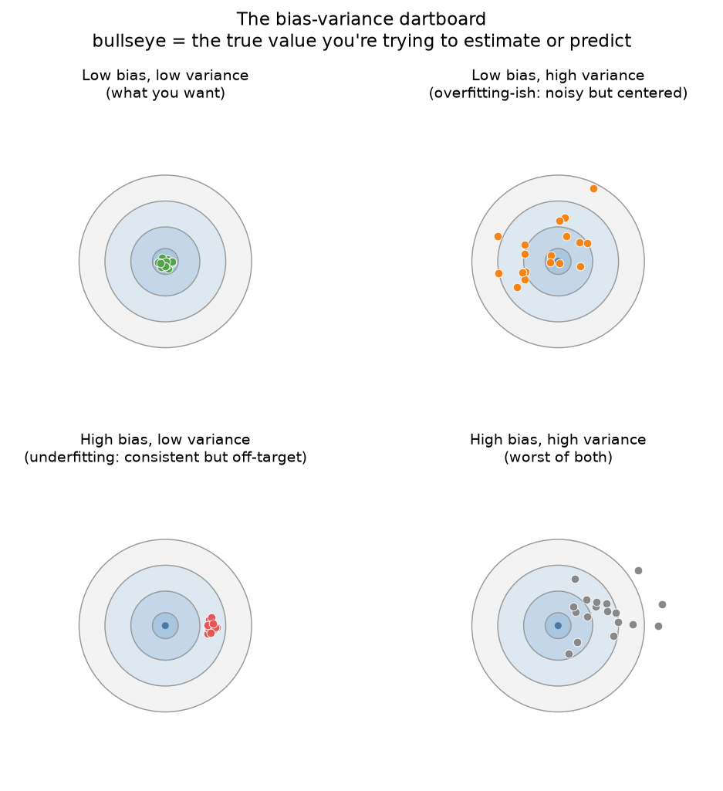

# Chapter 9: Sampling and Estimation

## The idea this chapter builds toward

An **estimator** is a *rule/formula* you apply to sample data to guess at an unknown population parameter (Chapter 1's $\mu$ vs $\bar{x}$ distinction, now made rigorous). Not all estimators are equally good - this chapter gives you precise language (bias, variance, consistency, efficiency) for comparing them, which matters because an entire area of statistics and ML (from "why divide by $n-1$" in Chapter 2, to "why regularize" in Chapter 16) is really arguments about which estimator to trust.

> **Intuition, in one breath:** An estimator is just a recipe for guessing, and the only two things that can go wrong with a guess are being aimed at the wrong spot on average (bias) and being wild from one try to the next (variance). You want a recipe that's centered correctly and steady.

## Estimator vs. estimate - a small but important distinction

An **estimator** is the general *procedure* (e.g., "take the sample average" - a formula, $\hat\mu = \bar X = \frac1n\sum X_i$). An **estimate** is the specific *number* you get when you apply that procedure to one particular dataset (e.g., "32.25," from Chapter 1's example). The hat symbol ($\hat\theta$, "theta-hat") is standard notation for "an estimator or estimate of the true parameter $\theta$."

Because an estimator is a formula applied to *random* sample data, the estimator itself is a **random variable** - it has its own distribution (its "sampling distribution"), exactly what Chapter 8's CLT described for the sample mean specifically.

## What makes an estimator "good"? Three properties

### 1. Bias

$$\text{Bias}(\hat\theta) = E[\hat\theta] - \theta$$

**Intuition**: if you ran your estimation procedure over and over on many different samples, would the *average* of all those estimates converge to the true value, or would it systematically overshoot/undershoot? An estimator is **unbiased** if $E[\hat\theta] = \theta$ exactly - no systematic error, even though any *single* estimate will still be off due to sampling randomness.

This is exactly why Chapter 2 divides sample variance by $n-1$ instead of $n$: dividing by plain $n$ produces an estimator whose *average* value across many samples is systematically a bit too small (biased low) - dividing by $n-1$ corrects that bias to exactly zero. You can now see "Bessel's correction" for what it really is: a bias-correction derived directly from this chapter's definition.

### 2. Variance (of the estimator)

How much does the estimate bounce around from sample to sample (exactly what Chapter 1's visualization showed, and what Chapter 8's standard error, $\sigma/\sqrt n$, quantifies for the sample mean specifically). Low variance means your estimates are consistent/stable across different samples, even if (hypothetically) biased.

### 3. The bias-variance tradeoff - a first preview

You generally cannot minimize bias and variance simultaneously beyond a point - pushing one down can push the other up. A silly but illustrative extreme estimator: "always guess the number 50, no matter what data you see." This has zero variance (always the same answer!) but is almost certainly badly biased (unless the truth happens to be exactly 50). Meanwhile $\bar X$ has zero bias but nonzero variance. Which is "better" depends on the relative sizes of the two errors - a question we'll return to with real teeth in Chapter 16, where this exact tradeoff explains overfitting vs underfitting in machine learning models.



*The classic picture for this tradeoff: the bullseye is the true value you're trying to hit. **Bias** is whether your throws are centered on the bullseye on average (top row vs. bottom row). **Variance** is how scattered your throws are around wherever they're centered (left column vs. right column). Top-left is what every estimator wants to be; the other three panels are the specific, distinct ways an estimator can fail - and they require different fixes, which is exactly why "it's a little off" is never a complete diagnosis without knowing whether the problem is bias, variance, or both.*

### 4. Consistency

An estimator is **consistent** if, as sample size $n \to \infty$, the estimate converges to the true value with probability approaching 1 (i.e., with enough data, you're essentially guaranteed to get arbitrarily close to the truth). $\bar X$ is consistent - this is a direct consequence of the CLT's shrinking standard error ($\sigma/\sqrt n \to 0$ as $n \to \infty$) combined with being unbiased.

### Reconstructing it yourself - proving bias and variance are the *only* two ways an estimator's error can arise

This chapter has been asserting that an estimator's quality comes down to bias and variance, as if those were two independent, separately-chosen properties. **If your guess is that there's a single formula that mechanically forces total error to split into exactly those two pieces and nothing else - derive it.** Define the estimator's **mean squared error**, $MSE(\hat\theta) = E[(\hat\theta-\theta)^2]$ - the average squared gap between your estimator and the true value $\theta$, across many hypothetical repeated samples. Add and subtract $E[\hat\theta]$ inside the square (a classic "add zero in a useful form" trick used constantly in statistics proofs):

$$(\hat\theta - \theta)^2 = \big((\hat\theta - E[\hat\theta]) + (E[\hat\theta]-\theta)\big)^2$$

Expand this as $(a+b)^2 = a^2+2ab+b^2$ with $a=\hat\theta-E[\hat\theta]$ and $b=E[\hat\theta]-\theta$, then take $E[\cdot]$ of the whole thing:

$$MSE(\hat\theta) = E\big[(\hat\theta-E[\hat\theta])^2\big] + 2\,E[\hat\theta-E[\hat\theta]]\cdot(E[\hat\theta]-\theta) + (E[\hat\theta]-\theta)^2$$

The middle term vanishes completely: $E[\hat\theta - E[\hat\theta]] = E[\hat\theta]-E[\hat\theta] = 0$ (an estimator's deviation from its own average is, on average, exactly zero - by definition of what "average" means), so that whole middle piece is multiplied by zero. What survives is:

$$MSE(\hat\theta) = \underbrace{E\big[(\hat\theta-E[\hat\theta])^2\big]}_{\text{Variance}} + \underbrace{(E[\hat\theta]-\theta)^2}_{\text{Bias}^2}$$

**Total error is forced, by pure algebra, to decompose into exactly variance plus squared bias - there is no third term, and there is no way for any other kind of error to sneak in.** This is the identical algebraic move (add-and-subtract-the-mean, expand, watch the cross term vanish) that produces the fuller bias-variance-plus-irreducible-error decomposition for a full predictive model in Chapter 16 - same proof, just applied one level up, to a trained model's predictions instead of a single estimator's value.

## Good vs. bad estimators: a concrete comparison

Suppose you want to estimate the "center" of a dataset. Candidate estimators: the sample mean, the sample median, or "just the first data point you happened to collect."

- **Sample mean**: unbiased for a symmetric distribution, low variance when $n$ is large (shrinks like $1/\sqrt n$), consistent. Generally a strong default.
- **Sample median**: also often unbiased for symmetric distributions, slightly *higher* variance than the mean when data is close to Normal, but far more **robust** to outliers (recall Chapter 2's income example) - so the "better" choice depends on whether your data has heavy outliers.
- **"First data point you collected"**: technically unbiased (its expected value equals the population mean, since it's a single random draw from the population)! But its variance is $\sigma^2$ - the *full* population variance, not shrunk at all by averaging, and it does **not** improve as you collect more data (collecting more data just means you're ignoring most of it). This is **inconsistent** in practice despite technically being unbiased - a good illustration that "unbiased" alone is not enough to make an estimator good; you need low variance (or consistency) too.

## The standard error, generalized

Chapter 8 gave you the standard error of the mean specifically: $SE(\bar X) = \sigma/\sqrt n$. More generally, the **standard error of an estimator** is just the standard deviation of its sampling distribution - "how much does this specific estimator bounce around across different samples of this size." Every estimator has its own standard error formula; the mean's happens to be the clean $\sigma/\sqrt n$ one because of the CLT, but other estimators (like the median, or a regression coefficient in Chapter 14) have their own, sometimes more complex, standard error formulas. The *concept* - "quantify how much this number would change if we re-sampled" - is universal and is exactly what feeds into confidence intervals (Chapter 11).

## The backstory - Ronald Fisher turns "estimation" into a rigorous science

Before the 1920s, statisticians used estimators somewhat informally - "take the average," "take the middle value" - without a crisp, general theory for comparing *why* one choice might be better than another. **Ronald A. Fisher**, working largely in the 1910s-20s (notably while analyzing decades of agricultural crop-yield data at the Rothamsted Experimental Station in England - the same work that leads directly into ANOVA in Chapter 13), set out to formalize exactly this comparison problem. He introduced much of the vocabulary you just learned - consistency, efficiency, and especially **sufficiency** (a related idea: does an estimator retain *all* the useful information in the data, or does it throw some away?) - as part of building statistics into a mathematically rigorous discipline rather than a bag of ad hoc recipes.

Fisher's motivating puzzle, worth sitting with because it's a genuinely good intuition-builder: given two different *unbiased* estimators for the same parameter, how do you decide which is "better" if both are correct on average? His answer was variance - of two unbiased estimators, prefer the one that varies *less* across hypothetical repeated samples (this is literally the definition of **efficiency**: an "efficient" estimator is the lowest-variance one among the unbiased options). This is exactly why, when choosing between the sample mean and sample median as an estimator of a Normal distribution's center (both unbiased for symmetric data), statisticians default to the mean - it has strictly lower variance for Normal data specifically (though, as the "income" example in Chapter 2 hints, the median's extra variance is often a worthwhile price to pay for robustness against outliers in non-Normal, real-world data - a tradeoff Fisher's clean theoretical framework doesn't automatically resolve for you, and still requires human judgment about your actual data).

## Why this matters for ML directly

Every number a model outputs or reports - a trained weight, a measured test accuracy, an estimated feature importance - is an *estimate* with its own bias and variance, even though ML practice often forgets to report it. "This model gets 94% accuracy" is itself an estimate of the model's *true* accuracy on the full population of possible inputs, with its own standard error depending on test-set size - reporting a bare accuracy number without any sense of its uncertainty is exactly the mistake this chapter is designed to prevent you from making unknowingly.

## Figures


*Sampling distributions of three estimators (sample mean, sample median, first data point) across three sample sizes. The red dashed line marks the true population mean -- compare how tightly each estimator clusters around it.*

## Run it yourself

`book/code/ch09_sampling_and_estimation.py` compares the three "center" estimators above (mean, median, first-data-point) across many repeated samples from a known population, computing each estimator's empirical bias and variance directly, and visualizing how each one's sampling distribution narrows (or doesn't) as sample size grows.

```bash
python book/code/ch09_sampling_and_estimation.py
```

## Why This Matters - In AI and In Everyday Life

**In AI / machine learning:**

- **Judging a reported model metric**: "91% accuracy" is an estimator's output with its own bias and variance -- this chapter is exactly what should make you ask what sample size and sampling procedure produced that number.
- **Biased training data as a biased estimator**: if your labeled training data was collected in a way that systematically over- or under-represents certain cases, your model's learned parameters inherit that bias, in the precise sense defined in this chapter.
- **Estimator variance in LLM evaluation**: every benchmark score for a transformer is a sample estimate whose standard error shrinks like $1/\sqrt n$ - which is exactly why leaderboards built on a few hundred evaluation prompts have wide error bars, and why a two-point gap between two models can be pure sampling noise rather than a real capability difference.
- **Bias-variance thinking in fine-tuning and regularization**: weight decay and early stopping during gradient-descent training are literally attempts to trade a small amount of bias for a large reduction in estimator variance, this chapter's central decomposition reappearing one level up at the level of trained model parameters.

**In everyday, non-AI life:**

- **Choosing between average and median home price**: realtors and the median-vs-mean choice directly reflects which estimator (Chapter 2's robustness argument, Chapter 9's variance/bias tradeoff) better represents "typical."
- **Government economic statistics**: unemployment rate and inflation figures are estimators computed from surveys, each with a known margin of error that government statisticians report alongside the headline number.

## Worked example - by hand, larger

A team deploys a spam classifier and wants to estimate its true accuracy on the whole population of incoming email. They hold out a test set of $n = 25$ labeled emails and count how many the model gets right.

This is a case where the estimator is a *proportion* and we can compute its bias and variance directly. Let $X_i = 1$ if email $i$ is classified correctly, $0$ otherwise, with $X_i \sim \text{Bernoulli}(p)$ where $p$ is the unknown true accuracy. The sample proportion is $\hat p = \frac{1}{n}\sum X_i$. Suppose the test set yields 22 correct out of 25, so $\hat p = 22/25 = 0.88$.

**Step 1 - is $\hat p$ unbiased?** Since $E[X_i] = p$, linearity of expectation gives $E[\hat p] = \frac{1}{n}\sum E[X_i] = \frac{1}{n}(np) = p$. Bias $= E[\hat p] - p = 0$ exactly. So $\hat p$ is unbiased for the true accuracy $p$ no matter what $p$ is.

**Step 2 - what is its variance?** For independent Bernoulli trials, $\text{Var}(X_i) = p(1-p)$, so $\text{Var}(\hat p) = \frac{1}{n^2}(n\,p(1-p)) = \frac{p(1-p)}{n}$. The standard error is the square root: $SE(\hat p) = \sqrt{\frac{p(1-p)}{n}}$. Plugging in the estimate, $SE \approx \sqrt{\frac{0.88 \times 0.12}{25}} = \sqrt{\frac{0.1056}{25}} = \sqrt{0.004224} \approx 0.065$.

**Step 3 - total error via the MSE decomposition.** From this chapter's proof, $MSE = \text{Variance} + \text{Bias}^2 = 0.004224 + 0 = 0.004224$, i.e. an RMSE of about 0.065 accuracy points. So "88% accuracy" is really "88% ± 6.5 percentage points" - a huge band driven entirely by $n=25$ being small. Quadrupling the test set to $n=100$ would halve that standard error to about 0.032, because $SE$ shrinks like $1/\sqrt n$.

Contrast this with a *biased* estimator of the same quantity: if the test set had been built by sampling only "easy" emails, the errors would no longer be Bernoulli$(p)$ for the real population, and $E[\hat p] \neq p$ - the estimate would be systematically high regardless of how large $n$ grew. **In one line: an unbiased estimator's error shrinks purely with sample size, while a biased one keeps its built-in offset forever, which is why "how big was the test set?" and "was it sampled fairly?" are two different questions you must both ask.** Takeaway: report both the point estimate and its standard error, and remember that increasing $n$ fixes only the variance half of the error - never the bias half.

## Check your understanding

- Explain why "always guess 50" has zero variance but is (usually) badly biased, and why "sample mean" is the reverse tradeoff.
- Why is the "first data point" estimator unbiased yet still a bad choice in practice?
- If someone reports "our model's accuracy is 91%" with no other information, what question from this chapter should you immediately ask?

## Exercises

### Exercise 1 - Bias of "divide by n" variance
A tiny dataset of $n = 3$ latency measurements (in ms) is $[10, 12, 14]$. Consider the estimator $s^2_n = \frac{1}{n}\sum(X_i - \bar X)^2$ (dividing by $n$, not $n-1$). The true population variance is $\sigma^2$. Show that the bias of $s^2_n$ is $-\frac{1}{n}\sigma^2$, and compute the actual bias for this dataset if $\sigma^2 = 4$.

<details><summary>Show solution</summary>

It is a standard result (and the reason for Bessel's correction) that $E\big[\sum(X_i-\bar X)^2\big] = (n-1)\sigma^2$. Therefore

$$E[s^2_n] = E\left[\frac{1}{n}\sum(X_i-\bar X)^2\right] = \frac{(n-1)\sigma^2}{n} = \sigma^2\left(1 - \frac{1}{n}\right)$$

so the bias is

$$\text{Bias}(s^2_n) = E[s^2_n] - \sigma^2 = \sigma^2\left(1 - \frac{1}{n}\right) - \sigma^2 = -\frac{\sigma^2}{n}.$$

For $n=3$ and $\sigma^2 = 4$: bias $= -\frac{4}{3} \approx -1.333$. The estimator systematically *underestimates* the true variance. (As a numeric sanity check, the sample values give $\bar X = 12$ and $\sum(X_i-\bar X)^2 = 4+0+4 = 8$, so $s^2_n = 8/3 \approx 2.667$ versus the unbiased $s^2 = 8/2 = 4$ - the $n$ divisor is smaller by exactly the $\frac{1}{n}$ factor.)

</details>

### Exercise 2 - Does more data help a biased estimator?
A model's accuracy is measured on a benchmark that, by construction, systematically omits a hard class of inputs. The resulting estimator has bias $+0.03$ (three accuracy points too high) and variance $\frac{p(1-p)}{n}$ with $p=0.9$. As $n \to \infty$, what does the MSE approach? Does the estimate ever become trustworthy?

<details><summary>Show solution</summary>

The MSE decomposition is $MSE = \text{Variance} + \text{Bias}^2$. Here

$$MSE = \frac{p(1-p)}{n} + (0.03)^2 = \frac{0.09}{n} + 0.0009.$$

As $n \to \infty$, the variance term $\frac{0.09}{n} \to 0$, but the bias term stays pinned at $0.0009$. So

$$MSE \to 0.0009, \qquad \sqrt{MSE} \to 0.03.$$

The RMSE floors out at 0.03 - three accuracy points - no matter how much data you collect. The estimator is *inconsistent*: it converges to the wrong value. More data shrinks the variance but does nothing to the bias, so collecting a million examples on a biased benchmark just gives you a very precise wrong answer. The fix is not more data but a better sampling procedure.

</details>

### Exercise 3 - Conceptual: why the "first data point" is a trap
A colleague proposes estimating a model's average inference latency by timing a *single* request, arguing "it's an unbiased draw from the real distribution, so it's a valid estimator." In one or two sentences each, state what is right and what is fatal about this argument, and name the property the estimator lacks.

<details><summary>Show solution</summary>

What is right: the single draw is technically unbiased - its expected value equals the population mean latency, because it is a genuine random sample of size one.

What is fatal: its variance is the *entire* population variance $\sigma^2$, with no $1/\sqrt n$ shrinkage, and it does not improve as you collect more requests, because it throws all the extra data away. It also has no reduction in error from repeated use unless you re-draw each time (in which case you are just averaging, i.e. using the sample mean anyway).

The missing property: **consistency** - it does not converge to the true mean as sample size grows. Unbiasedness alone is not enough; you also need low variance or consistency, which is exactly the lesson this chapter's "first data point" estimator was built to teach.

</details>

## What's next

Chapter 10 introduces **Maximum Likelihood Estimation** - a single, general *principle* for constructing good estimators (rather than guessing formulas like "take the average" ad hoc), which turns out to be the exact same mathematical object as the "loss function" you minimize when training almost any machine learning model.
