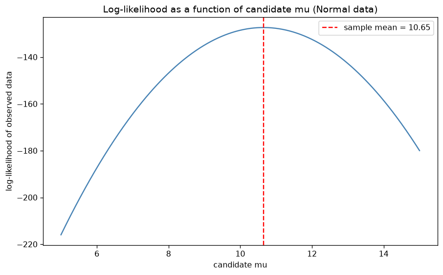

# Chapter 10: Maximum Likelihood Estimation

## The idea this chapter builds toward

Instead of guessing estimator formulas ad hoc ("let's just average the data" - why that formula and not another?), **Maximum Likelihood Estimation (MLE)** gives you a single, general *principle* for constructing the "best" estimator for any distribution's parameters: **pick the parameter values that make the data you actually observed as likely as possible.** This isn't just an abstract idea - it is, almost without exaggeration, the mathematical skeleton underneath how every standard machine learning loss function (mean squared error, cross-entropy, logistic loss) is derived. Understanding MLE is understanding *why* those specific loss functions were chosen, not just what they compute.

> **Intuition, in one breath:** Instead of asking "given a hypothesis, what data would I expect?", MLE flips the question and asks "given the data I actually saw, which hypothesis would have made it most unsurprising?" You then pick that hypothesis. It's reasoning backwards from evidence to explanation.

## The likelihood function - flipping probability around

Recall a distribution's PDF/PMF, $f(x \mid \theta)$, tells you the probability (density) of observing data value $x$, *given* a known parameter $\theta$ (like the mean $\mu$ or rate $\lambda$). The **likelihood function** flips the perspective: you now have *fixed, observed data*, and you treat $\theta$ as the unknown you're searching over:

$$L(\theta \mid x) = f(x \mid \theta)$$

Same formula, same numbers - but a different question. The PDF asks "given this $\theta$, how likely is this $x$?" The likelihood asks "given this $x$ (which already happened), how plausible is each candidate $\theta$?" This is exactly the $P(E\mid H)$-vs-$P(H\mid E)$ asymmetry from Chapter 4's Bayes' Theorem - likelihood is literally the $P(E \mid H)$ piece of that formula, just now applied with continuous parameters instead of two Bayes alternatives.

For multiple independent observations $x_1, \ldots, x_n$ (independence lets us multiply, from Chapter 3):

$$L(\theta \mid x_1,\ldots,x_n) = \prod_{i=1}^n f(x_i \mid \theta)$$

**MLE's principle**: find the $\hat\theta$ that maximizes $L(\theta)$ - the parameter value under which the data you actually saw was the *most probable* outcome.

## Why we take the log (and why this connects back to Chapter 0)

Multiplying many probabilities (each less than 1) together produces an extremely tiny number that underflows on a computer, and is hard to differentiate (take the derivative of, to find the maximum) by hand. Since $\log$ is a strictly increasing function (Chapter 0), the $\theta$ that maximizes $L(\theta)$ is the *exact same* $\theta$ that maximizes $\log L(\theta)$. So we maximize the **log-likelihood** instead:

$$\log L(\theta) = \sum_{i=1}^n \log f(x_i \mid \theta)$$

Using $\log(a\times b) = \log a + \log b$ from Chapter 0, the product has become a sum - numerically stable, and each term's derivative is manageable. This is why you will see "log-likelihood" instead of plain "likelihood" absolutely everywhere in statistics and ML - it is never a different concept, just the numerically sane way to work with the same quantity.

## Worked example: deriving that the sample mean IS the MLE for a Normal distribution's mean

This is one of the most satisfying derivations in this book, because it proves the formula you've been using since Chapter 2 wasn't arbitrary - it falls directly out of the MLE principle.

Suppose $x_1, \ldots, x_n$ are drawn independently from $N(\mu, \sigma^2)$ with $\sigma$ known, and we want the MLE for $\mu$. The log-likelihood (dropping the terms not involving $\mu$, since they don't affect which $\mu$ maximizes it) is:

$$\log L(\mu) = -\frac{1}{2\sigma^2}\sum_{i=1}^n (x_i - \mu)^2 + \text{constant}$$

To find the maximizing $\mu$, take the derivative with respect to $\mu$ and set it to zero (standard calculus move: at a maximum, the slope is flat):

$$\frac{d}{d\mu}\log L(\mu) = \frac{1}{\sigma^2}\sum_{i=1}^n (x_i - \mu) = 0$$

$$\implies \sum_{i=1}^n (x_i - \mu) = 0 \implies \sum x_i = n\mu \implies \mu = \frac{1}{n}\sum x_i = \bar x$$

**The MLE for the Normal mean is exactly the sample mean.** This isn't a coincidence or a separate justification - "take the average" was secretly "find the most likely parameter" the entire time, for any data that's roughly Normally distributed (and by the CLT from Chapter 8, that's an extremely common situation).

## The deeper payoff: MLE is why your loss functions look the way they do

### Mean Squared Error = Gaussian MLE

Look again at the expression we maximized above: $-\frac{1}{2\sigma^2}\sum(x_i-\mu)^2$. Maximizing this is the same as *minimizing* $\sum (x_i - \mu)^2$ - the **sum of squared errors**. This means: **assuming your prediction errors are Normally distributed, minimizing mean squared error (MSE) in a regression model is mathematically identical to maximizing likelihood.** This is *why* MSE was chosen as a standard regression loss - not an arbitrary convenient formula, but the MLE-correct choice under a Gaussian error assumption. (If your errors are *not* roughly Normal - e.g., heavy-tailed with occasional huge outlier errors - MSE is no longer the MLE-justified choice, and a different loss, like mean absolute error, may be more appropriate - a very practical modeling decision this derivation directly informs.)

### Cross-entropy loss = Bernoulli/Categorical MLE

For a binary classifier predicting probability $\hat p$ that a label is 1, assuming each label is a Bernoulli trial (Chapter 5) with that predicted probability, the likelihood of observing the true label $y \in \{0,1\}$ is $\hat p^{\,y}(1-\hat p)^{1-y}$. Taking the log and negating (convention: we minimize *negative* log-likelihood rather than maximize log-likelihood - same optimum, just flipped sign) gives exactly:

$$\text{loss} = -\big[y\log\hat p + (1-y)\log(1-\hat p)\big]$$

This is **binary cross-entropy loss** - the single most common loss function for classification in all of deep learning. It was not invented separately from statistics; it is the MLE-correct loss for a Bernoulli-distributed label, derived by the exact same recipe as MSE above, just with a different assumed distribution for the data. This is the single biggest "aha" this book offers: **choosing a loss function is secretly choosing a probability distribution for your data/errors, and the loss function is just its negative log-likelihood.** We'll return to this precise connection again in Chapter 25.

### Reconstructing it yourself - deriving that "count and divide" is the MLE for a coin's bias

Chapter 10 proved the Normal-mean case in full; let's close the loop on the Bernoulli/Binomial case referenced above and in Chapter 4's worked example, since it's the single most repeated MLE derivation in applied statistics. Suppose you observe $n$ independent coin flips with $k$ heads, and want the MLE for $p$, the true probability of heads. **If your intuition says the answer has to be $\hat p = k/n$ - the obvious "just count" estimate - prove it rather than assume it.**

The likelihood of observing exactly this sequence (in any specific order) is $L(p) = p^k(1-p)^{n-k}$ (each of the $k$ heads contributes a factor of $p$, each of the $n-k$ tails a factor of $1-p$ - the $\binom{n}{k}$ ordering count from Chapter 5 is a constant with respect to $p$ and can be dropped, since it doesn't affect which $p$ maximizes the expression). Take the log (Chapter 0's reason: turns the product into a sum, easy to differentiate):

$$\log L(p) = k\log p + (n-k)\log(1-p)$$

Differentiate with respect to $p$ and set to zero:

$$\frac{d}{dp}\log L(p) = \frac{k}{p} - \frac{n-k}{1-p} = 0$$

Multiply through by $p(1-p)$ to clear denominators: $k(1-p) = (n-k)p \implies k - kp = np - kp \implies k = np \implies p = \frac{k}{n}$.

**The MLE is exactly $\hat p = k/n$** - the "obviously correct" count-and-divide estimate turns out to be, once again, not an arbitrary convention but the precise output of the same maximize-the-likelihood machine that gave you the sample mean for Normal data. This is exactly the calculation underneath every reported "conversion rate," every A/B test's observed click-through rate, and - as Chapter 25 will make explicit - the Bernoulli half of every binary cross-entropy training loop.

## The backstory - Fisher's single unifying idea (1912, sharpened 1922)

As a 22-year-old undergraduate in 1912, Fisher wrote a short paper proposing what he then called the "method of the most probable value" - the same core idea you learned above, though he hadn't yet worked out its full theoretical justification. A decade later, in his landmark 1922 paper "On the Mathematical Foundations of Theoretical Statistics," he renamed it **maximum likelihood** and did something genuinely remarkable: he showed that this *single, general recipe* - "pick the parameter that makes the observed data most probable" - reproduces, as special cases, a whole scattering of previously separate, individually-derived estimation formulas that statisticians had cobbled together over the preceding century (including Gauss's least-squares approach from Chapter 6, and the sample proportion for Binomial data). Before Fisher, each distribution effectively needed its own bespoke, cleverly-reasoned estimator, discovered somewhat independently. After Fisher, you had one universal procedure that mechanically *generates* the right estimator for any distribution you can write a likelihood for - an enormous unification, philosophically similar to how Newton's laws of motion unified previously separate rules for falling bodies, planetary orbits, and pendulums into one framework. This is exactly why MLE, not some competing ad hoc principle, became the default estimation tool taught in every statistics course since - and exactly why, a century later, it turns out to be the same object underlying loss-function design in deep learning, a field Fisher could not have anticipated but whose mathematical bones he effectively built.

## MLE's known weaknesses (so you don't over-trust it)

MLE can overfit with small samples (it has no built-in preference for "simple" explanations - it will happily fit noise if that noise makes the observed data maximally likely) and it can behave badly for some distributions with small sample sizes (biased in finite samples, even though it's usually *asymptotically* unbiased and consistent as $n\to\infty$). The fix for the overfitting weakness - adding a preference for simpler/more plausible parameters - is exactly what Bayesian statistics (Chapter 17) and regularization (Chapter 16) formalize, by combining the likelihood with a *prior* belief (Chapter 4's Bayes' Theorem, reappearing here in a new costume).

## More real-world examples of MLE

- **Logistic regression** (binary classification): fits coefficients by maximizing the Bernoulli log-likelihood described above - every time you call `.fit()` on a logistic regression model, you're running MLE.
- **Language models**: training a next-word-prediction model by minimizing cross-entropy loss over a huge text corpus is, exactly, maximizing the likelihood of the observed training text under the model's predicted probability distribution over words - "the model that makes the real training data as unsurprising as possible" is a plain-English restatement of MLE.
- **Fitting a distribution to insurance claims data**: an actuary fitting, say, a Gamma distribution to historical claim sizes to estimate future risk uses MLE to find the Gamma parameters that make the observed claims history most probable.
- **A/B test conversion rate estimation**: the "obvious" estimator (observed conversions / total visitors) for a Binomial's $p$ is not a coincidence - it is exactly the MLE for Binomial data, derivable by the same log-likelihood-derivative-equals-zero recipe used above for the Normal mean.

## Figures



*The log-likelihood of Normal data as a function of candidate mu values. The peak sits exactly at the sample mean -- proof that the MLE for a Normal mean IS the sample mean.*

## Run it yourself

`book/code/ch10_maximum_likelihood_estimation.py` generates data from a known Normal distribution, plots the log-likelihood as a function of candidate $\mu$ values (so you can see the "hill" being climbed and confirm its peak sits exactly at $\bar x$), and then demonstrates the MSE-as-Gaussian-MLE connection concretely by fitting a simple linear regression two ways - once via `scipy.optimize` maximizing Gaussian log-likelihood directly, once via plain least-squares - and showing they land on identical parameters.

```bash
python book/code/ch10_maximum_likelihood_estimation.py
```

## Why This Matters - In AI and In Everyday Life

**In AI / machine learning:**

- **Every standard neural network loss function**: MSE, binary cross-entropy, and categorical cross-entropy are all literally negative log-likelihoods under a specific distributional assumption -- this chapter is the direct derivation of how deep learning training objectives were chosen.
- **Logistic regression and most classical ML model fitting**: calling `.fit()` on a logistic regression or many other classical models is, under the hood, running exactly the MLE recipe from this chapter.
- **Transformer language-model pretraining**: the cross-entropy objective used to train every large language model is literally the categorical MLE derived here - the model adjusts its weights to make the observed next tokens in the training corpus as probable as possible under its predicted distribution, so "pretraining" is maximum likelihood estimation at industrial scale.
- **Diffusion model training**: noising and denoising objectives in diffusion models reduce, under a Gaussian noise assumption, to a Gaussian MLE - minimizing the mean squared error between the true noise and the network's predicted noise. This chapter's "MSE is Gaussian MLE" identity is the statistical justification for that entire training recipe.

**In everyday, non-AI life:**

- **Estimating a true defect rate from inspected samples**: if you inspect 50 items and find 3 defective, the "obvious" estimate of 6% defect rate is literally the MLE for a Binomial parameter, derivable by this chapter's recipe.
- **Fitting any theoretical curve to real measurements**: an actuary fitting a claim-size distribution to historical insurance claims, or a physicist fitting a decay curve to measurements, is running MLE.

## Worked example - by hand, larger

Now a case the chapter has only referenced abstractly: deriving the MLE for a **Poisson rate** $\lambda$, the parameter behind "how many times per interval does this happen?" - exactly the quantity you estimate when modeling, say, the number of user sign-ups per hour or the number of errors a model makes per thousand requests. This is a different distribution from the Normal and Bernoulli cases above, so it is a genuine test that the *principle* is general, not a trick that only works for two examples.

Suppose you observe an autonomously running service and count the number of crashes in each of $n=5$ hours: counts $3, 1, 4, 2, 5$ (total $k = 15$ crashes across 5 hours). The Poisson PMF for a single count $x$ with rate $\lambda$ is $f(x\mid\lambda) = \frac{\lambda^x e^{-\lambda}}{x!}$.

**Step 1 - write the likelihood.** Independent observations let us multiply:

$$L(\lambda) = \prod_{i=1}^n \frac{\lambda^{x_i} e^{-\lambda}}{x_i!} = \frac{\lambda^{\sum x_i} e^{-n\lambda}}{\prod_i x_i!}$$

**Step 2 - take the log** (Chapter 10's reason: turn the product into a sum). Dropping the $\prod x_i!$ constant, since it does not involve $\lambda$:

$$\log L(\lambda) = \Big(\sum_i x_i\Big)\log\lambda - n\lambda + \text{constant} = 15\log\lambda - 5\lambda + \text{constant}.$$

**Step 3 - differentiate and set to zero.** Using $\frac{d}{d\lambda}\log\lambda = \frac{1}{\lambda}$:

$$\frac{d}{d\lambda}\log L(\lambda) = \frac{15}{\lambda} - 5 = 0.$$

**Step 4 - solve.** Multiply through by $\lambda$: $15 - 5\lambda = 0 \implies \lambda = \frac{15}{5} = 3$. The MLE for the Poisson rate is exactly the sample mean of the counts - $\hat\lambda = \bar x$, the same "just average the data" formula, now falling out of the same machine for a third distribution without any new special pleading. (You can confirm this is a maximum, not a minimum: $\frac{d^2}{d\lambda^2}\log L = -\frac{15}{\lambda^2} < 0$ everywhere positive.)

**The plain-language takeaway: whatever distribution you write a likelihood for, MLE hands you back the estimator that makes your observed data look the least surprising - and for the Poisson, that turns out to be the average count per interval, no different in spirit from the Normal mean or the coin's $k/n$.** This generality is the entire point: you learn one recipe, and it generates the right estimator for any distribution you can name.

## Check your understanding

- Why does maximizing $\log L(\theta)$ give the same answer as maximizing $L(\theta)$ directly?
- Walk through, in your own words, why setting the derivative of the log-likelihood to zero and solving gives $\mu = \bar x$ for Normal data.
- If someone tells you "we use MSE because it's the standard choice," what deeper statistical assumption are they implicitly making about their errors, according to this chapter?

## Exercises

### Exercise 1 - MLE for an exponential waiting time
A recommendation model's time-to-first-click (in seconds) for a stream of users is assumed Exponential with rate $\lambda$: $f(x\mid\lambda) = \lambda e^{-\lambda x}$. You observe $n = 4$ waiting times: $2, 3, 1, 6$ seconds. Derive the MLE for $\lambda$ by hand and give the numeric estimate.

<details><summary>Show solution</summary>

Write the likelihood for independent observations:

$$L(\lambda) = \prod_{i=1}^n \lambda e^{-\lambda x_i} = \lambda^n e^{-\lambda \sum_i x_i}.$$

Take the log:

$$\log L(\lambda) = n\log\lambda - \lambda\sum_i x_i = 4\log\lambda - 12\lambda.$$

Differentiate and set to zero:

$$\frac{d}{d\lambda}\log L(\lambda) = \frac{n}{\lambda} - \sum_i x_i = \frac{4}{\lambda} - 12 = 0 \implies \lambda = \frac{4}{12} = \frac{1}{3} \approx 0.333.$$

So the MLE is $\hat\lambda = 1/\bar x = n / \sum x_i$ - the reciprocal of the sample mean, which makes sense: a higher rate means shorter typical waits. Numerically $\hat\lambda = 0.333$ per second (one click about every 3 seconds on average). Confirm it's a maximum: $\frac{d^2}{d\lambda^2}\log L = -\frac{n}{\lambda^2} < 0$.

</details>

### Exercise 2 - Cross-entropy loss by hand on one example
A binary classifier outputs predicted probability $\hat p = 0.8$ for an item whose true label is $y = 1$. Compute the binary cross-entropy loss for this single example directly from its definition, then state what the loss would be if the same classifier had instead output $\hat p = 0.2$.

<details><summary>Show solution</summary>

Binary cross-entropy for one example is

$$\text{loss} = -\big[y\log\hat p + (1-y)\log(1-\hat p)\big].$$

With $y=1$, $\hat p=0.8$: the second term vanishes since $(1-y)=0$, leaving

$$\text{loss} = -\big[1\cdot\log 0.8\big] = -\log 0.8 \approx -(-0.2231) = 0.2231.$$

With the same $y=1$ but $\hat p = 0.2$:

$$\text{loss} = -\log 0.2 \approx 1.6094.$$

The loss is dramatically higher when the classifier confidently predicts the *wrong* class - this is exactly the negative log-likelihood this chapter derived, and it is precisely why confidently wrong predictions get heavily punished during training: the gradient of $-\log$ becomes enormous as $\hat p \to 0$.

</details>

### Exercise 3 - Conceptual: why MLE has no built-in preference for simplicity
This chapter notes MLE "has no built-in preference for simple explanations - it will happily fit noise if that noise makes the observed data maximally likely." In the language of the MSE/overfitting discussion (Chapter 15), explain why this directly motivates adding a regularization penalty term, and what the penalty is doing in likelihood terms.

<details><summary>Show solution</summary>

MLE maximizes $L(\theta)$ (equivalently minimizes negative log-likelihood) with respect to the data alone. Given enough free parameters, the maximizer will chase *any* pattern in the observed sample - including patterns that are pure sampling noise - because doing so genuinely makes that specific dataset more probable. Nothing in the objective says "prefer the parameter value that would also explain a *different* sample from the same population."

Regularization adds a penalty $\lambda R(\theta)$ to the negative log-likelihood, so the objective becomes $\text{loss} = -\log L(\theta) + \lambda R(\theta)$. In likelihood terms, that penalty is formally equivalent to a prior distribution on $\theta$ - which is exactly Bayesian MAP estimation (Chapter 17): penalizing large weights corresponds to a Gaussian prior, penalizing absolute weights corresponds to a Laplace prior. The penalty *biases* the estimate toward simpler parameters, accepting a small amount of bias in exchange for a large reduction in variance, i.e. less overfitting - the bias-variance tradeoff of Chapter 9, now expressed as a prior.

</details>

## What's next

Chapter 11 uses the CLT (Chapter 8) plus the sample mean's known standard error (Chapter 9) to build **confidence intervals** - a precise way to express "how wrong might this estimate be" rather than reporting a single bare number.
