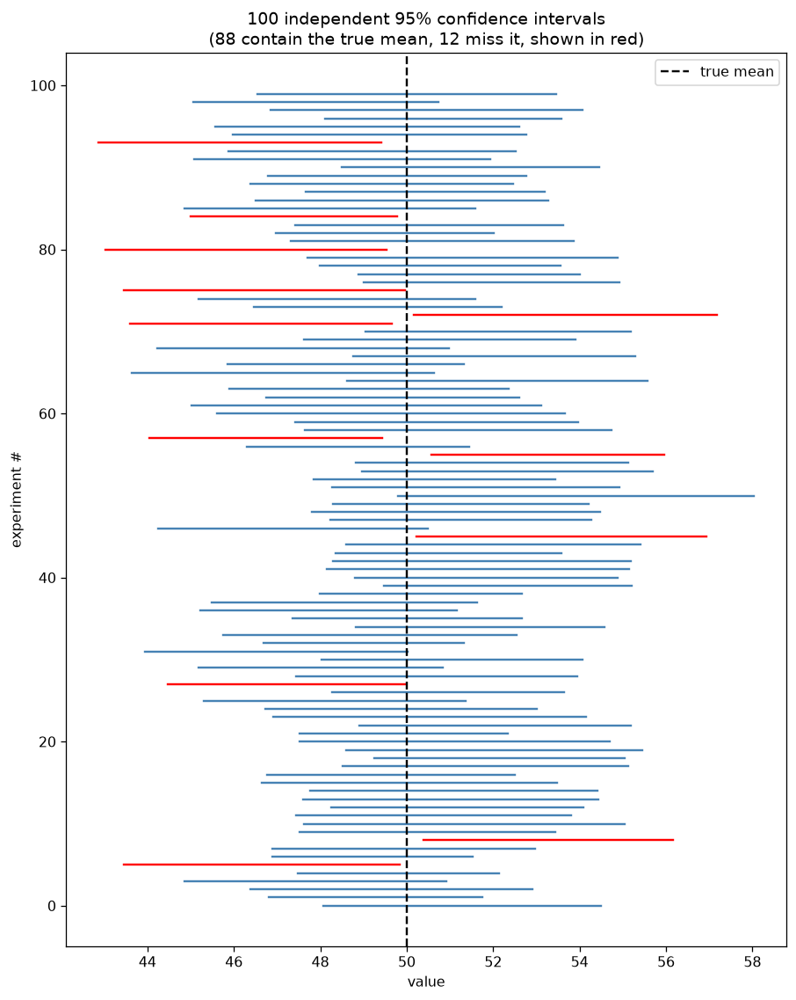

# Chapter 11: Confidence Intervals

## The idea this chapter builds toward

A single estimate like "$\bar x = 32.25$" (Chapter 1) hides how uncertain it is. A **confidence interval** reports a *range* of plausible values for the true parameter, built directly from the CLT (Chapter 8) and the estimator's standard error (Chapter 9), along with a precise (and commonly misunderstood) statement of how much to trust that range.

> **Intuition, in one breath:** A single number pretends to be certain, but it isn't. A confidence interval is that number wrapped in an honest error bar - a net wide enough that, if you cast it over and over, it catches the truth a set percentage of the time. More confidence means a wider net.

## Building the interval from pieces you already have

From Chapter 8, we know that for large enough $n$:

$$\bar X \approx N\left(\mu, \left(\frac{\sigma}{\sqrt n}\right)^2\right)$$

From Chapter 6's z-score idea, standardizing $\bar X$ gives $Z = \frac{\bar X - \mu}{\sigma/\sqrt n} \approx N(0,1)$. From the 68-95-99.7 rule, 95% of a Standard Normal distribution's mass lies between $z=-1.96$ and $z=+1.96$ (1.96 is just the precise version of "about 2" from the 95% rule of thumb). So, with 95% probability:

$$-1.96 \le \frac{\bar X - \mu}{\sigma/\sqrt n} \le 1.96$$

Rearranging this inequality to isolate $\mu$ in the middle (pure algebra - multiply through by $\sigma/\sqrt n$, then subtract $\bar X$ and flip signs):

$$\bar X - 1.96\frac{\sigma}{\sqrt n} \;\le\; \mu \;\le\; \bar X + 1.96\frac{\sigma}{\sqrt n}$$

That's the 95% confidence interval for $\mu$:

$$\text{CI} = \bar X \pm 1.96 \times SE, \qquad SE = \frac{\sigma}{\sqrt n}$$

Every confidence interval you'll ever see has this same anatomy: **point estimate ± (critical value) × (standard error)**. The "critical value" (1.96 here) just depends on how confident you want to be - 90% confidence uses 1.645, 99% confidence uses 2.576 (these come from the same Standard Normal table, just asking for different amounts of central area).

### What if you don't know $\sigma$? (the realistic case - the t-distribution)

In the formula above we assumed $\sigma$ (the true population standard deviation) was known. In real life, you almost never know $\sigma$ - you only have the sample standard deviation $s$ (Chapter 2) as an estimate of it. Substituting $s$ for $\sigma$ introduces *extra* uncertainty (you're now uncertain about two things: $\mu$ and $\sigma$, not just $\mu$), especially with small samples. William Gosset (writing as "Student," hence "Student's t-distribution") solved this: replace the Normal critical value with a **t-distribution** critical value, which has slightly heavier tails than Normal (to account for that extra uncertainty from estimating $\sigma$), controlled by a parameter called **degrees of freedom** (roughly, $n-1$ here - the same $n-1$ you first met in Chapter 2's variance formula, for closely related reasons). As $n$ grows large, the t-distribution converges to the Normal distribution (the extra uncertainty from estimating $\sigma$ becomes negligible), so for large samples, using $z=1.96$ vs. the exact t-critical-value barely matters - but for small samples (say $n<30$), it matters quite a bit, and you should always use the t-distribution unless you have a specific reason to know $\sigma$ exactly.

## What a confidence interval actually means (and the trap almost everyone falls into)

**Correct interpretation**: "If we repeated this entire sampling-and-interval-construction procedure many times, 95% of the resulting intervals would contain the true $\mu$." The 95% is a statement about the **long-run reliability of the *procedure***, not a probability statement about this one specific interval you computed.

**Common incorrect interpretation** (be careful - this is the #1 misconception in intro statistics): "there's a 95% probability that the true $\mu$ lies within *this specific* interval." This is subtly wrong under the classical (frequentist) framework, because in that framework $\mu$ is a fixed (if unknown) number, not a random variable - so for any *particular, already-computed* interval, $\mu$ either is or isn't in it; there's no probability left to speak of for that specific interval. The 95% describes the *procedure's* track record across hypothetical repeated samples, not your specific result.

(Interestingly, Bayesian statistics - Chapter 17 - has an analogous tool called a **credible interval** which *does* support the "95% probability $\mu$ is in this interval" interpretation directly, because in that framework $\mu$ is treated as a random variable with its own distribution. If you've ever found the frequentist interpretation above unsatisfying, that discomfort is legitimate, and Chapter 17 will resolve it by showing you an alternative framework built for exactly that kind of statement.)

## The backstory - Jerzy Neyman's deliberately narrow promise

**Jerzy Neyman** formalized the confidence interval in a 1937 paper, working in close (and famously combative) dialogue with Fisher and with Egon Pearson (Karl Pearson's son). Neyman was pushing statistics toward a strictly "frequentist," decision-procedure-based philosophy: rather than claim an interval captures your *degree of belief* about where $\mu$ truly is (a Bayesian-flavored claim, which Fisher himself was uneasy with for different reasons, and which the *correct* Bayesian tool - the credible interval, Chapter 17 - actually licenses), Neyman wanted something more defensible on strict long-run-frequency grounds: a *procedure* that, if you used it over and over across different problems and different data, would be right a known percentage of the time. This is precisely why the correct interpretation of a confidence interval (spelled out above) is awkwardly indirect - it's not a flaw in the explanation, it's a direct and deliberate consequence of Neyman's choice to build a guarantee about the *procedure's long-run behavior*, rather than about any single interval's probability, which he considered philosophically unjustifiable within a framework where $\mu$ is a fixed constant, not a random variable. Fisher, notably, never fully accepted Neyman's framing and promoted his own alternative ("fiducial intervals," now considered a historical dead end) - a reminder that even the giants who built this field were still arguing about what these numbers *mean*, not just how to compute them, well into the 20th century. If the interpretation feels unsatisfying to you, you're in excellent historical company.

## Worked example

Returning to our income-style sample: suppose a sample of $n=36$ customer support tickets takes an average $\bar x = 12.5$ minutes to resolve, with sample standard deviation $s=4.2$ minutes. Build a 95% CI for the true average resolution time (using the Normal approximation since $n=36$ is reasonably large):

$$SE = \frac{s}{\sqrt n} = \frac{4.2}{\sqrt{36}} = \frac{4.2}{6} = 0.7$$

$$\text{CI} = 12.5 \pm 1.96 \times 0.7 = 12.5 \pm 1.372 = [11.13,\ 13.87]$$

Interpretation: we're 95% confident (in the "long-run procedure reliability" sense above) that the true average resolution time across *all* tickets (not just these 36) is between about 11.1 and 13.9 minutes.

### What changes if you want 99% confidence instead?

Using the critical value 2.576 instead of 1.96: $\text{CI} = 12.5 \pm 2.576 \times 0.7 = 12.5 \pm 1.80 = [10.70, 14.30]$ - a **wider** interval. This is an unavoidable tradeoff: more confidence requires a wider net to be that sure you've caught the true value - you cannot get both narrower intervals *and* higher confidence from the same data; the only way to shrink the interval without losing confidence is to collect more data (shrinking $SE$ via larger $n$, straight from the CLT again).

<div class="labcard">
<div class="labkicker">Live - see what "95% confidence" really means</div>
<div class="labcontrols">
  <div class="labctrl"><label>Sample size (n) <b id="ch11_n_label">30</b></label><input type="range" id="ch11_n" min="5" max="300" value="30"></div>
  <div class="labctrl"><label>Confidence level <b id="ch11_conf_label">95%</b></label><input type="range" id="ch11_conf" min="80" max="99.5" step="0.5" value="95"></div>
  <div class="labctrl"><label>Number of experiments <b id="ch11_reps_label">100</b></label><input type="range" id="ch11_reps" min="20" max="300" value="100"></div>
</div>
<div class="labrow"><button class="labbtn" id="ch11_run">Run experiments</button></div>
<div class="labcanvas-wrap"><canvas id="ch11_canvas" width="820" height="320"></canvas></div>
<div class="labstat-grid">
  <div class="labstat"><div class="lbl">True population mean</div><div class="val" id="ch11_truemean">-</div></div>
  <div class="labstat"><div class="lbl">Intervals that captured it</div><div class="val" id="ch11_capture">-</div></div>
  <div class="labstat"><div class="lbl">Avg interval width</div><div class="val" id="ch11_width">-</div></div>
</div>
<p class="labnote">Each horizontal line is one experiment's confidence interval, drawn from a fresh random sample of a population with a known true mean. Blue intervals captured the true mean; red ones missed. Try pushing confidence to 99% with small n, then push n up to 300.</p>
</div>
<script>
document.addEventListener('DOMContentLoaded', function(){
  var SL = window.StatsLab;
  var TRUE_MEAN = 50, TRUE_SIGMA = 15;
  function run(){
    var n = parseInt(document.getElementById('ch11_n').value);
    var confPct = parseFloat(document.getElementById('ch11_conf').value);
    var reps = parseInt(document.getElementById('ch11_reps').value);
    var conf = confPct/100;
    var captured = 0, totalWidth = 0, intervals = [];
    for(var r=0;r<reps;r++){
      var sample = []; for(var i=0;i<n;i++) sample.push(SL.randNormal(TRUE_MEAN, TRUE_SIGMA));
      var xbar = SL.mean(sample), s = SL.std(sample,1);
      var tcrit = SL.tCriticalApprox(conf, n-1);
      var se = s/Math.sqrt(n);
      var lo = xbar - tcrit*se, hi = xbar + tcrit*se;
      var ok = lo<=TRUE_MEAN && hi>=TRUE_MEAN;
      if(ok) captured++;
      totalWidth += (hi-lo);
      intervals.push([lo,hi,ok]);
    }
    document.getElementById('ch11_truemean').textContent = TRUE_MEAN.toFixed(1);
    document.getElementById('ch11_capture').textContent = captured+' / '+reps+' ('+(100*captured/reps).toFixed(1)+'%)';
    document.getElementById('ch11_width').textContent = (totalWidth/reps).toFixed(2);

    var allLo = Math.min.apply(null, intervals.map(function(i){return i[0];}).concat([TRUE_MEAN-5]));
    var allHi = Math.max.apply(null, intervals.map(function(i){return i[1];}).concat([TRUE_MEAN+5]));
    var plot = SL.makePlot(document.getElementById('ch11_canvas'), {l:50,r:20,t:10,b:30});
    plot.setDomain([allLo,allHi],[0,reps]); plot.clear(); plot.axes('value','experiment #');
    intervals.forEach(function(iv, idx){
      var color = iv[2] ? SL.colors.accent : SL.colors.accent4;
      plot.ctx.strokeStyle = color; plot.ctx.lineWidth = 1.4;
      plot.ctx.beginPath();
      plot.ctx.moveTo(plot.px(iv[0]), plot.py(idx));
      plot.ctx.lineTo(plot.px(iv[1]), plot.py(idx));
      plot.ctx.stroke();
    });
    plot.vline(TRUE_MEAN, SL.colors.ink, true);
  }
  document.getElementById('ch11_n').addEventListener('input', function(e){ document.getElementById('ch11_n_label').textContent = e.target.value; });
  document.getElementById('ch11_conf').addEventListener('input', function(e){ document.getElementById('ch11_conf_label').textContent = e.target.value+'%'; });
  document.getElementById('ch11_reps').addEventListener('input', function(e){ document.getElementById('ch11_reps_label').textContent = e.target.value; });
  document.getElementById('ch11_run').addEventListener('click', run);
  run();
});
</script>

### Reconstructing it yourself - flipping the formula around to answer "how much data do I need?"

Every use of the confidence interval formula so far has gone one direction: given $n$, compute the margin of error. Real planning usually needs the *reverse*: "I need my poll/experiment/test-set measurement to be accurate to within $\pm E$ - how large does $n$ have to be, before I collect a single data point?" **If your instinct is to just solve the margin-of-error formula backwards for $n$ - that instinct is exactly right, try it.**

Start from the margin of error itself, $E = z \times \frac{\sigma}{\sqrt n}$ (this chapter's $\pm$ term), and isolate $n$ - straightforward algebra: multiply both sides by $\sqrt n$, divide by $E$, then square both sides.

$$E = \frac{z\sigma}{\sqrt n} \;\implies\; \sqrt n = \frac{z\sigma}{E} \;\implies\; n = \left(\frac{z\sigma}{E}\right)^2$$

**Worked check**: suppose you're planning the support-ticket study from this chapter's worked example ($\sigma \approx 4.2$ minutes) and you want 95% confidence ($z=1.96$) with a margin of error of just $\pm0.5$ minutes instead of the $\pm1.37$ you got with $n=36$. $n = \left(\frac{1.96 \times 4.2}{0.5}\right)^2 = (16.46)^2 \approx 271$. Needing the margin of error roughly $2.74\times$ smaller required roughly $7.5\times$ more data ($271/36\approx7.5$) - matching the "squared" relationship this formula predicts exactly ($2.74^2\approx7.5$), and giving you, for the first time in this book, a formula you can use *before* collecting any data at all, to decide how big a sample or test set you actually need to justify the precision you're promising stakeholders.

## Why this matters for ML directly

Reporting "test accuracy = 91%" with no confidence interval is reporting a point estimate with hidden uncertainty - exactly the gap Chapter 9 flagged. A 91% accuracy on a 100-example test set has a *much* wider confidence interval than 91% on a 100,000-example test set, even though the headline number is identical - and that difference should change how much you trust a claimed improvement from, say, 91% to 92% between two models.

## More real-world examples of confidence intervals

- **Political polling**: "52% support, margin of error ±3%" is a 95% confidence interval in disguise (roughly $[49\%, 55\%]$) - built from exactly the $\pm 1.96 \times SE$ formula above, with $SE$ depending on sample size and the observed proportion.
- **Medicine/clinical trials**: a drug's effect is reported as "reduced risk by 15% (95% CI: 8%-22%)" - the width of that interval tells a reader how precisely the effect was pinned down, and whether the lower bound still represents a clinically meaningful benefit.
- **Engineering tolerances**: a component's measured strength might be reported with a confidence interval around the mean failure load, directly informing safety margins in structural design.
- **ML model benchmarking**: reporting "accuracy = 91.2% (95% CI: 89.8%-92.6%)" instead of a bare 91.2% immediately tells a reader whether a competing model's 92% result is likely a genuine improvement or indistinguishable noise given test-set size - exactly the question Chapter 12 tackles head-on.

## Figures



*100 independently constructed 95% confidence intervals from repeated samples of a known population. About 95 of them (blue) capture the true mean; a handful (red) miss it -- this is what '95% confidence' actually means.*

## Run it yourself

`book/code/ch11_confidence_intervals.py` builds the support-ticket example above with both a z-based and t-based interval, then runs the single most convincing demonstration of what "95% confidence" really means: it repeats the sample-and-build-an-interval procedure 100 times from a *known* population and plots all 100 intervals, showing visually that almost exactly 95 of them contain the true mean and about 5 of them miss it - turning the correct (and often confusing) interpretation above into something you can literally see.

```bash
python book/code/ch11_confidence_intervals.py
```

## Why This Matters - In AI and In Everyday Life

**In AI / machine learning:**

- **Responsible model benchmarking**: reporting "accuracy = 91.2% (95% CI: 89.8%-92.6%)" instead of a bare number lets you tell whether a competitor's 92% is a real improvement or noise -- directly setting up Chapter 12.
- **Reporting uncertainty in any measured ML metric**: A/B test lift, fairness metrics, or latency improvements are all routinely reported with confidence intervals in serious ML engineering practice.
- **Benchmark leaderboard error bars**: a transformer's reported accuracy or F1 on an evaluation set is a point estimate with a standard error that scales like $1/\sqrt n$ - publishing the confidence interval, not the bare score, is what separates a leaderboard ranking that reflects real capability from one that reflects test-set luck.
- **Group-mean intervals in embeddings and RLHF evaluation**: comparing mean ratings across preference-annotator groups (or mean similarity scores across embedding clusters) is a confidence-interval comparison of means - overlapping intervals warn you that an apparent quality gap is within sampling noise before you ship a model change.

**In everyday, non-AI life:**

- **Political polling margins of error**: "52% support, margin of error +/-3%" is a 95% confidence interval in everyday news reporting, built from exactly this chapter's formula.
- **Clinical trial results**: a drug's effect is reported as "reduced risk by 15% (95% CI: 8%-22%)" so doctors and regulators know how precisely the effect was actually pinned down.

## Worked example - by hand, larger

Now a confidence interval for a **proportion** - the number behind every reported model accuracy, conversion rate, or click-through rate. Suppose an ML team evaluates a classifier on a held-out test set of $n = 400$ examples and it classifies $x = 344$ correctly, for an observed accuracy $\hat p = 344/400 = 0.86$.

**Step 1 - standard error of a proportion.** For a proportion, $SE = \sqrt{\frac{\hat p(1-\hat p)}{n}}$. Plug in:

$$SE = \sqrt{\frac{0.86 \times 0.14}{400}} = \sqrt{\frac{0.1204}{400}} = \sqrt{0.000301} \approx 0.01735.$$

**Step 2 - attach the critical value.** For 95% confidence the Normal critical value from this chapter is $z = 1.96$ (justified here because $n=400$ is large, so the CLT makes $\hat p$ approximately Normal, and a proportion's standard error depends only on $\hat p$, which we already have):

$$\text{CI} = \hat p \pm 1.96 \times SE = 0.86 \pm 1.96 \times 0.01735 = 0.86 \pm 0.0340 = [0.8260,\ 0.8940].$$

**Step 3 - read it like a practitioner.** The 95% CI is roughly $[82.6\%,\ 89.4\%]$. Now suppose a competing model reports a point accuracy of $0.88$. Is it genuinely better? $0.88$ sits comfortably *inside* this model's interval, so the two results are statistically indistinguishable at 95% confidence - the "2-point gain" is well within sampling noise. To shrink the interval to a useful $\pm 0.01$ (a width of 2 points total), you'd need the margin-of-error formula from this chapter solved backwards: $n = (z/0.01)^2 \cdot \hat p(1-\hat p) \approx (196)^2 \times 0.1204 \approx 4{,}626$ test examples - more than ten times the current set, exactly the "squared" penalty this chapter's $n = (z\sigma/E)^2$ formula predicts.

**The plain-language takeaway: a bare accuracy number is a claim about one sample, while its confidence interval is a claim about how much that sample could plausibly have fooled you - and comparing two models whose intervals overlap is comparing noise to noise, not capability to capability.**

## Check your understanding

- Why does wanting 99% confidence instead of 95% force the interval to get wider, using only the ± formula?
- In your own words, explain why "95% probability that mu is in this specific interval" is not quite the right interpretation under the frequentist framework.
- Why does the t-distribution matter more for small samples than large ones?

## Exercises

### Exercise 1 - Compute a CI and decide
A latency A/B test measures a mean response time over $n = 49$ requests: $\bar x = 120$ ms, sample standard deviation $s = 21$ ms. Build a 95% confidence interval for the true mean latency. Then: if a competing endpoint claims a true mean of 112 ms, does your interval rule it out?

<details><summary>Show solution</summary>

Standard error:

$$SE = \frac{s}{\sqrt n} = \frac{21}{\sqrt{49}} = \frac{21}{7} = 3 \text{ ms}.$$

95% CI with $z = 1.96$:

$$\text{CI} = 120 \pm 1.96 \times 3 = 120 \pm 5.88 = [114.12,\ 125.88] \text{ ms}.$$

The claimed true mean of 112 ms lies *below* the lower bound of 114.12 ms, so it is outside the 95% interval - the data are not consistent with a true mean of 112 ms at this confidence level. (Strictly, with $n=49$ small-ish and $s$ estimated, a $t$-critical value with $df=48$ - about 2.011 - would widen the interval slightly to roughly $[113.97,\ 126.03]$, which still excludes 112, so the conclusion is unchanged.)

</details>

### Exercise 2 - How much data for a target margin?
You must report a poll/proportion estimate accurate to within $\pm 0.02$ at 95% confidence ($z=1.96$). Using the conservative worst-case proportion $\hat p = 0.5$ (which maximizes $\hat p(1-\hat p)$), compute the required sample size.

<details><summary>Show solution</summary>

Use the planning formula derived in this chapter, adapted to a proportion where $\sigma^2 = \hat p(1-\hat p)$:

$$n = \left(\frac{z}{E}\right)^2 \hat p(1-\hat p).$$

With $z = 1.96$, $E = 0.02$, and $\hat p(1-\hat p) = 0.25$:

$$n = \left(\frac{1.96}{0.02}\right)^2 \times 0.25 = (98)^2 \times 0.25 = 9604 \times 0.25 = 2401.$$

So about 2,401 observations are needed. Note the dominant factor is $1/E^2$: halving the desired margin of error multiplies the required sample size by four. The $\hat p = 0.5$ choice is the "worst case" because it makes $\hat p(1-\hat p)$ as large as possible, so this $n$ is safe regardless of the true proportion.

</details>

### Exercise 3 - Conceptual: the interpretation trap
A colleague says: "Our 95% CI for accuracy is $[0.826, 0.894]$, so there's a 95% chance the true accuracy is in that range." Explain, in your own words, why this is not the correct frequentist interpretation, and give the statement that *is* correct.

<details><summary>Show solution</summary>

The colleague's statement treats the true accuracy as a random quantity and the interval as fixed. Under the frequentist framework this chapter adopts, the true parameter is a fixed (if unknown) constant - it either is or is not inside any particular already-computed interval, so there is no leftover probability to assign to *this specific* interval.

The correct statement is about the *procedure*: if we repeated the entire sampling-and-interval-construction procedure many times, 95% of the intervals so produced would contain the true value. The 95% is a long-run track record of the method, not a probability statement about a single realized interval.

(The colleague's intuition is, however, exactly what a Bayesian *credible interval* does claim - Chapter 17 - because there the parameter is itself treated as a random variable with a prior. Same digits, different framework, different permitted sentence.)

</details>

## What's next

Chapter 12 uses this exact same machinery (point estimate, standard error, critical values) to answer a different but related question: not "what range is $\mu$ probably in," but "is there good evidence that $\mu$ differs from some specific claimed value at all" - the foundation of **hypothesis testing** and the (in)famous **p-value**.
