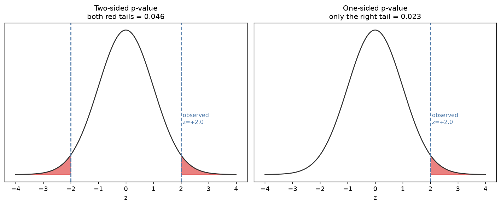

# Chapter 12: Hypothesis Testing and p-values

## The idea this chapter builds toward

Hypothesis testing answers: **"Is the pattern I'm seeing in my sample likely to be real, or could it plausibly just be random noise?"** It's structured as a kind of mathematical "innocent until proven guilty" argument, and the **p-value** is the precise number that quantifies how surprising your data would be if nothing interesting were actually going on. This machinery underlies A/B testing, "statistically significant" claims in papers, and, as we'll connect at the end, the entire logic of comparing whether one ML model is *actually* better than another or just got lucky on this particular test set.

## The structure of a hypothesis test — innocent until proven guilty

1. **Null hypothesis ($H_0$)**: the "boring," default, skeptical claim — usually "no effect," "no difference," "nothing interesting is happening." Example: "this new website design does not change the conversion rate."
2. **Alternative hypothesis ($H_1$ or $H_a$)**: what you actually suspect/hope is true — "there IS an effect." Example: "the new design changes the conversion rate."
3. You collect data and compute a **test statistic** — a single number summarizing how far your observed data is from what $H_0$ predicts, measured in standard-error units (exactly the z-score idea from Chapter 6, and the same mechanics as Chapter 11's confidence interval).
4. You compute a **p-value**: *assuming $H_0$ is true*, what's the probability of seeing a test statistic at least this extreme, purely by chance?
5. You compare the p-value to a pre-chosen threshold, $\alpha$ (commonly 0.05), and decide: if $p < \alpha$, you **reject $H_0$** ("statistically significant" result — reject the "boring" default in favor of your suspicion). If $p \ge \alpha$, you **fail to reject $H_0$** (not enough evidence against the boring default — crucially, this is *not* the same as "proving $H_0$ is true," only that your data didn't clear the bar to overturn it).

## What a p-value actually is (and the misconception to avoid)

**Correct definition**: the p-value is $P(\text{data this extreme or more extreme} \mid H_0 \text{ is true})$.

**Common incorrect interpretation**: "the p-value is the probability that $H_0$ is true" — this is backwards, and is exactly the same $P(E\mid H)$ vs. $P(H\mid E)$ confusion from Chapter 4's Bayes' Theorem. The p-value conditions on $H_0$ being true and asks about the data; it says nothing directly about $P(H_0 \mid \text{data})$ — that would require Bayes' Theorem and a prior (Chapter 4, and formalized properly in Chapter 17). A small p-value means "this data would be quite surprising if $H_0$ were true" — strong *evidence against* $H_0$, but not a direct probability that $H_0$ is false.

## Worked example — by hand

A website's historical conversion rate is known to be 10% ($H_0$: true rate = 0.10). You test a redesign on $n=400$ visitors and observe 52 conversions (13%). Is this good evidence the redesign genuinely improved conversions, or could 52/400 plausibly happen by chance even if the true rate is still 10%?

Under $H_0$, the number of conversions out of 400 follows (approximately, via CLT) a Normal distribution for the sample proportion $\hat p$, with mean $p_0 = 0.10$ and standard error:

$$SE = \sqrt{\frac{p_0(1-p_0)}{n}} = \sqrt{\frac{0.10 \times 0.90}{400}} = \sqrt{0.000225} = 0.015$$

Test statistic (z-score of the observed proportion under $H_0$):

$$z = \frac{\hat p - p_0}{SE} = \frac{0.13 - 0.10}{0.015} = \frac{0.03}{0.015} = 2.0$$

The observed conversion rate is 2 standard errors above what $H_0$ predicts. Using the Standard Normal distribution, $P(Z \ge 2.0) \approx 0.0228$. For a **two-sided test** (we'd be equally interested if the rate had dropped by this much), double it: $p\text{-value} \approx 0.0456$.

With $\alpha = 0.05$: since $0.0456 < 0.05$, we reject $H_0$ — there's statistically significant evidence of improvement. (Note how close this is to the threshold — a genuinely borderline result, which is itself a useful lesson: real-world "statistically significant" results are very often this close to the line, not overwhelming slam dunks, which is exactly why p-hacking — explained below — is such an easy trap.)



*The p-value is literally a shaded area under the curve — nothing more. Left: for a two-sided test, you shade BOTH tails beyond $|z|=2.0$ (because you'd be equally surprised by a 2-standard-error move in either direction), giving the $p\approx0.046$ computed above. Right: a one-sided test only shades the single tail you actually care about, which is why the exact same observed z-score produces a smaller p-value ($\approx0.023$) — it's answering a narrower, more committed question, which is precisely why you must pick a side *before* looking at the data, not after.*

<div class="labcard">
<div class="labkicker">Live — build your own p-value</div>
<div class="labcontrols">
  <div class="labctrl"><label>Null hypothesis mean (&mu;&#8320;) <b id="ch12_mu0_label">10</b></label><input type="range" id="ch12_mu0" min="-10" max="10" step="0.5" value="10"></div>
  <div class="labctrl"><label>Observed sample mean (x&#772;) <b id="ch12_xbar_label">13</b></label><input type="range" id="ch12_xbar" min="-10" max="20" step="0.5" value="13"></div>
  <div class="labctrl"><label>Population std dev (&sigma;) <b id="ch12_sigma_label">10</b></label><input type="range" id="ch12_sigma" min="1" max="20" step="0.5" value="10"></div>
  <div class="labctrl"><label>Sample size (n) <b id="ch12_n_label">100</b></label><input type="range" id="ch12_n" min="5" max="500" value="100"></div>
</div>
<label class="labcheck"><input type="checkbox" id="ch12_onesided"> One-sided test (only test for an increase)</label>
<div class="labstat-grid">
  <div class="labstat"><div class="lbl">z-statistic</div><div class="val" id="ch12_z">—</div></div>
  <div class="labstat"><div class="lbl">p-value</div><div class="val" id="ch12_p">—</div></div>
  <div class="labstat"><div class="lbl">Significant at &alpha;=0.05?</div><div class="val" id="ch12_sig">—</div></div>
</div>
<div class="labcanvas-wrap" style="margin-top:12px;"><canvas id="ch12_canvas" width="820" height="260"></canvas></div>
</div>
<script>
document.addEventListener('DOMContentLoaded', function(){
  var SL = window.StatsLab;
  function update(){
    var mu0 = parseFloat(document.getElementById('ch12_mu0').value);
    var xbar = parseFloat(document.getElementById('ch12_xbar').value);
    var sigma = parseFloat(document.getElementById('ch12_sigma').value);
    var n = parseInt(document.getElementById('ch12_n').value);
    var oneSided = document.getElementById('ch12_onesided').checked;
    document.getElementById('ch12_mu0_label').textContent = mu0;
    document.getElementById('ch12_xbar_label').textContent = xbar;
    document.getElementById('ch12_sigma_label').textContent = sigma;
    document.getElementById('ch12_n_label').textContent = n;

    var se = sigma/Math.sqrt(n);
    var z = (xbar-mu0)/se;
    var p = oneSided ? (1-SL.normalCDF(Math.abs(z),0,1)) : 2*(1-SL.normalCDF(Math.abs(z),0,1));
    document.getElementById('ch12_z').textContent = z.toFixed(3);
    document.getElementById('ch12_p').textContent = p.toFixed(4);
    document.getElementById('ch12_sig').textContent = p<0.05 ? 'YES (p < 0.05)' : 'no';

    var plot = SL.makePlot(document.getElementById('ch12_canvas'));
    var xs=[]; for(var zz=-4.2; zz<=4.2; zz+=0.02) xs.push(zz);
    var pts = xs.map(function(zzz){ return [zzz, SL.normalPDF(zzz,0,1)]; });
    var maxY = Math.max.apply(null, pts.map(function(pt){return pt[1];}));
    plot.setDomain([-4.2,4.2],[0,maxY*1.15]); plot.clear(); plot.axes('z','density');
    var zc = Math.abs(z);
    if(oneSided){
      plot.fillArea(pts.filter(function(p){return p[0]>=zc;}), SL.colors.accent4+'bb');
    } else {
      plot.fillArea(pts.filter(function(p){return p[0]>=zc;}), SL.colors.accent4+'bb');
      plot.fillArea(pts.filter(function(p){return p[0]<=-zc;}), SL.colors.accent4+'bb');
    }
    plot.line(pts, SL.colors.ink, 2);
    plot.vline(z, SL.colors.accent, false);
  }
  ['ch12_mu0','ch12_xbar','ch12_sigma','ch12_n'].forEach(function(id){ document.getElementById(id).addEventListener('input', update); });
  document.getElementById('ch12_onesided').addEventListener('change', update);
  update();
});
</script>

## One-sided vs. two-sided tests

A **two-sided test** asks "is the true value different (either direction)?" — used above. A **one-sided test** asks "is the true value specifically higher (or specifically lower)?" — only valid when you committed to that direction *before* seeing the data (deciding the direction after peeking at results, to get a smaller p-value, is a form of p-hacking — see below). One-sided tests use the *un-doubled* tail probability, so for the same raw z-score, a one-sided p-value is half the two-sided one — meaning it's "easier" to hit significance, which is exactly why you must commit to the direction in advance, not opportunistically.

## Type I and Type II errors — the two ways a test can be wrong

|                  | $H_0$ actually true          | $H_0$ actually false          |
|------------------|-------------------------------|---------------------------------|
| **You reject $H_0$**     | **Type I error** (false positive), probability = $\alpha$ | Correct decision (true positive) |
| **You fail to reject $H_0$** | Correct decision (true negative) | **Type II error** (false negative), probability = $\beta$ |

$\alpha$ (your significance threshold, e.g. 0.05) is *exactly* your Type I error rate by construction — it's the rate at which you'll falsely cry "effect!" when there isn't one, if you ran this exact test procedure over and over on data where $H_0$ was actually true. **Statistical power** is $1-\beta$: the probability of correctly detecting a real effect when one truly exists. Power depends on sample size, effect size, and $\alpha$ — bigger samples and bigger true effects are easier to detect (higher power), and this exact tradeoff is why underpowered A/B tests (too few users) routinely fail to detect real, meaningful improvements. This table should feel structurally familiar: it is the exact same 2×2 "confusion matrix" logic used to evaluate a binary classifier's false positives/false negatives in ML, just with different column labels.

## The backstory — a fight between two frameworks that got mashed together

What you learned above is actually a hybrid of **two different, historically rival frameworks**, and knowing this explains a lot of the lingering confusion around p-values today.

**Ronald Fisher** (1920s-30s) proposed "significance testing": compute a p-value as a continuous measure of evidence against a single null hypothesis, and use it as a flexible, informal guide for judgment — he explicitly did *not* want a rigid, mechanical accept/reject cutoff, and treated $p<0.05$ merely as a loose conventional benchmark for "worth another look," not an automatic verdict. Fisher's framework has no explicit alternative hypothesis and no formal concept of Type II error or power — it only ever asks "how surprising is this data under $H_0$?"

**Jerzy Neyman and Egon Pearson** (early 1930s), reacting against what they saw as Fisher's philosophical looseness, built a competing framework: "hypothesis testing" with an explicit null *and* alternative hypothesis, a pre-committed decision rule (reject or don't, based on a pre-chosen $\alpha$), and the formal machinery of Type I/Type II errors and power that lets you *design* an experiment in advance to guarantee controlled error rates — treating the whole exercise as a repeated, mechanical decision procedure (deliberately analogous to industrial quality-control acceptance sampling, which is literally the context Egon Pearson was consulting on).

Fisher and Neyman clashed over this publicly and bitterly for decades (Fisher at one point accused Neyman's approach of reducing science to "a mechanical rule… like a Russian five-year plan"). What gets taught in most intro courses today — and what you learned above — is an informal fusion of the two: Fisher's continuous p-value *computed*, but interpreted against Neyman-Pearson's pre-chosen fixed $\alpha$ threshold and formal Type I/II error framework. This hybrid is mathematically workable but was never endorsed as a coherent philosophy by either original camp — which is worth knowing simply so that when a p-value feels like it's being asked to do two subtly different jobs at once (a continuous evidence measure, *and* a binary accept/reject switch), that's not you misunderstanding it; that tension is baked into the hybrid's own history.

## The multiple-comparisons / p-hacking trap

If you run 20 independent hypothesis tests, each with $\alpha=0.05$, and $H_0$ is actually true for all 20, you'd *expect* about 1 of them to show "significance" purely by chance (that's what $\alpha=0.05$ means — a 1-in-20 false-alarm rate per test). If you test 20 unrelated things and report only the one that came out significant, you've badly misrepresented your evidence — this is called **p-hacking** (or the multiple comparisons problem), and it's one of the most common ways legitimate-looking statistics in papers and dashboards goes quietly wrong. Corrections exist (e.g., Bonferroni correction: divide $\alpha$ by the number of tests performed) specifically to guard against this inflation of false positives.

## Why this matters directly for ML model comparison

"Model B gets 92% accuracy, Model A gets 91%, so B is better" is exactly a hypothesis-testing question in disguise: $H_0$ = "the two models have the same true accuracy, and this 1% gap is just test-set sampling noise." Without running the equivalent of this chapter's test (comparing the gap to its standard error, given test-set size), you cannot tell whether that 1% is a real improvement or noise — this is precisely why rigorous ML benchmarking reports significance or confidence intervals around accuracy differences, not just bare point estimates, and why a 1% gap on a 100-example test set should earn far less trust than the same 1% gap on a 50,000-example test set.

## More real-world examples of hypothesis testing

- **Drug trials**: $H_0$ = "the new drug has no effect beyond placebo." Regulatory agencies (FDA, EMA) require pre-registered trials specifically to prevent p-hacking — the analysis plan (including which test, which $\alpha$, one-sided or two-sided) must be fixed *before* seeing the data, for exactly the reasons above.
- **Website A/B testing**: $H_0$ = "button color doesn't affect click-through rate." Companies routinely run dozens of simultaneous experiments across a product — without multiple-comparison correction, a meaningful fraction of "winning" experiments reported in a given quarter are expected to be pure noise, which is why mature experimentation platforms apply corrections or use False Discovery Rate control instead of raw per-test $\alpha=0.05$.
- **Manufacturing quality control**: $H_0$ = "this production batch meets the specified tolerance." A factory might sample and test each batch, accepting the Type I error rate (rejecting a genuinely fine batch) as a known, budgeted cost of doing business, traded off against Type II error (shipping a genuinely defective batch) — literally the Neyman-Pearson decision-procedure framing applied directly.
- **Scientific replication crisis**: a large fraction of widely-publicized psychology and biomedical findings from the 2000s-2010s failed to replicate when independently retested — a crisis substantially attributed to exactly the p-hacking and multiple-comparisons issues described above (combined with "publication bias," where only significant-looking results get published in the first place, further inflating the apparent rate of real effects in the literature).

## Figures


*p-values from 20 completely unrelated hypothesis tests run on pure noise (the null hypothesis is true for every single one). Notice p-values are uniformly distributed -- some will always look 'significant' by chance alone.*

## Run it yourself

`book/code/ch12_hypothesis_testing.py` reproduces the conversion-rate worked example with both the hand-formula z-test and `scipy`'s built-in proportion test, then runs a Type-I-error demonstration: simulate 1000 independent "experiments" where $H_0$ is deliberately true by construction, run a hypothesis test on each, and count how often you falsely reject $H_0$ — confirming it lands close to your chosen $\alpha$, and finally demonstrates the p-hacking trap by running 20 unrelated tests on pure noise and showing how often at least one comes out "significant" by chance alone.

```bash
python book/code/ch12_hypothesis_testing.py
```

## Why This Matters — In AI and In Everyday Life

**In AI / machine learning:**

- **Deciding whether Model B actually beats Model A**: comparing a 1% accuracy gap between two models is exactly a hypothesis test in disguise -- without it, you can't tell a real improvement from test-set noise.
- **Feature/ablation significance in ML research**: papers routinely test whether removing a component (an ablation) causes a statistically significant performance drop before claiming the component matters.

**In everyday, non-AI life:**

- **Website A/B testing**: "does changing the button color actually change the click-through rate, or did we just get lucky with this batch of visitors" is the canonical real-world use of this entire chapter.
- **Drug trials**: regulators require hypothesis tests (with pre-registered alpha and one/two-sided choice) before a new drug can be approved as genuinely effective versus placebo.

## Check your understanding

- In your own words, explain why a p-value of 0.03 does NOT mean "there's a 3% chance $H_0$ is true."
- Why does a two-sided test have double the p-value of a one-sided test for the same observed z-score, and why does that make "choosing the side after seeing the data" cheating?
- If you ran 100 totally unrelated hypothesis tests at $\alpha=0.05$ on data where every null hypothesis was actually true, roughly how many would you expect to falsely show "significance," and why?

## What's next

Chapter 13 extends this exact testing framework to more specific, very commonly used tests — the **t-test** (comparing two group means), the **chi-square test** (comparing categorical frequencies), and **ANOVA** (comparing more than two group means at once) — all built from the same null-hypothesis-and-p-value skeleton you just learned.
