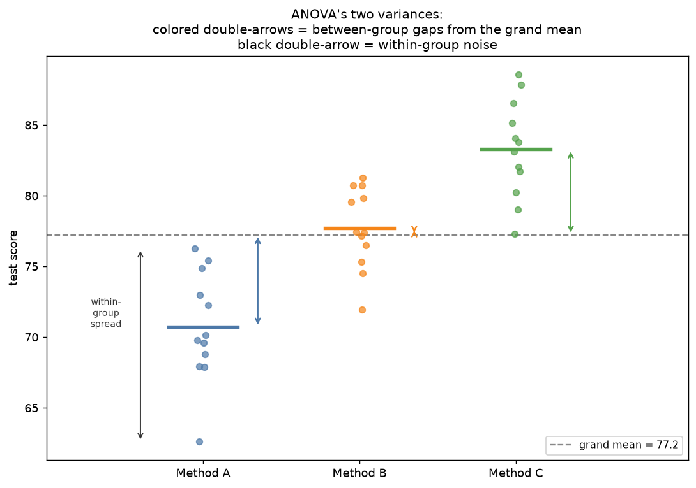
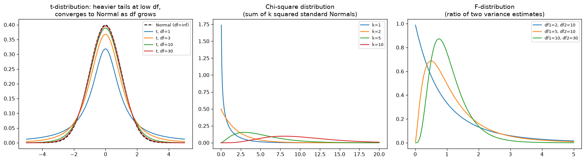

# Chapter 13: t-tests, Chi-square, and ANOVA

## The idea this chapter builds toward

Chapter 12 gave you the general skeleton of hypothesis testing (null hypothesis, test statistic, p-value, Type I/II errors). This chapter gives you the three workhorse tests built on that skeleton that you will see constantly in papers, dashboards, and real analyses: the **t-test** (comparing means), the **chi-square test** (comparing categorical frequencies), and **ANOVA** (comparing more than two means at once). Each test comes with its own probability distribution (the t-distribution, the chi-square distribution, the F-distribution) that you haven't met yet - so this chapter also deepens your distribution toolkit from Chapters 5-6, showing you *why* each new distribution had to be invented rather than just reusing the Normal.

> **Intuition, in one breath:** These three tests all ask the same plain question - "is the difference I see between these groups bigger than the wobble I'd expect from randomness alone?" - they just differ in what kind of thing is being compared: averages, category counts, or several averages at once.

## Part A: The t-test and the t-distribution

### Why the Normal distribution alone isn't enough here

Chapter 11 already hinted at this: when you don't know the true population standard deviation $\sigma$ and must estimate it from the sample ($s$), there's extra uncertainty beyond what the Normal distribution accounts for - especially with small samples. The **t-distribution** is specifically the distribution of the test statistic $\frac{\bar X - \mu}{s/\sqrt n}$ (note: $s$, the *estimated* standard deviation, not the true $\sigma$) - it looks like a Normal distribution but with heavier tails, and the tail-heaviness is controlled by a parameter called **degrees of freedom** ($df = n - 1$ for a one-sample test). As $n$ grows, $s$ becomes a more and more reliable estimate of $\sigma$, the extra uncertainty shrinks, and the t-distribution converges to the Standard Normal.

### The backstory - a brewer's trade secret, published under a pseudonym

This is one of the best stories in the history of statistics. **William Sealy Gosset** was a chemist working at the Guinness brewery in Dublin in the early 1900s, tasked with using small samples (sometimes just 3-4 batches of barley or hops) to make quality-control decisions about ingredients - and small samples meant the Normal-distribution-based methods of the day (which assumed $\sigma$ was essentially known) gave overconfident, misleadingly narrow intervals. Gosset worked out the correct small-sample distribution (the one described above) through a combination of theory and - remarkably for the time - Monte Carlo-style simulation, physically drawing thousands of cards to build up an empirical sampling distribution by hand. Guinness had a strict policy forbidding employees from publishing research (worried about leaking trade secrets about their quality-control methods to competitors), so when Gosset published his result in 1908, he used the pen name "**Student**" - which is the entire reason this is called "Student's t-distribution" and "Student's t-test" to this day, a pseudonym that outlived the secrecy policy that caused it by over a century. Fisher later (1920s) extended and popularized Gosset's work, formalizing the "degrees of freedom" concept in full generality.

### One-sample t-test

Tests whether a single sample's mean differs from some claimed/known value $\mu_0$:

$$t = \frac{\bar x - \mu_0}{s/\sqrt n}, \quad df = n-1$$

Same anatomy as Chapter 12's z-test, just with $s$ replacing $\sigma$ and a t-distribution critical value replacing the Normal one.

### Two-sample (independent) t-test

Tests whether two *separate* groups have different means - e.g., does Group A (control) have a different average outcome than Group B (treatment)? The test statistic compares the *difference* in sample means to the standard error of that difference:

$$t = \frac{\bar x_1 - \bar x_2}{SE_{\text{diff}}}, \qquad SE_{\text{diff}} = \sqrt{\frac{s_1^2}{n_1} + \frac{s_2^2}{n_2}} \quad \text{(Welch's version, unequal variances assumed)}$$

**Why does the standard error add the two groups' variance-over-n terms?** Because of a variance rule you half-met in Chapter 7: for *independent* random variables, $\text{Var}(X_1 - X_2) = \text{Var}(X_1) + \text{Var}(X_2)$ (variances of independent things add, even when you're *subtracting* the variables themselves - subtracting a random quantity doesn't reduce uncertainty, it still adds to it, because you don't know the sign of the error either group's estimate carries). Each group's sample mean has its own variance $s_i^2/n_i$ (straight from Chapter 8's standard error formula), and since the two groups are independent, those variances simply add under the square root.

### Paired t-test

Used when the two measurements are *not independent groups* but the *same* subjects measured twice (before/after a treatment, e.g. blood pressure before and after a drug for the same 20 patients). The trick: instead of treating this as "two groups," compute each subject's individual difference ($d_i = x_{i,\text{after}} - x_{i,\text{before}}$) and run a **one-sample t-test on the differences** against $\mu_0=0$. This is usually far more statistically powerful than an independent two-sample test on the same data, because it removes person-to-person variability (a tall person's blood pressure might differ wildly from a short person's at baseline, but that's irrelevant noise if you only care about the *change* within each person) - always use a paired test when your data is naturally paired, since using the independent-samples version instead throws away real statistical power for no benefit.

### Worked example

A trainer claims a new workout program changes resting heart rate. 8 participants' heart rates before and after 6 weeks: before = [72, 75, 68, 80, 74, 77, 71, 79], after = [70, 73, 66, 76, 72, 74, 70, 75]. Differences $d_i$ = [-2, -2, -2, -4, -2, -3, -1, -4], mean $\bar d = -2.5$, sample std $s_d \approx 1.07$. With $n=8$:

$$t = \frac{-2.5 - 0}{1.07/\sqrt 8} = \frac{-2.5}{0.378} \approx -6.61, \quad df=7$$

This is a huge t-statistic in magnitude (far out in the tail) - the two-tailed p-value for $|t|=6.61$ with $df=7$ is well under 0.001, strong evidence the program genuinely lowers heart rate (not reaching through a full t-table lookup by hand here - the code below computes the exact p-value with `scipy`).

## Part B: The chi-square test and the chi-square distribution

### What the chi-square distribution actually is

If you take $k$ *independent, Standard Normal* random variables and sum their squares, the result follows a **chi-square distribution with $k$ degrees of freedom**: $\chi^2_k = Z_1^2 + Z_2^2 + \cdots + Z_k^2$. This is a genuinely constructive definition, not an arbitrary named curve - because squares are always non-negative, the chi-square distribution lives entirely on $[0, \infty)$ and is right-skewed (more so for small $k$, approaching a Normal shape for large $k$ via the CLT, since it's a sum of many terms). It shows up anywhere you're measuring an accumulated squared deviation from an expectation - which is exactly the shape of the question "how far are my observed category counts from the counts I expected?"

### Reconstructing it yourself - finally proving why sample variance divides by $n-1$

Chapter 2 asked you to trust that dividing by $n-1$ (not $n$) makes sample variance unbiased, promising a full proof "later." This chapter's chi-square definition is exactly the tool that delivers it. **If your guess is that the $n-1$ comes from "losing one degree of freedom to the mean" - that phrase is about to become a literal, countable fact rather than jargon.**

Take $n$ independent $N(\mu,\sigma^2)$ data points and standardize each one: $Z_i = \frac{X_i-\mu}{\sigma}$. If you knew the true $\mu$, then $\sum_{i=1}^n Z_i^2 = \sum\frac{(X_i-\mu)^2}{\sigma^2}$ would be a sum of $n$ independent squared Standard Normals - exactly $\chi^2_n$, by the definition above, with $n$ full degrees of freedom. But in real sample variance, you don't get to use the true $\mu$ - you must use $\bar X$, a value *computed from the very same data*, which imposes a hidden constraint: $\sum_{i=1}^n (X_i - \bar X) = 0$ always, by the very definition of the mean (Chapter 2's "balance point" fact). Once you know any $n-1$ of the deviations $(X_i-\bar X)$, the last one is **not free to vary** - it's fully determined by forcing the sum to zero. You only have $n-1$ independent pieces of information left, not $n$.

It is a real (non-obvious, but provable) theorem that $\frac{(n-1)s^2}{\sigma^2} = \sum_{i=1}^n\frac{(X_i-\bar X)^2}{\sigma^2}$ follows *exactly* $\chi^2_{n-1}$ - one degree of freedom short of the $n$ you'd have gotten using the true $\mu$, precisely because estimating $\mu$ first used up one. Since the mean of a $\chi^2_{n-1}$ distribution is exactly $n-1$ (an immediate fact from this distribution's own construction - $k$ summed squared-unit-variance terms average to $k$), we get $E\left[\frac{(n-1)s^2}{\sigma^2}\right] = n-1 \implies E[s^2] = \sigma^2$ exactly, when $s^2$ is defined with the $n-1$ divisor. **Dividing by $n-1$ isn't a correction factor pulled from thin air - it's the chi-square distribution's degrees-of-freedom accounting for the one constraint that estimating $\bar X$ from the data itself imposes**, and it's also exactly why this chapter's t-distribution and F-distribution both carry "$n-1$"-flavored degrees of freedom parameters everywhere you look: the same constraint echoes through every formula built on top of an estimated mean.

### The backstory - Karl Pearson's 1900 paper

**Karl Pearson** (the same Pearson from Chapter 7's correlation coefficient) introduced the chi-square goodness-of-fit test in 1900, motivated by wanting a rigorous way to test whether observed data (e.g., outcomes of a roulette wheel, or counts of different eye colors in a population survey) matched a *theoretically expected* distribution, rather than relying on gut judgment about whether discrepancies "looked" meaningful. His key insight was to standardize each category's raw deviation using exactly the kind of "squared, scaled deviation" construction that - once you sum it across categories - happens to follow the distribution built from summed squared-Normals described above (this connection wasn't obvious at the time; Pearson derived the test statistic's distribution through his own independent reasoning about multinomial counts, and the connection to sums-of-squared-Normals was clarified more rigorously only later).

### Chi-square goodness-of-fit test

Tests whether observed category counts match an expected/theoretical distribution:

$$\chi^2 = \sum_{i} \frac{(O_i - E_i)^2}{E_i}$$

where $O_i$ = observed count in category $i$, $E_i$ = expected count under $H_0$. **Why divide by $E_i$?** Without it, a deviation of 10 in a category expected to have 1,000,000 observations would count identically to a deviation of 10 in a category expected to have only 15 - clearly the second is far more surprising/significant. Dividing by the expected count rescales each squared deviation relative to how much natural variability that category should have (closely related to the Poisson property from Chapter 5 that variance scales with the expected count) - a deviation is "big" only relative to how much wiggle was expected in the first place.

### Worked example

A die is rolled 60 times; if fair, you'd expect 10 of each face. Observed: [12, 8, 9, 11, 7, 13].

$$\chi^2 = \frac{(12-10)^2}{10} + \frac{(8-10)^2}{10} + \frac{(9-10)^2}{10} + \frac{(11-10)^2}{10} + \frac{(7-10)^2}{10} + \frac{(13-10)^2}{10}$$
$$= \frac{4+4+1+1+9+9}{10} = \frac{28}{10} = 2.8, \quad df = k-1 = 5$$

A chi-square statistic of 2.8 with 5 degrees of freedom is quite small (the mean of a $\chi^2_5$ distribution is exactly 5, by the way its construction averages $k$ squared-unit-variance terms) - not remotely surprising under $H_0$, so no evidence this die is unfair. The code below confirms the exact p-value.

### Chi-square test of independence

A different (but computationally identical-formula) use case: testing whether two *categorical* variables are related - e.g., is "preferred product color" independent of "customer's country"? You build a contingency table of observed counts, compute expected counts *under the independence assumption* (using the multiplication rule for independent events from Chapter 3: $E_{ij} = \frac{(\text{row total}_i)(\text{column total}_j)}{\text{grand total}}$), then apply the exact same $\sum\frac{(O-E)^2}{E}$ formula. This is the standard tool for testing relationships between two categorical features in a dataset - e.g., whether click-through rate differs meaningfully across device types in an A/B test, when both the outcome and the grouping are categorical rather than numeric.

## Part C: ANOVA (Analysis of Variance) and the F-distribution

### The problem ANOVA solves

Suppose you want to compare **more than two** group means at once - say, average crop yield across 4 different fertilizer treatments. You might be tempted to just run a t-test on every pair of groups (treatment 1 vs 2, 1 vs 3, 1 vs 4, 2 vs 3, ...). The problem: with 4 groups, that's 6 separate t-tests, and Chapter 12's multiple-comparisons/p-hacking warning applies directly - running 6 tests each at $\alpha=0.05$ substantially inflates your overall chance of a false positive somewhere in the batch, even if no real differences exist anywhere. ANOVA solves this by testing **all groups simultaneously** with a single test and a single, controlled false-positive rate.

### The surprising trick: testing means by analyzing *variance*

ANOVA's central, slightly counterintuitive idea: to test whether group *means* differ, compare two different ways of estimating variance. **Between-group variance**: how much the group *means* themselves bounce around the overall grand mean - if the true group means are genuinely different, this should be large. **Within-group variance**: how much individual data points bounce around their *own* group's mean - this reflects pure random noise, unaffected by whether the group means differ. The test statistic is their ratio:

$$F = \frac{\text{between-group variance}}{\text{within-group variance}}$$

If $H_0$ is true (all group means are actually equal), both numerator and denominator are just estimating the same underlying noise variance, so $F$ should hover around 1. If the true means genuinely differ, the between-group variance inflates relative to within-group noise, pushing $F$ well above 1. This ratio-of-two-variance-estimates follows the **F-distribution** (named after Fisher, by George Snedecor in the 1930s, as a tribute), parameterized by two separate degrees-of-freedom values (one for the numerator, one for the denominator), reflecting how reliably each variance estimate was itself computed.



*The colored double-arrows measure **between-group** variance: how far each method's own average sits from the overall grand mean. The black double-arrow on Method A measures **within-group** variance: how much individual students' scores bounce around their own method's average, which is just noise. ANOVA's F-statistic is the ratio of these two things - if the colored arrows are large relative to the black one, the group differences are too big to be explained by ordinary noise alone.*

### The backstory - Fisher, Rothamsted, and farm fields as an experiment

Fisher developed ANOVA in the 1920s while working at the Rothamsted Experimental Station, where decades of agricultural field-trial data (different fertilizer treatments applied to different plots of land) needed rigorous comparison. Fisher's deeper contribution here went beyond just the F-ratio trick: he also pioneered the **design of experiments** itself - concepts like randomization (randomly assigning treatments to plots, to prevent systematic bias from, say, one side of a field being sunnier) and blocking (grouping similar plots together before randomizing within them, to control for known sources of variation) - ideas that remain the backbone of rigorous experimental design in clinical trials, A/B testing, and scientific research broadly, a full century later. ANOVA the statistical test cannot be fully separated from ANOVA the *experimental philosophy* Fisher built it inside of.

### Worked example (conceptual, verified in code)

Three teaching methods tested on 3 small groups of 5 students each, measuring test scores. If within-group variability (natural student-to-student differences) is large relative to between-group differences (differences between the three method averages), $F$ stays close to 1 and you conclude no convincing evidence any method is better. If the between-group spread dominates the natural within-group noise, $F$ grows large and you reject $H_0$: at least one teaching method's true average differs from the others (note: ANOVA alone doesn't tell you *which* group differs - that requires a follow-up "post-hoc test," like Tukey's HSD, which applies its own multiple-comparisons correction when digging into pairwise differences after a significant ANOVA result).

## Figures



*The t-distribution (heavier tails at low degrees of freedom, converging to Normal), the chi-square distribution (for varying k), and the F-distribution (ratio of two variance estimates), all plotted directly.*

## Run it yourself

`book/code/ch13_ttests_chisquare_anova.py` works through all three worked examples above by hand-formula and cross-checks every result against `scipy.stats`'s built-in `ttest_rel`, `chisquare`, and `f_oneway` functions, then visualizes the t-distribution, chi-square distribution, and F-distribution shapes (including how the t-distribution's heavy tails shrink toward Normal as degrees of freedom grow) so you can see exactly what probability mass is being measured in each test's p-value.

```bash
python book/code/ch13_ttests_chisquare_anova.py
```

## Why This Matters - In AI and In Everyday Life

**In AI / machine learning:**

- **Comparing several model variants at once**: ANOVA (or its ML-flavored cousins) lets you test whether any of several model configurations differ in performance without the inflated false-positive risk of many separate t-tests.
- **Feature selection via chi-square**: testing whether a categorical feature is statistically associated with the target label (e.g. does device type relate to churn) is a standard chi-square test of independence used before model training.
- **Paired t-tests for ablation and A/B model comparison**: comparing the same model with a component on versus off across many matched evaluation batches is a paired t-test - pairing by batch cancels batch-to-batch variance and gives far more power to detect whether the component truly matters.
- **ANOVA-style comparison across embedding or clustering variants**: choosing among several clustering granularities or prompt templates by comparing their mean downstream scores is exactly the "more than two groups, one controlled test" problem ANOVA was built for, avoiding a factorial explosion of pairwise t-tests.

**In everyday, non-AI life:**

- **Fisher's original agricultural trials**: comparing crop yields across several fertilizer treatments at Rothamsted is literally what ANOVA was invented for, and the same logic still drives modern agricultural and industrial experiments.
- **Before/after medical measurements**: a paired t-test on patients' blood pressure before and after a treatment is standard practice in clinical research, exactly as in this chapter's worked example.

## Worked example - by hand, larger

This chapter's earlier worked examples covered a *paired* t-test and a chi-square goodness-of-fit test. Here is the third kind: an **independent two-sample (Welch) t-test**, the everyday question "does group A's mean differ from group B's mean?" - framed as an ML question about two retrieval models.

Two retrieval models are each run on separate sets of queries. Model A is evaluated on $n_1 = 10$ queries and scores $\bar x_1 = 82$ with sample variance $s_1^2 = 36$; Model B on $n_2 = 12$ queries, scoring $\bar x_2 = 78$ with variance $s_2^2 = 25$. Do the two models genuinely differ in mean score, or is a 4-point gap just query-sampling noise?

**Step 1 - standard error of the difference.** Using this chapter's Welch formula (variances of independent means add under the square root):

$$SE_{\text{diff}} = \sqrt{\frac{s_1^2}{n_1} + \frac{s_2^2}{n_2}} = \sqrt{\frac{36}{10} + \frac{25}{12}} = \sqrt{3.6 + 2.0833} = \sqrt{5.6833} \approx 2.384.$$

**Step 2 - the t-statistic.**

$$t = \frac{\bar x_1 - \bar x_2}{SE_{\text{diff}}} = \frac{82 - 78}{2.384} = \frac{4}{2.384} \approx 1.678.$$

**Step 3 - degrees of freedom (Welch-Satterthwaite).** The Welch df is

$$df = \frac{\left(\frac{s_1^2}{n_1} + \frac{s_2^2}{n_2}\right)^2}{\frac{\left(s_1^2/n_1\right)^2}{n_1-1} + \frac{\left(s_2^2/n_2\right)^2}{n_2-1}} = \frac{5.6833^2}{\frac{3.6^2}{9} + \frac{2.0833^2}{11}} = \frac{32.30}{1.44 + 0.3946} \approx \frac{32.30}{1.8346} \approx 17.6.$$

We'd round down conservatively to $df = 17$.

**Step 4 - compare to the critical value.** For a two-sided test at $\alpha = 0.05$, the t-critical value with $df=17$ is about 2.11. Our $|t| = 1.678 < 2.11$, so we **fail to reject** $H_0$. The 4-point gap is well within what ordinary query-to-query variation could produce; there is no convincing evidence the models differ.

Note also the check against the connection between tests and intervals: a 95% CI for the difference would be $4 \pm 2.11 \times 2.384 \approx [-1.03,\ 9.03]$, which straddles zero - the interval-based and t-test-based verdicts agree exactly, as they must.

**The plain-language takeaway: a raw difference between two group averages means nothing until you divide it by the standard error of that difference - here a 4-point gap sounded impressive but was only 1.68 standard errors, comfortably inside the noise floor of the sample sizes involved.**

## Check your understanding

- Why does the t-distribution converge to the Normal distribution as sample size grows, in terms of what's being estimated ($s$ vs. the true $\sigma$)?
- In your own words, why does ANOVA compare *variances* to test a hypothesis about *means*?
- Why is a paired t-test generally more powerful than an independent two-sample t-test on the same before/after data, and when would you NOT be able to use a paired test?

## Exercises

### Exercise 1 - One-sample t-test by hand
A team claims a new model's mean inference time is 90 ms. A sample of $n = 16$ runs gives $\bar x = 94$ ms and $s = 8$ ms. Run a two-sided one-sample t-test at $\alpha = 0.05$ (use $t$-critical $\approx 2.13$ for $df = 15$) and conclude.

<details><summary>Show solution</summary>

Standard error:

$$SE = \frac{s}{\sqrt n} = \frac{8}{\sqrt{16}} = \frac{8}{4} = 2 \text{ ms}.$$

Test statistic:

$$t = \frac{\bar x - \mu_0}{s/\sqrt n} = \frac{94 - 90}{2} = 2.0, \quad df = 15.$$

The critical value is about 2.13. Since $|t| = 2.0 < 2.13$, we **fail to reject** $H_0$ at $\alpha = 0.05$. The 4 ms increase is not statistically significant at this sample size. (It is close - a larger $n$ would sharpen the test - which is a good reminder that "not significant" often just means "not enough data yet.")

</details>

### Exercise 2 - Chi-square test of independence by hand
You suspect an ML system's error type depends on input language. Over 300 requests you observe: English: 60 correct, 40 error; Spanish: 90 correct, 60 error; German: 60 correct, 50 error. Compute the expected counts under independence and the first category's contribution to $\chi^2$.

<details><summary>Show solution</summary>

First form the contingency table with totals:

| | Correct | Error | Row total |
|---|---|---|---|
| English | 60 | 40 | 100 |
| Spanish | 90 | 60 | 150 |
| German | 60 | 50 | 110 |
| **Column total** | 210 | 150 | 300 |

Under independence, expected count $E_{ij} = \frac{(\text{row total}_i)(\text{column total}_j)}{\text{grand total}}$.

English / Correct:

$$E_{11} = \frac{100 \times 210}{300} = \frac{21000}{300} = 70.$$

Its contribution to the chi-square statistic:

$$\frac{(O_{11} - E_{11})^2}{E_{11}} = \frac{(60 - 70)^2}{70} = \frac{100}{70} \approx 1.429.$$

(For completeness the other English cell: $E_{12} = \frac{100\times150}{300} = 50$, contribution $\frac{(40-50)^2}{50} = 2.0$.) To finish the test you would sum contributions across all six cells and compare the total to a $\chi^2$ distribution with $df = (3-1)(2-1) = 2$. The point of the exercise is the mechanics: build marginals, expect proportional counts, and scale each squared deviation by its expected size.

</details>

### Exercise 3 - Conceptual: why not just run many t-tests?
You have 6 model variants and want to know if *any* differ in mean quality. Explain why running all 15 pairwise t-tests is statistically dangerous, and what ANOVA does differently, referencing this chapter's discussion.

<details><summary>Show solution</summary>

Fifteen pairwise t-tests each at $\alpha = 0.05$ means each has a 5% false-positive chance when nothing is truly different. The chance that *at least one* of the 15 comes out significant purely by chance is roughly $1 - (0.95)^{15} \approx 0.54$ - a greater-than-even chance of a spurious "difference" somewhere in the batch, even if all six variants are truly identical. This is the multiple-comparisons inflation from Chapter 12, and it makes the pairwise approach unreliable for the "is anything different?" question.

ANOVA instead tests all group means simultaneously with a *single* F-statistic and a *single* controlled false-positive rate. It compares between-group variance (spread of the group averages around the grand mean) to within-group variance (spread of individual points around their own group's mean); if the groups are truly equal, F hovers near 1. A significant F says "at least one mean differs," after which a *post-hoc* test (e.g. Tukey's HSD) - which itself carries a multiple-comparisons correction - is used to identify which.

</details>

## What's next

Chapter 14 shifts from "are these groups/distributions different" toward "can I predict one numeric variable from another" - starting with the simplest possible model, **simple linear regression**, built directly on this book's covariance/correlation machinery (Chapter 7) and MLE framework (Chapter 10).
