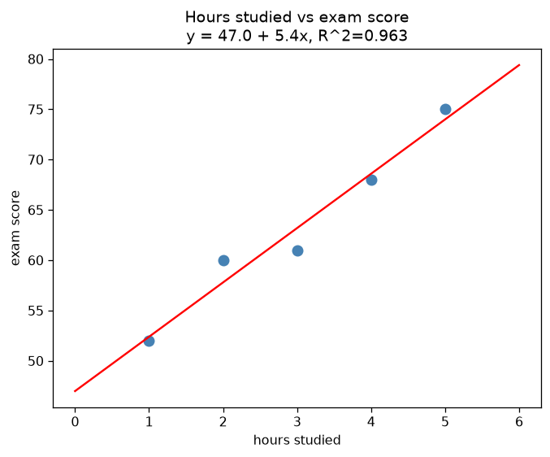
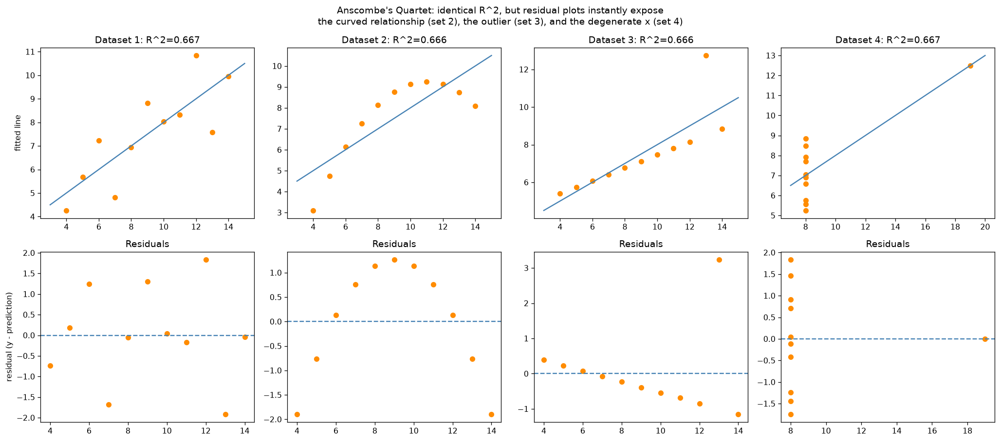

# Chapter 14: Correlation and Simple Linear Regression

## The idea this chapter builds toward

Correlation (Chapter 7) tells you *whether* and *how strongly* two variables move together. **Regression** goes one step further: it builds an actual predictive equation - "given $x$, my best guess for $y$ is ___" - and gives you a principled way to find the *single best-fitting straight line* through a scatter of points. This is the first chapter in the book that produces a genuine predictive model, and everything from here through Chapter 15 (multiple regression) is the direct statistical ancestor of every ML regression/classification model you'll ever train.

> **Intuition, in one breath:** Regression draws the one straight line that passes as close as possible to all your points at once, then uses that line to predict. "Close" means the squared vertical misses are as small as they can be, which is exactly why the slope ends up being about how the two variables move together.

## The model

$$y = \beta_0 + \beta_1 x + \varepsilon$$

- $\beta_0$: the intercept - predicted $y$ when $x=0$.
- $\beta_1$: the slope - how much $y$ changes for each 1-unit increase in $x$.
- $\varepsilon$ ("epsilon"): the **error term** - everything about $y$ that the line doesn't capture (noise, unmeasured factors). Standard regression assumes $\varepsilon \sim N(0, \sigma^2)$ - Normally distributed, centered at zero, with constant variance - an assumption that matters a lot, revisited in Chapter 15.

## Deriving the "best" line from scratch - the thought process, not just the formula

Here's the question Gauss and Legendre (early 1800s, the same least-squares story from Chapter 6) were actually solving: given a scatter of $(x_i, y_i)$ points that clearly don't lie on any single perfect line, what does "best line" even mean, and how do you find it?

**Step 1 - decide what "error" means for a candidate line.** For any candidate line $\hat y = b_0 + b_1 x$, each data point has a **residual**: $e_i = y_i - \hat y_i$ - the vertical gap between the actual point and the line's prediction at that $x$. A "good" line should make these residuals small overall.

**Step 2 - decide how to combine many residuals into one number to minimize.** You can't just sum raw residuals (same cancellation problem as Chapter 2's mean deviations - positive and negative residuals would cancel, letting a terrible line with huge errors in both directions look "perfect"). Gauss's solution: square each residual before summing, for exactly the same reasons variance is defined with squares (removes sign, penalizes big misses disproportionately, stays smooth for calculus). This defines the **sum of squared errors (SSE)**:

$$SSE(b_0, b_1) = \sum_{i=1}^n (y_i - b_0 - b_1 x_i)^2$$

**Step 3 - actually minimize it.** This is now a pure calculus problem: find the $(b_0, b_1)$ that minimizes $SSE$. Take the derivative of $SSE$ with respect to $b_0$, set it to zero; take the derivative with respect to $b_1$, set it to zero; solve the resulting two equations together (this is the "method of least squares," and the two zero-derivative equations are called the "normal equations"). Carrying out that calculus (not reproduced step-by-step here, but it's a very standard derivation you can look up or ask me to walk through live) yields clean closed-form answers:

$$\hat\beta_1 = \frac{\sum (x_i-\bar x)(y_i - \bar y)}{\sum (x_i - \bar x)^2} = \frac{\text{Cov}(X,Y)}{\text{Var}(X)}, \qquad \hat\beta_0 = \bar y - \hat\beta_1 \bar x$$

**This is deeply satisfying once you see it**: the best-fit slope is *exactly* the covariance between X and Y (Chapter 7), divided by the variance of X alone - i.e., "how much do X and Y move together, relative to how much X moves on its own." And the intercept formula guarantees the fitted line always passes exactly through the point $(\bar x, \bar y)$ - the "center of mass" of the data - which makes sense: the single most representative point in the whole dataset should sit exactly on your best-fit line.

### Connecting back to correlation

Recall $\rho = \frac{\text{Cov}(X,Y)}{\sigma_X \sigma_Y}$ from Chapter 7. A little algebra shows $\hat\beta_1 = \rho \times \frac{\sigma_Y}{\sigma_X}$ - the regression slope is literally the correlation coefficient, rescaled by the ratio of the two variables' spreads. This is *exactly* the mathematical mechanism behind Galton's "regression to the mean" (Chapter 7's backstory): whenever $|\rho| < 1$ (almost always, in real noisy data), the predicted change in $y$ is always a *shrunken* fraction of the change in $x$ - predictions regress toward the mean by construction, not as some mysterious biological force.

## Worked example - by hand

Five data points relating hours studied ($x$) to exam score ($y$): $(1, 52), (2, 60), (3, 61), (4, 68), (5, 75)$.

$\bar x = 3, \bar y = 63.2$. Compute $\sum(x_i-\bar x)(y_i-\bar y)$: deviations in $x$ are $(-2,-1,0,1,2)$; deviations in $y$ are $(-11.2,-3.2,-2.2,4.8,11.8)$. Products: $22.4, 3.2, 0, 4.8, 23.6$, summing to $54.0$. $\sum(x_i-\bar x)^2 = 4+1+0+1+4=10$.

$$\hat\beta_1 = \frac{54.0}{10} = 5.4, \qquad \hat\beta_0 = 63.2 - 5.4(3) = 63.2 - 16.2 = 47.0$$

Fitted line: $\hat y = 47.0 + 5.4x$ - each additional hour of studying predicts about 5.4 more exam points, and a student who studied zero hours is predicted to score 47.

## R² - how good is the fit?

$$R^2 = 1 - \frac{SSE}{SST}, \qquad SST = \sum(y_i-\bar y)^2$$

**Intuition**: $SST$ ("total sum of squares") measures how much $y$ varies if you *ignore* $x$ entirely and just always predict $\bar y$ (the simplest possible baseline model). $SSE$ measures how much variation is *left over* after using your regression line. $R^2$ is the *fraction of y's variation that your line explains*: $R^2=1$ means a perfect fit (no leftover error at all); $R^2=0$ means your line does no better than just guessing the average every time. For simple linear regression specifically, $R^2 = \rho^2$ - exactly the squared correlation coefficient, which is a nice, tidy fact worth remembering: a correlation of 0.7 corresponds to an $R^2$ of only 0.49 - the line explains less than half the variance despite "0.7" sounding like a strong relationship, a very common point of confusion worth internalizing.

<div class="labcard">
<div class="labkicker">Live - generate data at a target correlation and watch the fit</div>
<div class="labcontrols">
  <div class="labctrl"><label>Target correlation (&rho;) <b id="ch14_rho_label">0.70</b></label><input type="range" id="ch14_rho" min="-1" max="1" step="0.05" value="0.7"></div>
  <div class="labctrl"><label>Number of points <b id="ch14_n_label">60</b></label><input type="range" id="ch14_n" min="10" max="300" value="60"></div>
</div>
<div class="labrow">
  <button class="labbtn secondary" id="ch14_regen">Regenerate data</button>
  <label class="labcheck"><input type="checkbox" id="ch14_parabola"> Parabola mode (Y=X&sup2;, correlation's blind spot)</label>
</div>
<div class="labcanvas-wrap"><canvas id="ch14_canvas" width="820" height="320"></canvas></div>
<div class="labstat-grid">
  <div class="labstat"><div class="lbl">Correlation (r)</div><div class="val" id="ch14_corr">-</div></div>
  <div class="labstat"><div class="lbl">R&sup2;</div><div class="val" id="ch14_r2">-</div></div>
  <div class="labstat"><div class="lbl">Slope</div><div class="val" id="ch14_slope">-</div></div>
  <div class="labstat"><div class="lbl">Intercept</div><div class="val" id="ch14_intercept">-</div></div>
</div>
<p class="labnote">Turn on parabola mode: Y becomes perfectly determined by X, yet the computed correlation sits near zero because the relationship is curved, not linear - always plot your data.</p>
</div>
<script>
document.addEventListener('DOMContentLoaded', function(){
  var SL = window.StatsLab;
  var data = [];
  function regenerate(){
    var rho = parseFloat(document.getElementById('ch14_rho').value);
    var n = parseInt(document.getElementById('ch14_n').value);
    var parabola = document.getElementById('ch14_parabola').checked;
    data = [];
    for(var i=0;i<n;i++){
      var x = SL.randNormal(0,1), y;
      if(parabola) y = x*x + SL.randNormal(0,0.05);
      else y = rho*x + Math.sqrt(Math.max(0,1-rho*rho))*SL.randNormal(0,1);
      data.push([x,y]);
    }
    draw();
  }
  function draw(){
    var xs = data.map(function(d){return d[0];}), ys = data.map(function(d){return d[1];});
    var xbar = SL.mean(xs), ybar = SL.mean(ys);
    var sx = SL.std(xs,1), sy = SL.std(ys,1);
    var cov=0; for(var i=0;i<xs.length;i++) cov += (xs[i]-xbar)*(ys[i]-ybar);
    cov /= (xs.length-1);
    var r = cov/(sx*sy);
    var slope = cov/SL.variance(xs,1);
    var intercept = ybar - slope*xbar;
    var sst = ys.reduce(function(a,y){return a+(y-ybar)*(y-ybar);},0);
    var sse = xs.reduce(function(a,x,ii){return a+Math.pow(ys[ii]-(intercept+slope*x),2);},0);
    var r2 = 1-sse/sst;
    document.getElementById('ch14_corr').textContent = r.toFixed(3);
    document.getElementById('ch14_r2').textContent = r2.toFixed(3);
    document.getElementById('ch14_slope').textContent = slope.toFixed(3);
    document.getElementById('ch14_intercept').textContent = intercept.toFixed(3);

    var xlo = Math.min.apply(null,xs)-0.5, xhi = Math.max.apply(null,xs)+0.5;
    var ylo = Math.min.apply(null,ys)-0.5, yhi = Math.max.apply(null,ys)+0.5;
    var plot = SL.makePlot(document.getElementById('ch14_canvas'));
    plot.setDomain([xlo,xhi],[ylo,yhi]); plot.clear(); plot.axes('X','Y');
    plot.scatter(data, SL.colors.accent+'cc', 3.5);
    plot.line([[xlo, intercept+slope*xlo],[xhi, intercept+slope*xhi]], SL.colors.accent4, 2.5);
  }
  document.getElementById('ch14_rho').addEventListener('input', function(e){ document.getElementById('ch14_rho_label').textContent = parseFloat(e.target.value).toFixed(2); regenerate(); });
  document.getElementById('ch14_n').addEventListener('input', function(e){ document.getElementById('ch14_n_label').textContent = e.target.value; regenerate(); });
  document.getElementById('ch14_regen').addEventListener('click', regenerate);
  document.getElementById('ch14_parabola').addEventListener('change', regenerate);
  regenerate();
});
</script>

### Reconstructing it yourself - proving $R^2 = \rho^2$ instead of just quoting it

**If your guess is that this equality should fall out of substituting the least-squares slope formula directly into $R^2$'s definition - it does, in about four lines.** Start from $SSE = \sum(y_i - \hat y_i)^2$ with $\hat y_i = \bar y + \hat\beta_1(x_i - \bar x)$ (the fitted line, rewritten around the means). Substitute and expand:

$$y_i - \hat y_i = (y_i - \bar y) - \hat\beta_1(x_i-\bar x)$$

Square and sum over all $i$; the cross term, after using $\hat\beta_1 = \frac{\sum(x_i-\bar x)(y_i-\bar y)}{\sum(x_i-\bar x)^2}$ (this chapter's own slope formula) and simplifying, collapses the whole expression down to:

$$SSE = SST - \hat\beta_1^2\sum(x_i-\bar x)^2 = SST\left(1 - \rho^2\right)$$

(using $\hat\beta_1 = \rho\frac{\sigma_Y}{\sigma_X}$ from the "connecting back to correlation" section above, and $SST = \sum(y_i-\bar y)^2 = (n-1)\sigma_Y^2$, the algebra reduces the $\hat\beta_1^2\sum(x_i-\bar x)^2$ term to exactly $\rho^2 \cdot SST$ - a satisfying but slightly tedious substitution worth working through on paper once). Plug this directly into $R^2$'s definition:

$$R^2 = 1-\frac{SSE}{SST} = 1-\frac{SST(1-\rho^2)}{SST} = 1-(1-\rho^2) = \rho^2$$

**$R^2=\rho^2$ isn't a coincidence to memorize - it's the direct algebraic consequence of the least-squares slope formula being built from correlation in the first place.** It also tells you something the bare fact alone doesn't: because this derivation leaned on the *specific* least-squares slope formula from this chapter, $R^2=\rho^2$ is a fact unique to *simple linear* regression - the moment you add a second predictor in Chapter 15, $R^2$ and any single pairwise correlation stop being interchangeable, which is exactly why Chapter 15 needs its own, separate reasoning about what $R^2$ does and doesn't tell you.

## Checking the assumptions - residual plots

Regression's validity depends on assumptions about $\varepsilon$: roughly Normal, constant variance across the range of $x$ (called **homoscedasticity** - hetero*scedasticity*, its opposite, is when error spread grows or shrinks systematically across $x$, e.g. predictions for expensive houses having much bigger absolute errors than cheap houses), and no leftover systematic pattern. The standard diagnostic is a **residual plot**: plot residuals $e_i$ against $x_i$ (or against $\hat y_i$). A healthy fit shows residuals scattered randomly with no pattern and roughly constant spread; a curved pattern suggests you're missing a nonlinear relationship (you fit a line to a curve); a funnel/fan shape suggests heteroscedasticity. This single plot is one of the most useful two-second sanity checks in applied regression and is skipped far too often in practice - recall Anscombe's Quartet (Chapter 2): a residual plot would have instantly revealed that datasets 2 and 3 were poorly served by a straight line, despite an identical $R^2$ to dataset 1.

## Figures



*The hours-studied vs exam-score example: data points with the least-squares best-fit line and its equation.*



*Anscombe's Quartet refit with linear regression. Top row: fitted lines (identical R^2 for all four). Bottom row: residual plots, which instantly expose the curved relationship, the outlier, and the degenerate x-values that R^2 alone hides.*

## Run it yourself

`book/code/ch14_simple_linear_regression.py` reproduces the hours-studied example by hand-formula and with `numpy.polyfit`/`scipy.stats.linregress`, computes and visualizes $R^2$, and then deliberately re-fits all four Anscombe's Quartet datasets from Chapter 2 with linear regression plus residual plots side by side - showing you exactly how a residual plot exposes the three "badly fit by a line" datasets that an $R^2$/correlation number alone would hide.

```bash
python book/code/ch14_simple_linear_regression.py
```

## Why This Matters - In AI and In Everyday Life

**In AI / machine learning:**

- **The simplest baseline model in any ML pipeline**: before trying anything fancy, fitting simple linear regression tells you how much signal a single feature carries, and gives a sanity-check baseline to beat.
- **Interpretable feature effects**: a regression slope answering "how much does predicted output change per unit of this one feature" is often more valuable for stakeholder trust than a complex black-box model's equivalent behavior.
- **The linear probe on embeddings**: checking whether a concept (say, sentiment) is linearly encoded in a transformer's learned representations is exactly fitting this chapter's regression on the embedding vector - a high $R^2$ from a linear probe means the representation exposes that concept along a straight direction.
- **Scaling laws in model training**: the observation that loss falls roughly linearly with log(compute) or log(parameters) is a simple linear regression on log-transformed axes, used to predict how much bigger a model must grow to reach a target loss before spending the training budget.

**In everyday, non-AI life:**

- **Predicting house prices from square footage**: one of the most common real-estate analytics examples, and a direct application of this chapter's exact formula.
- **Predicting sales from advertising spend**: marketing teams routinely fit this exact simple regression to estimate return on ad spend before committing to a bigger campaign.

## Worked example - by hand, larger

The earlier worked example used five points and stopped at the slope and intercept. Here is a larger one - six points, a different domain, and carried all the way through to $R^2$ - relating a model's **batch size** $x$ (in hundreds) to its measured **throughput** $y$ (in thousands of tokens/sec).

Data: $(1, 10), (2, 13), (3, 15), (4, 16), (5, 20), (6, 22)$.

**Step 1 - means.** $\bar x = \frac{1+2+3+4+5+6}{6} = \frac{21}{6} = 3.5$, and $\bar y = \frac{10+13+15+16+20+22}{6} = \frac{96}{6} = 16$.

**Step 2 - the pieces of the slope.** $x$-deviations from 3.5: $-2.5, -1.5, -0.5, 0.5, 1.5, 2.5$. $y$-deviations from 16: $-6, -3, -1, 0, 4, 6$.

Cross products $(x_i-\bar x)(y_i-\bar y)$: $(-2.5)(-6)=15$, $(-1.5)(-3)=4.5$, $(-0.5)(-1)=0.5$, $(0.5)(0)=0$, $(1.5)(4)=6$, $(2.5)(6)=15$. Sum $= 15+4.5+0.5+0+6+15 = 41.0$.

Squared $x$-deviations: $6.25 + 2.25 + 0.25 + 0.25 + 2.25 + 6.25 = 17.5$.

**Step 3 - slope and intercept.**

$$\hat\beta_1 = \frac{41.0}{17.5} \approx 2.343, \qquad \hat\beta_0 = \bar y - \hat\beta_1\bar x = 16 - 2.343(3.5) = 16 - 8.2 = 7.8.$$

Fitted line: $\hat y = 7.8 + 2.343x$ - each additional 100 units of batch size predicts about 2,343 more tokens/sec.

**Step 4 - $R^2$.** First $SST = \sum(y_i-\bar y)^2 = 36 + 9 + 1 + 0 + 16 + 36 = 98$. Predictions: $7.8+2.343(1)=10.143$, $12.486$, $14.829$, $17.171$, $19.514$, $21.857$. Residuals (actual - predicted): $-0.143, 0.514, 0.171, -1.171, 0.486, 0.143$. Squared and summed:

$$SSE = 0.0204 + 0.2642 + 0.0292 + 1.3712 + 0.2362 + 0.0204 \approx 1.942.$$

$$R^2 = 1 - \frac{SSE}{SST} = 1 - \frac{1.942}{98} \approx 1 - 0.0198 = 0.980.$$

**Step 5 - interpret.** The line explains about 98% of the variation in throughput, so batch size alone is a strong predictor here. As a cross-check, $R^2 = \rho^2$ from this chapter: the correlation is $\sqrt{0.980} \approx 0.990$, which checks out - these six points really do lie almost on a straight line.

**The plain-language takeaway: the slope is just "how the two variables move together, rescaled by how much $x$ moves on its own," and $R^2$ is just the fraction of $y$'s wobble your line accounts for - compute the sums of squared deviations by hand once and the formulas stop being magic.**

## Check your understanding

- Walk through why squaring residuals (rather than using absolute value) was the natural choice here, echoing Chapter 2's variance argument - where exactly does the calculus/differentiability argument matter in the derivation above?
- Why does $\hat\beta_1 = \rho \cdot \sigma_Y/\sigma_X$ explain "regression to the mean" whenever $|\rho|<1$?
- For one of Anscombe's Quartet's non-linear datasets, explain what a residual plot would show that a bare $R^2$ number wouldn't.

## Exercises

### Exercise 1 - Fit a line by hand
Four points relate a small feature's value $x$ to a model's output $y$: $(0, 2), (1, 5), (2, 5), (3, 8)$. Compute $\hat\beta_1$, $\hat\beta_0$, and $R^2$.

<details><summary>Show solution</summary>

Means: $\bar x = \frac{0+1+2+3}{4} = 1.5$, $\bar y = \frac{2+5+5+8}{4} = 5$.

$x$-deviations: $-1.5, -0.5, 0.5, 1.5$. $y$-deviations: $-3, 0, 0, 3$.

Cross products: $4.5, 0, 0, 4.5$; sum $= 9.0$. Squared $x$-deviations: $2.25+0.25+0.25+2.25 = 5.0$.

$$\hat\beta_1 = \frac{9.0}{5.0} = 1.8, \qquad \hat\beta_0 = 5 - 1.8(1.5) = 5 - 2.7 = 2.3.$$

Line: $\hat y = 2.3 + 1.8x$.

$SST = 9 + 0 + 0 + 9 = 18$. Predictions: $2.3, 4.1, 5.9, 7.7$. Residuals: $-0.3, 0.9, -0.9, 0.3$; squares $0.09, 0.81, 0.81, 0.09$; $SSE = 1.8$.

$$R^2 = 1 - \frac{1.8}{18} = 1 - 0.1 = 0.9.$$

So the line explains 90% of the variance, consistent with $\rho^2 = 0.9 \Rightarrow \rho \approx 0.949$.

</details>

### Exercise 2 - Why a correlation of 0.7 is less impressive than it sounds
A feature has correlation $\rho = 0.70$ with the target. Compute $R^2$ and explain what it means for prediction, then state what correlation would be needed for $R^2 = 0.70$.

<details><summary>Show solution</summary>

For simple linear regression, $R^2 = \rho^2 = 0.70^2 = 0.49$. So the fitted line explains only 49% of the target's variation - barely half. "0.7" feels strong, but squared it means the model leaves a bit more than half the variance unexplained.

For $R^2 = 0.70$ you need $\rho = \sqrt{0.70} \approx 0.837$. The takeaway: because the relationship between $\rho$ and explained variance is quadratic, correlations must be quite high before a single-feature linear model explains most of the variance - a classic trap when reading coefficients of determination reported as correlations.

</details>

### Exercise 3 - Conceptual: residuals versus $R^2$
Two different datasets both produce a fitted line with $R^2 = 0.85$. Explain, using the residual-plot idea from this chapter, why these two models could still be very different in quality, and what single diagnostic would distinguish them.

<details><summary>Show solution</summary>

$R^2$ aggregates all residuals into a single number, so two datasets with the same $R^2$ can have wildly different *patterns* of residuals. One might have residuals scattered randomly with roughly constant spread (a well-specified linear model), while the other might have residuals forming a curve (implying the true relationship is nonlinear - a line is the wrong model), or a funnel shape (heteroscedasticity - error spread grows with $x$), or a few huge outliers (which can inflate $R^2$ while the line is badly wrong elsewhere).

The distinguishing diagnostic is the **residual plot**: plot $e_i$ against $x_i$ (or $\hat y_i$). Unpatterned, constant-spread residuals indicate a healthy fit regardless of the $R^2$ value; visible curvature, funnels, or clustered outliers indicate a model problem that $R^2$ alone cannot reveal. This is exactly the point of Anscombe's Quartet - identical summary statistics, radically different data - and it is why you should always look at the residual plot, never trust $R^2$ on its own.

</details>

## What's next

Chapter 15 extends this to **multiple** predictors at once (not just one $x$, but many features simultaneously), introduces $R^2$'s correction for model complexity (adjusted $R^2$), and gives you your first full, precise look at **overfitting** - a concept you'll recognize instantly once you see it, because you've already met its building blocks across Chapters 2, 9, and 13.
