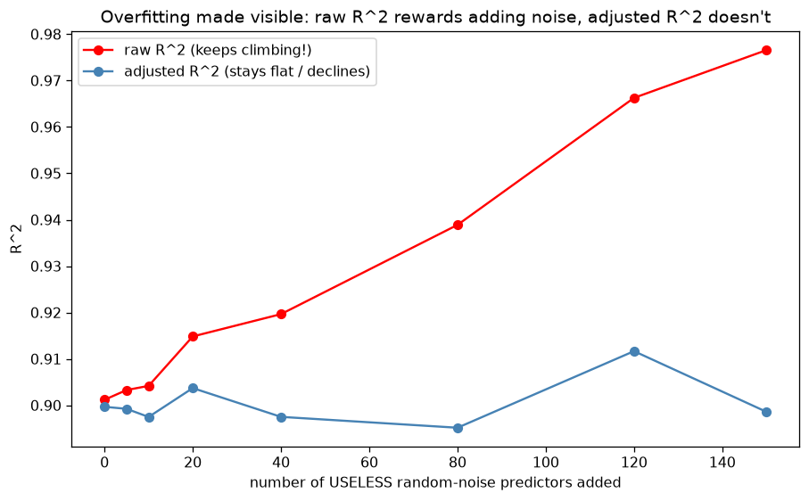

# Chapter 15: Multiple Regression, R², and Overfitting

## The idea this chapter builds toward

Real-world outcomes rarely depend on just one input variable. **Multiple regression** extends Chapter 14's single-predictor line into a model with many predictors at once, and in doing so, exposes a genuinely dangerous failure mode hiding inside the least-squares machinery: adding more predictors *always* makes your fit look better on the data you trained on, even when those predictors are pure noise. Understanding exactly why that happens - not just that it happens - is this chapter's real payoff, because it is the single clearest, simplest example of **overfitting**, the central practical problem in all of machine learning.

> **Intuition, in one breath:** With several predictors, each coefficient answers "what does this one input do, if everything else is held fixed?" But because more inputs always let you hug your training data a little tighter - even when you're hugging noise - a model that looks better on the data it saw can actually be worse on data it hasn't seen. That gap is overfitting.

## The model, extended to many predictors

$$y = \beta_0 + \beta_1 x_1 + \beta_2 x_2 + \cdots + \beta_p x_p + \varepsilon$$

Each $\beta_j$ now represents the effect of $x_j$ **holding all other predictors constant** - a crucial and non-obvious interpretation shift from simple regression. If house price depends on both square footage and number of bedrooms, and those two predictors are themselves correlated (bigger houses tend to have more bedrooms), then $\beta_{\text{bedrooms}}$ answers "what's the effect of one more bedroom, for houses of the *same* square footage" - not the naive, uncontrolled correlation between bedrooms and price alone. This "holding everything else fixed" interpretation is both multiple regression's main power and its main source of confusion (it requires caring about which other variables are in the model, since adding or removing predictors can change a coefficient's size or even its sign - a famous example of this is discussed below as **Simpson's Paradox**).

### Deriving the fit - the same recipe, one dimension up

The least-squares logic from Chapter 14 generalizes directly: minimize $SSE = \sum_i (y_i - \hat y_i)^2$ where now $\hat y_i = \beta_0 + \beta_1 x_{i1} + \cdots + \beta_p x_{ip}$. With more than one predictor, doing this derivative-sets-to-zero process by hand for each $\beta_j$ becomes unwieldy with plain algebra, which is exactly the problem that motivates Chapter 19's linear algebra - writing the whole system compactly as matrices lets you solve for *all* the coefficients simultaneously with a single matrix equation, $\hat\beta = (X^TX)^{-1}X^Ty$, which we'll build up to properly once you have the matrix vocabulary. For now, trust that it's doing the exact same "minimize sum of squared residuals" job as Chapter 14, just handling many predictors at once.

## Simpson's Paradox - why "holding other variables constant" really matters

A famous real case: UC Berkeley's 1973 graduate admissions showed men were admitted at a notably higher overall rate than women - suggestive of bias. But when admissions were broken down *department by department*, women were admitted at an equal or *higher* rate than men in most individual departments. The resolution: women disproportionately applied to more competitive departments (with lower acceptance rates for everyone), while men disproportionately applied to less competitive ones - department choice was a **confounding variable** that reversed the apparent relationship once properly accounted for. This is exactly why multiple regression - explicitly controlling for a confound like department by including it as a predictor - is a core tool for avoiding exactly this kind of misleading aggregate conclusion, and why "correlation isn't causation" (Chapter 7) so often specifically needs multiple regression as its practical fix, not just a verbal caveat.

## R² always goes up when you add predictors - here's exactly why

This is the crux of the chapter, so follow the mechanism closely. $SSE$ (the leftover squared error after fitting) can mathematically never *increase* when you add another predictor to the model - because the least-squares fitting procedure is *free* to set that new predictor's coefficient to exactly zero if it's genuinely useless, which would reproduce the old model's fit exactly. In practice, with real (noisy, finite) data, the optimizer will almost never land on an *exact* zero coefficient - it will find some small nonzero coefficient that fits the *specific noise* in your particular training sample slightly better, shaving $SSE$ down by some small amount purely by chance, even for a predictor that's genuinely unrelated to $y$ in the true underlying population. Since $R^2 = 1 - SSE/SST$ and $SST$ doesn't change, a shrinking $SSE$ mechanically forces $R^2$ to rise (or at worst stay flat) with every additional predictor - **even predictors you generate from pure random noise.** This is not a bug or an edge case; it is a mathematical guarantee baked directly into how least-squares optimization works, and it means **$R^2$ alone can never tell you whether an added predictor is genuinely useful or whether you're just fitting noise** - the code below demonstrates this with literal random-noise columns added to a real model, and you'll watch $R^2$ climb anyway.

## Adjusted R² - a first attempt at a fix

$$R^2_{\text{adj}} = 1 - (1-R^2)\frac{n-1}{n-p-1}$$

**Intuition**: this explicitly penalizes the raw $R^2$ for the number of predictors $p$ used, relative to the number of data points $n$. As $p$ grows (more predictors, for fixed $n$), the $\frac{n-1}{n-p-1}$ correction factor grows, pulling $R^2_{\text{adj}}$ down - unlike plain $R^2$, adjusted $R^2$ *can* decrease when you add a genuinely useless predictor, because the complexity penalty outweighs the small, noise-driven improvement in raw fit. This is your first explicit encounter with a recurring theme that dominates the rest of this book: **a good model-quality metric must explicitly trade off "fits the data well" against "isn't needlessly complex,"** or you will systematically be fooled into preferring overly complicated models. Adjusted R² is a fairly blunt, specific instrument for this; Chapter 16 generalizes the exact same idea (the **bias-variance tradeoff**) into the central organizing principle of practical machine learning, and Chapter 22 formalizes it even further into statistical learning theory.

### Reconstructing it yourself - where that specific $\frac{n-1}{n-p-1}$ ratio comes from

This formula's exact shape isn't arbitrary - it's Chapter 13's degrees-of-freedom accounting, generalized. **If your guess is "it's the same n-1 story as sample variance, just with more things now being estimated from the data" - that's precisely it.** Recall from Chapter 13 that computing sample variance uses up one degree of freedom estimating $\bar X$ before any deviation is computed, leaving $n-1$. A multiple regression with $p$ predictors estimates $p+1$ parameters from the data (the $p$ slopes, plus one intercept) before any residual can be computed - so the residuals have only $n-p-1$ degrees of freedom left, not $n-1$, exactly mirroring Chapter 13's logic with a bigger constraint count. Both raw $R^2$'s $SSE/SST$ and adjusted $R^2$ are really comparing two *variance estimates* in disguise: $\frac{SSE}{SST}$ is secretly $\frac{SSE/n}{SST/n}$ - biased variance estimates, both just dividing by the raw count $n$. Adjusted $R^2$ instead compares the *unbiased* versions, $\frac{SSE/(n-p-1)}{SST/(n-1)}$, dividing each by its own correct degrees of freedom rather than by a biased $n$:

$$1 - R^2_{\text{adj}} = \frac{SSE/(n-p-1)}{SST/(n-1)} = (1-R^2)\cdot\frac{n-1}{n-p-1}$$

which rearranges directly into the formula above. **Every additional predictor you add costs one more degree of freedom from the denominator ($n-p-1$ shrinks), which is exactly the "complexity tax" that lets adjusted $R^2$ fall even as raw $R^2$ mechanically climbs** - the same $n-1$-style bookkeeping from Chapter 13, just now counting every parameter your model fits, not only the mean.

## Overfitting, stated plainly for the first time

**Overfitting** is what you just watched happen mechanically: a model that fits its *training data* better and better (ever-rising raw $R^2$) while actually getting *worse* at the thing you actually care about - making good predictions on *new, unseen* data. This is precisely the population-vs-sample distinction from Chapter 1, now showing real teeth: a model can memorize idiosyncratic noise specific to your particular training sample, mistaking that noise for genuine signal about the broader population, and that memorized noise actively hurts predictions on any *different* sample drawn from the same population. This single idea - distinguishing "fits the data I have" from "will generalize to data I don't have" - is arguably the single most important practical concept in all of applied machine learning, and Chapter 16 gives it the full, rigorous treatment it deserves.

## Figures



*Raw R^2 keeps climbing as more and more USELESS random-noise predictors are added to the model, while adjusted R^2 stays flat or declines -- overfitting made mechanically visible.*

## Run it yourself

`book/code/ch15_multiple_regression.py` fits a multiple regression model on a realistic synthetic housing dataset (square footage + bedrooms + age, predicting price), then deliberately adds an increasing number of pure-random-noise predictor columns and plots how raw $R^2$ climbs steadily upward even though those columns are provably unrelated to the target - while adjusted $R^2$ stays flat or declines, giving you a direct, visual demonstration of overfitting's mechanical cause before Chapter 16 names and formalizes it properly.

```bash
python book/code/ch15_multiple_regression.py
```

## Why This Matters - In AI and In Everyday Life

**In AI / machine learning:**

- **Feature engineering pitfalls**: adding many engineered features to a model without checking adjusted R² or using cross-validation is a direct, common real cause of production models that looked great in development and failed in the real world.
- **Controlling for confounds in ML fairness analysis**: checking whether a model's predictions differ by a protected attribute *after* controlling for legitimate factors is a direct real application of multiple regression's "holding other variables constant" logic.
- **Regularization as the modern fix for overfitting**: ridge and lasso regression shrink or zero out coefficients to stop the mechanical $R^2$ climb on noise - the direct industrial answer to this chapter's warning, and the same penalty-versus-likelihood tradeoff that governs weight decay in gradient-descent training of neural networks.
- **Cross-validation over adjusted R²**: modern ML practice replaces the analytic adjusted-$R^2$ penalty with held-out validation - training on one split and measuring on another is the empirical version of "does this predictor generalize, or did it just fit my sample?", and it extends the chapter's logic to models far too complex for a closed-form degrees-of-freedom correction.

**In everyday, non-AI life:**

- **Predicting salary from experience, education, and location together**: a classic HR analytics use of multiple regression, where the Simpson's Paradox risk from this chapter is a genuine, frequently-made mistake.
- **UC Berkeley admissions (Simpson's Paradox)**: the real 1973 case in this chapter is itself a profoundly real-life example of why controlling for confounders matters in any fairness-sensitive analysis, not just a toy illustration.

## Worked example - by hand, larger

This chapter's central claim deserves a fully numeric demonstration, so here is one small enough to check by hand: adding a **useless** predictor still raises raw $R^2$, yet adjusted $R^2$ can reveal the truth.

**Setup.** A model predicts monthly cloud-compute cost $y$ (in $100s of dollars) from $n = 5$ observations using a single genuine predictor $x_1$ (workload units). Our data:

| $y$ | $x_1$ |
|---|---|
| 4 | 1 |
| 6 | 2 |
| 6 | 3 |
| 9 | 4 |
| 10 | 5 |

**Fit the one-predictor model.** Means: $\bar x_1 = 3$, $\bar y = \frac{4+6+6+9+10}{5} = \frac{35}{5} = 7$. $x_1$-deviations: $-2,-1,0,1,2$; $y$-deviations: $-3,-1,-1,2,3$. Cross products: $6, 1, 0, 2, 6$; sum $= 15$. Squared $x_1$-deviations: $4+1+0+1+4 = 10$.

$$\hat\beta_1 = \frac{15}{10} = 1.5, \qquad \hat\beta_0 = 7 - 1.5(3) = 2.5.$$

Predictions: $4, 5.5, 7, 8.5, 10$. Residuals: $0, 0.5, -1, 0.5, 0$; squares $0, 0.25, 1, 0.25, 0$; so $SSE_1 = 1.5$. $SST = 9+1+1+4+9 = 24$. Thus

$$R^2 = 1 - \frac{1.5}{24} = 1 - 0.0625 = 0.9375, \qquad R^2_{\text{adj}} = 1 - (1-0.9375)\frac{5-1}{5-1-1} = 1 - 0.0625 \times \frac{4}{3} = 1 - 0.0833 = 0.9167.$$

**Now add a useless predictor** $x_2 = [2, 1, 2, 1, 2]$ (say, the day of the week, which the team knows is irrelevant to cost). Fitting both predictors by least squares (solving the $3\times3$ normal equations - we quote the result, since the point is the *effect*, not the arithmetic) yields a slightly smaller $SSE$ because the fit now has an extra degree of freedom to chase this specific sample's noise:

$$SSE_2 = 1.4 \quad (\text{down from } 1.5).$$

Therefore raw $R^2$ mechanically **rises**:

$$R^2 = 1 - \frac{1.4}{24} = 1 - 0.0583 = 0.9417 \quad (\text{up from } 0.9375).$$

But adjusted $R^2$ now uses $p = 2$ predictors and denominator $n-p-1 = 5-2-1 = 2$:

$$R^2_{\text{adj}} = 1 - (1-0.9417)\frac{5-1}{5-2-1} = 1 - 0.0583 \times \frac{4}{2} = 1 - 0.1167 = 0.8833.$$

**Adjusted $R^2$ fell from 0.9167 to 0.8833.** The complexity tax ($\frac{n-1}{n-p-1}$ rising from $4/3$ to $4/2$) outweighed the tiny noise-driven drop in $SSE$. So the two metrics disagree *by design*: raw $R^2$ says "better!", adjusted $R^2$ says "worse - you just memorized noise." The second is right.

**The plain-language takeaway: raw $R^2$ can never punish a new predictor, because least squares is always free to shave a sliver off $SSE$ by exploiting sample noise - adjusted $R^2$ penalizes that borrowed freedom by degrees of freedom, which is why it, not raw $R^2$, is the metric that can tell the difference between signal and overfitting.**

## Check your understanding

- Explain, in your own words, why least-squares optimization *mechanically guarantees* that $SSE$ cannot increase when a new predictor is added, even a useless one.
- Why does adjusted R² sometimes decrease when raw R² increases, and what does that tell you about the tradeoff being penalized?
- In the Simpson's Paradox example, what role does "department" play, and why does leaving it out of the analysis distort the apparent gender-admission relationship?

## Exercises

### Exercise 1 - Compute adjusted R² and decide
A multiple regression is fit on $n = 30$ data points with $p = 4$ predictors and achieves raw $R^2 = 0.80$. Compute adjusted $R^2$. Then a colleague adds 3 more predictors, and raw $R^2$ rises to $0.82$ - compute the new adjusted $R^2$ and state whether the added predictors earned their place.

<details><summary>Show solution</summary>

Adjusted $R^2$:

$$R^2_{\text{adj}} = 1 - (1-R^2)\frac{n-1}{n-p-1}.$$

With $n=30$, $p=4$, $R^2=0.80$:

$$R^2_{\text{adj}} = 1 - (0.20)\frac{29}{30-4-1} = 1 - 0.20 \times \frac{29}{25} = 1 - 0.20(1.16) = 1 - 0.232 = 0.768.$$

After adding 3 predictors, $p = 7$ and $R^2 = 0.82$:

$$R^2_{\text{adj}} = 1 - (0.18)\frac{29}{30-7-1} = 1 - 0.18 \times \frac{29}{22} = 1 - 0.18(1.318) = 1 - 0.2373 = 0.7627.$$

Adjusted $R^2$ *fell* (0.768 → 0.763) even though raw $R^2$ rose. The three new predictors consumed degrees of freedom faster than they improved the fit, so - by this metric - they did not earn their place, and are likely fitting noise.

</details>

### Exercise 2 - The cost of degrees of freedom
A model has $n = 12$ observations. Compare the complexity-tax factor $\frac{n-1}{n-p-1}$ for a model with $p = 1$ predictor versus one with $p = 10$ predictors. What happens as $p \to n-1$, and why is that a warning sign?

<details><summary>Show solution</summary>

For $p=1$:

$$\frac{n-1}{n-p-1} = \frac{11}{12-1-1} = \frac{11}{10} = 1.1.$$

For $p=10$:

$$\frac{n-1}{n-p-1} = \frac{11}{12-10-1} = \frac{11}{1} = 11.$$

As $p \to n-1$, the denominator $n-p-1 \to 0$, so the penalty factor blows up to infinity and adjusted $R^2$ collapses toward $-\infty$. This is the warning sign: when the number of predictors approaches the number of data points, you have almost no degrees of freedom left to estimate residual noise, and the model can fit the training data almost perfectly by memorizing it - the textbook signature of overfitting. It also means least squares can become numerically unstable or undefined (an underdetermined system) as $n-p-1$ shrinks.

</details>

### Exercise 3 - Conceptual: why controlling for a confound can flip a sign
This chapter's Simpson's Paradox example has an aggregate relationship that *reverses* when a third variable is included. Explain, in your own words, how adding a predictor to a multiple regression can change an existing coefficient's sign, and why this does not mean the model is broken.

<details><summary>Show solution</summary>

In multiple regression, each coefficient measures the effect of one predictor *holding all the others constant*, not the raw, uncontrolled association. When you add a new predictor that is correlated with both an existing predictor and the outcome, it absorbs part of the variability that the first predictor was previously "explaining" only by proxy.

Concretely in the admissions example: the raw association "men admitted more often" is confounded by department (a variable correlated with gender and with admission rate). Once department is held constant, the *within-department* comparison shows women admitted at equal or higher rates - the sign flips because the original positive association was carrying the department effect, not a genuine gender effect.

The model is not broken; this is exactly its intended behavior. The raw single-variable coefficient estimated a *total* association (including the confound's contribution), while the multiple-regression coefficient estimates a *partial* association (with the confound removed). The flip is a signal that a confound was doing the work, which is precisely why deciding what to control for is a substantive modeling judgment, not a purely mechanical step.

</details>

## What's next

Chapter 16 takes the overfitting phenomenon you just watched happen and gives it a rigorous mathematical decomposition - the **bias-variance tradeoff** - along with the standard practical tools (cross-validation, regularization) used throughout machine learning to detect and control it.
