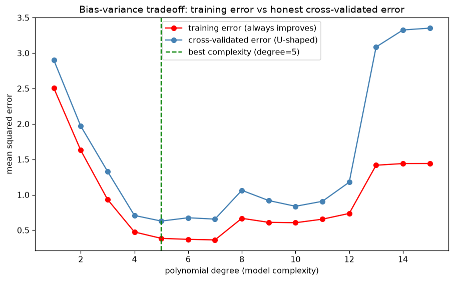
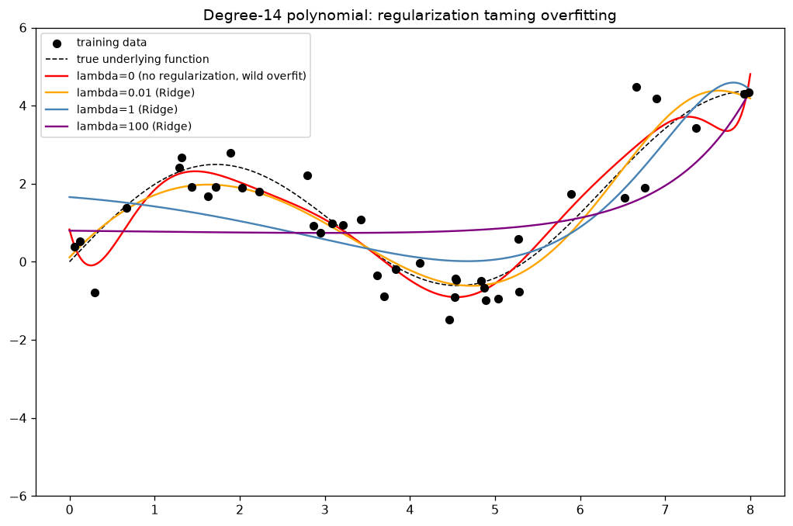

# Chapter 16: Bias-Variance Tradeoff, Cross-Validation, and Regularization

## The idea this chapter builds toward

This chapter gives precise mathematical teeth to the overfitting phenomenon you watched happen in Chapter 15, by decomposing a model's prediction error into exactly two competing sources — **bias** and **variance** — using the exact same algebra as Chapter 7's expectation/variance machinery. It then gives you the two standard practical tools for managing this tradeoff: **cross-validation** (a way to *measure* overfitting honestly) and **regularization** (a way to actively *prevent* it). Together, this chapter is the conceptual core of practical machine learning model-building.

## Deriving the bias-variance decomposition

Suppose the true relationship is $y = f(x) + \varepsilon$ (some true underlying function $f$, plus irreducible random noise $\varepsilon$ with mean 0 and variance $\sigma^2$). You train a model $\hat f$ on a particular sample of training data, and want to understand the *expected squared error* of its prediction at some point $x$, averaged over all the different training sets you *could* have drawn (echoing Chapter 9's "estimator as a random variable" framing — here, the whole trained model is the "estimator"). Using the variance identity from Chapter 7 ($\text{Var}(Z) = E[Z^2]-(E[Z])^2$, rearranged as $E[Z^2] = \text{Var}(Z) + (E[Z])^2$) applied to the error $Z = f(x) - \hat f(x)$, the expected squared prediction error decomposes cleanly into three additive pieces:

$$E\big[(y - \hat f(x))^2\big] = \underbrace{\big(f(x) - E[\hat f(x)]\big)^2}_{\text{Bias}^2} + \underbrace{\text{Var}(\hat f(x))}_{\text{Variance}} + \underbrace{\sigma^2}_{\text{Irreducible error}}$$

Each term, in plain language:

- **Bias²**: how far off is your model's *average* prediction (averaged over all possible training sets) from the true function $f(x)$? High bias means your model is systematically wrong — it's too simple/rigid to capture the real pattern, regardless of how much data you feed it (this is **underfitting**).
- **Variance**: how much does your model's prediction *change* depending on which particular training set you happened to draw? High variance means your model is overly sensitive to the specific noise in whatever training sample it saw — exactly the overfitting mechanism from Chapter 15's noise-column demonstration.
- **Irreducible error ($\sigma^2$)**: pure randomness in the real world that *no* model, however good, can ever predict away (recall $\varepsilon$ in the regression model from Chapter 14) — a hard floor on achievable accuracy that exists regardless of model choice.

## The tradeoff, made concrete with model complexity

Picture fitting polynomials of increasing degree to noisy data: a degree-1 line (very rigid) can't bend to match real curvature in the data — high bias, but very low variance (the line barely changes shape even if you resample the training data, since it has little flexibility to begin with). A degree-20 polynomial (very flexible) can wiggle through every single training point almost exactly — essentially zero *training* bias, but wildly high variance (a slightly different training sample produces a dramatically different wiggly curve, especially in regions with sparse data) — exactly the "memorizing noise" behavior from Chapter 15. The sweet spot — the complexity level that minimizes *total* error on new data — sits somewhere in between, and finding it is really the entire practical craft of model selection in machine learning.

<div class="labcard">
<div class="labkicker">Live — watch overfitting happen as you raise the degree</div>
<div class="labcontrols">
  <div class="labctrl"><label>Polynomial degree <b id="ch16_deg_label">3</b></label><input type="range" id="ch16_deg" min="1" max="14" value="3"></div>
  <div class="labctrl"><label>Noise level <b id="ch16_noise_label">0.5</b></label><input type="range" id="ch16_noise" min="0.05" max="2" step="0.05" value="0.5"></div>
</div>
<div class="labrow"><button class="labbtn secondary" id="ch16_regen">Generate new data</button></div>
<div class="labcanvas-wrap"><canvas id="ch16_canvas" width="820" height="320"></canvas></div>
<div class="lablegend">
  <span><i class="labswatch" style="background:var(--ink-muted)"></i>Training points</span>
  <span><i class="labswatch" style="background:var(--accent3)"></i>True function</span>
  <span><i class="labswatch" style="background:var(--accent4)"></i>Fitted polynomial</span>
</div>
<div class="labstat-grid">
  <div class="labstat"><div class="lbl">Training MSE</div><div class="val" id="ch16_train">—</div></div>
  <div class="labstat"><div class="lbl">True held-out MSE</div><div class="val" id="ch16_test">—</div></div>
</div>
<p class="labnote">Degree 1-2: too rigid (high bias). Push past degree 8-10: the curve snakes through every training point (training error near zero) while true held-out error gets WORSE — overfitting, live.</p>
</div>
<script>
document.addEventListener('DOMContentLoaded', function(){
  var SL = window.StatsLab;
  var trainX=[], trainY=[], testX=[], testY=[];
  function trueFn(x){ return Math.sin(x)*2 + 0.3*x; }
  function regenerate(){
    var noise = parseFloat(document.getElementById('ch16_noise').value);
    trainX=[]; trainY=[]; testX=[]; testY=[];
    for(var i=0;i<22;i++){ var x = Math.random()*8; trainX.push(x); trainY.push(trueFn(x)+SL.randNormal(0,noise)); }
    for(var j=0;j<300;j++){ var xx = Math.random()*8; testX.push(xx); testY.push(trueFn(xx)+SL.randNormal(0,noise)); }
    draw();
  }
  function draw(){
    var degree = parseInt(document.getElementById('ch16_deg').value);
    var coeffs = SL.polyFit(trainX, trainY, degree);
    var trainPred = trainX.map(function(x){return SL.polyEval(coeffs,x);});
    var trainMSE = SL.mean(trainX.map(function(x,i){return Math.pow(trainY[i]-trainPred[i],2);}));
    var testPred = testX.map(function(x){return SL.polyEval(coeffs,x);});
    var testMSE = SL.mean(testX.map(function(x,i){return Math.pow(testY[i]-testPred[i],2);}));
    document.getElementById('ch16_train').textContent = trainMSE.toFixed(3);
    document.getElementById('ch16_test').textContent = testMSE.toFixed(3);

    var plot = SL.makePlot(document.getElementById('ch16_canvas'));
    plot.setDomain([-0.3,8.3],[-6,6]); plot.clear(); plot.axes('x','y');
    plot.scatter(trainX.map(function(x,i){return [x,trainY[i]];}), SL.colors.inkSoft, 4);
    var truePts = []; for(var x=0;x<=8;x+=0.05) truePts.push([x, trueFn(x)]);
    plot.line(truePts, SL.colors.accent3, 2);
    var fitPts = []; for(var xf=0;xf<=8;xf+=0.03){ var y = SL.polyEval(coeffs,xf); y = Math.max(-6, Math.min(6, y)); fitPts.push([xf,y]); }
    plot.line(fitPts, SL.colors.accent4, 2.5);
  }
  document.getElementById('ch16_deg').addEventListener('input', function(e){ document.getElementById('ch16_deg_label').textContent = e.target.value; draw(); });
  document.getElementById('ch16_noise').addEventListener('input', function(e){ document.getElementById('ch16_noise_label').textContent = e.target.value; regenerate(); });
  document.getElementById('ch16_regen').addEventListener('click', regenerate);
  regenerate();
});
</script>

### Why this decomposition had to wait until now

This derivation is often attributed to a clear articulation by Stuart Geman, Elie Bienenstock, and René Doursat in a widely-cited 1992 paper on neural networks, though the underlying idea (that model flexibility trades off two different error sources) had been swirling in the statistics literature for decades before that (closely related to Fisher's efficiency ideas from Chapter 9, and to the adjusted-R² complexity penalty from Chapter 15). The 1992 paper's real contribution was popularizing this specific clean decomposition and applying it explicitly to the then-emerging question of how complex a neural network should be allowed to get — making this one of the earliest rigorous statistical treatments of what we'd now unambiguously call a deep learning question, decades before "deep learning" was the term anyone used.

## Cross-validation — honestly measuring where you are on the tradeoff

The core problem Chapter 15 exposed: evaluating a model on the *same data it was trained on* is systematically misleading (training error always looks optimistic, arbitrarily so as complexity increases). **Cross-validation** fixes this by reusing a trick you already understand deeply from Chapter 1: hold out part of your data as a stand-in "unseen population" the model never gets to train on, and evaluate performance there instead.

**k-fold cross-validation**, the standard version: split your data into $k$ roughly equal chunks ("folds"). For each fold in turn, train the model on the *other* $k-1$ folds and evaluate it on the held-out fold; average the $k$ resulting performance scores. This gives you an honest, low-variance estimate of how the model performs on data it hasn't seen, using *all* your data for both training and evaluation (just never the same data simultaneously) — directly addressing the population-vs-sample tension from Chapter 1 in a practical, repeatable procedure. A common choice is $k=5$ or $k=10$ — larger $k$ means more training data per fold (less bias in the error estimate) but more computation and, with $k=n$ (called **leave-one-out cross-validation**), potentially higher variance in the final averaged estimate, itself an echo of this chapter's central tradeoff theme appearing one level up, in how you evaluate models rather than in the models themselves.

## Regularization — actively fighting high variance

Rather than just *measuring* overfitting (cross-validation's job), **regularization** actively discourages a model from becoming too flexible/noise-fitting in the first place, by adding a penalty term to the loss function that punishes overly large or overly numerous coefficients:

$$\text{Loss} = SSE + \lambda \sum_j |\beta_j| \quad \text{(Lasso / L1)} \qquad \text{or} \qquad \text{Loss} = SSE + \lambda \sum_j \beta_j^2 \quad \text{(Ridge / L2)}$$

**Intuition**: a model minimizing $SSE$ alone (Chapter 14/15) is free to inflate coefficients as much as needed to chase every wiggle in the training noise. Adding $\lambda\sum\beta_j^2$ (or $\lambda\sum|\beta_j|$) makes that inflation *costly* — the model must now justify any large coefficient by a genuinely large reduction in $SSE$, not just a marginal, noise-driven improvement. $\lambda$ (a **hyperparameter** you choose, often via cross-validation) controls the tradeoff directly: $\lambda=0$ recovers plain least-squares (potentially high variance); very large $\lambda$ forces coefficients toward zero (high bias, low variance, eventually underfitting if pushed too far). Ridge (L2) tends to shrink all coefficients smoothly toward zero without eliminating any; Lasso (L1) can push some coefficients to *exactly* zero, effectively performing automatic feature selection — a direct, surgical answer to Chapter 15's noise-column problem: Lasso regularization would, with the right $\lambda$, zero out most of those useless noise coefficients automatically.

### Regularization is secretly a Bayesian prior — connecting back to Chapter 4

Here's a genuinely striking fact to end on, previewed fully in Chapter 17: adding an L2 penalty ($\lambda\sum\beta_j^2$) to a least-squares loss is *mathematically identical* to performing MLE (Chapter 10) after first assuming a Normal-distributed **prior belief** (Chapter 4) that each $\beta_j$ is probably close to zero, before seeing any data. In other words, "regularization" isn't a separate ad hoc trick bolted onto least-squares — it's Bayesian reasoning (posterior ∝ likelihood × prior) wearing a classical-statistics costume. This single observation is one of the deepest unifications in this entire book: Chapters 4, 10, and 16 — Bayes' Theorem, Maximum Likelihood, and regularization — are, underneath, variations on one idea.

## Figures



*Training error (keeps improving) vs cross-validated error (U-shaped) as polynomial degree increases. The green line marks the complexity level cross-validation selects as best.*



*A wildly overfit degree-14 polynomial (red) tamed by Ridge regularization at increasing lambda values, pulling the curve back toward the true underlying function (black dashed).*

## Run it yourself

`book/code/ch16_bias_variance_regularization.py` fits polynomials of degree 1 through 15 to noisy synthetic data, plots training error vs. cross-validated error against model complexity (making the classic U-shaped "sweet spot" curve visible directly), then applies Ridge regularization at several $\lambda$ values to the overly-complex polynomial and shows how increasing $\lambda$ pulls the wild, overfit curve back toward a smoother, better-generalizing one.

```bash
python book/code/ch16_bias_variance_regularization.py
```

## Why This Matters — In AI and In Everyday Life

**In AI / machine learning:**

- **L1/L2 regularization, dropout, and cross-validation**: these are not separate tricks -- they are the standard, default tools in nearly every real ML training pipeline, and this chapter is their complete justification.
- **Hyperparameter tuning**: choosing a regularization strength, model depth, or number of training epochs via cross-validation is the single most common practical workflow in applied machine learning.

**In everyday, non-AI life:**

- **A tailor fitting clothes**: too loose and it doesn't capture your shape (underfitting/high bias); tailored to one specific momentary body position and it won't move with you (overfitting/high variance) -- a genuinely useful everyday analogy for the tradeoff.
- **A student over-preparing for one specific practice exam**: memorizing the exact practice questions (low bias on that one test, but high variance -- it won't transfer) versus learning general principles (slightly imperfect on the practice test, but generalizes) is bias-variance in a classroom.

## Check your understanding

- In your own words, why does a very flexible model (high-degree polynomial) have low bias but high variance, while a very rigid model (straight line) has the reverse?
- Why is evaluating a model on its own training data systematically optimistic, and how does k-fold cross-validation fix this using data you already have?
- Explain, intuitively, why penalizing large coefficients ($\lambda\sum\beta_j^2$) reduces variance — what exactly is it preventing the model from doing?

## What's next

Chapter 17 goes deep on **Bayesian statistics** — the "posterior ∝ likelihood × prior" framework you've now seen echo through Bayes' Theorem (Chapter 4), MLE (Chapter 10), and regularization (this chapter) — formalizing it as a complete, coherent alternative to the frequentist machinery of Chapters 9-13, and resolving the confidence-interval interpretation discomfort flagged back in Chapter 11.
