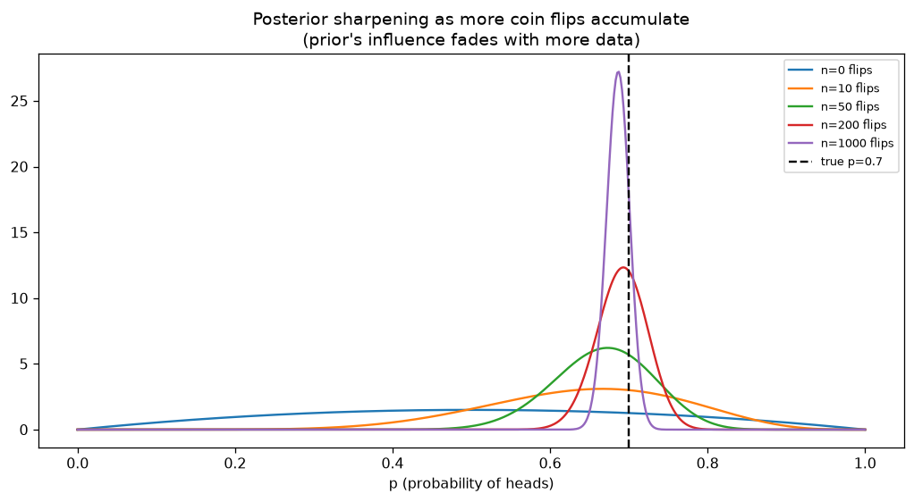

# Chapter 17: Bayesian Statistics in Depth

## The idea this chapter builds toward

Every chapter since 9 has used the **frequentist** framework: a true parameter is a fixed (if unknown) constant, and probability statements describe the long-run behavior of a *procedure* across hypothetical repeated samples (this is exactly why Chapter 11's confidence interval and Chapter 12's p-value both have those slightly awkward, indirect interpretations). This chapter presents the alternative, coherent framework hinted at since Chapter 4: treat the unknown parameter itself as a random variable with its own full probability distribution, representing your *degree of belief*, and update that belief with data using Bayes' Theorem directly. This isn't a totally separate subject - it's the same mathematical building blocks (Bayes' Theorem from Chapter 4, likelihood from Chapter 10) assembled into a different, internally consistent philosophy, with genuinely different practical answers to some questions.

> **Intuition, in one breath:** you start with a belief, you see evidence, and you blend the two in proportion to how confident each one was - then your updated belief becomes the starting belief next time. That's the whole idea.

## The frequentist/Bayesian divide, made concrete

Frequentist question: "If I repeated this experiment infinitely many times, what fraction of constructed intervals would contain the true $\mu$?" (A statement about the *procedure*.)

Bayesian question: "Given the data I actually observed, what is the probability distribution of $\mu$ itself?" (A direct statement about the *parameter*, treated as uncertain in the same sense a weather forecast treats tomorrow's rain as uncertain.)

Neither is "more correct" in some absolute sense - they're different, internally valid mathematical frameworks answering different questions, suited to different situations. You already met this fork in Chapter 4's backstory (Bayes and Laplace vs. the many mathematicians uneasy with assigning probabilities to fixed unknown facts) - this chapter is where that two-century-old disagreement gets fully resolved into precise, usable machinery.

## The Bayesian recipe, step by step

### 1. Choose a prior: $P(\theta)$

Before seeing any data, express your belief about the parameter $\theta$ as a full probability distribution. This might be based on previous studies, domain expertise, or deliberately chosen to be "weak"/uninformative if you want the data to speak almost entirely for itself.

### 2. Compute the likelihood: $P(\text{data}\mid\theta)$

Exactly Chapter 10's likelihood function - how probable is the data you actually observed, for each candidate value of $\theta$.

### 3. Combine via Bayes' Theorem to get the posterior: $P(\theta \mid \text{data})$

$$P(\theta \mid \text{data}) = \frac{P(\text{data}\mid\theta) \, P(\theta)}{P(\text{data})} \propto P(\text{data}\mid\theta)\,P(\theta)$$

Since the denominator $P(\text{data})$ doesn't depend on $\theta$ (it's just a normalizing constant, as in Chapter 4), it's common to write this as a proportionality: **posterior ∝ likelihood × prior**, the single sentence summary you first saw in Chapter 4, now applied to estimating an entire continuous parameter's distribution rather than choosing between two discrete hypotheses.

## Worked example - estimating a coin's bias, by hand, using a Beta prior

Suppose you want to estimate $p$, the true probability a coin lands heads, and you flip it 10 times, observing 7 heads. Being honest that you have mild prior belief the coin is probably close to fair (not a strong belief - you're open to being wrong), you choose a **Beta(2,2) prior** - a standard choice for probabilities (bounded between 0 and 1), whose shape is a gentle hump centered at 0.5 (chosen here specifically because it is mathematically *conjugate* to the Binomial likelihood - see the box below - making the update trivially easy to compute by hand, which is exactly why Beta priors are the standard textbook choice for this exact problem).

The Binomial likelihood for $k=7$ heads out of $n=10$ is proportional to $p^7(1-p)^3$ (dropping the $\binom{n}{k}$ constant, since it doesn't depend on $p$ and so doesn't affect the shape of the posterior). The Beta(2,2) prior density is proportional to $p^{2-1}(1-p)^{2-1} = p(1-p)$. Multiplying likelihood × prior:

$$\text{posterior} \propto p^7(1-p)^3 \times p(1-p) = p^{8}(1-p)^{4}$$

This is recognizably (up to a normalizing constant) a **Beta(9, 5)** distribution - using the general pattern Beta$(\alpha,\beta)$'s density $\propto p^{\alpha-1}(1-p)^{\beta-1}$, matching exponents $\alpha-1=8 \Rightarrow \alpha=9$ and $\beta-1=4\Rightarrow\beta=5$. The posterior mean of a Beta$(\alpha,\beta)$ is $\frac{\alpha}{\alpha+\beta}$, so our updated best estimate of $p$ is $\frac{9}{14}\approx 0.643$ - notice this sits *between* the prior's belief (0.5) and the raw data's suggestion ($7/10=0.7$), pulled toward 0.5 by the prior's gentle skepticism, exactly the "posterior as a weighted compromise between prior and data" intuition that the Bayesian framework formalizes everywhere.

### Why conjugate priors made Bayesian statistics computationally tractable for 200 years

Notice the genuinely convenient coincidence above: a Beta prior, combined with a Binomial likelihood, produces *another* Beta distribution as the posterior - this is called a **conjugate prior** relationship, and it's why Beta/Binomial (and similarly, Normal/Normal, and Gamma/Poisson) pairings are the textbook workhorses of Bayesian statistics: the algebra stays in closed form, with no numerical integration required, across every stage of updating. For two centuries, this computational convenience wasn't a minor nicety - it was the *entire reason* Bayesian methods remained practically usable at all, because for almost any other prior/likelihood combination, computing the posterior exactly requires integrating over all possible $\theta$ values (recall Chapter 6: continuous probabilities require integrals), which has no closed-form solution for most realistic models with many parameters - a genuinely hard computational problem.

### Reconstructing it yourself - the Normal-Normal conjugate update, by hand

The Beta-Binomial pairing above was mentioned as one of several conjugate pairs - let's actually work the other common one, since it's the Bayesian version of exactly the Normal-mean estimation problem you already know from Chapter 10's MLE. **If your guess is that a Normal prior combined with Normal data should produce another Normal posterior - test it by multiplying the two densities together and collecting terms.**

Suppose your prior belief about an unknown mean $\mu$ is itself Normal, $\mu \sim N(\mu_0, \tau_0^2)$ (a specific prior guess $\mu_0$, with $\tau_0^2$ expressing how confident you are in that guess), and you observe one data point $x \sim N(\mu, \sigma^2)$ with known $\sigma$. The posterior is proportional to prior $\times$ likelihood:

$$P(\mu\mid x) \propto \underbrace{\exp\left(-\frac{(\mu-\mu_0)^2}{2\tau_0^2}\right)}_{\text{prior}} \times \underbrace{\exp\left(-\frac{(x-\mu)^2}{2\sigma^2}\right)}_{\text{likelihood}}$$

Multiplying two exponentials means *adding* their exponents, and expanding both quadratics in $\mu$, collecting $\mu^2$ terms and $\mu$ terms separately, and completing the square (the same "write it back in the standard bell-curve shape" algebra used throughout Chapter 6) lands you - after a page of otherwise unremarkable algebra not reproduced in full here - on a new Normal distribution whose precision (inverse variance, $1/\text{variance}$) and mean are:

$$\frac{1}{\tau_1^2} = \frac{1}{\tau_0^2} + \frac{1}{\sigma^2}, \qquad \mu_1 = \tau_1^2\left(\frac{\mu_0}{\tau_0^2} + \frac{x}{\sigma^2}\right)$$

**Precisions (not variances) simply add** - a genuinely elegant fact: your posterior's confidence is literally the sum of your prior's confidence and the data's confidence, measured in the same "inverse-variance" currency. And the posterior mean $\mu_1$ is a **precision-weighted average** of the prior guess $\mu_0$ and the observed data $x$ - if your prior was very confident ($\tau_0^2$ small, so $1/\tau_0^2$ large), the posterior barely budges from $\mu_0$ even after seeing data; if your prior was vague ($\tau_0^2$ large), the posterior is almost entirely driven by $x$. This is the exact mathematical mechanism behind the coin-flip example's qualitative observation that "the posterior sits between the prior and the data" - here you can see precisely *how far* between the two it sits, as a weighted average with explicit, computable weights.

## Worked example - by hand, larger

This time let's run the Normal-Normal update with actual numbers and watch the precision-weighted average do its job. A sensor measures a physical quantity (say, a component's true resistance) in some fixed units. Your prior belief, from the manufacturer's spec sheet, is $\mu_0 = 100$ with prior variance $\tau_0^2 = 4$ (so prior precision $1/\tau_0^2 = 0.25$ - you're fairly confident). The measurement instrument is noisy with known variance $\sigma^2 = 1$ (precision $1/\sigma^2 = 1$). You take a single reading: $x = 104$.

**Step 1 - add the precisions.** Posterior precision $= 0.25 + 1 = 1.25$. So posterior variance $\tau_1^2 = 1/1.25 = 0.8$ - sharper (smaller variance) than either input alone, as it must be, since two sources of information can only make you more certain, never less.

**Step 2 - precision-weighted average for the mean.** $\mu_1 = \tau_1^2\left(\frac{\mu_0}{\tau_0^2} + \frac{x}{\sigma^2}\right) = 0.8 \times \left(\frac{100}{4} + \frac{104}{1}\right) = 0.8 \times (25 + 104) = 0.8 \times 129 = 103.2$.

Sanity-check with the weighted-average reading: the prior carried weight $0.25$ and the data carried weight $1$, so the data should pull harder - and indeed $103.2$ sits much closer to the data's $104$ than to the prior's $100$. As a fraction, the data's share is $1/1.25 = 0.8$, and $0.8 \times 104 + 0.2 \times 100 = 83.2 + 20 = 103.2$. ✓

**Step 3 - what if the instrument were noisy instead?** Suppose the same $x=104$ came from a sloppier sensor with $\sigma^2 = 16$ (precision $0.0625$). Now posterior precision $= 0.25 + 0.0625 = 0.3125$, posterior variance $= 3.2$, and $\mu_1 = 3.2 \times (\frac{100}{4} + \frac{104}{16}) = 3.2 \times (25 + 6.5) = 3.2 \times 31.5 = 100.8$. The posterior barely budged from the prior - the weak measurement got almost no weight. **The same data point shifts your belief a lot or a little depending entirely on how precise both the prior and the measurement were; precisions literally decide the tug-of-war.**

**Takeaway: Bayesian updating is precision-weighted averaging - the more confident a source is (smaller variance, bigger precision), the more the posterior leans its way, and combining sources always leaves you at least as certain as the best of them.**

## Why Bayesian methods were a historical dead end for so long, and what revived them

Outside of a few conjugate-prior special cases, Bayesian statistics was largely impractical for complex, real-world, multi-parameter problems until computers became powerful enough (starting seriously in the late 1980s-1990s) to run **Markov Chain Monte Carlo (MCMC)** methods - a family of simulation techniques that *approximate* the posterior distribution numerically rather than requiring a closed-form solution, by cleverly sampling from it even when its exact formula is intractable (full treatment in Chapter 24, once you have the Markov chain vocabulary needed to understand how it works). This computational unlock is a large part of why Bayesian methods, after roughly two centuries on the philosophical sidelines of mainstream (largely Fisher/Neyman-dominated frequentist) 20th-century statistics, surged back into widespread practical use from the 1990s onward - and it's also directly why Bayesian deep learning, a genuinely modern and still-developing subfield, needs serious computational machinery (variational inference, which approximates MCMC's job more cheaply) to be tractable at the scale of neural networks with millions of parameters.

## Credible intervals vs. confidence intervals - finally resolving Chapter 11's discomfort

A **95% credible interval** is the Bayesian posterior distribution's direct equivalent of a confidence interval, but with the straightforward interpretation Chapter 11 explicitly denied you: "given the data I observed, there is a 95% probability the true $\theta$ lies in this specific interval" - a perfectly legitimate statement *within the Bayesian framework*, precisely because $\theta$ is treated as a random variable with a genuine posterior probability distribution, not a fixed constant. If you found Chapter 11's frequentist interpretation unsatisfying, that discomfort reflected a real, valid intuition - you were just reaching for a Bayesian-flavored statement using frequentist machinery that isn't built to support it. With real data and weak/uninformative priors, credible intervals and confidence intervals often end up numerically very close - the disagreement is almost entirely philosophical/interpretational, not usually about the final numbers, which is worth knowing so you don't feel you must pick a "side" for every analysis.

## How regularization is secretly a Bayesian prior (promised in Chapter 16, now fully delivered)

Chapter 16 promised this connection: Ridge regression's $\lambda\sum\beta_j^2$ penalty is mathematically identical to performing MLE after assuming each $\beta_j$ has an independent $N(0,\tau^2)$ prior (for some $\tau$ related to $\lambda$) - maximizing the resulting posterior (not just the plain likelihood) is called **Maximum A Posteriori (MAP)** estimation, and it reproduces Ridge regression's loss function exactly. Lasso's $\lambda\sum|\beta_j|$ penalty similarly corresponds to a Laplace-distributed prior (a distribution with a sharper peak at zero than Normal, which is exactly why it pushes coefficients all the way to zero rather than just shrinking them). This means: **every time you choose a regularization strength, you are implicitly choosing a prior belief about how large your model's parameters should plausibly be** - regularization was Bayesian reasoning all along, just without the vocabulary to say so explicitly.

## Figures



*The posterior distribution for a coin's true bias p, sharpening and shifting toward the true value (black dashed line) as more coin flips accumulate -- the prior's influence visibly fades with more data.*

## Run it yourself

`book/code/ch17_bayesian_statistics.py` reproduces the coin-bias Beta-Binomial example exactly as derived above, visualizes how the posterior shifts and sharpens as you feed it more and more coin flips (watch the prior's influence fade as data accumulates - a general Bayesian phenomenon worth seeing directly), and concretely demonstrates the Ridge-regression-as-MAP-estimation connection by fitting the same regression two ways - once via `sklearn`'s Ridge, once by directly maximizing a Gaussian-likelihood-times-Gaussian-prior posterior - and showing they match.

```bash
python book/code/ch17_bayesian_statistics.py
```

## Why This Matters - In AI and In Everyday Life

**In AI / machine learning:**

- **Bayesian hyperparameter optimization**: tools used throughout ML research treat each hyperparameter setting's performance as uncertain and use Bayesian updating to decide what to try next, directly using this chapter's machinery.
- **Cold-start recommendation systems**: when a new user or item has almost no data, a sensible prior belief (informed by similar users/items) combined with the little data available is exactly Bayesian updating in production.
- **Variational inference in modern generative models**: VAEs, Bayesian neural networks, and the latent-variable stages of many diffusion models all approximate an intractable posterior with a tractable one, replacing the exact conjugate updates of this chapter with an optimization that finds the closest distribution - the computational legacy of the conjugate-prior revival described here.
- **RLHF's prior-keeping KL penalty**: fine-tuning a language model against human preferences while penalizing divergence from the pretrained model is a MAP-style update where the pretrained weights play the prior role, keeping the reward-driven posterior from wandering too far from sensible behavior.

**In everyday, non-AI life:**

- **Doctors updating a diagnosis as test results come in**: each new test result updates the posterior belief about what's wrong, which then becomes the prior for interpreting the next test -- real diagnostic reasoning, not just theory.
- **Weather forecasts updating through the day**: a morning forecast is a prior; afternoon radar data updates it to a posterior, which becomes the new prior for the evening forecast -- sequential Bayesian updating in daily life.

## Check your understanding

- In your own words, contrast what a frequentist confidence interval and a Bayesian credible interval are each actually claiming.
- Why does the posterior mean $\frac{9}{14}$ in the worked example sit between the prior's belief (0.5) and the raw observed proportion (0.7), and what happens to this balance as you collect much more data (say 1000 flips, 700 heads)?
- Explain, in your own words, why Ridge regression's L2 penalty corresponds to a Normal prior on the coefficients, using the posterior ∝ likelihood × prior logic.

## Exercises

### Exercise 1 - Update a Beta posterior by hand

A different coin uses a Beta(1,1) prior (flat/uninformative). You flip it 8 times and see 6 heads. What is the posterior distribution, and what is the posterior mean?

<details><summary>Show solution</summary>

Likelihood $\propto p^6(1-p)^2$. Prior is Beta(1,1): $p^{1-1}(1-p)^{1-1} = p^0(1-p)^0 = 1$ (flat). Multiplying: posterior $\propto p^6(1-p)^2$, which is Beta$(\alpha,\beta)$ with $\alpha - 1 = 6 \Rightarrow \alpha = 7$ and $\beta - 1 = 2 \Rightarrow \beta = 3$. So the posterior is **Beta(7,3)**.

Posterior mean $= \frac{\alpha}{\alpha+\beta} = \frac{7}{10} = 0.7$, matching the raw observed proportion $6/8 = 0.75$ pulled very slightly toward the flat prior's $0.5$. With an uninformative prior, the posterior mean is $(k+\alpha-1)/(n+\alpha+\beta-2) = (6+0)/(8+0) = 0.75$ if the prior truly contributes nothing - here the Beta(1,1)'s uniform weight gives $7/10$; the small gap is the prior's faint pull.

</details>

### Exercise 2 - Precision-weighted update with numbers

Prior: $\mu_0 = 20$, $\tau_0^2 = 9$. One observation: $x = 26$, $\sigma^2 = 3$. Compute the posterior variance and posterior mean.

<details><summary>Show solution</summary>

Precisions: prior $1/9 \approx 0.1111$, data $1/3 \approx 0.3333$. Sum $= 0.4444$, so $\tau_1^2 = 1/0.4444 = 2.25$.

Mean: $\mu_1 = \tau_1^2\left(\frac{\mu_0}{\tau_0^2} + \frac{x}{\sigma^2}\right) = 2.25 \times \left(\frac{20}{9} + \frac{26}{3}\right) = 2.25 \times (2.2222 + 8.6667) = 2.25 \times 10.8889 = 24.5$.

Check: data weight $= \frac{1/3}{1/9 + 1/3} = \frac{0.3333}{0.4444} = 0.75$, so $0.75 \times 26 + 0.25 \times 20 = 19.5 + 5 = 24.5$. ✓ The data pulled the estimate most of the way from $20$ toward $26$.

</details>

### Exercise 3 - Conceptual: prior as a human-preference knob in RLHF

In reinforcement learning from human feedback (RLHF), a language model is fine-tuned against a reward model, typically with a KL-divergence penalty keeping the new model close to the original pretrained one. Explain how this penalty plays the same role as a Bayesian prior.

<details><summary>Show solution</summary>

The pretrained model acts as a **prior belief** over what good outputs look like - a strong, data-informed starting point. The reward signal is the **likelihood** - new evidence about which outputs humans actually prefer. The KL penalty is the mechanism that stops the posterior (the fine-tuned model) from drifting arbitrarily far from the prior in pursuit of reward: just as a tight Normal prior (small $\tau_0^2$) keeps a posterior mean close to $\mu_0$, a large KL penalty keeps the fine-tuned policy close to the pretrained one.

Without it, the model over-optimizes the imperfect reward model - the Bayesian analogue of an overconfident likelihood overwhelming a reasonable prior, yielding outputs that score well but are degenerate. The penalty is, quite literally, choosing how much to trust your prior versus your new data. And as in this chapter's update rule, the balance is a weighted tug-of-war, not an all-or-nothing choice.

</details>

## What's next

Chapter 18 steps back toward a more computational, less distributionally-assumption-heavy toolkit: **resampling methods** (the bootstrap and permutation tests), which let you estimate uncertainty and test hypotheses directly from your data via repeated simulation, often needed exactly when the clean-formula assumptions behind Chapters 11-13 don't quite hold.
