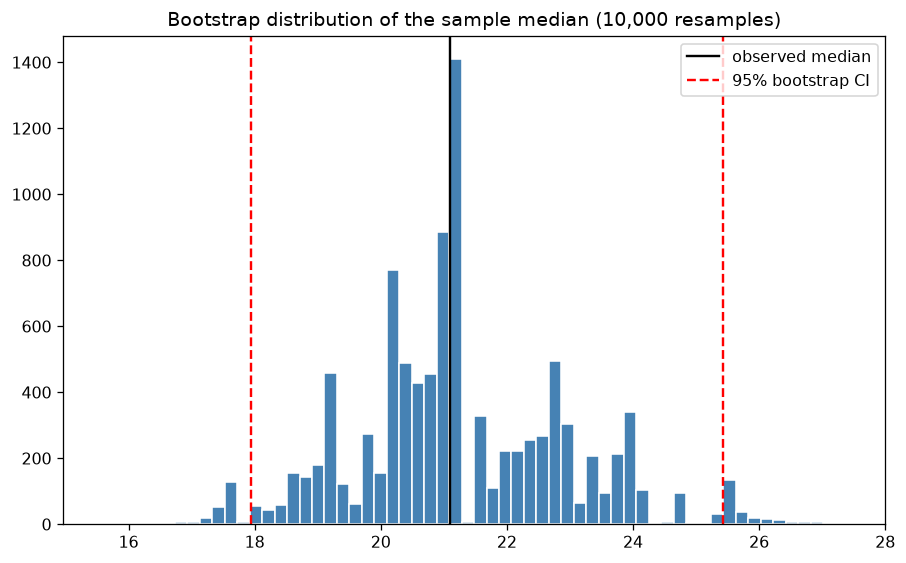
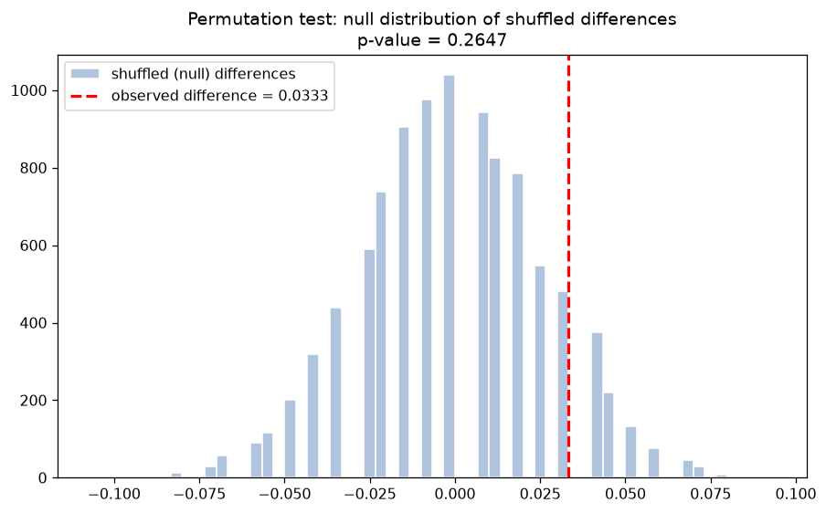

# Chapter 18: Resampling - Bootstrap and Permutation Tests

## The idea this chapter builds toward

Chapters 11-13's confidence intervals and hypothesis tests leaned on known formulas (standard error $=\sigma/\sqrt n$, t-distributions, chi-square distributions) that depend on specific distributional assumptions (Normality, independence, known sample-size behavior). **Resampling methods** sidestep needing those formulas at all: instead of deriving a sampling distribution mathematically, you *simulate* it directly from your own data, repeatedly, by a computer. This chapter gives you two such methods - the **bootstrap** (for building confidence intervals around almost any statistic) and **permutation tests** (for hypothesis testing without distributional assumptions) - both of which became practical only once computers made brute-force repeated resampling cheap, making this one of the more recent major ideas in this book's timeline.

> **Intuition, in one breath:** instead of trusting a formula about how your statistic would jump around if you could re-run the whole study, you just re-run it thousands of times on shuffled, resampled versions of the data you already have - and watch how much it jumps.

## The bootstrap - the core trick, explained from first principles

Here's the conceptual leap, and it's worth sitting with because it initially sounds almost like cheating: you don't have access to the true population (Chapter 1's whole problem), so you can't draw new samples from it to see how your statistic (say, the median) would vary from sample to sample. The bootstrap's trick: **treat your one actual sample as a stand-in for the population**, and draw new "fake" samples *from it*, **with replacement**, of the same size as your original sample. Because your sample is itself (hopefully) a reasonably representative slice of the real population, resampling from it mimics - imperfectly, but often remarkably well - what would happen if you could actually draw fresh samples from the true population.

### Why "with replacement" specifically?

If you resampled *without* replacement at the same size $n$ as your original sample, you'd just get back the exact same sample every single time (same $n$ items, no replacement, from a pool of exactly $n$ items - there's only one way to do that). Sampling *with replacement* means each "fake" resample can include some original data points multiple times and omit others entirely - introducing exactly the kind of sample-to-sample variability that a real repeated-sampling-from-the-population process would also produce, letting you empirically observe how your statistic fluctuates.

### The procedure, step by step

1. From your original sample of size $n$, draw a new sample of size $n$, **with replacement** (some original points repeat, some are left out).
2. Compute your statistic of interest (mean, median, correlation, a regression coefficient - anything) on this resampled "bootstrap sample."
3. Repeat steps 1-2 many times (typically 1,000-10,000 times), building up a whole distribution of the statistic across all these bootstrap resamples.
4. This distribution of bootstrap statistics *is* your empirical approximation of the statistic's sampling distribution - directly usable to build a confidence interval (e.g., take the 2.5th and 97.5th percentiles of the bootstrap distribution for a 95% interval - called the **percentile method**), with no formula for standard error ever required.

### Why this is especially useful beyond the mean

Chapter 11's confidence interval formula worked specifically for the mean, leaning on the CLT. But what if you want a confidence interval for the **median**, or for a **correlation coefficient**, or for the **ratio of two medians** - statistics with no clean, universally-agreed-upon standard-error formula (or one that requires strong, possibly-wrong distributional assumptions)? The bootstrap handles *any* statistic identically, with the same simple resample-and-recompute procedure - this generality, not raw statistical power, is its primary appeal.

### Reconstructing it yourself - a surprising, exact fact hiding inside "with replacement"

Here's a genuinely pretty question worth working out directly: when you draw a bootstrap resample of size $n$ with replacement from your original $n$ data points, what fraction of the *original* points end up **never chosen at all** in a given resample? **If your guess is "roughly a third are left out" - that's a startlingly good guess; let's see exactly why, and why that specific fraction isn't a coincidence.**

For any single original data point, the probability it is *not* picked on one specific draw is $\frac{n-1}{n} = 1-\frac1n$ (there are $n$ equally likely points to draw, and $n-1$ of them aren't this one). Since the $n$ draws making up a resample are independent (with-replacement sampling, by design), the probability this same point is missed on *every single one* of the $n$ draws is:

$$P(\text{point never chosen}) = \left(1-\frac1n\right)^n$$

Recognize this? It's the exact same limit expression from Chapter 5's Poisson derivation and Chapter 0's compound-interest aside, just evaluated at a fixed ratio instead of taken to a limit at a fixed $\lambda$. As $n$ grows large, $\left(1-\frac1n\right)^n \to e^{-1} \approx 0.368$. **About 36.8% of the original data points are excluded from any given bootstrap resample - meaning about 63.2% are included (some of them more than once, to fill the remaining slots).** This isn't just a cute fact: it's the exact mathematical justification for **out-of-bag error estimation** in random forests and bagged ensembles (Chapter 16's ensembling idea, operationalized) - since roughly a third of the training data is excluded from any one bootstrap-trained tree, that excluded third serves as a free, built-in held-out test set for evaluating that specific tree, without needing a separate validation split at all.

## The backstory - Bradley Efron names and formalizes an old gambling-adjacent idea

**Bradley Efron** introduced the bootstrap formally in a 1979 paper, explicitly naming it after the phrase "pull yourself up by your bootstraps" - an idiom for accomplishing something seemingly impossible using only what you already have on hand (originally a sarcastic, physically-impossible image, used here in a knowingly self-deprecating way to describe a method that sounds almost too good to be true: estimating a sampling distribution's spread without any new data or any distributional formula). Efron's genuinely sharp insight was recognizing that a specific family of older, more narrowly-scoped resampling techniques (notably Quenouille and Tukey's earlier "jackknife" method, which works by systematically leaving out one observation at a time rather than resampling with replacement) could be generalized into one clean, universal, and remarkably broadly-applicable procedure - and that the then-newly-cheap availability of computing power made running thousands of resamples for *any* dataset entirely practical for the first time, unlocking a method whose core logic had arguably existed in pieces for decades but had never been computationally affordable enough to use routinely.

## Permutation tests - hypothesis testing by shuffling labels

Where the bootstrap builds confidence intervals, **permutation tests** answer a hypothesis-testing question (Chapter 12) with a similarly simulation-based, assumption-light approach. Suppose you're testing whether two groups (e.g., a treatment and control group) have genuinely different means. The null hypothesis is that group *labels are meaningless* - that treatment and control come from the same underlying distribution, and any observed difference is just due to which data points randomly happened to land in which group.

**The trick**: if the null hypothesis is true, the group labels really are arbitrary - so you can randomly **shuffle** (permute) which data points are labeled "treatment" vs "control," recompute the difference in group means for this shuffled/fake labeling, and repeat this shuffling thousands of times. This builds up an empirical distribution of "what differences in means look like when the labels are meaningless" - directly from your actual data, with zero distributional assumptions. Your p-value is then simply: *what fraction of these shuffled, label-meaningless differences were as extreme as (or more extreme than) the difference you actually observed in the real, correctly-labeled data?* If your real observed difference is far more extreme than almost all the shuffled versions, that's strong evidence the group labels genuinely matter.

This method traces back conceptually to **Ronald Fisher** himself (the same Fisher from Chapters 9, 10, and 13) in the 1930s, who described permutation-based reasoning as the logically "exact" foundation underlying his more commonly-used parametric tests (like the t-test) - but doing it by hand for even modest sample sizes was computationally prohibitive before computers (the number of possible permutations explodes combinatorially with sample size, e.g. splitting just 20 subjects into two groups of 10 already has over 184,000 distinct permutations) - another example, alongside the bootstrap and MCMC (Chapters 17 and 24), of an idea that existed in theory long before computers made it practically usable.

## Worked example, conceptually

Two groups of website visitors: 15 saw design A, converting at particular rates; 15 saw design B. Observed difference in conversion rate: 4 percentage points, in B's favor. A permutation test would: combine all 30 visitors' outcomes into one pool, repeatedly reshuffle which 15 get relabeled "A" and which 15 get relabeled "B" (ignoring the true original labels), and recompute the fake "difference" each time. If only, say, 2% of these 10,000 random reshufflings produce a fake difference as large as the real observed 4 points, your permutation p-value is 0.02 - strong evidence the real design difference isn't just random noise in who happened to land in which group.

## Worked example - by hand, larger

Let's actually build a bootstrap distribution by hand, small enough to fully enumerate. Suppose a tiny dataset of model inference latencies (in milliseconds) on 5 examples: $[2, 4, 4, 6, 9]$. The sample mean is $\bar x = \frac{2+4+4+6+9}{5} = 25/5 = 5$. We want a bootstrap standard error for the mean, so we resample with replacement and recompute.

Rather than 10,000 resamples, consider all the *distinct bootstrap resamples up to our small n*. Because the original values cluster ($4$ appears twice), let's trace a few concrete resamples and their means:

- Resample $[2,2,4,6,9]$: mean $= 23/5 = 4.6$.
- Resample $[4,4,4,4,9]$: mean $= 25/5 = 5.0$.
- Resample $[2,6,6,9,9]$: mean $= 32/5 = 6.4$.
- Resample $[2,2,2,2,2]$: mean $= 2.0$ (possible! every draw happened to land on the index holding value 2).
- Resample $[9,9,9,9,9]$: mean $= 9.0$ (equally possible, though very unlikely: probability $(1/5)^5 = 1/3125 \approx 0.00032$).

Notice how the bootstrap means spread both *below* the smallest imaginable formula-based behavior and *above*: the resample means range from $2.0$ to $9.0$, a much wider spread than the original data's range of $2$-$9$ would naively suggest for an average. That widening is the method working - it's reconstructing, from a single 5-point sample, a plausible spread of what the mean could have been. The bootstrap standard error is the standard deviation (Chapter 2's formula) of that whole collection of resample means; with enough resamples it stabilizes to roughly $s/\sqrt n$ here, where $s$ is the sample SD, but the point is you *measured* it without deriving anything.

Now a permutation-test version on the same kind of small data. Two model variants, each tested on 3 inputs. Variant A scores: $[8, 9, 7]$ (mean $8$). Variant B scores: $[10, 12, 8]$ (mean $10$). Observed difference $= 10 - 8 = 2$ in B's favor. Under the null (labels meaningless), we pool all six values $[7,8,8,9,10,12]$ and consider every way to split them into two groups of 3. There are $\binom{6}{3} = 20$ such splits. The most extreme split in B's favor is $\{10,12,8\}$... wait - that's exactly the observed one, giving difference $2$. The *most* extreme possible is B getting the three largest $\{10,12,9\}$ vs A getting $\{7,8,8\}$: difference $\frac{31}{3} - \frac{23}{3} = \frac{8}{3} \approx 2.67$. Count how many of the 20 splits give a difference $\geq 2$: only the two symmetric extremes, giving a permutation p-value of roughly $2/20 = 0.1$ - weak evidence, since with only 3 and 3 the test simply can't resolve small effects. **This "too few permutations to be conclusive" pinch is exactly why permutation tests were impractical by hand and needed computers.**

**Takeaway: both methods manufacture a whole distribution of "what could have happened" from the data you already have - the bootstrap by resampling, the permutation test by relabeling - and you read your answer off that simulated spread instead of a formula.**

## Figures



*The bootstrap distribution of the sample median, built from 10,000 resamples with replacement, with the 95% percentile-based confidence interval marked.*



*A permutation test's null distribution (differences in conversion rate under randomly shuffled group labels), with the real observed difference marked in red.*

## Run it yourself

`book/code/ch18_resampling_methods.py` builds a bootstrap confidence interval for the **median** of a skewed dataset (a statistic with no simple textbook standard-error formula) and compares it to a naive Normal-approximation interval to show where they diverge, then runs a full permutation test on a two-group conversion-rate comparison, visualizing the simulated null distribution of shuffled differences against the real observed difference.

```bash
python book/code/ch18_resampling_methods.py
```

## Why This Matters - In AI and In Everyday Life

**In AI / machine learning:**

- **Bootstrap confidence intervals for any ML metric**: when there's no clean textbook formula for a metric's uncertainty (e.g. an F1 score or a custom business metric), bootstrapping the test set is the standard practical fix used in real ML evaluation.
- **Permutation-based feature importance**: a standard, assumption-light way to measure how much a feature matters to a trained model is to permute (shuffle) that feature's values and see how much performance drops -- literally this chapter's permutation-test logic repurposed.
- **Out-of-bag error in random forests and gradient boosting**: because each tree trains on a bootstrap resample that excludes roughly 36.8% of the data, those excluded points form a free held-out set for estimating that tree's error - the $\left(1-\frac1n\right)^n \to e^{-1}$ fact from this chapter is the reason the trick works at all.
- **Bootstrap-based uncertainty in LLM and diffusion evaluation**: benchmark scores for generative models are increasingly reported with bootstrap confidence intervals over the test set, precisely because metrics like pass@k or human-preference win rates have no tidy sampling formula and the samples are small.

**In everyday, non-AI life:**

- **Estimating uncertainty in a small-sample medical or industrial study**: when you only have a handful of measurements and no clean formula applies, bootstrapping lets you still get a defensible confidence interval.
- **Testing whether a process change actually helped**, using only the limited before/after data a small factory or clinic actually has, rather than assuming a textbook distribution that may not fit.

## Check your understanding

- Why does resampling *with* replacement (not without) introduce the variability needed to approximate a sampling distribution?
- In your own words, explain what the "null world" looks like in a permutation test, and why shuffling labels simulates it directly.
- For what kind of statistic would you reach for the bootstrap instead of a classical formula-based confidence interval, and why?

## Exercises

### Exercise 1 - Bootstrap the median by hand

Dataset of 5 response times: $[1, 3, 3, 8, 20]$. The sample median is $3$. List three distinct bootstrap resamples and their medians, then explain why you'd expect the bootstrap median distribution here to be lumpy (not smooth).

<details><summary>Show solution</summary>

Example resamples (with replacement, size 5):

- $[1,1,3,8,20]$: sorted $[1,1,3,8,20]$, median $= 3$.
- $[3,3,3,3,20]$: sorted $[3,3,3,3,20]$, median $= 3$.
- $[1,3,8,8,20]$: sorted $[1,3,8,8,20]$, median $= 8$.
- $[1,1,1,3,3]$: sorted $[1,1,1,3,3]$, median $= 1$.

The medians cluster hard on the value $3$ because $3$ appears twice in the original data, so it gets drawn often and is frequently the middle value. That makes the bootstrap distribution **lumpy** - it can only ever take values equal to the original data points (medians of resamples are always one of the observed values), so you get spikes rather than a smooth curve. With 5 points the lumps are very visible; with hundreds of points they smooth out. This is exactly why the bootstrap still works for the median even though no clean standard-error formula exists: the method doesn't care how lumpy the underlying statistic's behavior is.

</details>

### Exercise 2 - Permutation test with numbers

Two ad campaigns: A gets clicks from 4 of 8 users, B gets clicks from 7 of 8. Observed difference in click rate $= \frac{7}{8} - \frac{4}{8} = 0.375$. Under the null, all 11 clickers are pooled across 16 users. If the most extreme possible shuffled split gave a difference of $\frac{8}{8} - \frac{3}{8} = 0.625$, and a quick simulation found only 1.4% of shuffles matched or beat the observed $0.375$, what is the p-value and what would you conclude?

<details><summary>Show solution</summary>

The permutation p-value is the fraction of null (shuffled) differences at least as extreme as the observed $0.375$. The simulation says **1.4%**, so $p \approx 0.014$.

Under the usual 5% threshold, this is significant: the observed gap is larger than almost all the "labels don't matter" shuffles, so we reject the null and conclude the campaign difference is unlikely to be pure random assignment. Note the p-value here carries *no distributional assumption* - no Normal, no t-distribution - it's read straight off the simulated null distribution, which is the entire selling point of the permutation approach over a textbook two-proportion test.

</details>

### Exercise 3 - Conceptual: bootstrap vs. permutation, which and why

You want a 95% confidence interval for the ratio of two groups' medians in a small study. Would you use the bootstrap or a permutation test, and why is the other one the wrong tool for this question?

<details><summary>Show solution</summary>

Use the **bootstrap**. A confidence interval is a statement about the *spread of an estimate* - "if I redrew my data, how much would this ratio move around?" - which is exactly what resampling-with-replacement reconstructs. It also handles messy statistics like a ratio of medians that have no clean standard-error formula, which is the bootstrap's central advantage.

A **permutation test** answers a hypothesis-testing question - "is there any difference at all between the groups?" - by simulating the null of meaningless labels. It produces a p-value, not a confidence interval, so it's the wrong tool here. The crisp rule: estimating uncertainty and interval-building $\to$ bootstrap; testing whether groups differ $\to$ permutation.

</details>

## What's next

Chapter 19 takes a short but essential detour into **linear algebra** - vectors, matrices, and the geometric intuition behind them - which you'll need as genuine prerequisite vocabulary for multivariate statistics (Chapter 20), the compact matrix form of multiple regression promised back in Chapter 15, and essentially all of modern machine learning notation from here onward.
