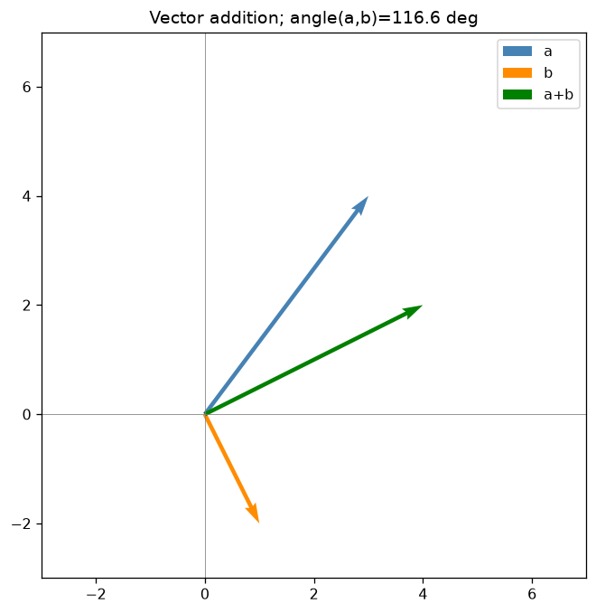
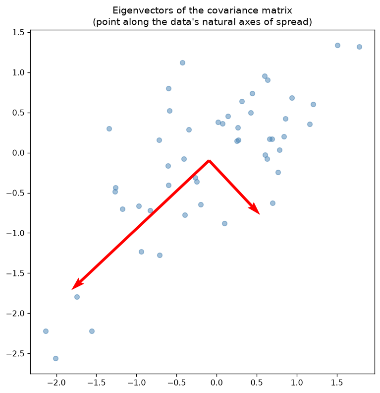

# Chapter 19: Linear Algebra Essentials for Statistics and ML

## The idea this chapter builds toward

Everything from here on - multivariate statistics, PCA, the inner workings of neural networks - is written in the language of vectors and matrices, because it is a dramatically more compact and computationally natural way to describe "many numbers interacting with many other numbers at once" than writing out giant sums of individually-subscripted variables. This chapter is a focused, intuition-first crash course covering only what you need for the rest of the book, building each idea from a concrete picture rather than abstract symbol manipulation.

> **Intuition, in one breath:** a vector is an arrow, a matrix is a machine that moves every arrow in space, and the dot product just asks how much two arrows point the same way. Almost everything else is bookeeping on top of those three pictures.

## Vectors - just an ordered list of numbers, with a picture attached

A vector like $\mathbf{v} = [3, 4]$ can be thought of two equivalent ways: as a simple list of two numbers, or - more usefully - as an arrow from the origin $(0,0)$ to the point $(3,4)$ on a plane. This geometric picture is what makes linear algebra intuitive rather than purely symbolic.

### Vector addition and scalar multiplication

Adding two vectors, $[3,4] + [1,-2] = [4,2]$, corresponds geometrically to placing the second arrow's tail at the first arrow's tip and seeing where you land - the "tip-to-tail" rule. Multiplying a vector by a scalar (a plain number), like $2 \times [3,4] = [6,8]$, stretches the arrow to twice its length in the same direction (a negative scalar flips its direction).

### The dot product - the single most important vector operation in this whole book

$$\mathbf{a}\cdot\mathbf{b} = \sum_i a_i b_i = a_1b_1 + a_2b_2 + \cdots$$

This is pure algebra on the surface (multiply corresponding entries, sum them up), but it has a beautiful geometric meaning: $\mathbf{a}\cdot\mathbf{b} = |\mathbf{a}||\mathbf{b}|\cos\theta$, where $|\mathbf{a}|$ is the vector's length and $\theta$ is the angle between the two vectors. This means the dot product measures **how much two vectors point in the same direction**: it's large and positive when vectors point roughly the same way, zero when they're exactly perpendicular (90°, $\cos 90°=0$), and negative when they point roughly opposite ways. **This is not a coincidence - it's the exact same idea as covariance from Chapter 7**: covariance is (up to centering and scaling) a dot product between two "deviation from the mean" vectors, and correlation is that dot product normalized by both vectors' lengths - which is *exactly* $\cos\theta$. This single realization unifies a huge amount of statistics and geometry: correlation IS the cosine of the angle between two centered data vectors, which is why $\rho$ is always between -1 and +1, the exact range cosine can take.

## Matrices - a grid of numbers, and what they actually *do*

A matrix is a rectangular grid of numbers, like $X = \begin{bmatrix}1 & 2\\3 & 4\\5 & 6\end{bmatrix}$ - here, a 3×2 matrix (3 rows, 2 columns). In statistics, a dataset is almost always stored exactly this way: each **row** is one observation, each **column** is one feature/variable - so this specific example could represent 3 data points, each with 2 features, which is exactly how `X` is structured in every regression and ML model you'll ever fit (recall Chapter 15's multiple regression, where $X$ held your predictors - now you know the shape convention).

### Matrix-vector multiplication - the operation that makes everything click

$$X\mathbf{\beta} = \begin{bmatrix}1&2\\3&4\\5&6\end{bmatrix}\begin{bmatrix}\beta_1\\\beta_2\end{bmatrix} = \begin{bmatrix}1\beta_1+2\beta_2\\3\beta_1+4\beta_2\\5\beta_1+6\beta_2\end{bmatrix}$$

Notice each output row is exactly a **dot product** between that row of $X$ and the vector $\beta$. This is precisely why multiple regression's prediction equation, $\hat y_i = \beta_0 + \beta_1x_{i1}+\cdots+\beta_px_{ip}$ from Chapter 15, collapses into one clean line of matrix notation: $\hat y = X\beta$ - every single prediction, for every data point, computed simultaneously as one matrix-vector multiplication. This compactness is not just notational convenience - it's exactly how numerical libraries (`numpy`, `PyTorch`, `TensorFlow`) actually compute these operations efficiently, using hardware (and GPUs) specifically optimized for this kind of bulk, parallel arithmetic.

### Another way to see matrix multiplication: as a transformation of space

A matrix can also be understood as a function that transforms vectors - feed it a vector, it spits out a new, transformed vector (rotated, stretched, squished, reflected, or some combination). This "matrix as a geometric transformation of the whole plane/space" picture is the one that becomes indispensable once you reach PCA (Chapter 20) and neural network layers (Chapter 25) - a neural network layer is, at its core, exactly a matrix transformation (plus a nonlinearity), applied to an input vector.

## Worked example - by hand, larger

Let's compute a full matrix-vector product and then a regression prediction from it, all by hand. Take a dataset of 3 examples with 2 features each, plus an intercept column of ones (so the design matrix is 3×3, with a leading column of 1s):

$$X = \begin{bmatrix}1 & 2 & 1\\1 & 0 & 3\\1 & 4 & 2\end{bmatrix} \qquad \beta = \begin{bmatrix}\beta_0\\\beta_1\\\beta_2\end{bmatrix} = \begin{bmatrix}4\\-1\\2\end{bmatrix}$$

Each row of $X\beta$ is the dot product of that row with $\beta$:

- Row 1: $1(4) + 2(-1) + 1(2) = 4 - 2 + 2 = 4$
- Row 2: $1(4) + 0(-1) + 3(2) = 4 + 0 + 6 = 10$
- Row 3: $1(4) + 4(-1) + 2(2) = 4 - 4 + 4 = 4$

So $X\beta = [4, 10, 4]^T$ - the model's three predictions, all computed at once. If the true targets were $y = [5, 10, 3]^T$, the residuals are $y - X\beta = [1, 0, -1]^T$ and the sum of squared errors is $1^2 + 0^2 + (-1)^2 = 2$.

Now let's see *why* $(X^TX)^{-1}$ even appears, all by hand. Compute $X^TX$ (each entry is a dot product of two columns of $X$):

$$X^TX = \begin{bmatrix}3 & 6 & 6\\6 & 20 & 10\\6 & 10 & 14\end{bmatrix}$$

The diagonal entries are sums of squares, the off-diagonals are sums of cross-products - exactly the quantities the least-squares normal equations need. Now compute $X^Ty$:

$$X^Ty = \begin{bmatrix}1\cdot5 + 1\cdot10 + 1\cdot3\\2\cdot5 + 0\cdot10 + 4\cdot3\\1\cdot5 + 3\cdot10 + 2\cdot3\end{bmatrix} = \begin{bmatrix}18\\22\\41\end{bmatrix}$$

The least-squares estimate solves $(X^TX)\hat\beta = X^Ty$. We can check our earlier guess $\beta = [4,-1,2]$ against this: $X^TX \cdot [4,-1,2] = [3(4)+6(-1)+6(2),\ 6(4)+20(-1)+10(2),\ 6(4)+10(-1)+14(2)] = [12-6+12,\ 24-20+20,\ 24-10+28] = [18, 24, 42]$. Compare to $X^Ty = [18,22,41]$ - close but *not equal*, which confirms $[4,-1,2]$ was a hand-picked guess, not the true least-squares solution. The true $\hat\beta$ is whatever satisfies the equation exactly, and inverting the 3×3 $X^TX$ is precisely the by-hand (or software) step that finds it.

**Takeaway: a matrix-vector product is just a stack of dot products producing all predictions at once, and the normal-equations machinery is nothing more than stuffing the right sums-of-squares and sums-of-cross-products into a grid and solving the resulting linear system.**

## Why the normal equations from Chapter 15 use $(X^TX)^{-1}$

Recall Chapter 15 promised the closed-form multiple regression solution $\hat\beta=(X^TX)^{-1}X^Ty$ once you had matrix vocabulary. Here's the intuitive reading, piece by piece:

- $X^T$ ("X transpose") flips $X$'s rows and columns - needed so the dimensions line up correctly for the multiplications that follow (a purely mechanical bookkeeping requirement of matrix multiplication rules).
- $X^TX$ produces a square matrix that turns out to contain, in its entries, exactly the sums-of-products needed for the least-squares normal equations (the same "set derivative to zero and solve" equations from Chapter 14, just for many predictors simultaneously, packaged compactly).
- $(\cdot)^{-1}$, the **matrix inverse**, is the matrix equivalent of "divide" - for an ordinary number, $a^{-1}=1/a$ undoes multiplication by $a$ (since $a \times a^{-1}=1$); a matrix inverse similarly "undoes" the matrix's transformation, satisfying $X^{-1}X = I$ (the **identity matrix**, matrix algebra's version of the number 1 - a matrix that leaves anything it multiplies unchanged).

You will essentially never compute a matrix inverse by hand (and in modern numerical practice, direct inversion is often avoided even by software, in favor of more numerically stable algorithms) - the point here is purely to let the formula $\hat\beta=(X^TX)^{-1}X^Ty$ stop looking like a magic incantation and start looking like a compact, mechanical restatement of ideas you already fully understand from Chapter 14.

## Eigenvalues and eigenvectors - the idea you need for Chapter 20, built from a picture

Most vectors, when transformed by a matrix, change direction. An **eigenvector** of a matrix is special: a vector that, when transformed by that matrix, **doesn't change direction at all** - it only gets stretched or shrunk (possibly flipped). The amount it gets stretched by is called its corresponding **eigenvalue**.

$$A\mathbf{v} = \lambda\mathbf{v}$$

($A$ is the matrix, $\mathbf{v}$ is the eigenvector, $\lambda$ ["lambda"] is the eigenvalue - the scalar stretch factor.)

**Why should you care?** For a covariance matrix specifically (which you'll meet properly in Chapter 20), the eigenvectors point along the directions in your data where variance is purely "stretching" with no "twisting" - the natural axes along which your data's spread is most cleanly describable, and the eigenvalues tell you exactly how much variance lies along each of those directions. This is the *entire* mechanism behind Principal Component Analysis (Chapter 20): PCA is nothing more or less than finding a covariance matrix's eigenvectors and eigenvalues and using them to re-describe your data along its most informative natural axes.

### Reconstructing it yourself - actually solving for eigenvalues by hand, once

The definition $A\mathbf v=\lambda\mathbf v$ tells you what an eigenvector *is*, but not how anyone would ever *find* one. **If your guess is "rearrange the definition until it looks like a system you can solve for when a nonzero solution exists" - that's exactly the standard trick.** Rewrite $A\mathbf v = \lambda\mathbf v$ as $A\mathbf v - \lambda\mathbf v = 0$, factor out $\mathbf v$: $(A-\lambda I)\mathbf v = 0$. A matrix equation $(M)\mathbf v=0$ has a *nonzero* solution $\mathbf v$ only when $M$ is **not invertible** (if $M$ were invertible, you could multiply both sides by $M^{-1}$ and get $\mathbf v=0$ - the only, uninteresting, solution). And a matrix fails to be invertible exactly when its determinant is zero. So eigenvalues are precisely the values of $\lambda$ satisfying:

$$\det(A-\lambda I) = 0 \quad \text{(the "characteristic equation")}$$

**Worked example**: take $A=\begin{bmatrix}2&1\\1&2\end{bmatrix}$ (a simple covariance-matrix-shaped example, symmetric with positive correlation). Then $A-\lambda I = \begin{bmatrix}2-\lambda&1\\1&2-\lambda\end{bmatrix}$, and for a 2×2 matrix $\begin{bmatrix}a&b\\c&d\end{bmatrix}$, the determinant is $ad-bc$:

$$\det(A-\lambda I) = (2-\lambda)^2 - 1 = 0 \;\implies\; (2-\lambda)^2=1 \;\implies\; 2-\lambda=\pm1 \;\implies\; \lambda = 1 \text{ or } \lambda=3$$

For $\lambda=3$: solve $(A-3I)\mathbf v=0$, i.e. $\begin{bmatrix}-1&1\\1&-1\end{bmatrix}\mathbf v=0$, which says $v_1=v_2$ - any vector along the direction $(1,1)$ works, e.g. $\mathbf v=(1,1)$. For $\lambda=1$: solve $\begin{bmatrix}1&1\\1&1\end{bmatrix}\mathbf v=0$, which says $v_1=-v_2$ - the perpendicular direction $(1,-1)$. **The two eigenvectors came out exactly perpendicular to each other** - not a coincidence for this particular matrix, but a guaranteed property of any *symmetric* matrix (which every covariance matrix always is, since $\text{Cov}(X,Y)=\text{Cov}(Y,X)$), which is precisely why Chapter 20's principal components always come out mutually uncorrelated by construction, with no extra step required to force it.

## The backstory - linear algebra's slow convergence from several unrelated sources

Unlike most topics in this book, linear algebra doesn't trace back to one or two named inventors with one motivating problem - it coalesced from several independent threads: solving systems of linear equations (a problem going back to ancient Chinese and Babylonian mathematics, millennia before "matrices" were formalized as objects), the 19th-century development of matrix notation itself by **Arthur Cayley** (1850s, largely as a bookkeeping convenience for representing systems of linear equations more compactly), and the eigenvalue concept's origins in solving differential equations describing vibrating physical systems (18th-19th century physics - eigenvectors there describe a vibrating system's natural "modes," the stable patterns of vibration that don't change shape, just amplitude - a strikingly direct physical analog to the "doesn't change direction" statistical intuition above). Linear algebra only became the unified, abstract field taught today in the late 19th/early 20th century, and its explosive relevance to statistics and computing specifically exploded again in the mid-20th century once digital computers made large matrix computations (regression on real datasets, image transformations, and eventually neural networks) practically feasible at scale.

## Figures



*Vector addition visualized: a, b, and a+b as arrows from the origin, with the angle between a and b labeled.*



*Eigenvectors of a covariance matrix, drawn as red arrows over the correlated data they describe -- pointing exactly along the data's natural axes of spread.*

## Run it yourself

`book/code/ch19_linear_algebra_essentials.py` visualizes vector addition and the dot-product-as-cosine-angle relationship directly on a 2D plot, demonstrates that correlation (Chapter 7) is exactly the cosine of the angle between two centered data vectors by computing it both ways and confirming they match, verifies the $(X^TX)^{-1}X^Ty$ regression formula against `sklearn`'s fitted coefficients from Chapter 15's housing example, and visualizes eigenvectors of a simple covariance matrix as arrows overlaid on a scatter of correlated data - a direct visual preview of what Chapter 20's PCA is about to do.

```bash
python book/code/ch19_linear_algebra_essentials.py
```

## Why This Matters - In AI and In Everyday Life

**In AI / machine learning:**

- **Every single neural network forward pass**: a layer's computation is literally a matrix-vector multiplication (this chapter's core operation) followed by a nonlinearity -- there is no deep learning without this chapter.
- **Word/image embeddings**: representing words, images, or users as vectors, and measuring their similarity via the dot product/cosine similarity from this chapter, underlies search, recommendation, and language models alike.
- **Attention in transformers**: the scaled dot-product attention that powers GPT-style models is, at its core, exactly this chapter's dot product applied to query and key vectors to measure how aligned they are, then used to weight a sum of value vectors - correlation-as-cosine, operationalized at massive scale.
- **Low-rank matrix structure in LoRA and model compression**: fine-tuning techniques like LoRA exploit the fact that effective weight updates are approximately low-rank, and SVD-style eigen/singular decompositions of large weight matrices are the standard tools for pruning and compressing modern vision and language models.

**In everyday, non-AI life:**

- **Rotating and scaling a photo**: every image-editing transformation (rotate, zoom, skew) is a matrix applied to the image's pixel coordinate vectors -- the "matrix as a transformation of space" idea from this chapter.
- **GPS triangulation**: computing your location from satellite signals is solved as a system of linear equations, the same normal-equations machinery used for regression in this chapter.

## Check your understanding

- Why is the dot product zero exactly when two vectors are perpendicular, connecting the algebraic formula to the $\cos\theta$ geometric picture?
- In your own words, explain why correlation being "the cosine of an angle between data vectors" guarantees it must lie between -1 and +1.
- What does it mean, physically/geometrically, for a vector to be an eigenvector of a matrix - why is "doesn't change direction" the defining property rather than something about its length?

## Exercises

### Exercise 1 - Dot product and cosine similarity

Two embedding vectors for words are $\mathbf{a} = [3, 4]$ and $\mathbf{b} = [4, 3]$. Compute their dot product, both lengths, and the cosine similarity (correlation-style). Are they more similar than $\mathbf{a}$ and $\mathbf{c} = [3, -4]$?

<details><summary>Show solution</summary>

Dot product: $\mathbf{a}\cdot\mathbf{b} = 3(4) + 4(3) = 12 + 12 = 24$.

Lengths: $|\mathbf{a}| = \sqrt{9+16} = 5$, $|\mathbf{b}| = \sqrt{16+9} = 5$.

Cosine similarity: $\cos\theta = \frac{24}{5 \times 5} = \frac{24}{25} = 0.96$ - a small angle, so very similar.

For $\mathbf{c}=[3,-4]$: $\mathbf{a}\cdot\mathbf{c} = 3(3) + 4(-4) = 9 - 16 = -7$, $|\mathbf{c}| = 5$, so $\cos\theta = \frac{-7}{25} = -0.28$ - nearly perpendicular, slightly opposed.

Yes: $\mathbf{a}$ is far more similar to $\mathbf{b}$ ($0.96$) than to $\mathbf{c}$ ($-0.28$). This is exactly how embeddings get compared in search and recommendation - high cosine similarity means "pointing the same way," i.e. semantically related.

</details>

### Exercise 2 - Matrix-vector prediction by hand

Using $X = \begin{bmatrix}1 & 1\\1 & 2\\1 & 3\end{bmatrix}$ and $\beta = [2, 5]^T$ (intercept 2, slope 5), compute the three predictions $X\beta$ and the residuals if $y = [7, 12, 17]^T$.

<details><summary>Show solution</summary>

$X\beta$ row by row:

- $1(2) + 1(5) = 7$
- $1(2) + 2(5) = 12$
- $1(2) + 3(5) = 17$

So predictions are $[7, 12, 17]^T$, which equal $y$ exactly - residuals $[0,0,0]^T$ and SSE $= 0$. This is a perfectly linear dataset that the model fits with zero error (a clean, noiseless line), which is why a straight-line fit nails all three points. In real data the residuals would be nonzero and $X\beta$ a least-squares compromise rather than an exact fit.

</details>

### Exercise 3 - Conceptual: what an eigenvector means for a covariance matrix

A 2D dataset's covariance matrix has eigenvectors $(1,1)/\sqrt2$ with eigenvalue $10$ and $(1,-1)/\sqrt2$ with eigenvalue $2$. Describe the shape of the data's scatter and where most of its variance lives, in plain words.

<details><summary>Show solution</summary>

The data forms an **elongated ellipse tilted at 45°**, stretched along the $(1,1)$ direction (the "northeast-southwest" diagonal) and squashed along the perpendicular $(1,-1)$ direction. The eigenvalue $10$ on $(1,1)$ means 10 units of variance lie along that diagonal; the eigenvalue $2$ on $(1,-1)$ means only 2 units lie along the anti-diagonal.

So the two original variables (X and Y) are strongly *positively correlated*: when one goes up, the other tends to go up, which is why the cloud leans along the positive diagonal. Total variance $= 10 + 2 = 12$ (the trace), and the first principal component explains $10/12 \approx 83\%$ of it - so a 2D dataset is effectively nearly 1D, captured by that one diagonal direction. This is exactly the situation PCA exploits for compression.

</details>

## What's next

Chapter 20 puts this linear algebra directly to work: building the **covariance matrix** for many variables at once, extending the Normal distribution to multiple dimensions, and using eigenvectors/eigenvalues to perform **Principal Component Analysis (PCA)** - the standard technique for understanding and reducing the dimensionality of real, multi-feature datasets.
