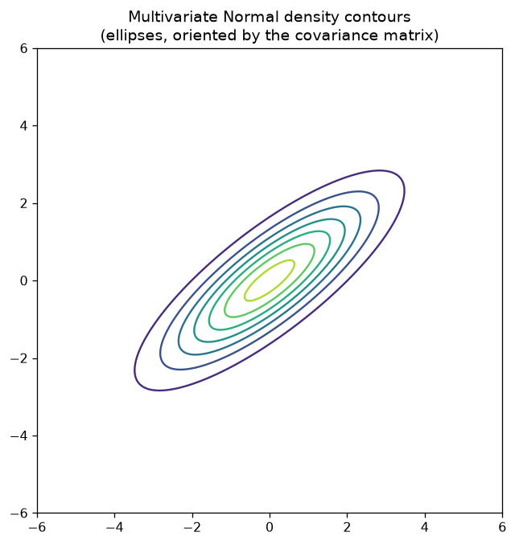
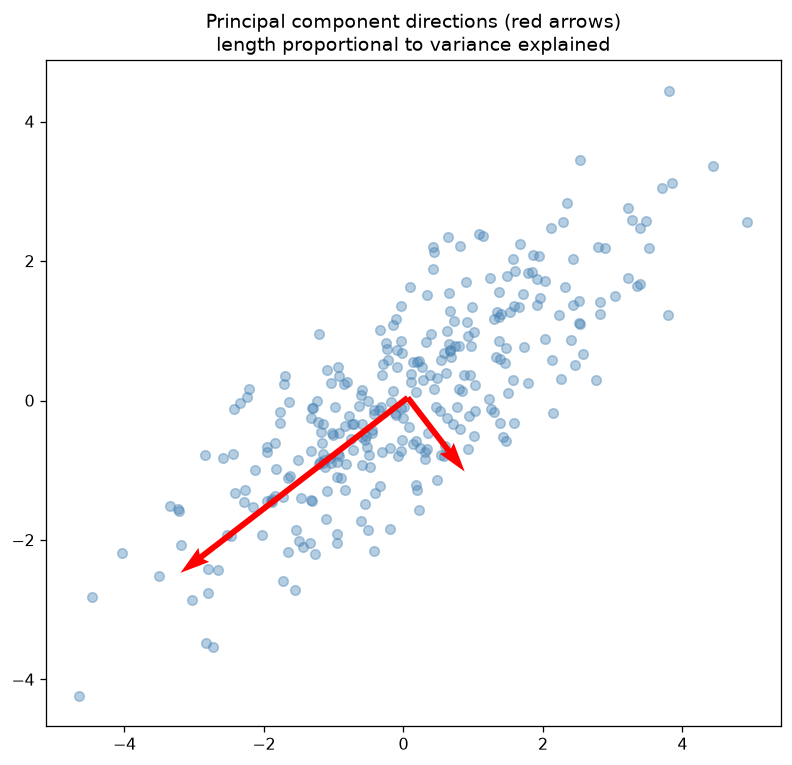
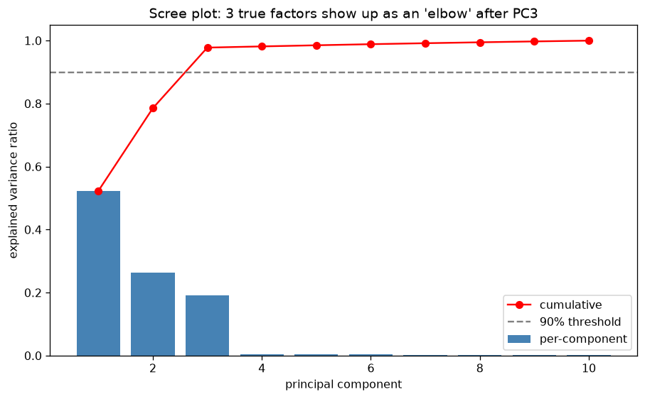

# Chapter 20: Multivariate Statistics - Covariance Matrices and PCA

## The idea this chapter builds toward

Real datasets have many variables at once (a housing dataset might have square footage, bedrooms, age, location, and a dozen other features). This chapter extends covariance (Chapter 7) to handle *all pairs* of variables simultaneously via the **covariance matrix**, extends the Normal distribution (Chapter 6) into multiple dimensions, and then uses the eigenvector machinery from Chapter 19 to perform **Principal Component Analysis (PCA)** - the standard technique for compressing many correlated features down into a smaller number of genuinely informative ones, and the direct statistical ancestor of dimensionality reduction and representation learning in modern ML.

> **Intuition, in one breath:** when many features all move together, the data really lives on a smaller, tilted surface inside the big space - PCA finds the tilt of that surface and lets you describe everything with far fewer numbers without losing much.

## The covariance matrix - every pairwise covariance, organized in a grid

For $p$ variables, the covariance matrix $\Sigma$ ("Sigma," capital, not to be confused with the summation symbol) is a $p\times p$ grid where entry $(i,j)$ is $\text{Cov}(X_i, X_j)$:

$$\Sigma = \begin{bmatrix}\text{Var}(X_1) & \text{Cov}(X_1,X_2) & \cdots\\ \text{Cov}(X_2,X_1) & \text{Var}(X_2) & \cdots \\ \vdots & \vdots & \ddots\end{bmatrix}$$

Notice the diagonal entries are just each variable's own variance (Chapter 2) - the covariance of a variable with itself, $\text{Cov}(X,X) = \text{Var}(X)$, which checks out directly from Chapter 7's covariance definition. The matrix is symmetric ($\text{Cov}(X_i,X_j)=\text{Cov}(X_j,X_i)$) because covariance itself doesn't care about order. This single matrix is a complete summary of how every variable relates to every other variable, two at a time - the natural multivariate generalization of the single covariance number from Chapter 7.

## The Multivariate Normal distribution

Just as Chapter 6's Normal distribution was fully described by a mean $\mu$ and variance $\sigma^2$, the **multivariate Normal distribution** is fully described by a mean *vector* $\boldsymbol\mu$ (one mean per variable) and the covariance matrix $\Sigma$ above. Its density formula looks intimidating (it involves $\Sigma^{-1}$, the matrix inverse from Chapter 19, and a matrix generalization of the squared-distance term from Chapter 6's single-variable formula), but the intuition carries over directly: instead of a 1D bell curve, you get a bell-shaped *hill* in however many dimensions you have variables, and instead of "circles" of equal density (which you'd get if variables were uncorrelated with equal variance), correlated variables produce **elliptical** contours of equal density - tilted ellipses whose orientation and stretch are determined exactly by $\Sigma$'s eigenvectors and eigenvalues (Chapter 19) - the same ellipse orientation you'll see directly in this chapter's code.

### Why this matters for Chapter 25 and beyond

The multivariate Normal is the standard assumed distribution behind an enormous amount of machine learning machinery: Gaussian Mixture Models (Chapter 23), the noise models behind many generative models, and the typical initialization/weight distributions in neural networks (Chapter 25) are all built on exactly this object.

## PCA - the problem it solves

Suppose you have 20 correlated features (e.g., many financial indicators that largely move together, or many pixel values in a small image patch that are spatially correlated). Much of that "20-dimensional" information might really be driven by just a handful of genuinely independent underlying factors, with the rest being redundant, correlated restatements of those same few factors. **PCA finds the smaller set of new, uncorrelated "directions" (combinations of your original variables) that capture as much of the data's total variance as possible**, letting you compress many redundant correlated features into a few genuinely informative ones.

### Deriving PCA - the thought process, built on what you already know

Here's the question PCA answers, framed as a search: "what single direction (as a vector) in my data's feature space, if I projected all my data points onto it, would preserve the *most* variance?" (Why maximize variance specifically? Because a direction along which data barely varies carries almost no distinguishing information between data points - projecting onto a near-constant direction would make nearly every point look identical, throwing away exactly the information that makes your data points *different from each other*, which is usually the signal you actually care about for downstream analysis or modeling.)

It turns out - and this is the single payoff fact of Chapter 19's eigenvector detour - that the direction maximizing projected variance is *exactly* the covariance matrix $\Sigma$'s eigenvector with the **largest eigenvalue**. The eigenvalue itself tells you exactly how much variance lies along that direction. The second-largest eigenvalue's eigenvector gives you the next-best direction, *constrained to be perpendicular to the first* (guaranteeing the new directions are mutually uncorrelated - zero covariance between them, geometrically because perpendicular vectors have zero dot product, directly from Chapter 19), and so on. These ranked eigenvector directions are called **principal components**.

### Why this specific claim (top eigenvector = max-variance direction) is true, intuitively

Recall from Chapter 19 that eigenvectors of a matrix are the special directions that matrix only stretches, never rotates. For a covariance matrix specifically, "stretching" along a direction corresponds exactly to variance along that direction (since the covariance matrix is literally built from squared/cross deviations). The eigenvector with the biggest eigenvalue is, by definition, the direction the covariance matrix stretches *the most* - which is precisely the direction carrying the most variance. This is why PCA reduces, mechanically, to: compute the covariance matrix, find its eigenvectors/eigenvalues, sort by eigenvalue size, and keep the top few - a remarkably short recipe for something that initially sounds like a hard optimization problem (searching over every possible direction in a high-dimensional space).

<div class="labcard">
<div class="labkicker">Live - watch the principal components rotate and rescale</div>
<div class="labcontrols">
  <div class="labctrl"><label>Correlation between X and Y <b id="ch20_rho_label">0.70</b></label><input type="range" id="ch20_rho" min="-0.98" max="0.98" step="0.02" value="0.7"></div>
  <div class="labctrl"><label>Variance of X relative to Y <b id="ch20_ratio_label">1.0x</b></label><input type="range" id="ch20_ratio" min="0.2" max="4" step="0.1" value="1.0"></div>
</div>
<div class="labrow"><button class="labbtn secondary" id="ch20_regen">Regenerate data</button></div>
<div class="labcanvas-wrap"><canvas id="ch20_canvas" width="820" height="380"></canvas></div>
<div class="labstat-grid">
  <div class="labstat"><div class="lbl">PC1 explained variance</div><div class="val" id="ch20_pc1">-</div></div>
  <div class="labstat"><div class="lbl">PC2 explained variance</div><div class="val" id="ch20_pc2">-</div></div>
</div>
<p class="labnote">The red arrows are PC1's eigenvector, the orange arrows PC2's - both scaled by the square root of their eigenvalue. Push correlation toward &plusmn;1 and watch PC1 swallow almost all the variance as the data collapses toward a line.</p>
</div>
<script>
document.addEventListener('DOMContentLoaded', function(){
  var SL = window.StatsLab;
  var data = [];
  function regenerate(){
    var rho = parseFloat(document.getElementById('ch20_rho').value);
    var ratio = parseFloat(document.getElementById('ch20_ratio').value);
    data = [];
    var sxTarget = Math.sqrt(ratio);
    for(var i=0;i<250;i++){
      var z1 = SL.randNormal(0,1), z2 = SL.randNormal(0,1);
      var x = sxTarget*z1;
      var y = rho*z1 + Math.sqrt(Math.max(0,1-rho*rho))*z2;
      data.push([x,y]);
    }
    draw();
  }
  function draw(){
    var xs = data.map(function(d){return d[0];}), ys = data.map(function(d){return d[1];});
    var xbar = SL.mean(xs), ybar = SL.mean(ys);
    var varX = SL.variance(xs,1), varY = SL.variance(ys,1);
    var cov=0; for(var i=0;i<xs.length;i++) cov += (xs[i]-xbar)*(ys[i]-ybar);
    cov/=(xs.length-1);
    var a=varX, d=varY, b=cov;
    var trace = a+d, det = a*d-b*b;
    var temp = Math.sqrt(Math.max(0, trace*trace/4 - det));
    var lambda1 = trace/2 + temp, lambda2 = trace/2 - temp;
    var v1;
    if(Math.abs(b)>1e-9) v1 = [lambda1-d, b];
    else v1 = (a>=d) ? [1,0] : [0,1];
    var v1norm = Math.sqrt(v1[0]*v1[0]+v1[1]*v1[1]);
    v1 = [v1[0]/v1norm, v1[1]/v1norm];
    var v2 = [-v1[1], v1[0]];
    var total = lambda1+lambda2;
    document.getElementById('ch20_pc1').textContent = (100*lambda1/total).toFixed(1)+'%';
    document.getElementById('ch20_pc2').textContent = (100*lambda2/total).toFixed(1)+'%';

    var lim = 4;
    var plot = SL.makePlot(document.getElementById('ch20_canvas'));
    plot.setDomain([-lim,lim],[-lim,lim]); plot.clear(); plot.axes('X','Y');
    plot.scatter(data, SL.colors.accent+'99', 3);
    var s1 = 2*Math.sqrt(Math.max(lambda1,0)), s2 = 2*Math.sqrt(Math.max(lambda2,0));
    plot.arrow(xbar,ybar, xbar+v1[0]*s1, ybar+v1[1]*s1, SL.colors.accent4, 3);
    plot.arrow(xbar,ybar, xbar-v1[0]*s1, ybar-v1[1]*s1, SL.colors.accent4, 3);
    plot.arrow(xbar,ybar, xbar+v2[0]*s2, ybar+v2[1]*s2, SL.colors.accent2, 2.5);
    plot.arrow(xbar,ybar, xbar-v2[0]*s2, ybar-v2[1]*s2, SL.colors.accent2, 2.5);
  }
  document.getElementById('ch20_rho').addEventListener('input', function(e){ document.getElementById('ch20_rho_label').textContent = parseFloat(e.target.value).toFixed(2); regenerate(); });
  document.getElementById('ch20_ratio').addEventListener('input', function(e){ document.getElementById('ch20_ratio_label').textContent = parseFloat(e.target.value).toFixed(1)+'x'; regenerate(); });
  document.getElementById('ch20_regen').addEventListener('click', regenerate);
  regenerate();
});
</script>

## The backstory - Pearson's geometric puzzle, Hotelling's practical tool

**Karl Pearson** (yet again - correlation in Chapter 7, chi-square in Chapter 13, and now this) first posed PCA's core geometric question in an 1901 paper titled "On Lines and Planes of Closest Fit to Systems of Points in Space" - framed purely as a geometry problem: given a cloud of points in space, what's the best-fitting lower-dimensional line or plane through them (in a least-squares sense, directly echoing Chapter 14's regression logic, but here fitting through the data's *shape* rather than predicting one variable from another)? Pearson worked out the geometric and algebraic idea but didn't develop it into a broadly practical statistical tool. That step came three decades later from **Harold Hotelling** (1933), an economist-turned-statistician, who reframed the same mathematics explicitly in terms of variance-maximization and named it "principal components" - his motivating applications were primarily in psychology and educational testing, specifically the question of whether a battery of many different mental ability test scores could be explained by a much smaller number of genuinely distinct underlying "ability factors" (a question closely related to, and historically intertwined with, "factor analysis," a close statistical cousin of PCA with a subtly different generative assumption about the data, worth knowing exists even though this book doesn't cover it separately).

## Explained variance ratio - deciding how many components to keep

Each principal component's eigenvalue, divided by the sum of *all* eigenvalues, gives its **explained variance ratio** - what fraction of the data's total variance that single component captures. A common practical rule: keep enough components to explain, say, 90-95% of total variance, discarding the rest as likely redundant/noise - directly echoing Chapter 16's bias-variance tradeoff theme: discarding too few components risks keeping noise (akin to overfitting), discarding too many risks losing genuine signal (akin to underfitting), and there's no universal "correct" cutoff - it's a judgment call informed by exactly this explained-variance curve (often visualized as a "scree plot," plotting explained variance against component number, looking for where the curve's steep drop flattens into a shallow "elbow").

### Reconstructing it yourself - why "divide by the sum of eigenvalues" is even legitimate

That ratio is only a meaningful "fraction of total variance" if the sum of all eigenvalues actually *equals* the data's total variance in the first place - a fact worth confirming rather than assuming. **If your guess is that this falls out of a basic linear-algebra identity relating a matrix's diagonal to its eigenvalues - you're right, and it's a short one.** The **trace** of a square matrix (the sum of its diagonal entries) has a general property: it always equals the sum of that matrix's eigenvalues, $\text{tr}(A) = \sum_i \lambda_i$, regardless of what the matrix represents (this is a standard, provable linear-algebra fact, not specific to covariance matrices - it follows from the characteristic polynomial's coefficients, a derivation outside this book's scope but easy to verify numerically on the 2×2 example above: $\text{tr}(A)=2+2=4$, and indeed $\lambda_1+\lambda_2=3+1=4$). Now recall from this chapter's opening that a covariance matrix's **diagonal entries are each variable's own variance** (Chapter 2) - so the trace of a covariance matrix is, by definition, the sum of every individual variable's variance, which is exactly what "total variance in the dataset" means. Combining both facts: $\text{total variance} = \text{tr}(\Sigma) = \sum_i \lambda_i$ - **the eigenvalues don't just happen to add up to something variance-like; they are mathematically guaranteed to add up to exactly the data's total variance**, which is precisely why dividing any one eigenvalue by that sum gives a legitimate, literal percentage of total variance explained, not just a suggestive-looking ratio.

## Worked example - by hand, larger

Let's run a complete 2D PCA by hand, from raw data to explained variance. Two standardized features $X$ and $Y$ are measured on four points: $(1,2)$, $(2,4)$, $(3,5)$, $(4,9)$. First, the means: $\bar X = \frac{1+2+3+4}{4} = 2.5$, $\bar Y = \frac{2+4+5+9}{4} = 5$. Center each point:

| point | $x-\bar X$ | $y-\bar Y$ |
|---|---|---|
| 1 | $-1.5$ | $-3$ |
| 2 | $-0.5$ | $-1$ |
| 3 | $0.5$ | $0$ |
| 4 | $1.5$ | $4$ |

Using the population (divide-by-$n$) covariance formulas, $\text{Var}(X) = \frac{(-1.5)^2 + (-0.5)^2 + (0.5)^2 + (1.5)^2}{4} = \frac{2.25+0.25+0.25+2.25}{4} = \frac{5}{4} = 1.25$. And $\text{Var}(Y) = \frac{9 + 1 + 0 + 16}{4} = \frac{26}{4} = 6.5$. The covariance: $\text{Cov} = \frac{(-1.5)(-3) + (-0.5)(-1) + (0.5)(0) + (1.5)(4)}{4} = \frac{4.5 + 0.5 + 0 + 6}{4} = \frac{11}{4} = 2.75$. So $\Sigma = \begin{bmatrix}1.25 & 2.75\\2.75 & 6.5\end{bmatrix}$.

Now the eigen-decomposition, using Chapter 19's trace/det shortcut. Trace $= 1.25 + 6.5 = 7.75$. Determinant $= 1.25(6.5) - 2.75^2 = 8.125 - 7.5625 = 0.5625$. So $\lambda_{1,2} = \frac{7.75}{2} \pm \sqrt{\frac{7.75^2}{4} - 0.5625} = 3.875 \pm \sqrt{15.015625 - 0.5625} = 3.875 \pm \sqrt{14.453125} = 3.875 \pm 3.8017$. Thus $\lambda_1 \approx 7.677$ and $\lambda_2 \approx 0.0733$.

Check the trace identity from this chapter: $\lambda_1 + \lambda_2 = 7.677 + 0.0733 = 7.75 = \text{tr}(\Sigma)$ ✓ (and $\text{tr}(\Sigma) = 1.25 + 6.5 = 7.75$, the total variance). The explained variance ratios are $\lambda_1/7.75 = 7.677/7.75 \approx 99.1\%$ and $\lambda_2/7.75 \approx 0.9\%$ - this 2-feature dataset is essentially one-dimensional, a single dominant direction carrying almost all the variance. For the first eigenvector, solve $(\Sigma - 7.677 I)\mathbf v = 0$: the first row gives $(1.25 - 7.677)v_1 + 2.75 v_2 = 0 \Rightarrow -6.427 v_1 = -2.75 v_2 \Rightarrow v_1 \approx 0.4278\, v_2$, so a direction like $(0.4278, 1)$, normalized to $\approx (0.393, 0.919)$ - a steep positive slope, consistent with $Y$ varying far more than $X$ and the two moving together.

**Takeaway: PCA on real data is just this procedure at scale - center, form the covariance matrix, find its eigenvalues and eigenvectors, and let the eigenvalues tell you which single direction to keep when the data is secretly low-dimensional.**

## Figures



*Elliptical density contours of a Multivariate Normal distribution -- the ellipse's tilt and stretch are determined entirely by the covariance matrix.*



*Principal component directions (red arrows) overlaid on correlated 2D data, with arrow length proportional to the variance each component explains.*



*A scree plot on 10-feature data generated from only 3 true underlying factors: notice the sharp 'elbow' after the 3rd principal component.*

## Run it yourself

`book/code/ch20_multivariate_pca.py` generates correlated multivariate data, visualizes the Multivariate Normal's elliptical density contours directly, performs PCA from scratch using `numpy`'s eigenvector decomposition (matching `sklearn.decomposition.PCA`'s output exactly, to prove the "it's just eigenvectors of the covariance matrix" claim), plots the principal component directions as arrows over the original data (directly extending Chapter 19's eigenvector visualization), and produces a scree plot on a higher-dimensional synthetic dataset to show the "elbow" rule for choosing how many components to keep.

```bash
python book/code/ch20_multivariate_pca.py
```

## Why This Matters - In AI and In Everyday Life

**In AI / machine learning:**

- **Dimensionality reduction before training**: compressing hundreds of correlated features (or high-dimensional embeddings) down to a handful of principal components is standard practice to fight the curse of dimensionality and speed up training.
- **Visualizing high-dimensional model embeddings**: projecting a language or vision model's internal representations down to 2-3 dimensions for visualization (often as a first step before more specialized tools) relies directly on this chapter's eigenvector machinery.
- **Latent-space structure in diffusion and generative models**: the low-dimensional manifold that generative models learn to sample from is the modern, nonlinear analogue of PCA's linear subspace - PCA is the linear baseline every autoencoder and diffusion model is (implicitly) compared against.
- **Whitening and covariance conditioning in deep learning**: feature whitening layers, batch normalization's decorrelation intuition, and the handling of ill-conditioned weight covariance matrices all rest on this chapter's covariance-matrix eigen-decomposition and the trace/variance identity derived here.

**In everyday, non-AI life:**

- **Summarizing a company's dashboard**: reducing dozens of correlated KPIs (revenue, signups, churn, engagement) into a few "principal" health indicators that capture most of what's really moving is a direct real-world PCA use case.
- **Population genetics**: PCA on genetic marker data is a standard real technique for visualizing human population structure and ancestry, directly using this chapter's covariance-matrix eigen-decomposition.

## Check your understanding

- Why does maximizing variance along a projection direction correspond to preserving the most "information" about how data points differ from each other?
- In your own words, explain why the eigenvector with the largest eigenvalue of a covariance matrix is the direction of maximum variance.
- If the first two principal components of a 10-feature dataset explain 93% of total variance, what would that tell you about the real "effective dimensionality" of the underlying data?

## Exercises

### Exercise 1 - Explained variance ratio by hand

A 3-feature dataset yields covariance-matrix eigenvalues $6$, $3$, and $1$. Compute each component's explained variance ratio. How many components would you keep to exceed 90% of total variance, and what does the answer say about the data's effective dimensionality?

<details><summary>Show solution</summary>

Total variance $= 6 + 3 + 1 = 10$ (the trace).

Ratios: PC1 $= 6/10 = 60\%$, PC2 $= 3/10 = 30\%$, PC3 $= 1/10 = 10\%$.

Cumulative: after PC1, $60\%$; after PC2, $60\% + 30\% = 90\%$; after PC3, $100\%$. To *exceed* 90% strictly, you need all three - but you're right at the boundary, and a practical analyst would look at the scree plot. PC3's 10% is a small tail eigenvalue, so the "elbow" sits after PC2, suggesting the data is effectively **2-dimensional** and PC3 mostly captures noise/redundancy. A common real-world call would be to keep 2 components and accept 90% of the variance.

</details>

### Exercise 2 - From covariance matrix to the max-variance direction

Given $\Sigma = \begin{bmatrix}4 & 2\\2 & 4\end{bmatrix}$, find both eigenvalues and the eigenvector for the larger one. Which direction of the data has the most variance?

<details><summary>Show solution</summary>

Trace $= 8$, determinant $= 4(4) - 2^2 = 16 - 4 = 12$. Eigenvalues $= \frac{8}{2} \pm \sqrt{\frac{8^2}{4} - 12} = 4 \pm \sqrt{16 - 12} = 4 \pm 2$. So $\lambda_1 = 6$, $\lambda_2 = 2$.

Check: $\lambda_1 + \lambda_2 = 8 = \text{tr}(\Sigma)$ ✓; $\lambda_1 \lambda_2 = 12 = \det(\Sigma)$ ✓.

For $\lambda_1 = 6$: $(\Sigma - 6I)\mathbf v = \begin{bmatrix}-2 & 2\\2 & -2\end{bmatrix}\mathbf v = 0 \Rightarrow -2v_1 + 2v_2 = 0 \Rightarrow v_1 = v_2$. So $\mathbf v = (1,1)/\sqrt2$, the 45° diagonal.

That diagonal is the **direction of maximum variance** ($\lambda_1 = 6$, versus 2 on the perpendicular anti-diagonal). Both entries of $\Sigma$ being positive ($\text{Cov}=2$) means the variables are positively correlated, so the data cloud leans along the positive diagonal - exactly as the max-variance eigenvector says.

</details>

### Exercise 3 - Conceptual: why PCA can hurt downstream accuracy

You're about to train a classifier on 100 features. A colleague applies PCA and keeps the top 10 components (explaining 95% of *variance*), but test accuracy drops versus using all 100 features. Explain how this is possible given PCA preserves 95% of the variance.

<details><summary>Show solution</summary>

PCA keeps directions of maximum **variance**, not directions of maximum **predictive value** for your label. A direction with small variance can still be exactly the signal that separates the classes - think of a feature that is nearly constant overall but differs sharply between classes; PCA sees low variance and may discard it, even though it's the most useful variable for classification.

PCA is also **unsupervised**: it never looks at $y$. So the 5% of variance it threw away can be concentrated precisely in the class-separating directions, while the 95% it kept is dominated by high-variance directions that may be irrelevant (or even noise) for the task. This is a classic reminder that "explains 95% of variance" and "preserves the information you care about" are different claims - the bias-variance tradeoff from Chapter 16 appearing again, here as a choice of what to throw away.

</details>

## What's next

Chapter 21 shifts from describing data's *shape* (this chapter) to quantifying **uncertainty and information itself** - entropy, cross-entropy, and KL divergence - the information-theoretic vocabulary that directly explains why cross-entropy loss (first derived as Bernoulli MLE back in Chapter 10) is named the way it is, and that underlies an enormous amount of modern deep learning's loss-function design.
