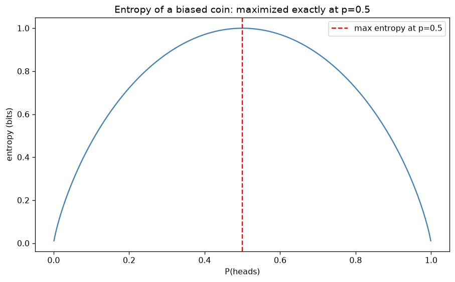

# Chapter 21: Information Theory - Entropy, Cross-Entropy, and KL Divergence

## The idea this chapter builds toward

This chapter answers a deceptively simple question: can you *measure* uncertainty and information with an actual number, the way you measure length or weight? The answer - **entropy** - turns out to have a remarkably clean derivation from almost nothing but common sense, and it directly explains why **cross-entropy loss** (which you first derived as Bernoulli MLE in Chapter 10) is named the way it is, and why it behaves the way it does as a loss function throughout deep learning.

> **Intuition, in one breath:** Surprising news carries more information than predictable news, and entropy is just "how surprising, on average, is this thing?" Compression and cross-entropy loss are two faces of the same idea: a message you can already predict takes fewer bits, and a model that predicts well is surprised less.

## Deriving "information content" from scratch - the thought process

Claude Shannon's starting question (1948): if someone tells you an event happened, how much "information" did that message actually convey? Shannon reasoned about what properties a sensible measure of information should have, and derived the formula from those requirements rather than guessing it:

1. **A certain event should convey zero information.** If I tell you "the sun rose today," you've learned nothing new - $P=1$ should map to information $=0$.
2. **A rarer event should convey more information than a common one.** Being told "you won the lottery" ($P$ tiny) is far more informative/surprising than "it's Tuesday" ($P$ large, if it's actually Tuesday). So information content should be a *decreasing* function of probability.
3. **Information from independent events should add up.** If two unrelated coin flips both come up heads, the total information learned should be the sum of what each flip individually told you - not some more complicated combination.

Requirement 3 is the one that pins down the exact mathematical form. Recall from Chapter 3 that for *independent* events, probabilities **multiply**: $P(A\text{ and }B) = P(A)P(B)$. But requirement 3 demands that information content **add**: $I(A\text{ and }B) = I(A)+I(B)$. You need a function that turns multiplication into addition - and from Chapter 0, you already know exactly which function does that: the **logarithm** ($\log(ab)=\log(a)+\log(b)$). Combined with requirement 2 (information should *decrease* as probability increases, while log of a probability between 0 and 1 is negative and grows more negative as probability shrinks toward 0), the only sensible, consistent choice is:

$$I(x) = -\log P(x) = \log\frac{1}{P(x)}$$

This single, short derivation - "requirement 3 forces a logarithm" - is one of the most elegant small proofs in all of applied mathematics, and it's worth re-reading until the "why log" question feels fully answered rather than asserted.

### Units: bits vs. nats

If you use $\log_2$ (base 2), information is measured in **bits** - literally the number of yes/no binary questions needed, on average, to pin down the outcome (an event with $P=1/2$, like a fair coin flip, carries exactly $-\log_2(1/2)=1$ bit, matching the intuition that one well-chosen yes/no question resolves it). If you use the **natural log** ($\ln$, base $e$), the unit is called **nats** - this is the convention almost universally used in machine learning (because $\ln$ is the natural partner for calculus/gradients used in training, exactly as Chapter 0 flagged for log-likelihoods), so when you see "entropy" or "cross-entropy" reported in a deep learning context, it's typically in nats unless stated otherwise.

## Entropy - the *expected* information content of a whole distribution

A single event's information content, $-\log P(x)$, is interesting, but what you usually want is a summary for an *entire distribution* - how unpredictable is this random variable, on average? This is exactly an expectation (Chapter 7): weight each outcome's information content by its own probability, and sum:

$$H(X) = -\sum_x P(x)\log P(x) = E\big[-\log P(X)\big]$$

**Intuition, with worked examples:** A fair coin ($P(H)=P(T)=0.5$): $H = -(0.5\log0.5 + 0.5\log0.5) = -\log0.5 = \log 2 = 1$ bit - maximally unpredictable for a two-outcome variable, and indeed entropy is *maximized* exactly when all outcomes are equally likely (spread evenly, nothing to exploit to guess better than chance). A heavily biased coin ($P(H)=0.99$, $P(T)=0.01$): $H = -(0.99\log0.99+0.01\log0.01) \approx 0.08$ bits - very low entropy, because you can predict the outcome ("heads," almost always) with high confidence most of the time, so on average very little information is conveyed by observing the actual result. **Entropy is, in a precise mathematical sense, a measure of how unpredictable a distribution is** - zero entropy for a fully deterministic (certain) outcome, maximum entropy for a perfectly uniform distribution over its possible outcomes.

## Cross-entropy - comparing a true distribution to a model's beliefs

Entropy $H(X)$ assumes you know the *true* distribution $P$. **Cross-entropy** instead measures the average "surprise" when the true outcomes come from distribution $P$, but you're using a (possibly wrong) *model's* predicted distribution $Q$ to compute information content:

$$H(P, Q) = -\sum_x P(x)\log Q(x)$$

**This is exactly the negative log-likelihood from Chapter 10's Bernoulli MLE derivation**, just rewritten in expectation form: instead of a sum over your specific observed training *data points*, it's a sum over the possible *outcomes* weighted by their true probabilities. When you train a classifier by minimizing cross-entropy loss, you are literally minimizing the average surprise your model's predicted probabilities $Q$ would generate, if the real world truly behaved according to the true label distribution $P$ - making your model's beliefs ($Q$) match reality ($P$) as closely as possible is *exactly* what drives cross-entropy toward its theoretical minimum.

### A crucial fact: cross-entropy is never smaller than entropy

$$H(P,Q) \ge H(P), \quad \text{with equality exactly when } Q = P$$

This isn't just a definition - it's a provable mathematical fact (via a classical result called Gibbs' inequality, not reproduced here but worth knowing by name; the section just below actually proves it), and it has a deep practical consequence: **the absolute best possible cross-entropy loss your model can ever achieve is $H(P)$ itself - the data's own inherent entropy** - a model literally cannot do better than matching the true distribution exactly, because any mismatch between $Q$ and $P$ can only add surprise, never subtract it. This is exactly why a classification task with inherently ambiguous/noisy labels (irreducible uncertainty, echoing Chapter 16's $\sigma^2$ term) has a hard floor on achievable loss, no matter how good your model gets - a genuinely useful sanity-check concept when interpreting a stubbornly nonzero training loss.

### Reconstructing it yourself - actually proving Gibbs' inequality

**If your guess is that proving $D_{KL}(P\|Q)\ge0$ should come down to some basic fact about the logarithm curve's shape - you're exactly right, and the specific fact is that $\log$ is *concave*.** A concave function always lies on or below any straight line drawn tangent to it - in particular, the tangent line to $\log(x)$ at $x=1$ is simply $x-1$ (since $\log(1)=0$ and the slope of $\log$ at $x=1$ is exactly $1$), giving the single inequality that does all the work here:

$$\log(x) \le x - 1 \quad \text{for all } x>0, \text{ with equality only at } x=1$$

Now apply this to $-D_{KL}(P\|Q) = \sum_x P(x)\log\frac{Q(x)}{P(x)}$ (just the negative of Chapter 21's KL formula, with the fraction flipped, which flips its sign). Substitute $x=\frac{Q(x)}{P(x)}$ into the inequality above:

$$-D_{KL}(P\|Q) = \sum_x P(x)\log\frac{Q(x)}{P(x)} \le \sum_x P(x)\left(\frac{Q(x)}{P(x)}-1\right) = \sum_x Q(x) - \sum_x P(x) = 1 - 1 = 0$$

(the last step uses the fact that both $P$ and $Q$ are valid probability distributions, so each sums to exactly 1 - Chapter 3's axioms, doing quiet work here). So $-D_{KL}(P\|Q)\le 0$, which means $D_{KL}(P\|Q)\ge 0$ - proven, using nothing but one property of the log curve and the fact that probabilities sum to one. Equality holds only when $\frac{Q(x)}{P(x)}=1$ everywhere (the one point where the tangent-line inequality is exact), i.e. only when $Q=P$ exactly - confirming the "floor" claim above isn't just plausible, it's airtight.

## KL Divergence - isolating exactly the "extra surprise" from using the wrong model

$$D_{KL}(P \| Q) = H(P,Q) - H(P) = \sum_x P(x)\log\frac{P(x)}{Q(x)}$$

**Intuition**: KL divergence strips away the *unavoidable* baseline uncertainty ($H(P)$, which no model can fix) and isolates exactly the *extra, avoidable* surprise caused specifically by $Q$ being a wrong/imperfect approximation of $P$. This makes it a natural measure of "distance" between two probability distributions - though it is **not a true mathematical distance** (it's not symmetric: $D_{KL}(P\|Q) \ne D_{KL}(Q\|P)$ in general, unlike, say, the ordinary distance between two points, which doesn't care which point you measure "from"). Minimizing cross-entropy loss during training and minimizing KL divergence are *equivalent* optimization problems whenever $P$ (the true data distribution) is treated as fixed - since $H(P,Q) = D_{KL}(P\|Q) + H(P)$ and $H(P)$ doesn't depend on your model's parameters at all, minimizing one minimizes the other identically; which name gets used in a given paper or textbook is mostly a matter of which framing (information-theoretic "divergence between distributions" vs. the data-point-level "negative log-likelihood") the author found more natural for their argument.

<div class="labcard">
<div class="labkicker">Live - entropy of a coin, and cross-entropy / KL between two distributions</div>
<div class="labcontrols">
  <div class="labctrl"><label>P(heads) <b id="ch21_p_label">0.50</b></label><input type="range" id="ch21_p" min="0.01" max="0.99" step="0.01" value="0.5"></div>
</div>
<div class="labstat-grid"><div class="labstat"><div class="lbl">Entropy (bits)</div><div class="val" id="ch21_entropy">-</div></div></div>
<div class="labcanvas-wrap" style="margin-top:10px;"><canvas id="ch21_canvas" width="820" height="180"></canvas></div>
<p class="labnote">Three outcomes below. Drag P's and Q's first two bars; the third is whatever makes each distribution sum to 1. Make Q identical to P and watch KL divergence drop to exactly zero.</p>
<div class="labcontrols">
  <div class="labctrl"><label>True P, outcome 1 <b id="ch21_p1_label">0.50</b></label><input type="range" id="ch21_p1" min="0" max="1" step="0.01" value="0.5"></div>
  <div class="labctrl"><label>True P, outcome 2 <b id="ch21_p2_label">0.30</b></label><input type="range" id="ch21_p2" min="0" max="1" step="0.01" value="0.3"></div>
</div>
<div class="labcontrols">
  <div class="labctrl"><label>Model Q, outcome 1 <b id="ch21_q1_label">0.33</b></label><input type="range" id="ch21_q1" min="0" max="1" step="0.01" value="0.33"></div>
  <div class="labctrl"><label>Model Q, outcome 2 <b id="ch21_q2_label">0.33</b></label><input type="range" id="ch21_q2" min="0" max="1" step="0.01" value="0.33"></div>
</div>
<div class="labcanvas-wrap" style="margin-top:10px;"><canvas id="ch21_bars" width="820" height="200"></canvas></div>
<div class="labstat-grid">
  <div class="labstat"><div class="lbl">Entropy H(P)</div><div class="val" id="ch21_hp">-</div></div>
  <div class="labstat"><div class="lbl">Cross-entropy H(P,Q)</div><div class="val" id="ch21_ce">-</div></div>
  <div class="labstat"><div class="lbl">KL divergence</div><div class="val" id="ch21_kl">-</div></div>
</div>
</div>
<script>
document.addEventListener('DOMContentLoaded', function(){
  var SL = window.StatsLab;
  function entropyBernoulli(p){
    if(p<=0||p>=1) return 0;
    return -(p*Math.log2(p) + (1-p)*Math.log2(1-p));
  }
  function updateA(){
    var p = parseFloat(document.getElementById('ch21_p').value);
    document.getElementById('ch21_p_label').textContent = p.toFixed(2);
    document.getElementById('ch21_entropy').textContent = entropyBernoulli(p).toFixed(4)+' bits';
    var plot = SL.makePlot(document.getElementById('ch21_canvas'), {l:50,r:20,t:10,b:30});
    var pts = []; for(var pp=0.001; pp<=0.999; pp+=0.004) pts.push([pp, entropyBernoulli(pp)]);
    plot.setDomain([0,1],[0,1.05]); plot.clear(); plot.axes('P(heads)','entropy (bits)');
    plot.line(pts, SL.colors.accent3, 2.5);
    plot.vline(p, SL.colors.accent4);
  }
  function updateB(){
    var p1 = parseFloat(document.getElementById('ch21_p1').value);
    var p2 = parseFloat(document.getElementById('ch21_p2').value);
    if(p1+p2>1){ p2 = 1-p1; document.getElementById('ch21_p2').value = p2; }
    var p3 = Math.max(0, 1-p1-p2);
    var q1 = parseFloat(document.getElementById('ch21_q1').value);
    var q2 = parseFloat(document.getElementById('ch21_q2').value);
    if(q1+q2>1){ q2 = 1-q1; document.getElementById('ch21_q2').value = q2; }
    var q3 = Math.max(0, 1-q1-q2);
    document.getElementById('ch21_p1_label').textContent = p1.toFixed(2);
    document.getElementById('ch21_p2_label').textContent = p2.toFixed(2);
    document.getElementById('ch21_q1_label').textContent = q1.toFixed(2);
    document.getElementById('ch21_q2_label').textContent = q2.toFixed(2);

    var P = [p1,p2,p3], Q = [Math.max(q1,1e-9),Math.max(q2,1e-9),Math.max(q3,1e-9)];
    var Hp=0, CE=0;
    for(var i=0;i<3;i++){
      if(P[i]>1e-9) Hp += -P[i]*Math.log(P[i]);
      if(P[i]>1e-9) CE += -P[i]*Math.log(Q[i]);
    }
    var KL = CE-Hp;
    document.getElementById('ch21_hp').textContent = Hp.toFixed(4)+' nats';
    document.getElementById('ch21_ce').textContent = CE.toFixed(4)+' nats';
    document.getElementById('ch21_kl').textContent = KL.toFixed(4)+' nats';

    var plot = SL.makePlot(document.getElementById('ch21_bars'), {l:50,r:20,t:16,b:40});
    plot.setDomain([0,3],[0,1.05]); plot.clear(); plot.axes('outcome','probability');
    var ctx = plot.ctx;
    [0,1,2].forEach(function(i){
      var xP = i+0.35, xQ = i+0.65;
      ctx.fillStyle = SL.colors.accent;
      var y0=plot.py(0), y1=plot.py(P[i]);
      ctx.fillRect(plot.px(xP)-14, y1, 28, y0-y1);
      ctx.fillStyle = SL.colors.accent2;
      y1=plot.py(Q[i]);
      ctx.fillRect(plot.px(xQ)-14, y1, 28, y0-y1);
      ctx.fillStyle = SL.colors.ink; ctx.textAlign='center'; ctx.font='11px -apple-system,sans-serif';
      ctx.fillText('outcome '+(i+1), plot.px(i+0.5), plot.py(0)+16);
    });
    ctx.fillStyle = SL.colors.accent; ctx.fillText('P (true)', plot.px(0.35), 12);
    ctx.fillStyle = SL.colors.accent2; ctx.fillText('Q (model)', plot.px(0.65), 12);
  }
  document.getElementById('ch21_p').addEventListener('input', updateA);
  ['ch21_p1','ch21_p2','ch21_q1','ch21_q2'].forEach(function(id){ document.getElementById(id).addEventListener('input', updateB); });
  updateA(); updateB();
});
</script>

## The backstory - a telephone engineer solves a problem nobody had posed rigorously before

**Claude Shannon** developed this entire framework in a single, landmark 1948 paper, "A Mathematical Theory of Communication," while working at Bell Labs on an extremely practical engineering problem: how many physical resources (wires, time, signal bandwidth) does it fundamentally take to transmit a message reliably over a noisy telephone or telegraph line? Before Shannon, "information" had no rigorous quantitative definition at all - engineers reasoned about signal transmission in largely ad hoc, case-by-case ways. Shannon's genuinely radical insight was realizing that the *engineering* question ("how efficiently can I encode and transmit this message?") and the *statistical* question ("how uncertain/unpredictable is this message's content, viewed as a random variable?") are the same question - the minimum number of bits needed to transmit a message, on average, equals exactly its entropy. This single paper essentially created the entire field of information theory from scratch, and the fact that its central object (entropy) turned out, decades later, to also be exactly the right lens for understanding machine learning loss functions is a genuinely striking example of mathematics developed for one purpose (telephone engineering) turning out to be exactly the right tool for a completely different one (statistical learning) that didn't exist yet when the math was invented.

## Figures



*Entropy of a biased coin as a function of P(heads), maximized exactly at p=0.5 -- a fair coin is the most unpredictable possible two-outcome variable.*

## Run it yourself

`book/code/ch21_information_theory.py` computes entropy for several coin biases and plots entropy as a function of $P(\text{heads})$ (confirming the maximum sits exactly at $p=0.5$), computes cross-entropy and KL divergence between a true distribution and several candidate model distributions to show KL divergence shrinking toward zero as the model distribution approaches the truth, and directly demonstrates, numerically, that a neural-network-style binary cross-entropy loss computed on actual predicted probabilities equals exactly the negative log-likelihood formula first derived in Chapter 10.

```bash
python book/code/ch21_information_theory.py
```

## Why This Matters - In AI and In Everyday Life

**In AI / machine learning:**

- **Cross-entropy loss, used in literally every standard classifier and every token prediction in a language model**: this chapter's entropy/cross-entropy formulas are not an analogy for deep learning loss functions -- they ARE the loss function.
- **KL divergence in VAEs, diffusion models, and RLHF**: keeping a fine-tuned language model's behavior close to its original pretrained behavior during reinforcement learning, or regularizing a generative model's latent space, is a direct real application of KL divergence.
- **Tokenizers and perplexity**: the entropy of a text corpus is what sets the floor on a language model's per-token cross-entropy; the reported "perplexity" of a transformer is literally $e^{\text{cross-entropy}}$ (in nats), so this chapter's formulas are the unit every modern LLM benchmark is measured in.
- **Temperature and top-p sampling in generative AI**: dividing logits by a temperature before softmax trades entropy for determinism - low temperature sharpens the distribution toward the mode (low entropy), high temperature flattens it (high entropy), a direct manipulation of this chapter's entropy knob at inference time.

**In everyday, non-AI life:**

- **Data compression (zip files, JPEG, MP3)**: Shannon's original insight -- that the minimum bits needed to encode a message equals its entropy -- is the literal mathematical foundation every compression algorithm is built on.
- **Morse code's letter frequencies**: common letters like "E" get short codes and rare letters like "Q" get long codes, a real pre-Shannon intuition for exactly the entropy-minimizing coding this chapter formalizes.

## Worked example - by hand, larger

Suppose a weather model must predict one of three outcomes - Sunny ($S$), Rainy ($R$), Cloudy ($C$) - and the true long-run frequencies are $P(S)=0.5$, $P(R)=0.3$, $P(C)=0.2$. A first model $Q$ predicts $Q(S)=0.6$, $Q(R)=0.3$, $Q(C)=0.1$. Using natural logs, let's compute entropy, cross-entropy, and KL divergence entirely by hand.

**Entropy of the truth.** Each term is $-P\log P$:
- Sunny: $-0.5\ln 0.5 = 0.5 \times 0.6931 = 0.3466$.
- Rainy: $-0.3\ln 0.3 = 0.3 \times 1.2040 = 0.3612$.
- Cloudy: $-0.2\ln 0.2 = 0.2 \times 1.6094 = 0.3219$.

Sum: $H(P) = 0.3466+0.3612+0.3219 = 1.0297$ nats.

**Cross-entropy against $Q$.** Now weight the *model's* surprise by the *true* probabilities, each term $-P\log Q$:
- Sunny: $-0.5\ln 0.6 = 0.5 \times 0.5108 = 0.2554$.
- Rainy: $-0.3\ln 0.3 = 0.3612$ (same as before, since $P=Q$ here).
- Cloudy: $-0.2\ln 0.1 = 0.2 \times 2.3026 = 0.4605$.

Sum: $H(P,Q) = 0.2554+0.3612+0.4605 = 1.0771$ nats. So the model pays a real price for underestimating Cloudy: its surprise on cloudy days ($-\ln 0.1 = 2.3026$) is large and never fully compensated.

**KL divergence** is the gap: $D_{KL}(P\|Q) = H(P,Q)-H(P) = 1.0771-1.0297 = 0.0474$ nats. That is the *avoidable* extra surprise - the irreducible $1.0297$ nats is the floor, and $0.0474$ is what a better model could still shave off. Concretely, the model would need to move its Cloudy and Sunny probabilities toward $0.5/0.2$ to reach zero.

**The takeaway:** cross-entropy is the total bill, entropy is the part you can never avoid, and their difference - KL divergence - is the only part your model can actually fix by better predictions.

## Check your understanding

- Walk through, in your own words, why requirement 3 ("information from independent events adds") forces the use of a logarithm in the information-content formula.
- Why is entropy maximized by a uniform distribution, in terms of predictability?
- Explain why $D_{KL}(P\|Q) \ge 0$ always, and what it means, intuitively, for this value to equal exactly zero.

## Exercises

### Exercise 1 - Compress a lopsided coin
A file records 1000 outcomes of a coin with $P(H)=0.9$, $P(T)=0.1$. Using $\log_2$ (bits), (a) compute the entropy per outcome, (b) how many bits would a naive "1 bit per outcome" encoding need, and (c) roughly how many bits does the entropy-optimal encoding save over all 1000 outcomes?

<details><summary>Show solution</summary>

(a) $H = -(0.9\log_2 0.9 + 0.1\log_2 0.1)$. Now $\log_2 0.9 = \ln 0.9/\ln 2 = (-0.10536)/0.69315 = -0.15200$, and $\log_2 0.1 = \ln 0.1/\ln 2 = (-2.30259)/0.69315 = -3.32193$. So $H = 0.9 \times 0.15200 + 0.1 \times 3.32193 = 0.1368 + 0.3322 = 0.4690$ bits per outcome.

(b) Naive fixed-length: 1000 bits.

(c) Optimal expected length $= 1000 \times 0.4690 = 469$ bits, saving $1000 - 469 = 531$ bits - less than half the naive size. This is Shannon's source-coding insight: the entropy is the hard floor on average compression, and a highly predictable coin compresses enormously.

</details>

### Exercise 2 - Prove cross-entropy is never below entropy
Using the tangent-line inequality $\log x \le x-1$ (equality only at $x=1$), prove $H(P,Q) \ge H(P)$, i.e. $D_{KL}(P\|Q) \ge 0$.

<details><summary>Show solution</summary>

$$D_{KL}(P\|Q) = \sum_x P(x)\log\frac{P(x)}{Q(x)}.$$

Apply $\log x \le x-1$ with $x = P(x)/Q(x)$ term by term:

$$\sum_x P(x)\log\frac{P(x)}{Q(x)} \ge \sum_x P(x)\left(1 - \frac{Q(x)}{P(x)}\right) = \sum_x P(x) - \sum_x Q(x) = 1-1 = 0.$$

Wait - careful with direction: since $\log x \le x-1$, we have $\log\frac{P}{Q} \ge 1 - \frac{Q}{P}$. Multiplying by $P(x)\ge0$ preserves the inequality, and summing gives $\ge 0$. Equality requires $P(x)/Q(x)=1$ for every $x$ with $P(x)>0$, i.e. $Q=P$. Hence $H(P,Q)=H(P)+D_{KL}(P\|Q)\ge H(P)$.

</details>

### Exercise 3 - Why language models use cross-entropy, not accuracy
A next-token model assigns "cat" probability $0.7$ when the true next token is "cat." Compute the loss in nats under (a) cross-entropy and (b) a crude 0/1 accuracy loss. Then explain why cross-entropy gives useful gradient signal during training while accuracy mostly does not.

<details><summary>Show solution</summary>

(a) Cross-entropy for a single observed token: $-\ln 0.7 = 0.3567$ nats. If the model instead said $0.1$, the loss would be $-\ln 0.1 = 2.3026$ nats - a much larger penalty for confident wrongness.

(b) Accuracy: since "cat" was the top guess, accuracy loss $=0$ for both a $0.7$ prediction and a $0.05$ prediction as long as "cat" still ranks first.

Cross-entropy is differentiable and its gradient w.r.t. the model's logit scales with how wrong the probability was, so gradient descent gets a usable nudge ("push cat's probability up") every step. Accuracy is piecewise-constant: nudging probabilities slightly often doesn't change which token wins, so the gradient is zero almost everywhere and tells the optimizer nothing. This is exactly why Chapter 21's cross-entropy - the negative log-likelihood of the Categorical distribution - is the universal training loss for transformers rather than accuracy.

</details>

## What's next

Chapter 22 asks a question this chapter's tools make precise: if a model perfectly matches its training data (zero training loss), what, mathematically, justifies any confidence at all that it will perform well on new data? This is **statistical learning theory**, and it formalizes the generalization question that's been circling since Chapter 15's overfitting demonstration.
