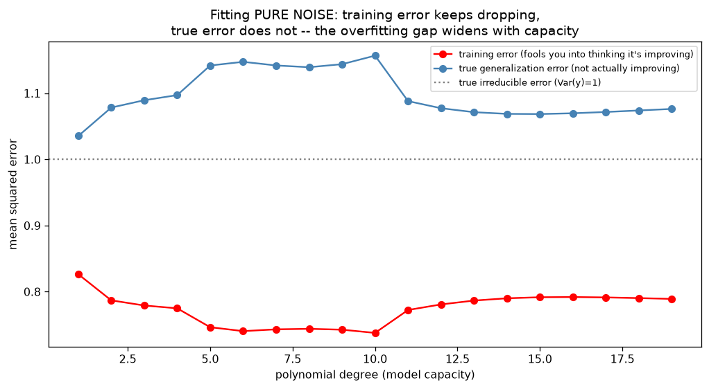

# Chapter 22: Statistical Learning Theory - Why Generalization Works At All

## The idea this chapter builds toward

Chapters 15-16 showed you *that* overfitting happens and gave you practical tools (cross-validation, regularization) to manage it. This chapter asks a deeper, more philosophical-sounding but genuinely rigorous question: **why should a model fit to one specific sample of data ever be expected to perform well on different data it has never seen?** There's no logical law of the universe guaranteeing this - it has to be *earned* mathematically, under specific conditions, and **statistical learning theory** is the field that works out precisely what those conditions are. This chapter won't turn you into a learning theorist, but it will replace the vague phrase "generalization" with a concrete, derivable mathematical story.

> **Intuition, in one breath:** Performance on your training data is like a practice test - a model that scores well there has only succeeded if it learned the underlying pattern rather than memorized the specific questions. Learning theory is just the bookkeeping of how much flexibility you can afford before "practice score" stops predicting "real-world score."

## Restating the problem precisely

You have a training sample drawn from some true (unknown) population distribution - exactly Chapter 1's population/sample framing, now applied to an entire learning algorithm rather than a single statistic. You fit a model by minimizing **training error** (error measured on the specific sample you have). You actually care about **generalization error** (also called **true risk** or **expected risk**): the model's expected error averaged over the *entire* population of possible future inputs, most of which you will never directly observe. The central question of learning theory: **how large can the gap between training error and generalization error be, and what controls that gap's size?**

## A naive first idea, and why it fails: just check *a* hypothesis

Suppose you pick one single candidate model (not searched for, just handed to you) and measure its error on a fresh, held-out sample. The CLT (Chapter 8) already tells you precisely how close that sample's measured error should be to the true population error - this is exactly Chapter 11's confidence interval machinery, and for one fixed, pre-chosen model, there's no special mystery: more held-out data means a tighter, more trustworthy estimate of true performance, full stop.

**The real difficulty appears once you *search* over many candidate models** (as every ML training procedure does - trying many possible weight settings, architectures, or hyperparameters) and pick whichever one happens to score best on your data. This is precisely the **multiple-comparisons problem from Chapter 12**, reappearing in a new, higher-stakes costume: if you evaluate enough different candidate models against the same dataset, *some* candidate will look good purely by chance - by having accidentally fit that particular sample's noise well - even if it's genuinely no better than average on the true population. The more candidates you search through (the larger and more flexible your "hypothesis space," in learning-theory vocabulary), the more likely you are to stumble onto one that looks deceptively great on your specific training sample, purely from this noise-fitting effect. This is the precise, rigorous version of "overfitting" - not a vague warning, but a direct consequence of the same multiple-comparisons logic you already understand from hypothesis testing.

## VC dimension - measuring "how many different things a model could possibly fit"

To make the "how large is your hypothesis space" idea mathematically precise, **Vladimir Vapnik and Alexey Chervonenkis** (working in the Soviet Union in the late 1960s-70s, hence "VC dimension") introduced a clever measuring stick: ask how many data points, in the worst case, a given model family can perfectly "shatter" - correctly classify *every possible labeling* of, regardless of how those labels happen to be assigned. A straight line in 2D, for instance, can correctly separate any labeling of 3 points (arranged generically) into two classes, no matter how those 3 points are labeled - but there exist arrangements of 4 points no single straight line can separate for *every* possible labeling (e.g., an XOR-like pattern, which is the classic textbook example of what a linear model fundamentally cannot do). So a 2D linear classifier's **VC dimension is 3** - a precise number capturing its "capacity," or how flexible/complex the model family fundamentally is, independent of any specific dataset.

### Reconstructing it yourself - finding the specific 4-point arrangement that breaks a line

**If your guess is that the failing arrangement must be the one where "same-class" points end up diagonally opposite each other - try drawing it and confirm no single straight line works.** Place 4 points at the corners of a square: $(0,0)$, $(0,1)$, $(1,0)$, $(1,1)$, and assign labels so that the two diagonal pairs get *opposite* classes - $(0,0)$ and $(1,1)$ are class A, while $(0,1)$ and $(1,0)$ are class B (literally the XOR truth table, laid out on a grid: label $= x \oplus y$). Try to draw one straight line separating the A points from the B points. Any line you draw either has both A points on the same side (then it must have both B points split across the line too, since the B points sit on the other diagonal, crossing the square the opposite way) or cuts through the square in some other orientation that still can't isolate both diagonal pairs simultaneously - convince yourself by trying a few lines by hand: a straight cut can separate "left half from right half" or "top half from bottom half" or any single rotated version of those, but a diagonal-pairs-vs-diagonal-pairs split is fundamentally a *two-sided* pattern that one single straight boundary cannot express, regardless of its angle. This is precisely why a plain linear classifier (logistic regression, a single-layer perceptron) can never learn XOR - a famous, specific limitation pointed out by Marvin Minsky and Seymour Papert in 1969, which contributed to a multi-year slowdown in neural network research funding (the first "AI winter") until multi-layer networks with nonlinear hidden units - which can combine several lines to carve out exactly this kind of diagonal pattern - were shown to overcome it.

### Why VC dimension matters: it bounds the overfitting gap directly

Vapnik and Chervonenkis proved a genuinely remarkable theorem: the gap between training error and true generalization error can be bounded (with high probability) by a formula involving **VC dimension** and **sample size**, roughly of the shape:

$$\text{generalization error} \le \text{training error} + O\left(\sqrt{\frac{\text{VC dimension}}{n}}\right)$$

You don't need the exact constants, but the *shape* of this bound tells you everything important, and it should feel immediately familiar: **more training data ($n$) shrinks the overfitting gap, while higher model capacity (VC dimension) widens it** - this is, again, the bias-variance tradeoff (Chapter 16) and the adjusted-R² complexity penalty (Chapter 15), now derived from a completely different, far more general mathematical direction (worst-case combinatorial bounds on hypothesis spaces, rather than a specific decomposition of squared error) and arriving at the exact same qualitative conclusion. Seeing the same tradeoff fall out of three genuinely different mathematical arguments (bias-variance decomposition, adjusted R²'s complexity penalty, and VC-dimension generalization bounds) is strong evidence you're looking at something structurally fundamental about learning from data, not an artifact of any one specific method.

## Why this matters, and also its real limitation, for deep learning specifically

Classical VC-dimension bounds, applied literally to modern deep neural networks (which can have millions or billions of parameters - enormous nominal capacity), predict wildly pessimistic generalization gaps that don't match what's actually observed: huge neural networks routinely generalize far better in practice than classical VC theory would predict, a genuinely open and actively researched puzzle sometimes called the "generalization paradox" of deep learning. Current research explanations point to factors classical VC theory doesn't fully capture - properties of the specific optimization algorithm used (stochastic gradient descent appears to have an implicit bias toward "flatter," more robust solutions, even among many solutions that fit the training data equally well), properties of real-world data (which tends to have much lower effective complexity than a worst-case adversarial VC-dimension argument assumes), and other complexity measures beyond raw parameter count (like margin-based bounds, or measures of a trained network's effective, rather than nominal, capacity). This is one of the places in this book where I'll be honest that the field's theoretical understanding genuinely lags behind its practical success - a correct and useful thing to know, rather than something to paper over.

## The backstory - Cold War statistics with no immediate audience

Vapnik and Chervonenkis developed VC theory and the broader framework now called **statistical learning theory** largely in the 1960s-70s, working within the Soviet Union's cybernetics research institutes, with relatively limited direct contact with Western machine learning research at the time due to Cold War-era isolation. Their work remained comparatively obscure in the West for roughly two decades until Vapnik emigrated and began working at AT&T Bell Labs in the early 1990s - the very same lab, not coincidentally, where a cluster of researchers (including Vapnik) were simultaneously developing the **Support Vector Machine**, an algorithm whose entire theoretical justification leans directly on VC-dimension-style generalization guarantees, giving this once-obscure theoretical framework a concrete, practically successful algorithm to anchor itself to and finally bringing it into the mainstream of machine learning research through the 1990s and 2000s.

## Figures



*Fitting PURE RANDOM NOISE (y has no real relationship to x) with increasingly flexible polynomials: training error keeps dropping while the true generalization error does not -- the overfitting gap widens with model capacity.*

## Run it yourself

`book/code/ch22_statistical_learning_theory.py` directly demonstrates the "searching over many models inflates the overfitting gap" effect: it generates data from pure random noise (genuinely no real signal), then fits increasingly flexible polynomial models and tracks the ever-widening gap between training error and true held-out error as model flexibility increases - concretely replaying Chapter 15's noise-column demonstration, but now explicitly framed and plotted against the VC-dimension-style bound's predicted shape ($\sqrt{\text{capacity}/n}$), to make the connection between "search space size" and "overfitting risk" visually unmistakable.

```bash
python book/code/ch22_statistical_learning_theory.py
```

## Why This Matters - In AI and In Everyday Life

**In AI / machine learning:**

- **Why deep learning's generalization is still an open research question**: this chapter's VC-dimension bounds, and where they fail to explain modern neural networks, is literally the subject of active, ongoing deep learning research.
- **Guiding model capacity and regularization choices**: understanding the generalization-gap tradeoff is what justifies practical choices like early stopping, weight decay, and architecture size limits in real ML systems.
- **Scaling laws as an empirical end-run around VC bounds**: because classical VC theory fails for huge transformers, AI labs instead fit regression curves to observed loss-vs-compute data (Kaplan 2020, Chinchilla 2022) - a practical, empirical substitute for the theoretical generalization guarantee this chapter shows VC dimension was supposed to provide.
- **The pretraining-to-fine-tuning transfer question**: theories of generalization explain why a model trained on one distribution (pretraining) is even expected to transfer to another (downstream tasks), which is the statistical assumption underneath the whole modern "pretrain then fine-tune" paradigm for LLMs.

**In everyday, non-AI life:**

- **A student who aces practice tests but fails the real exam**: memorizing specific practice questions (fitting the "training sample" perfectly) without learning transferable principles is overfitting happening to a person, not a model.
- **Why a tailor-made process that works perfectly for one client often fails for the next**: a solution overly tuned to one specific case (high "capacity" relative to how much it was tested) often fails to generalize to new, similar-but-different cases.

## Worked example - by hand, larger

Suppose you're choosing between two model families for a small tabular dataset, and you want to use the VC-dimension-style bound to forecast the overfitting gap. The bound has the shape $\text{gap} \le c\sqrt{\text{VC}/n}$, and for this illustration take the constant $c = 1$ (a deliberately optimistic, easily hand-checkable choice).

**Family A** is a logistic regression on 20 features, with VC dimension roughly $d_A = 21$ (weights plus bias). **Family B** is a flexible ensemble with effective VC dimension $d_B = 400$.

**Case 1 - $n = 500$ training rows.** For A: $\sqrt{21/500} = \sqrt{0.042} = 0.2050$, so the gap is bounded by about $0.205$, i.e. up to roughly 20 percentage points of error. For B: $\sqrt{400/500} = \sqrt{0.8} = 0.8944$ - a gap bound near $0.894$, i.e. essentially uninformative ("training error tells you almost nothing"). At this sample size the flexible family is theoretically unjustifiable.

**Case 2 - you collect more data, $n = 20{,}000$ rows.** For A: $\sqrt{21/20000} = \sqrt{0.00105} = 0.0324$, a gap under about 3 points. For B: $\sqrt{400/20000} = \sqrt{0.02} = 0.1414$, a gap under about 14 points. Notice that B's bound fell from $0.894$ to $0.141$ - a factor of $\sqrt{40} \approx 6.3$ improvement, exactly the $\sqrt{1/n}$ scaling - purely from adding data, with no change to the model.

**Case 3 - capacity reduction instead.** Keep $n=500$ but shrink B's effective capacity to $d_B = 21$ (heavy regularization, fewer effective parameters). Its gap bound becomes identical to A's $0.205$. So you have two levers of equal formal standing: add data (divide by $\sqrt{n}$) or cut capacity (divide by $\sqrt{\text{VC}}$).

**The takeaway:** the overfitting gap scales like the square root of (capacity ÷ data) - doubling your data only shrinks the gap by about $1/\sqrt{2}$ (≈29%), while halving model capacity does the same, which is precisely why both collecting more data and regularizing are legitimate, complementary fixes rather than competing philosophies.

## Check your understanding

- Explain, in your own words, why searching over *many* candidate models reintroduces the multiple-comparisons problem from Chapter 12, even if each individual candidate model is evaluated "honestly."
- Why does VC dimension specifically measure a model family's worst-case flexibility (via "shattering"), rather than, say, its number of parameters directly?
- Why does classical VC theory's prediction for deep neural networks' generalization gap conflict with what's observed in practice, and what does that conflict suggest about the completeness of the classical theory?

## Exercises

### Exercise 1 - Forecasting a gap
A model family has VC dimension $dV = 100$. Using the bound $\text{gap} \le \sqrt{\text{VC}/n}$ (constant set to 1), compute the maximum gap for (a) $n=1000$ and (b) $n=10{,}000$. By what factor does the gap shrink?

<details><summary>Show solution</summary>

(a) $n=1000$: $\sqrt{100/1000} = \sqrt{0.1} = 0.3162$ → a gap of up to about 31.6%.

(b) $n=10{,}000$: $\sqrt{100/10000} = \sqrt{0.01} = 0.1000$ → a gap of up to about 10.0%.

Shrink factor: $0.3162/0.1000 = 3.162$, which is exactly $\sqrt{10}$ - the 10x data increase only buys a $\sqrt{10}\approx3.16$x gap reduction. This is the same diminishing-returns arithmetic that governs sample-size planning: to halve the gap you must quadruple the data.

</details>

### Exercise 2 - Shattering, conceptually
A 1D threshold classifier assigns label 1 if $x > t$ and 0 otherwise, for some threshold $t$. What is its VC dimension, and why?

<details><summary>Show solution</summary>

VC dimension $= 1$. A single threshold can shatter 1 point trivially (place $t$ above or below it to realize either label), so VC ≥ 1. But it cannot shatter 2 points: ordinal labels like $(0, 1)$ (lower point labeled 1, upper labeled 0) are impossible, because a single "greater than $t$" rule always labels the *larger* point 1 once the smaller is labeled 1 - the pattern is monotone. Since some labeling of 2 points is unachievable, VC $< 2$, so VC $= 1$. The lesson: VC dimension counts the largest set of points whose *every* labeling is achievable, and a monotone rule family has a very small capacity despite being able to place its threshold anywhere.

</details>

### Exercise 3 - Why the double descent puzzles theorists
Classical VC theory predicts monotonic degradation as capacity grows past the data size. Modern neural networks instead show "double descent": test error falls, rises near the interpolation threshold, then *falls again* as networks get much larger. Explain in conceptual terms why the classical bound cannot capture this, connecting to this chapter's discussion.

<details><summary>Show solution</summary>

The classical bound $\text{gap} \le O(\sqrt{\text{VC}/n})$ depends on capacity only through a single worst-case combinatorial number, and it is monotone: bigger VC (or more parameters) can only make the guaranteed gap looser. It contains no mechanism that could produce a *second* descent, because it ignores *which* particular solution out of the many that fit the data the optimizer actually lands on.

Empirically, the second descent comes from the inductive bias of stochastic gradient descent, which preferentially finds smooth, low-complexity interpolating solutions even inside a huge hypothesis space, and from the fact that real data has far less effective complexity than a worst-case shattering argument assumes. Measures like margin, norm of the weights, or the effective rank of the representation - not raw VC dimension - correlate with the real gap, which is exactly why this chapter flags deep-learning generalization as genuinely under-explained by classical theory.

</details>

## What's next

Chapter 23 looks at a different flavor of model: ones that explicitly assume your data was generated by a mixture of several hidden, unobserved subpopulations - **latent variable models** like Gaussian Mixture Models, and the general **Expectation-Maximization** algorithm used to fit them - directly extending the Multivariate Normal (Chapter 20) and MLE (Chapter 10) machinery you already have.
