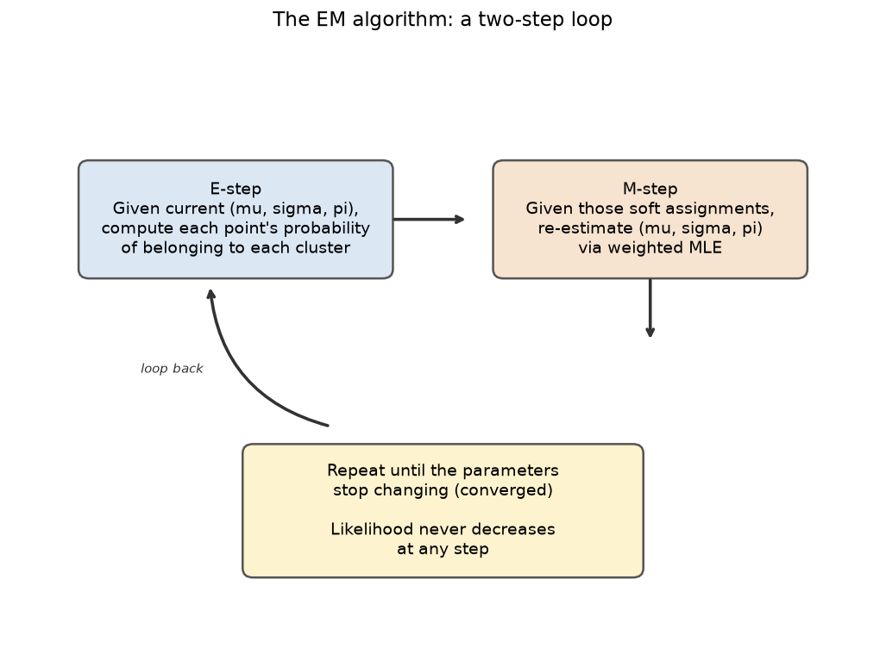

# Chapter 23: Probabilistic Models and Latent Variables (Mixtures, EM)

## The idea this chapter builds toward

So far, every model in this book has assumed your data comes from one single, clean distribution (one Normal, one Binomial, etc.). Real data is often messier: it might be a blend of several distinct subpopulations mixed together, without labels telling you which point came from which group. This chapter introduces **latent variable models** - models with an explicit, unobserved ("latent," meaning hidden) variable representing group membership - using the **Gaussian Mixture Model (GMM)** as the running example, and the general **Expectation-Maximization (EM) algorithm** used to fit such models, which turns out to be a strikingly elegant extension of the MLE framework from Chapter 10 to handle missing information.

> **Intuition, in one breath:** If you don't know which of several groups each data point came from, you can still fit the groups by guessing memberships softly, refitting on those guesses, then re-guessing - each pass using your current best model to make a slightly better guess than the last. EM is just this "guess, refit, repeat" loop made rigorous.

## The problem GMM solves - mixtures that MLE alone can't fit directly

Imagine measuring adult heights without recording gender, and the data genuinely comes from two overlapping Normal distributions (say, one centered around 165cm, one around 178cm), blended together. A single Normal distribution fit to this combined data (Chapter 10's MLE recipe) would produce one mean and variance that poorly describes *either* true subgroup - it would find some compromise bell curve that doesn't match the actual bimodal (two-humped) shape of the real data at all. What you actually want is to recover **both** underlying Normal distributions, plus the mixing proportion (what fraction of the data comes from each), *despite never having observed which group any individual data point belongs to*.

## The model, piece by piece

A GMM assumes each data point was generated by a two-step hidden process: (1) first, secretly pick one of $K$ clusters, according to some mixing probabilities $\pi_1, \ldots, \pi_K$ (summing to 1) - this pick is the **latent variable**, call it $Z$, which you never get to observe; (2) then, generate the actual data point $x$ from *that* cluster's own Normal distribution, $N(\mu_k, \sigma_k^2)$. The overall probability of observing any data point $x$, marginalizing out (averaging over) which hidden cluster it came from, is:

$$P(x) = \sum_{k=1}^{K} \pi_k \, N(x\mid \mu_k,\sigma_k^2)$$

**Why can't we just run MLE directly, the way Chapter 10 taught?** Because the log-likelihood of this mixture, $\sum_i \log\left(\sum_k \pi_k N(x_i\mid\mu_k,\sigma_k^2)\right)$, has a **log of a sum** inside it - and remember from Chapter 0/10 that logs are specifically useful because they turn products into sums, making differentiation clean; a log wrapped around a sum (rather than a product) doesn't simplify nicely at all, and taking derivatives with respect to each $\mu_k, \sigma_k, \pi_k$ produces a tangled system of equations with no clean closed-form solution the way Chapter 10's single-Normal MLE had. This is precisely the mathematical obstacle EM is built to route around.

## Expectation-Maximization - the key insight, step by step

Here's the thought process: **if you knew which cluster each data point truly came from, fitting the model would be trivial** - you'd just split the data by cluster label and run ordinary single-Normal MLE (Chapter 10) separately on each group, exactly like Chapter 13's independent-samples t-test setup. The entire difficulty is *only* that you don't know those labels. EM's resolution is a clever two-step iterative loop that alternates between *guessing* the labels and *using* that guess to refit the model, each time using the current best model to make a better-informed guess than the last:

- **E-step ("Expectation")**: given the *current* best guess of each cluster's $(\mu_k, \sigma_k, \pi_k)$, compute, for every data point, the *probability* it belongs to each cluster (not a hard yes/no assignment - a soft, probabilistic "responsibility," computed directly via Bayes' Theorem from Chapter 4: given this data point's value, how likely is each cluster to have generated it, weighted by each cluster's current size $\pi_k$?).
- **M-step ("Maximization")**: given those soft cluster-membership probabilities (now treated as known, fixed weights), re-estimate each cluster's $(\mu_k,\sigma_k,\pi_k)$ via a probability-*weighted* version of ordinary MLE - each data point contributes to each cluster's estimated mean/variance in proportion to how strongly it was assigned ("responsible") to that cluster in the E-step.
- **Repeat.** Each full E-step/M-step cycle is mathematically guaranteed to never decrease the overall log-likelihood (a genuinely non-obvious but provable fact) - so the algorithm reliably climbs "uphill" on the likelihood surface, eventually settling (converging) on a stable set of cluster parameters, though - like gradient-based optimization generally - it can converge to a merely local, not necessarily globally best, optimum depending on where you start, which is why in practice EM is typically run several times from different random starting points and the best-scoring result is kept.

This "guess the missing piece, then refit, then re-guess, then refit" loop is the general pattern behind EM far beyond just GMMs - any model with a sensible notion of "if only I knew this one hidden thing, fitting would be easy" is a candidate for an EM-style algorithm.



*The entire algorithm is just this loop, repeated until the parameters stop changing. Nothing hidden: guess soft cluster memberships (E), refit the clusters using those guesses as weights (M), check if anything changed, and go again.*

## The backstory - formalizing and naming a pattern that kept reappearing

Variants of the "alternate between estimating missing data and refitting" idea had been independently rediscovered piecemeal across different specific statistical problems for years before being unified. It was **Arthur Dempster, Nan Laird, and Donald Rubin**'s landmark 1977 paper that gave the general pattern its name (Expectation-Maximization) and proved, in full generality, the key guarantee that each iteration cannot decrease the likelihood - turning a loose grab-bag of problem-specific tricks into one named, broadly reusable algorithmic framework, much the way Fisher's 1922 MLE paper (Chapter 10) had unified an earlier generation of individually-derived estimators. This 1977 paper is now one of the most-cited statistics papers ever written, precisely because so many seemingly unrelated problems - missing data imputation, mixture models, hidden Markov models (a close cousin briefly touched on in Chapter 24's Markov chain discussion), and various unsupervised learning methods - turn out to be instances of this exact same pattern once you know to look for it.

## Connecting to modern unsupervised learning and generative models

GMM is the direct conceptual ancestor of **soft clustering** broadly (as opposed to algorithms like k-means, which make hard, all-or-nothing cluster assignments - in fact, k-means can be derived as a limiting special case of GMM's EM algorithm under specific simplifying assumptions, worth knowing as a unifying fact if you've used both). More broadly, the core idea - assume data is generated via some hidden/latent structure, and use likelihood-based methods to recover that structure despite never directly observing it - is the same conceptual skeleton underlying far more sophisticated modern **generative models** such as Variational Autoencoders, where a neural network plays the role of a far more flexible "cluster/latent-structure generator" than GMM's simple Normal components, and where a close mathematical relative of EM (variational inference, briefly mentioned back in Chapter 17) is used to approximately fit the model, for exactly the reason EM itself was needed here: the true likelihood is intractable to optimize directly once hidden variables are involved.

## Figures


*Left: a single Normal distribution fit via plain MLE badly misrepresents bimodal data. Right: a 2-component Gaussian Mixture fit via EM correctly recovers the two true underlying clusters.*

## Run it yourself

`book/code/ch23_latent_variable_models.py` generates synthetic bimodal data from two true overlapping Normal clusters (with hidden, unobserved labels), fits a single Normal distribution via plain MLE to show how badly it misrepresents the data's real bimodal shape, then implements the E-step/M-step GMM fitting loop from scratch (watching the estimated cluster parameters converge toward the true generating values over several iterations), and finally confirms the from-scratch result matches `sklearn.mixture.GaussianMixture`'s fitted parameters.

```bash
python book/code/ch23_latent_variable_models.py
```

## Why This Matters - In AI and In Everyday Life

**In AI / machine learning:**

- **Customer/user segmentation without labels**: clustering users into behavioral groups nobody explicitly labeled (a Gaussian Mixture Model or similar) is standard practice in product analytics and marketing ML.
- **Topic modeling and speaker clustering**: discovering hidden topics in a document collection (LDA, a close cousin of GMM) or clustering speakers in an audio recording both rely directly on this chapter's EM-style latent-variable fitting.
- **Word embeddings and latent structure in transformers**: the embedding vectors a language model learns place words in latent space where geometric proximity encodes meaning, a direct descendant of the GMM premise that observed data lies on a lower-dimensional hidden structure recovered by likelihood-based fitting.
- **Variational inference in VAEs and diffusion models**: when the true latent-variable likelihood is intractable (this chapter's log-of-a-sum problem in neural-network form), modern generative models fit a proxy bound with a neural network instead of EM's exact E-step - the same latent-variable philosophy scaled up.

**In everyday, non-AI life:**

- **Market segmentation**: a business grouping its customers into "budget-conscious," "premium," and "occasional" segments, without anyone having labeled customers that way in advance, is a real-world latent-variable clustering problem.
- **Discovering hidden subgroups in survey data**: social scientists routinely find that survey respondents cluster into unlabeled subgroups (e.g. political or cultural archetypes) using exactly this chapter's mixture-model logic.

## Worked example - by hand, larger

Let's run one full E-step and one M-step by hand on a tiny 1D two-component GMM, with known variances for simplicity so the arithmetic stays honest. Suppose we're clustering a single feature (say, clicks per session) and we've committed to two clusters, each with variance $\sigma_1^2=\sigma_2^2=1$. Current parameter estimates: $\mu_1 = 2$, $\mu_2 = 6$, mixing weights $\pi_1=\pi_2=0.5$. We observe one data point $x = 4.5$.

**E-step - compute responsibilities.** Under cluster 1, the density at $x=4.5$ is proportional to $\exp(-(4.5-2)^2/2) = \exp(-6.25/2) = \exp(-3.125) = 0.04394$. Under cluster 2, it's $\exp(-(4.5-6)^2/2) = \exp(-2.25/2) = \exp(-1.125) = 0.32465$. Weighting by the mixing proportions (both $0.5$, which cancels): the responsibility of cluster 1 is
$$r_1 = \frac{0.04394}{0.04394+0.32465} = \frac{0.04394}{0.36859} = 0.1192,$$
and $r_2 = 1-0.1192 = 0.8808$. So this point is "likely from cluster 2, but not certain."

**M-step - refit using soft weights.** Now suppose we actually have the whole dataset, just these two points for a hand-checkable illustration: $x_a = 4.5$ (we just computed $r_1=0.1192$, $r_2=0.8808$) and $x_b = 3.0$. For $x_b$: cluster 1 density $\propto \exp(-(3-2)^2/2)=\exp(-0.5)=0.6065$; cluster 2 $\propto \exp(-(3-6)^2/2)=\exp(-4.5)=0.01111$. So $r_1(x_b) = 0.6065/(0.6065+0.01111)=0.9820$, $r_2(x_b)=0.0180$.

The soft-weighted mean for cluster 1 is
$$\mu_1^{\text{new}} = \frac{r_1(x_a)\,x_a + r_1(x_b)\,x_b}{r_1(x_a)+r_1(x_b)} = \frac{0.1192\times4.5 + 0.9820\times3.0}{0.1192+0.9820} = \frac{0.5364+2.9460}{1.1012} = \frac{3.4824}{1.1012} = 3.162.$$
For cluster 2:
$$\mu_2^{\text{new}} = \frac{0.8808\times4.5 + 0.0180\times3.0}{0.8808+0.0180} = \frac{3.9636+0.0540}{0.8988} = \frac{4.0176}{0.8988} = 4.470.$$
The new mix weights are the mean responsibilities: $\pi_1^{\text{new}} = (1.1012+0.8988)/2 = 1.0$? No - by construction the two responsibilities for each point sum to 1, so total responsibility across both clusters is 2, giving $\pi_1^{\text{new}} = 1.1012/2 = 0.5506$ and $\pi_2^{\text{new}} = 0.8988/2 = 0.4494$.

**Read the motion.** Cluster 1's mean drifted *up* from 2 to about 3.16, pulled toward the nearby point $3.0$ that it now claims with high confidence; cluster 2's mean slid down from 6 to about 4.47, pulled toward $4.5$. The clusters are moving toward the data and toward each other - the first iteration of the climb.

**The takeaway:** the E-step converts "how likely is this point under each cluster" into soft weights that sum to 1, and the M-step is just ordinary MLE means with those weights - every iteration provably pushes the total log-likelihood uphill.

## Check your understanding

- Why does a log-of-a-sum (as opposed to a log-of-a-product) break the clean MLE derivation that worked so well for a single Normal distribution in Chapter 10?
- In your own words, explain why the E-step computes "soft," probabilistic cluster assignments rather than hard yes/no labels.
- Why is EM only guaranteed to find a *local* optimum, and what's the standard practical workaround?

## Exercises

### Exercise 1 - One E-step by hand
A 2-component GMM has $\mu_1=0$, $\mu_2=4$, both variances $1$, and $\pi_1=\pi_2=0.5$. For a data point $x=1$, compute the responsibilities $r_1$ and $r_2$.

<details><summary>Show solution</summary>

Density under cluster 1: $\propto \exp(-(1-0)^2/2)=\exp(-0.5)=0.6065$.
Density under cluster 2: $\propto \exp(-(1-4)^2/2)=\exp(-9/2)=\exp(-4.5)=0.01111$.
The equal mixing weights cancel. So
$$r_1 = \frac{0.6065}{0.6065+0.01111} = \frac{0.6065}{0.6176} = 0.9820, \quad r_2 = 0.0180.$$
The point sits much closer to cluster 1's mean, so it is assigned to cluster 1 with about 98% responsibility - but the 2% to cluster 2 is exactly the "softness" EM relies on.

</details>

### Exercise 2 - The log-of-a-sum obstacle
Explain, using the derivative of the mixture log-likelihood, why a closed-form M-step for a GMM's means does not exist, whereas for a single Normal it does.

<details><summary>Show solution</summary>

For a single Normal the log-likelihood is $\sum_i\big[-\frac{(x_i-\mu)^2}{2\sigma^2} - \log(\sigma\sqrt{2\pi})\big]$ - a *sum* of simple terms - so $\partial/\partial\mu = \sum_i (x_i-\mu)/\sigma^2 = 0$ solves cleanly to $\hat\mu = \frac{1}{n}\sum_i x_i$.

For a mixture the log-likelihood is $\sum_i \log\big(\sum_k \pi_k N(x_i\mid\mu_k,\sigma_k^2)\big)$. The derivative of the outer log is an inverse of the *inner sum*: $\partial/\partial\mu_k = \sum_i \frac{\pi_k N(x_i\mid\mu_k,\sigma_k^2)}{\sum_j \pi_j N(x_i\mid\mu_j,\sigma_j^2)} \cdot \frac{(x_i-\mu_k)}{\sigma_k^2}$. That fraction is the responsibility $r_{ik}$, which itself depends on $\mu_k$. Setting the derivative to zero gives $\mu_k = \frac{\sum_i r_{ik}x_i}{\sum_i r_{ik}}$ - which looks closed-form but has $r_{ik}$ on the right-hand side, so it can only be *iterated*, not solved directly. That circular dependence is precisely what forces the EM loop instead of algebra.

</details>

### Exercise 3 - EM's monotonicity, conceptually
Why does each EM iteration guarantee the log-likelihood never decreases, even though EM is only a local optimizer?

<details><summary>Show solution</summary>

EM can be viewed (via Jensen's inequality) as constructing a *lower bound* on the log-likelihood that touches it exactly at the current parameters. The E-step sets the responsibilities to the current posterior over the latent variables, which makes that lower bound tight at the current $\theta$; the M-step then maximizes that lower bound w.r.t. $\theta$. Since the bound touches the true likelihood at the start and is raised by the M-step, the true likelihood at the new parameters is at least the raised bound, hence at least the old value. So the likelihood is non-decreasing.

This is a statement about *progress*, not about global optimality: monotonic ascent can still stall at a local maximum or a saddle, and different starting points reach different optima. That is exactly why standard practice is to run EM from several random initializations and keep the best final likelihood - the same multi-start heuristic used for gradient-based optimization.

</details>

## What's next

Chapter 24 introduces **Markov chains** (processes where the future depends only on the present, not the full history) and **Monte Carlo methods**, including the **MCMC** algorithms that make modern Bayesian statistics (Chapter 17) computationally tractable for exactly the kind of intractable-likelihood problems this chapter's EM algorithm was built to route around in a different way.
