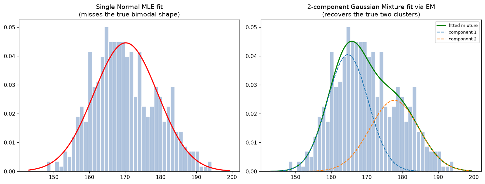

# Chapter 23: Probabilistic Models and Latent Variables (Mixtures, EM)

## The idea this chapter builds toward

So far, every model in this book has assumed your data comes from one single, clean distribution (one Normal, one Binomial, etc.). Real data is often messier: it might be a blend of several distinct subpopulations mixed together, without labels telling you which point came from which group. This chapter introduces **latent variable models** — models with an explicit, unobserved ("latent," meaning hidden) variable representing group membership — using the **Gaussian Mixture Model (GMM)** as the running example, and the general **Expectation-Maximization (EM) algorithm** used to fit such models, which turns out to be a strikingly elegant extension of the MLE framework from Chapter 10 to handle missing information.

## The problem GMM solves — mixtures that MLE alone can't fit directly

Imagine measuring adult heights without recording gender, and the data genuinely comes from two overlapping Normal distributions (say, one centered around 165cm, one around 178cm), blended together. A single Normal distribution fit to this combined data (Chapter 10's MLE recipe) would produce one mean and variance that poorly describes *either* true subgroup — it would find some compromise bell curve that doesn't match the actual bimodal (two-humped) shape of the real data at all. What you actually want is to recover **both** underlying Normal distributions, plus the mixing proportion (what fraction of the data comes from each), *despite never having observed which group any individual data point belongs to*.

## The model, piece by piece

A GMM assumes each data point was generated by a two-step hidden process: (1) first, secretly pick one of $K$ clusters, according to some mixing probabilities $\pi_1, \ldots, \pi_K$ (summing to 1) — this pick is the **latent variable**, call it $Z$, which you never get to observe; (2) then, generate the actual data point $x$ from *that* cluster's own Normal distribution, $N(\mu_k, \sigma_k^2)$. The overall probability of observing any data point $x$, marginalizing out (averaging over) which hidden cluster it came from, is:

$$P(x) = \sum_{k=1}^{K} \pi_k \, N(x\mid \mu_k,\sigma_k^2)$$

**Why can't we just run MLE directly, the way Chapter 10 taught?** Because the log-likelihood of this mixture, $\sum_i \log\left(\sum_k \pi_k N(x_i\mid\mu_k,\sigma_k^2)\right)$, has a **log of a sum** inside it — and remember from Chapter 0/10 that logs are specifically useful because they turn products into sums, making differentiation clean; a log wrapped around a sum (rather than a product) doesn't simplify nicely at all, and taking derivatives with respect to each $\mu_k, \sigma_k, \pi_k$ produces a tangled system of equations with no clean closed-form solution the way Chapter 10's single-Normal MLE had. This is precisely the mathematical obstacle EM is built to route around.

## Expectation-Maximization — the key insight, step by step

Here's the thought process: **if you knew which cluster each data point truly came from, fitting the model would be trivial** — you'd just split the data by cluster label and run ordinary single-Normal MLE (Chapter 10) separately on each group, exactly like Chapter 13's independent-samples t-test setup. The entire difficulty is *only* that you don't know those labels. EM's resolution is a clever two-step iterative loop that alternates between *guessing* the labels and *using* that guess to refit the model, each time using the current best model to make a better-informed guess than the last:

- **E-step ("Expectation")**: given the *current* best guess of each cluster's $(\mu_k, \sigma_k, \pi_k)$, compute, for every data point, the *probability* it belongs to each cluster (not a hard yes/no assignment — a soft, probabilistic "responsibility," computed directly via Bayes' Theorem from Chapter 4: given this data point's value, how likely is each cluster to have generated it, weighted by each cluster's current size $\pi_k$?).
- **M-step ("Maximization")**: given those soft cluster-membership probabilities (now treated as known, fixed weights), re-estimate each cluster's $(\mu_k,\sigma_k,\pi_k)$ via a probability-*weighted* version of ordinary MLE — each data point contributes to each cluster's estimated mean/variance in proportion to how strongly it was assigned ("responsible") to that cluster in the E-step.
- **Repeat.** Each full E-step/M-step cycle is mathematically guaranteed to never decrease the overall log-likelihood (a genuinely non-obvious but provable fact) — so the algorithm reliably climbs "uphill" on the likelihood surface, eventually settling (converging) on a stable set of cluster parameters, though — like gradient-based optimization generally — it can converge to a merely local, not necessarily globally best, optimum depending on where you start, which is why in practice EM is typically run several times from different random starting points and the best-scoring result is kept.

This "guess the missing piece, then refit, then re-guess, then refit" loop is the general pattern behind EM far beyond just GMMs — any model with a sensible notion of "if only I knew this one hidden thing, fitting would be easy" is a candidate for an EM-style algorithm.


*The entire algorithm is just this loop, repeated until the parameters stop changing. Nothing hidden: guess soft cluster memberships (E), refit the clusters using those guesses as weights (M), check if anything changed, and go again.*

## The backstory — formalizing and naming a pattern that kept reappearing

Variants of the "alternate between estimating missing data and refitting" idea had been independently rediscovered piecemeal across different specific statistical problems for years before being unified. It was **Arthur Dempster, Nan Laird, and Donald Rubin**'s landmark 1977 paper that gave the general pattern its name (Expectation-Maximization) and proved, in full generality, the key guarantee that each iteration cannot decrease the likelihood — turning a loose grab-bag of problem-specific tricks into one named, broadly reusable algorithmic framework, much the way Fisher's 1922 MLE paper (Chapter 10) had unified an earlier generation of individually-derived estimators. This 1977 paper is now one of the most-cited statistics papers ever written, precisely because so many seemingly unrelated problems — missing data imputation, mixture models, hidden Markov models (a close cousin briefly touched on in Chapter 24's Markov chain discussion), and various unsupervised learning methods — turn out to be instances of this exact same pattern once you know to look for it.

## Connecting to modern unsupervised learning and generative models

GMM is the direct conceptual ancestor of **soft clustering** broadly (as opposed to algorithms like k-means, which make hard, all-or-nothing cluster assignments — in fact, k-means can be derived as a limiting special case of GMM's EM algorithm under specific simplifying assumptions, worth knowing as a unifying fact if you've used both). More broadly, the core idea — assume data is generated via some hidden/latent structure, and use likelihood-based methods to recover that structure despite never directly observing it — is the same conceptual skeleton underlying far more sophisticated modern **generative models** such as Variational Autoencoders, where a neural network plays the role of a far more flexible "cluster/latent-structure generator" than GMM's simple Normal components, and where a close mathematical relative of EM (variational inference, briefly mentioned back in Chapter 17) is used to approximately fit the model, for exactly the reason EM itself was needed here: the true likelihood is intractable to optimize directly once hidden variables are involved.

## Figures



*Left: a single Normal distribution fit via plain MLE badly misrepresents bimodal data. Right: a 2-component Gaussian Mixture fit via EM correctly recovers the two true underlying clusters.*

## Run it yourself

`book/code/ch23_latent_variable_models.py` generates synthetic bimodal data from two true overlapping Normal clusters (with hidden, unobserved labels), fits a single Normal distribution via plain MLE to show how badly it misrepresents the data's real bimodal shape, then implements the E-step/M-step GMM fitting loop from scratch (watching the estimated cluster parameters converge toward the true generating values over several iterations), and finally confirms the from-scratch result matches `sklearn.mixture.GaussianMixture`'s fitted parameters.

```bash
python book/code/ch23_latent_variable_models.py
```

## Why This Matters — In AI and In Everyday Life

**In AI / machine learning:**

- **Customer/user segmentation without labels**: clustering users into behavioral groups nobody explicitly labeled (a Gaussian Mixture Model or similar) is standard practice in product analytics and marketing ML.
- **Topic modeling and speaker clustering**: discovering hidden topics in a document collection (LDA, a close cousin of GMM) or clustering speakers in an audio recording both rely directly on this chapter's EM-style latent-variable fitting.

**In everyday, non-AI life:**

- **Market segmentation**: a business grouping its customers into "budget-conscious," "premium," and "occasional" segments, without anyone having labeled customers that way in advance, is a real-world latent-variable clustering problem.
- **Discovering hidden subgroups in survey data**: social scientists routinely find that survey respondents cluster into unlabeled subgroups (e.g. political or cultural archetypes) using exactly this chapter's mixture-model logic.

## Check your understanding

- Why does a log-of-a-sum (as opposed to a log-of-a-product) break the clean MLE derivation that worked so well for a single Normal distribution in Chapter 10?
- In your own words, explain why the E-step computes "soft," probabilistic cluster assignments rather than hard yes/no labels.
- Why is EM only guaranteed to find a *local* optimum, and what's the standard practical workaround?

## What's next

Chapter 24 introduces **Markov chains** (processes where the future depends only on the present, not the full history) and **Monte Carlo methods**, including the **MCMC** algorithms that make modern Bayesian statistics (Chapter 17) computationally tractable for exactly the kind of intractable-likelihood problems this chapter's EM algorithm was built to route around in a different way.
