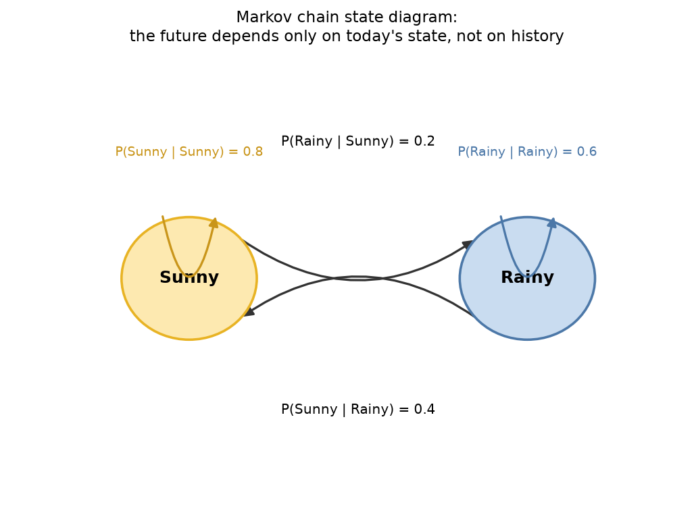
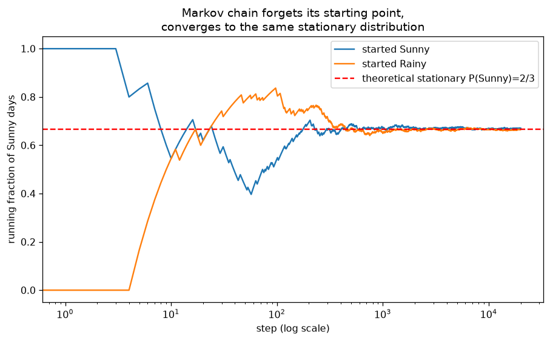
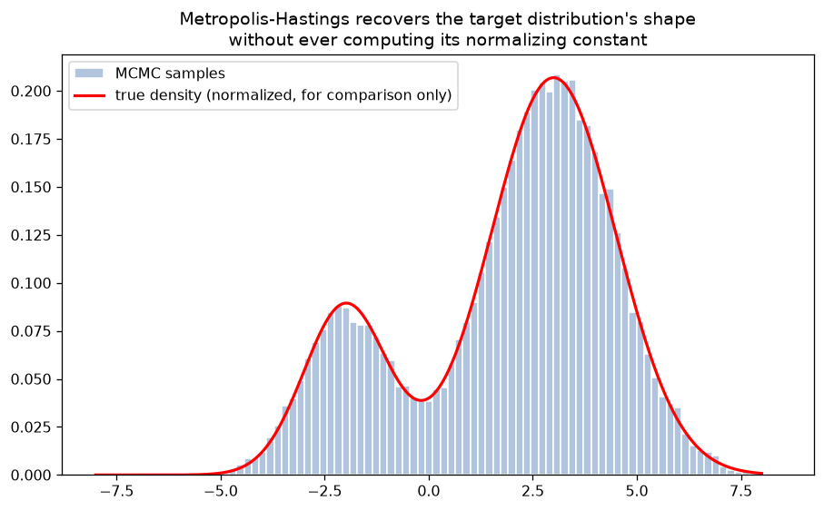

# Chapter 24: Markov Chains and Monte Carlo Methods

## The idea this chapter builds toward

This chapter covers two related tools that recur constantly in modern statistics and AI: **Markov chains** (a simple, powerful way to model systems that evolve randomly over time, where the future depends only on the present state, not the full history) and **Monte Carlo methods** (using repeated random simulation to approximate quantities too hard to compute exactly). Combined, they form **MCMC (Markov Chain Monte Carlo)** — the computational technique that, as promised in Chapter 17, finally made Bayesian statistics practical for complex, real-world, many-parameter models.

## Markov chains — "the future depends only on the present"

A **Markov chain** describes a system that moves between a set of **states**, where the probability of moving to any next state depends *only* on the current state — not on the sequence of states that led there. This is called the **Markov property** (memorylessness, a cousin of the Exponential distribution's memoryless property from Chapter 6, but applied to discrete state sequences rather than continuous waiting times).

### Worked example — a simple weather model

Suppose weather is either "Sunny" or "Rainy," and tomorrow's weather depends only on today's: if today is Sunny, there's an 80% chance tomorrow is also Sunny (20% Rainy); if today is Rainy, there's a 60% chance tomorrow is also Rainy (40% Sunny). This is fully captured by a **transition matrix**:

$$T = \begin{bmatrix}0.8 & 0.2\\0.4 & 0.6\end{bmatrix} \quad \text{(rows: from state, columns: to state; Sunny, Rainy)}$$



*Every Markov chain can be drawn this way: one circle per state, one arrow per possible transition, labeled with its probability. Notice every state's outgoing arrows (including its self-loop) sum to exactly 1 — you have to go somewhere, possibly back to where you started. This picture contains the entire model; nothing about the chain's future behavior depends on anything not drawn here.*

**A genuinely useful question**: if you run this process for a very long time, what fraction of days end up Sunny vs. Rainy overall, regardless of where you started? This long-run distribution is called the **stationary distribution** — a probability distribution over states that, once reached, the chain stays in forever (applying the transition matrix to it reproduces the exact same distribution). For this example, solving $\pi T = \pi$ (finding the stationary distribution, a close mathematical cousin of the eigenvector equation from Chapter 19 — the stationary distribution is literally the eigenvector of $T^T$ with eigenvalue 1) gives a long-run Sunny probability of $\frac{0.4}{0.2+0.4} = \frac{2}{3}$, regardless of whether you started on a Sunny or Rainy day — a genuinely useful and non-obvious fact: **the chain "forgets" its starting point over time and settles into one fixed long-run behavior**, a property that turns out to be the entire key to why MCMC works, below.

## Monte Carlo methods — approximating hard quantities by repeated random simulation

You've actually already used Monte Carlo methods throughout this book without the formal name attached: every time you've simulated an experiment thousands of times in the companion code (Chapter 3's Monty Hall simulation, Chapter 9's estimator comparisons, Chapter 18's bootstrap and permutation tests) to approximate some probability or statistic you couldn't easily compute by exact formula, that was a **Monte Carlo method**: using repeated random sampling to numerically approximate a quantity that's hard or impossible to compute exactly in closed form.

### The backstory — nuclear weapons research and a card game

The name and modern formalization trace to **Stanislaw Ulam and John von Neumann**, working at Los Alamos National Laboratory in the late 1940s on nuclear weapon design, specifically needing to estimate how neutrons would scatter and multiply through fissile material — a problem with no clean closed-form solution, but one that could be approximated by simulating many random neutron paths and averaging the outcomes. Ulam reportedly got the core idea while recovering from an illness and playing solitaire, wondering about the probability of winning a given hand — realizing that rather than working out the combinatorics exactly (extremely hard for solitaire), he could simply *play out* many random simulated games and count how often he won. The method needed a public, unclassified code-name for the then-secret weapons project, and a colleague, Nicholas Metropolis, suggested "Monte Carlo" — a reference to the famous Monaco casino, where Ulam's uncle reportedly gambled, a fittingly playful name for a method fundamentally about exploiting randomness to get useful answers.

## MCMC — combining both ideas to sample from distributions you can't directly compute

Here's the exact problem MCMC solves, directly connecting back to Chapter 17: Bayesian posterior distributions, $P(\theta\mid\text{data}) \propto P(\text{data}\mid\theta)P(\theta)$, are usually only known **up to their normalizing constant** — you can compute the *relative* height of the posterior at any given $\theta$ (just multiply likelihood by prior), but computing the exact normalizing constant $P(\text{data})$ (Chapter 4's "evidence" term) requires integrating over every possible $\theta$ value, which is intractable for complex, many-parameter models. **MCMC's trick**: construct a specially-designed Markov chain whose **stationary distribution is exactly the posterior distribution you want**, even though you never needed to know its normalizing constant to build that chain. Then, you simply run the chain for a long time and record the sequence of states it visits — because of the stationary-distribution property demonstrated in the weather example above, the chain will visit different $\theta$ values *in proportion to their true posterior probability*, even though you never explicitly computed that probability's exact formula. Collect enough samples from running the chain, and you have an empirical approximation of the entire posterior distribution, ready for histogramming, computing credible intervals (Chapter 17), or any other downstream use — all without ever touching the intractable normalizing integral directly.

### The Metropolis-Hastings algorithm, sketched

The classic recipe for constructing such a chain (named for the same Metropolis who suggested "Monte Carlo," plus Hastings' later 1970 generalization): at each step, propose a random small move from your current $\theta$ to a nearby candidate $\theta'$; compute the ratio of the (unnormalized) posterior at $\theta'$ versus at $\theta$ — crucially, this ratio's normalizing constants cancel out exactly, since they're the same constant at both points, which is precisely why you never need to know that constant; if the candidate $\theta'$ has higher (unnormalized) posterior probability, always accept the move; if lower, accept it anyway but only with a probability equal to that ratio (this crucial willingness to sometimes accept a "worse" move, rather than only ever climbing uphill, is exactly what prevents the chain from getting permanently stuck at a single peak and lets it properly explore the full shape of the posterior, including other nearby peaks). Over many iterations, this simple accept/reject rule provably constructs a chain whose stationary distribution is exactly your target posterior.

## Why this matters for AI directly

Modern **Bayesian deep learning**, probabilistic programming languages (like Stan, PyMC, or NumPyro), and Bayesian hyperparameter optimization all lean on MCMC or its faster modern approximations (variational inference, briefly mentioned in Chapter 17, trades some accuracy for dramatically more speed by turning the sampling problem into an optimization problem instead). More broadly, **Hidden Markov Models** — Markov chains where the true state is latent/unobserved (directly extending Chapter 23's latent-variable theme, with EM-style algorithms used to fit them) — underlie classical approaches to speech recognition, genetic sequence analysis, and part-of-speech tagging in early natural language processing, making this chapter's Markov chain vocabulary a genuine prerequisite for understanding how NLP was done before the deep-learning-dominated era that followed.

## Figures



*The Sunny/Rainy Markov chain started from two different initial states, both converging to the same long-run stationary distribution (P(Sunny)=2/3) -- the chain 'forgets' where it started.*



*Samples drawn by a from-scratch Metropolis-Hastings sampler, histogrammed against the true target density -- recovered without ever computing the distribution's normalizing constant.*

## Run it yourself

`book/code/ch24_markov_chains_monte_carlo.py` simulates the weather Markov chain example directly (confirming the $\frac{2}{3}$/$\frac{1}{3}$ stationary distribution empirically by running the chain for thousands of steps from different starting points and watching them converge to the same long-run proportions), then implements a from-scratch Metropolis-Hastings sampler to draw samples from a target posterior distribution known only up to its normalizing constant, and compares the resulting histogram of samples against the distribution's true (separately, exactly computable in this toy example) shape to confirm the sampler recovered it correctly.

```bash
python book/code/ch24_markov_chains_monte_carlo.py
```

## Why This Matters — In AI and In Everyday Life

**In AI / machine learning:**

- **Google's original PageRank algorithm**: modeling a web surfer randomly clicking links as a Markov chain, and finding its stationary distribution, is literally how PageRank ranked the early web.
- **Reinforcement learning's entire mathematical foundation**: a Markov Decision Process (the formal object behind RL) is this chapter's Markov chain plus actions and rewards -- there is no modern RL theory without this chapter.

**In everyday, non-AI life:**

- **Board games like Monopoly or snakes-and-ladders**: your next position depends only on your current position and the dice roll, not on how you got there -- a textbook Markov chain playing out at the kitchen table.
- **Queueing at a bank or call center**: models of how many people are in line next, given only how many are in line now (not the full history), use exactly this chapter's Markov chain machinery for staffing decisions.

## Check your understanding

- Explain, in your own words, why the weather chain's long-run behavior stops depending on whether you started on a Sunny or Rainy day.
- Why does Metropolis-Hastings's accept/reject ratio let you avoid ever computing the posterior's normalizing constant?
- Why is "sometimes accept a worse candidate" a necessary feature of the algorithm, rather than a bug to be removed?

## What's next

Chapter 25 is the capstone synthesis chapter: it walks through where every single piece of probability and statistics you've learned across this entire book — MLE, cross-entropy, the Normal distribution, the bias-variance tradeoff, Bayesian priors, and more — shows up, by name and by mechanism, directly inside the design and training of neural networks.
