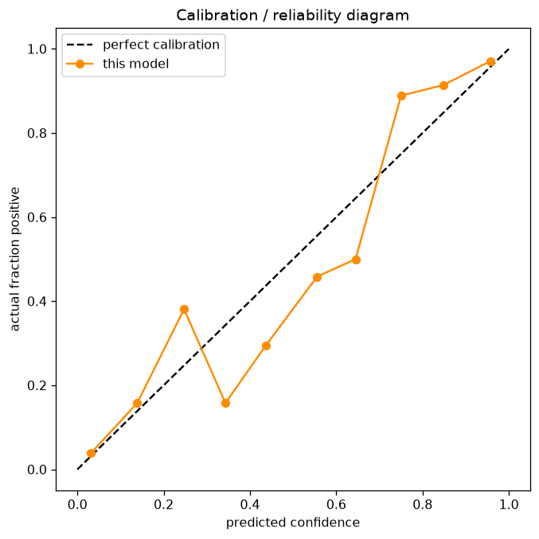
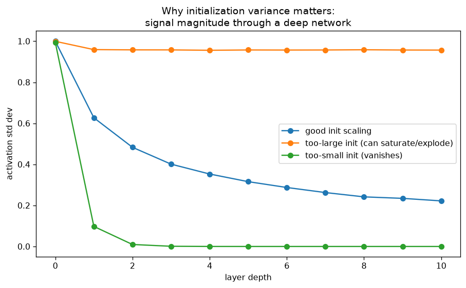

# Chapter 25: The Statistics Hiding Inside Neural Networks

## The idea this chapter builds toward

This is the synthesis chapter — no fundamentally new statistical machinery, but a deliberate, explicit walk through exactly where every major idea from this entire book shows up, by name and by mechanism, inside the design and training of neural networks. If you've followed the book this far, almost nothing in this chapter will feel genuinely new; the goal is for the "aha, deep learning is just statistics wearing a different vocabulary" feeling to become fully concrete and permanent.

## Loss functions are negative log-likelihoods (Chapter 10, Chapter 21)

Every standard neural network loss function is a direct instance of Chapter 10's MLE recipe, just with the model's parameters being millions of network weights instead of a handful of regression coefficients:

- **Mean squared error** (regression networks) = negative log-likelihood under an assumed Gaussian error distribution (derived explicitly in Chapter 10).
- **Binary cross-entropy** (binary classifiers) = negative log-likelihood under a Bernoulli label distribution (derived explicitly in Chapter 10, reframed via entropy in Chapter 21).
- **Categorical cross-entropy** (multi-class classifiers, including every token-prediction step in a language model) = the direct multi-outcome generalization of the same Bernoulli argument, using a Categorical distribution (the multi-outcome generalization of Bernoulli from Chapter 5) instead of a two-outcome one.

A genuinely useful habit once you know this: whenever you see a new, unfamiliar loss function in a paper, ask "what probability distribution over the data is this the negative log-likelihood of?" — the answer almost always exists and almost always clarifies *why* that specific loss was chosen over alternatives, rather than leaving it as an arbitrary-feeling formula.

## Softmax is just the Categorical distribution's parameterization, made differentiable

A multi-class classifier's final layer typically outputs raw scores ("logits") that get passed through **softmax**: $\hat p_k = \frac{e^{z_k}}{\sum_j e^{z_j}}$, turning arbitrary real numbers into a valid probability distribution (non-negative, summing to 1 — exactly the requirements a PMF must satisfy, from Chapter 5). The $e^{(\cdot)}$ exponential ensures positivity (echoing exactly the same exponential-of-a-quantity trick used to build the Normal density in Chapter 6 and the Poisson/exponential family more broadly), and dividing by the sum of all exponentials is precisely the normalizing-constant idea you've now seen repeatedly (Chapter 4's Bayes evidence term, Chapter 6's Normal density's $\frac{1}{\sigma\sqrt{2\pi}}$, Chapter 17's Bayesian posterior denominator) — softmax is nothing more than "take arbitrary scores, exponentiate them to force positivity, then normalize so they sum to 1," the same universal recipe for turning *anything* into a valid probability distribution.

## Weight initialization is literally choosing a prior (Chapter 4, Chapter 6, Chapter 17)

Before training starts, a neural network's weights must be set to *some* initial values, and the standard practice is drawing them randomly from a Normal (or closely related) distribution with a carefully chosen variance (e.g., "Xavier/Glorot initialization" and "He initialization" are specific variance formulas, chosen based on the number of inputs/outputs of each layer, designed so signal magnitude neither explodes nor vanishes as it passes through many layers — a direct, practical echo of the variance-scaling rule $\text{Var}(aX)=a^2\text{Var}(X)$ from Chapter 7). This is, structurally, **exactly a Bayesian prior** (Chapter 17): before any data is seen, you're expressing a belief distribution over plausible initial weight values, chosen specifically to keep early training numerically well-behaved. Unlike Chapter 17's explicit Bayesian MAP estimation (where the prior stays mathematically present throughout fitting), this initial "prior" mostly just sets the starting point for an otherwise non-Bayesian (plain MLE-via-gradient-descent) optimization — but the conceptual lineage is unmistakable, and some genuinely Bayesian deep learning methods keep a prior's influence active throughout training in a more literal, Chapter-17-style way.

## Regularization in deep learning is still Chapter 16/17's same idea

**Weight decay** (an L2 penalty added directly to a neural network's loss, exactly Chapter 16's Ridge penalty) and **Dropout** (randomly "turning off" a fraction of neurons during each training step) both serve the same bias-variance-tradeoff purpose as Chapter 16's regularization: preventing the enormous flexibility of a many-millions-of-parameters model from simply memorizing training-set noise (exactly the overfitting mechanism demonstrated concretely in Chapters 15 and 22). Dropout has a neat probabilistic interpretation worth knowing: it can be shown to approximate training an enormous *ensemble* of many smaller sub-networks simultaneously and averaging their predictions — directly invoking the CLT-style variance-reduction-through-averaging logic from Chapter 8's ensembling preview.

## Batch normalization is literally Chapter 6's z-score standardization, applied mid-network

**Batch normalization** takes the activations flowing through an intermediate layer and standardizes them — subtracting the batch's mean, dividing by the batch's standard deviation — exactly reproducing Chapter 6's z-score formula, $z=\frac{x-\mu}{\sigma}$, except computed using a mini-batch of training examples' statistics rather than a known population $\mu,\sigma$ (making it, in effect, an online, repeatedly-re-estimated application of Chapter 9's estimator machinery, recomputed fresh at every training step). The motivation is precisely the same as standardizing input features before training a classical regression model (mentioned back in Chapter 6): keeping values on a consistent, well-behaved scale makes optimization dramatically easier and more stable, now applied not just to the raw input data but to every intermediate layer's outputs throughout a deep network.

## Training itself is MLE via an iterative optimization procedure

Chapter 10 derived the Normal-distribution MLE by setting a derivative to exactly zero and solving algebraically — a closed-form shortcut only possible because that specific problem (one parameter, one simple distribution) was mathematically tractable by hand. A neural network's loss landscape, with millions of interacting parameters, has no such closed-form solution — so instead of solving for the zero-derivative point directly, **gradient descent** repeatedly nudges every parameter a small step in the direction that locally decreases the loss (echoing Chapter 0's derivative-as-slope intuition), iterating until it settles near a (typically local, not provably global, as flagged in Chapter 23's EM discussion) minimum. The *target being minimized* is still exactly the same negative log-likelihood object from Chapter 10 — only the *method of finding the minimum* has changed, from algebra to iterative numerical search, out of sheer necessity given the problem's scale.

## Why a classifier's softmax output can be interpreted as a confidence — and why that confidence can be miscalibrated

Because softmax outputs are trained (via cross-entropy loss, Chapter 21) to approximate the true conditional probability $P(\text{class}\mid\text{input})$, it's tempting to read a network's output of "0.93 for cat" as a literal, trustworthy probability — but this interpretation can be badly wrong in practice, a phenomenon called **miscalibration**. A perfectly calibrated classifier should be correct roughly 93% of the time whenever it outputs 0.93 confidence — modern, very large/flexible networks are empirically known to often be systematically **overconfident** relative to this ideal, a direct, measurable consequence of the same model-capacity-versus-generalization tension formalized in Chapter 22's statistical learning theory, and a very active area of applied ML research (calibration techniques like "temperature scaling" exist specifically to correct this gap after training, by rescaling the softmax logits to better match Chapter 12's and Chapter 17's notions of what a trustworthy probability statement ought to mean).

## Figures


*The training loss curve of a tiny network -- this curve IS the negative log-likelihood, decreasing every epoch.*



*A calibration / reliability diagram: predicted confidence vs actual accuracy. Points on the diagonal are perfectly calibrated.*



*Activation magnitude through 10 layers under good, too-large, and too-small weight initialization -- showing exactly how poor scaling causes signal to explode or vanish with depth.*

## Run it yourself

`book/code/ch25_statistics_in_neural_networks.py` trains a tiny neural network (built with plain `numpy`, no deep learning framework, so every piece is visible) on a toy binary classification problem, printing and confirming that its training loss at each step is numerically identical to the negative log-likelihood formula from Chapter 10/21, directly visualizes its softmax output probabilities against a reliability/calibration diagram to show over/under-confidence directly, and separately demonstrates weight-initialization variance scaling by comparing activation magnitudes through several layers under good vs. poorly-chosen initialization variances.

```bash
python book/code/ch25_statistics_in_neural_networks.py
```

## Why This Matters — In AI and In Everyday Life

**In AI / machine learning:**

- **This entire chapter IS the AI application**: softmax, weight initialization, batch normalization, weight decay, dropout, and training itself are all direct, named instances of the statistics covered across this whole book.
- **Model calibration in high-stakes deployments**: ensuring a medical-diagnosis or self-driving-car model's stated confidence actually matches its real accuracy (this chapter's reliability diagram) is a genuine, actively-managed real-world safety concern.

**In everyday, non-AI life:**

- **A student learning from a teacher's corrections**: a loss function is mathematically a teacher's "how wrong was that, and in which direction" signal, and gradient descent is the student nudging their understanding step by step -- a real pedagogical analogy, not just a cute one.
- **Trusting an AI's stated confidence**: when a medical-imaging AI says "85% confident this is malignant," whether that 85% is actually trustworthy (calibration) has direct, real consequences for patient care decisions made by real doctors.

## Check your understanding

- Pick any loss function you've heard of elsewhere (e.g. hinge loss, Huber loss, focal loss) and try to guess what probability-distribution assumption it might correspond to, using this chapter's "what distribution is this the negative log-likelihood of" question as a guide.
- Why is weight initialization a kind of prior, in the Chapter 17 sense, even though training doesn't keep referring back to it the way Bayesian MAP estimation does?
- Why would an overconfident (miscalibrated) classifier be especially dangerous in a high-stakes application (e.g. medical diagnosis), connecting back to Chapter 4's medical-test base-rate discussion?

## What's next

Chapter 26, the final chapter, is a short map of where to go next — causal inference, time series analysis, experimental design/A-B testing at scale, and pointers for deepening any single thread of this book further — now that you have the full statistical vocabulary to understand what each of those next steps is actually for.
